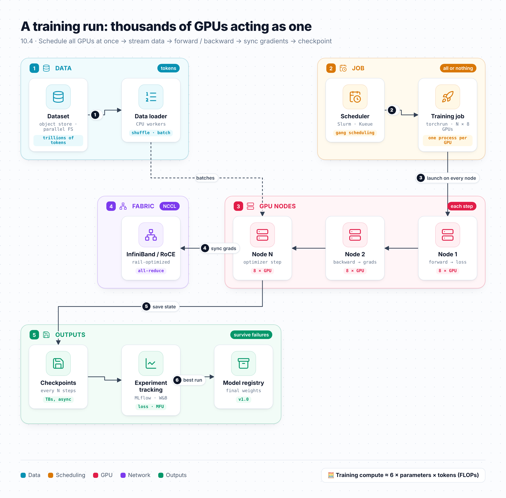
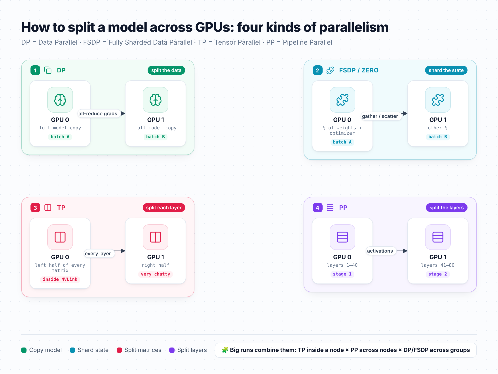
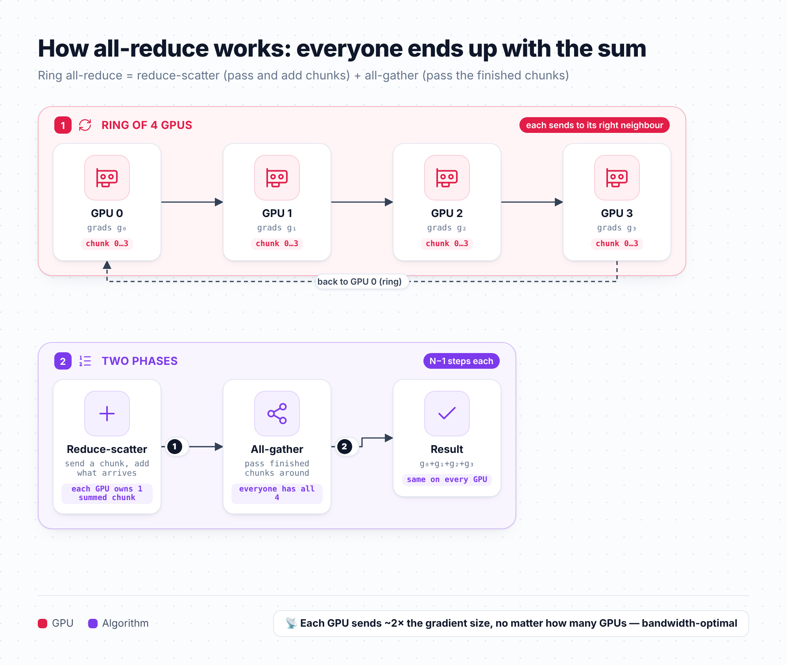

# 10.4 — Dağıtık eğitim

!!! abstract "Tek cümlede"
    Eğitim tek bir döngüyü milyarlarca kez tekrarlar: **forward** (tahmin et), **loss** (ne kadar yanlış), **backward**
    (her parametreyi hangi yöne itmeli), **optimizer adımı** (it). Büyük bir model tek bir GPU'ya sığmaz, sığsa da tek GPU'da
    yüzyıllar sürerdi. Bu yüzden iş, birkaç tür **paralellik** ile binlerce GPU'ya bölünür. GPU'lar NVLink ve InfiniBand üzerinden
    all-reduce gibi **toplu işlemlerle (collective)** senkron tutulur, **hepsi birden** zamanlanır (gang scheduling) ve
    sık alınan **checkpoint**'lerle arızalara karşı korunur.

## 📖 Terimler ve kısaltmalar

| Terim | Açılımı | Nedir | Nasıl çalışır (tek satır) |
|---|---|---|---|
| **Forward / backward pass** | — | Tahminleri hesapla / gradyanları hesapla | Backward katmanları ters sırada dolaşır (backpropagation) |
| **Loss** | — | Tahminlerin ne kadar yanlış olduğunu ölçen tek sayı | LLM'lerde: gerçek sıradaki token'ın cross-entropy'si |
| **Gradyan** | Gradient | Her parametrenin ne yönde ve ne kadar değişeceği | Her parametre için backpropagation ile hesaplanır |
| **Optimizer** (Adam/AdamW) | Adaptive Moment Estimation | Gradyanlardan parametreleri güncelleyen kural | Parametre başına 2 hareketli ortalama tutar (m, v) |
| **Batch / global batch** | — | Adım başına işlenen örnekler / tüm GPU'larda toplam | Büyük batch = daha az ama daha büyük adım |
| **Karma hassasiyet** | Mixed precision | BF16/FP8'de hesapla, ana ağırlıkları FP32'de tut | Düşük hassasiyetin hızı, yüksek hassasiyetin kararlılığı |
| **Aktivasyon checkpointing** | — | Tüm aktivasyonları saklama, backward'da yeniden hesapla | ~%30 fazla hesaplama karşılığında çok daha az bellek |
| **DP** | Data Parallel | Her GPU'da modelin tam kopyası, farklı veri | Gradyanların ortalaması her adımda all-reduce ile alınır |
| **FSDP / ZeRO** | Fully Sharded Data Parallel / Zero Redundancy Optimizer | Ağırlık, gradyan ve optimizer durumlarının parçalandığı DP | Bir katmanın ağırlıklarını tam zamanında topla, sonra serbest bırak |
| **TP** | Tensor Parallel | Her katmanın matrisleri GPU'lara bölünür | Kısmi sonuçlar her katmanda değiş tokuş edilir → NVLink gerekir |
| **PP** | Pipeline Parallel | Katmanlar farklı GPU'lardaki aşamalara bölünür | Mikro-batch'ler aşamalardan montaj hattı gibi geçer |
| **EP** | Expert Parallel | MoE uzmanları farklı GPU'lara yerleştirilir | Token'lar all-to-all ile uzmanlarına gönderilir |
| **CP / SP** | Context / Sequence Parallel | Uzun diziler GPU'lara bölünür | Her GPU token'ların bir kısmını işler, attention K/V değiş tokuş eder |
| **Collective** | Toplu işlem | Çok sayıda GPU arasında bir iletişim deseni | All-reduce, all-gather, reduce-scatter, broadcast, all-to-all |
| **All-reduce** | — | Herkes bir tensör katkısı verir, herkes toplamı alır | NCCL'de ring/tree algoritmaları |
| **NCCL** | NVIDIA Collective Communications Library | Toplu işlemleri uygulayan kütüphane | Node içinde NVLink, node'lar arasında RDMA kullanır |
| **Gang scheduling** | — | Bir işin tüm pod/process'lerini ya hep birlikte başlat ya hiç | Yarım başlamış işlerin GPU'ları sonsuza dek tutmasını önler |
| **Slurm** | Simple Linux Utility for Resource Management | Klasik HPC batch zamanlayıcısı | Node tahsisleri üzerinde `sbatch` / `srun` işleri |
| **Kueue / JobSet / KAI** | — | Kubernetes kuyruklama, çok pod'lu işler, AI zamanlayıcısı | Kotalar, gang kabulü, topolojiye duyarlı yerleştirme |
| **torchrun** | — | PyTorch'un dağıtık başlatıcısı | GPU başına bir process başlatır ve rank'leri bağlar |
| **Rank / world size** | — | Bir process'in kimliği / toplam process sayısı | Loglamayı ve checkpoint kaydını genelde rank 0 yapar |
| **Checkpoint** | — | Ağırlık + optimizer + veri konumunun kaydedilmiş anlık görüntüsü | Arızalardan sonra devam etmek için |
| **MFU** | Model FLOPs Utilization | Elde edilen faydalı FLOP ÷ tepe FLOPS | İyi ayarlanmış büyük koşularda %35–55 tipiktir |
| **Paralel FS** | Parallel File System (Lustre, GPFS…) | Birçok sunucuya dağıtılmış depolama | Binlerce istemci yüksek toplam hızla okur/yazar |

## 🗺️ Büyük resim



---

## 1 · Eğitim döngüsü nedir ve nasıl çalışır?

### Nedir?

Eğitim bir optimizasyondur: loss'u eğitim verisi üzerinde küçük yapan parametre değerlerini bul.

### Nasıl çalışır?

1. **Forward:** bir batch token dizisini modelden geçir, her sıradaki token için tahmin al.
2. **Loss:** tahminleri gerçek sıradaki token'larla karşılaştır (cross-entropy).
3. **Backward:** backpropagation her parametre için bir **gradyan** hesaplar.
4. **Senkron (dağıtıksa):** data-parallel GPU'lar arasında gradyanların ortalamasını al (**all-reduce**).
5. **Optimizer adımı:** AdamW her parametreyi biraz günceller.
6. Milyonlarca adım boyunca tekrarla. Her N adımda bir **checkpoint** al.

## 2 · Bellek hesabı: tek GPU neden yetmez

Karma hassasiyet ve AdamW ile parametre başına:

| Kalem | Parametre başına byte |
|---|---|
| BF16 ağırlıklar | 2 |
| BF16 gradyanlar | 2 |
| FP32 ana ağırlıklar | 4 |
| Adam birinci moment (m) | 4 |
| Adam ikinci moment (v) | 4 |
| **Toplam (aktivasyonlar hariç)** | **~16** |

70B'lik bir model → sadece bu durum için **~1,1 TB**, üstüne aktivasyonlar. 80–288 GB'lık bir GPU bunu tutamaz. Bu yüzden durum **parçalanmalı** (FSDP/ZeRO), iş de **bölünmelidir** (TP/PP).

**Hesaplama:** eğitim FLOP'u ≈ **6 × parametre × token**. Örnek: 8B parametre × 15T token × 6 ≈ 7×10²³ FLOP. ~1.000 TFLOPS tepe ve %40 MFU ile bu ~500.000 GPU-saat eder: yani **1.000 GPU ile yaklaşık 3 hafta**.

## 3 · Paralellik: türleri neler ve nasıl çalışırlar?

| Tür | Ne bölünür | İletişim | Nerede çalışmalı |
|---|---|---|---|
| **DP** | **Veri**. Her GPU'da tam kopya var | Adım başına bir kez gradyan all-reduce | Her yerde (scale-out olur) |
| **FSDP / ZeRO** | Ağırlık, gradyan, optimizer **durumu** | Katman başına ağırlık all-gather, gradyan reduce-scatter | Her yerde, DP'den fazla trafik |
| **TP** | Katman içindeki her **matris** | Her katmanda, forward ve backward | **NVLink alanının içinde** |
| **PP** | **Katmanlar** aşamalara | Aşamalar arası aktivasyonlar | Node'lar arası. Pipeline "boşluklarına" (bubble) dikkat |
| **EP** | MoE **uzmanları** | All-to-all token yönlendirme | Node içinde ya da node'lar arası |
| **CP / SP** | **Dizi** (uzun bağlamlar) | Attention'da K/V değiş tokuşu | Hızlı alanların içinde |

Büyük koşular bunları birleştirir ("3D/4D paralellik"): ör. **her sunucunun içinde TP=8 × sunucular arası PP=4 × geri kalanında DP**.



## 4 · Toplu işlemler: all-reduce nedir ve nasıl çalışır?

### Nedir?

All-reduce her GPU'dan bir tensör alır ve **her GPU'ya eleman eleman toplamı** (ya da ortalamayı) verir. Data-parallel GPU'lar aynı gradyanlarda bu yolla anlaşır.

### Nasıl çalışır? (ring algoritması)

1. Her GPU gradyanını N parçaya böler ve GPU'lar bir **halka** oluşturur.
2. **Reduce-scatter** (N−1 adım): her GPU bir parçayı komşusuna gönderir ve aldığı parçayı kendi parçasına ekler. Sonunda her GPU **tamamen toplanmış** bir parçanın sahibidir.
3. **All-gather** (N−1 adım): biten parçalar, her GPU hepsine sahip olana kadar dolaştırılır.
4. Her GPU toplamda gradyan boyutunun ~2 katını gönderir ve bu **GPU sayısından bağımsızdır**. Bu yüzden ring bant genişliğini en iyi şekilde kullanır. NCCL gecikme için tree ve başka algoritmalar da kullanır.



## 5 · GPU'ların etrafındaki cluster

| Parça | Önemli olan |
|---|---|
| **Ağ** ([10.2](02-gpu.md)) | Rail-optimized, tıkanmasız IB/RoCE. Toplu işlemler en yavaş GPU'yu beklediği için tek bir yavaş bağlantı **her** adımı yavaşlatır. |
| **Depolama** | Veri setleri nesne depolamadan ya da paralel FS'ten akıtılır. Checkpoint'lerin her biri **TB'larca** olabilir, bu yüzden asenkron ve paralel yazılmalıdır. |
| **Zamanlama** | **Gang scheduling** (ya hep ya hiç), **topolojiye duyarlı yerleştirme** (bir işin node'larını ağda yakın tut), ekipler arası kotalar ve öncelikler. HPC'de Slurm, Kubernetes'te **Kueue/JobSet/KAI/Volcano**. |
| **Arızalar** | Binlerce GPU'da her birkaç saatte bir bir GPU, NIC ya da node arızalanır. Arızayı tespit et (XID hataları, NCCL zaman aşımları, yavaş kalanlar), node'u değiştir, **son checkpoint'ten yeniden başlat**. |
| **Gözlemlenebilirlik** | Loss eğrisi, token/sn, adım süresi, **MFU**, GPU başına kullanım, NCCL bant genişliği. |

> DevOps bağlantısı: bir eğitim cluster'ı bir web servisi değil, bir **batch sistemidir**. Önemli olan **goodput**'tur: arızalar, yeniden başlatmalar, kuyrukta bekleme ve yavaş node'lardan sonra GPU-saatlerin gerçekten modeli ilerleten kısmı.

## 6 · Fine-tuning: küçük ölçekli versiyon

Çoğu ekip ön eğitim yapmaz. Açık bir modeli **fine-tune** eder:

| Yöntem | Donanım | Notlar |
|---|---|---|
| **LoRA** | 1–8 GPU | Küçük adaptörleri eğit, temel ağırlıklar dondurulmuş |
| **QLoRA** | 1 GPU | Temel model 4-bit, adaptörler BF16 |
| **Tam fine-tune** | Çok node'lu | Tüm ağırlıklar güncellenir, FSDP gerekir |

---

## 🧪 Kendin dene

```bash
# 1) CPU üzerinde 2 process ile data-parallel eğitim (GPU gerekmez): rank'leri ve all-reduce'u gör
cat > ddp_demo.py <<'EOF'
import os, torch, torch.distributed as dist
dist.init_process_group("gloo")
rank, world = dist.get_rank(), dist.get_world_size()
model = torch.nn.parallel.DistributedDataParallel(torch.nn.Linear(10, 1))
opt = torch.optim.AdamW(model.parameters(), lr=1e-2)
for step in range(3):
    x = torch.randn(32, 10) + rank            # her rank farklı veri alır
    loss = ((model(x) - 1) ** 2).mean()
    opt.zero_grad(); loss.backward(); opt.step()   # backward() gradyanları all-reduce eder
    print(f"rank {rank}/{world} step {step} loss {loss.item():.3f} weight[0]={model.module.weight[0,0].item():.4f}")
dist.destroy_process_group()
EOF
torchrun --nproc_per_node=2 ddp_demo.py   # ağırlıklar iki rank'te de aynı kalır

# 2) Ham bir all-reduce
cat > allreduce_demo.py <<'EOF'
import torch, torch.distributed as dist
dist.init_process_group("gloo")
t = torch.tensor([float(dist.get_rank())])
dist.all_reduce(t)
print(f"rank {dist.get_rank()}: {t.item()}")   # her rank 6.0 yazar (0+1+2+3)
EOF
torchrun --nproc_per_node=4 allreduce_demo.py

# 3) Bellek ve hesaplama hesabı
python3 -c "
p=70e9; print('eğitim durumu TB:', p*16/1e12)
print('8B x 15T token için GPU-saat @ 1000 TFLOPS, %40 MFU:', 6*8e9*15e12/(1e15*0.4)/3600)"
```

```bash
# 4) Çok node'lu eğitim için bir Slurm iş iskeleti (referans için)
#SBATCH --nodes=4 --gpus-per-node=8 --ntasks-per-node=1 --exclusive
srun torchrun --nnodes=$SLURM_NNODES --nproc_per_node=8 \
     --rdzv_backend=c10d --rdzv_endpoint=$(hostname):29500 train.py
```

**Görev:** DDP demosunda `DistributedDataParallel`'ı kaldır (düz modeli kullan) ve tekrar çalıştır. İki rank'teki ağırlıklar hâlâ aynı mı? Neden değil?

---

## 🃏 Hatırlatma kartı

```text
Döngü: forward → loss → backward (gradyanlar) → all-reduce → optimizer adımı → tekrar · her N adımda checkpoint
Bellek: ~16 byte/parametre (BF16 a+g, FP32 ana, Adam m+v) + aktivasyonlar → parçala
Hesaplama: FLOP ≈ 6 × parametre × token · %35–55 MFU iyidir
DP (modeli kopyala) · FSDP/ZeRO (durumu parçala) · TP (matrisleri böl, NVLink içinde) · PP (katmanları böl) · EP (uzmanlar) · CP (dizi)
All-reduce (ring): reduce-scatter + all-gather · N'den bağımsız olarak GPU başına ~2 kat veri
Cluster: rail-optimized IB/RoCE · paralel FS / nesne depo · gang scheduling (Slurm, Kueue, KAI) · checkpoint'ten yeniden başlat
```

---

## ❓ Kendini test et

??? question "1. Tensor parallelism neden genelde tek bir sunucunun (ya da NVLink alanının) içinde tutulur?"
    TP, kısmi sonuçları her katmanda, forward ve backward'da değiş tokuş eder. Bu, NVLink'in TB/sn bant genişliğini ve düşük gecikmesini gerektirir. Ağ üzerinden yapılsa her adımı bekletirdi.

??? question "2. AdamW ve karma hassasiyetle 13B'lik bir modelin tam eğitim durumu kabaca ne kadar bellek ister?"
    Parametre başına yaklaşık 16 byte → aktivasyonlar hariç ~208 GB. Bu tek bir GPU'dan fazla, bu yüzden birkaç GPU üzerinde FSDP/ZeRO kullanırsın.

??? question "3. Gang scheduling nedir ve dağıtık eğitim neden ona ihtiyaç duyar?"
    Bir işin tüm process'lerini ya hep birlikte başlatmak ya da hiç başlatmamak. Rank'lerin sadece bir kısmı başlarsa, pahalı GPU'ları tutarken diğerlerini bekleyerek kilitlenirler. Böyle iki iş cluster'ı kilitleyebilir.

??? question "4. 512 GPU'luk bir işteki bir node'un NIC'i yavaş. Tüm işe ne olur?"
    Her toplu işlem en yavaş katılımcıyı bekler, bu yüzden her adım o node'un hızına düşer. Yavaş kalanları tespit etmek ve node'u değiştirmek önemlidir.

??? question "5. 1.000 GPU'luk koşun her 3 saatte bir checkpoint alıyor ve ortalama her 4 saatte bir node arızalanıyor. Bu neden kötü?"
    Her arıza 3 saate kadar × 1.000 GPU'luk işi artı yeniden başlatma süresini kaybettirir ve arızalar neredeyse checkpoint'ler kadar sık olur. Goodput'u artırmak için daha sık (asenkron) checkpoint al.

---

## 📚 Kaynaklar

- [PyTorch distributed genel bakış](https://pytorch.org/tutorials/beginner/dist_overview.html) · [FSDP eğitimi](https://pytorch.org/tutorials/intermediate/FSDP_tutorial.html)
- [ZeRO makalesi](https://arxiv.org/abs/1910.02054) · [Megatron-LM makalesi (tensor + pipeline parallel)](https://arxiv.org/abs/2104.04473)
- [Hugging Face: The Ultra-Scale Playbook](https://huggingface.co/spaces/nanotron/ultrascale-playbook)
- [NCCL dokümanları](https://docs.nvidia.com/deeplearning/nccl/user-guide/docs/index.html)
- [Kueue](https://kueue.sigs.k8s.io/) · [Slurm](https://slurm.schedmd.com/)

## ✍️ Kendi notlarım

> 70B'lik bir modelin neden birkaç tür paralelliğe ihtiyaç duyduğunu ve all-reduce'un ne yaptığını kendi cümlelerinle 5 satırda anlat.

-
