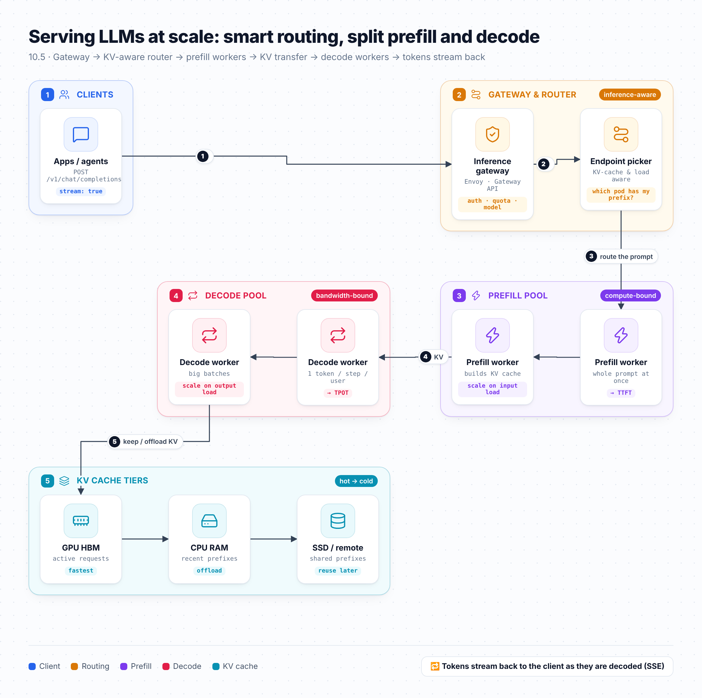
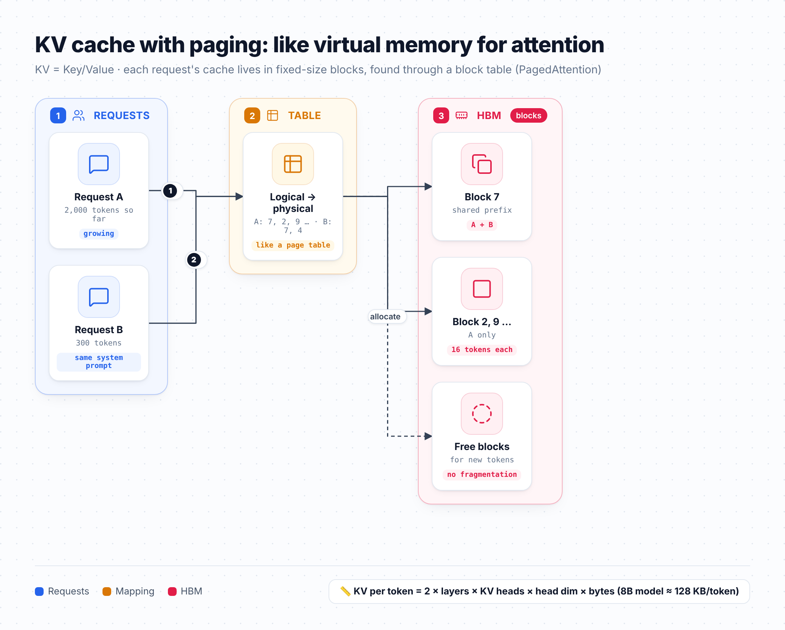
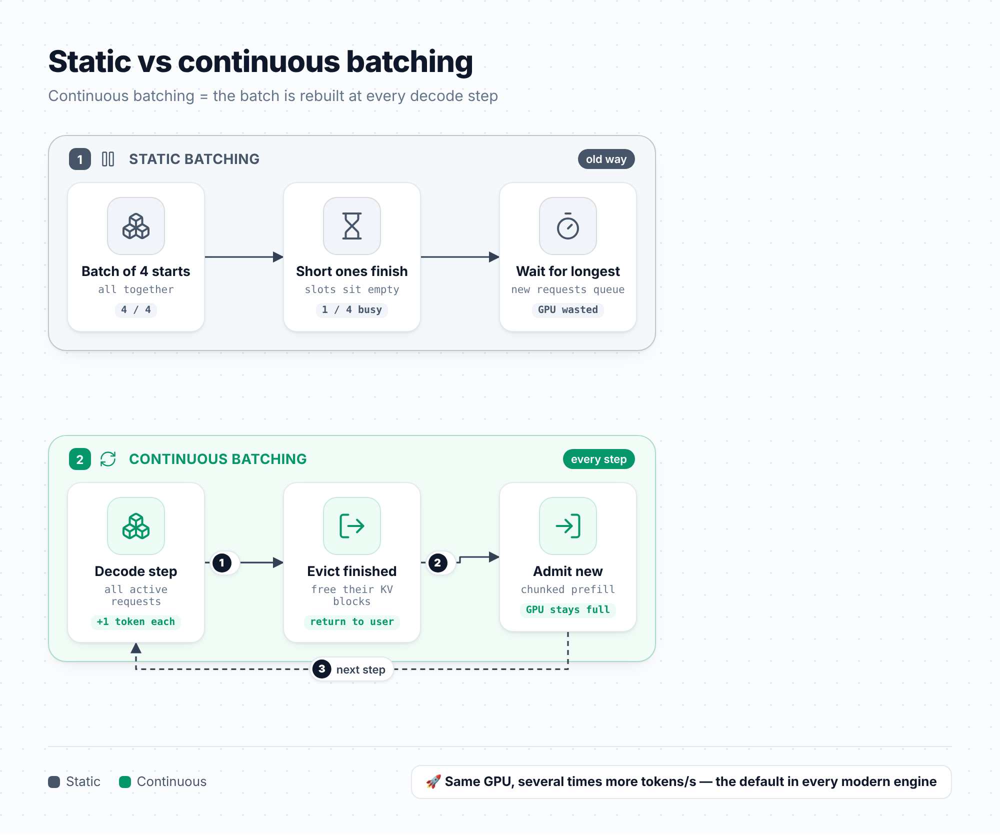
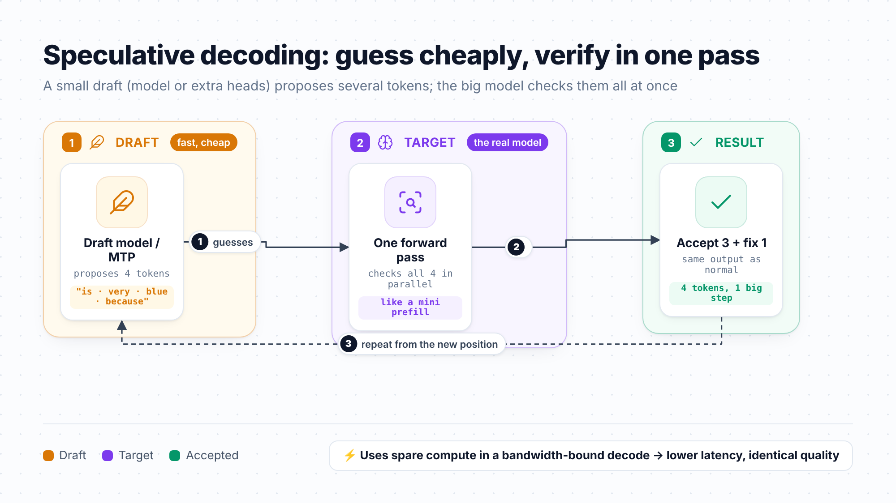

# 10.5 — Inference & serving deep dive

!!! abstract "In one sentence"
    Serving an LLM means turning GPU memory bandwidth into **tokens per second** for many users at once while keeping
    **time to first token** and **time per output token** low. The tools are: a **KV cache** managed like virtual memory,
    **continuous batching** to keep the GPU full, **quantization** and **speculative decoding** to make each step cheaper,
    **prefix caching** to skip repeated work, and at scale **KV-aware routing** and **separate prefill and decode pools**.

## 📖 Key terms & abbreviations

| Term | Stands for | What it is | How it works (one line) |
|---|---|---|---|
| **Inference / serving** | — | Running a trained model for users | An engine loads weights, accepts requests, streams tokens |
| **Prefill** | — | Processing the whole prompt | All prompt tokens in parallel, builds the KV cache |
| **Decode** | — | Generating output tokens | One token per request per step |
| **TTFT** | Time To First Token | Latency until the first output token | Queueing + prefill |
| **TPOT / ITL** | Time Per Output Token / Inter-Token Latency | Time between output tokens | One decode step for this request |
| **E2E latency** | End-to-End | Total request time | TTFT + TPOT × (output tokens − 1) |
| **Throughput** | — | Total tokens/s (or requests/s) of a deployment | Grows with batch size, until latency SLOs break |
| **Goodput** | — | Throughput that meets the latency SLO | What actually counts for users |
| **SLO** | Service Level Objective | A latency/availability target | e.g. p95 TTFT < 1 s, p95 TPOT < 50 ms |
| **KV cache** | Key-Value cache | Stored attention K and V of past tokens | Grows with context length × concurrent requests |
| **GQA / MQA** | Grouped-Query / Multi-Query Attention | Fewer K/V heads than Q heads | Shrinks the KV cache several times |
| **PagedAttention** | — | KV cache stored in fixed-size blocks | A block table maps logical to physical blocks (like page tables) |
| **Continuous batching** | — | Rebuild the batch at every decode step | New requests join, finished ones leave immediately |
| **Chunked prefill** | — | Split long prompts into chunks | Mixes prefill chunks with decode steps so decodes don't stall |
| **Prefix caching** | — | Reuse KV of a shared prompt prefix | System prompt / chat history computed once |
| **Quantization** | — | Store weights (and maybe KV/activations) in fewer bits | FP8, INT8, INT4 (AWQ, GPTQ), FP4 |
| **Speculative decoding** | — | Draft several tokens cheaply, verify in one big pass | Output identical to normal decoding, fewer slow steps |
| **MTP** | Multi-Token Prediction | Extra heads that predict several next tokens | Built-in draft for speculative decoding |
| **P/D disaggregation** | Prefill/Decode disaggregation | Prefill and decode on different workers | KV cache transferred between them over RDMA |
| **KV-aware routing** | — | Send a request where its prefix KV already is | Router tracks which pod holds which prefixes |
| **EPP** | Endpoint Picker | The routing brain in the Gateway API Inference Extension | Scores pods by KV cache hit, queue, load |
| **NIXL** | NVIDIA Inference Xfer Library | Fast KV-cache transfer library | Moves KV between GPUs/nodes/storage tiers |
| **Multi-LoRA** | — | Many fine-tuned adapters on one base model | Adapter chosen per request, base weights shared |
| **SSE** | Server-Sent Events | HTTP streaming format | `data: {...}` chunk per token(s) |
| **OpenAI-compatible API** | — | `/v1/chat/completions`, `/v1/completions`, `/v1/embeddings` | De-facto standard request/response format |

## 🗺️ Big picture



---

## 1 · What happens to one request?

1. The client sends `POST /v1/chat/completions` with `stream: true`.
2. The **gateway** authenticates, applies quotas, picks the model. The **router** picks a replica (ideally one that already has this prompt prefix cached).
3. The engine's **scheduler** queues the request, then admits it into the running batch when there's KV cache space.
4. **Prefill**: the prompt is tokenized and processed in one big parallel pass. The KV cache is filled. The first token comes out → **TTFT**.
5. **Decode**: every step, the engine runs the whole batch for one more token per request → **TPOT**. Each token is streamed back as an SSE chunk.
6. On a stop token or `max_tokens`, the request leaves the batch and its KV blocks are freed (or kept for prefix reuse).

## 2 · Metrics that matter

| Metric | Driven by | Users feel it as |
|---|---|---|
| **TTFT** | Queue time + prompt length (prefill compute) | "It starts answering quickly" |
| **TPOT** | Batch size, model size, memory bandwidth | "It types fast" (~20–50 ms/token feels fluent) |
| **Throughput** (tokens/s per GPU) | Batch size, KV cache capacity, optimizations | Cost per million tokens |
| **Goodput** | Throughput **within** SLOs | The real capacity number to plan with |

The core trade-off: **bigger batches → higher throughput but higher TPOT**. Capacity planning = find the largest batch (concurrency) where p95 TTFT and TPOT still meet the SLO.

## 3 · What is the KV cache, and how does paging work?

### What is it?

For every token in a request, every layer stores its attention **Key** and **Value** vectors so they don't have to be recomputed at every decode step.

```text
KV bytes per token = 2 (K and V) × layers × KV heads × head dim × bytes per value
Llama-3-8B (32 layers, 8 KV heads, 128 dim, BF16): 2 × 32 × 8 × 128 × 2 ≈ 128 KB per token
→ 8,000-token conversation ≈ 1 GB · 50 such users ≈ 50 GB of KV cache, on top of 16 GB of weights
```

### How does paging work? (PagedAttention)

1. GPU memory left after the weights is cut into **fixed-size blocks** (e.g. 16 tokens each).
2. Each request has a **block table** mapping its logical blocks to physical blocks, exactly like an OS page table (Chapter 3).
3. Blocks are allocated **on demand** as the request grows, so no memory is reserved for tokens that may never be generated.
4. Requests with the **same prefix** can point to the **same physical blocks** (copy-on-write), which is how prefix caching works.
5. When memory is full, the scheduler **preempts** (pauses) a request or **offloads** blocks to CPU RAM/SSD.



## 4 · What is continuous batching, and how does it work?

### What is it?

Instead of starting a fixed batch and waiting for its longest request to finish, the engine **re-forms the batch at every decode step**.

### How does it work?

1. Run one decode step for every active request (+1 token each).
2. Remove requests that just finished, free their KV blocks, return them to users.
3. Admit waiting requests into the free space. Their prompts are processed with **chunked prefill**, mixed into decode steps so existing users don't stall.
4. Repeat. The GPU never sits half-empty waiting for one long answer.



## 5 · Making each step cheaper

| Technique | What it saves | Trade-off |
|---|---|---|
| **Quantization** (FP8 / INT8 / INT4 / FP4 weights, FP8 KV cache) | Memory and bandwidth per token → more tokens/s, bigger batches | Small accuracy loss, must evaluate |
| **FlashAttention / fused kernels / CUDA Graphs** | HBM traffic and CPU launch overhead | None (engine default) |
| **Prefix caching** | Prefill of repeated system prompts, RAG context, chat history | Memory to hold cached blocks |
| **Speculative decoding / MTP** | Number of slow decode steps | Extra draft compute; best at low batch sizes |
| **GQA / MLA** (model architecture) | KV cache size | Chosen at training time |

### How does speculative decoding work?

1. A **draft** (a small model, or extra MTP heads on the big model) quickly proposes the next *k* tokens.
2. The big **target** model checks all *k* in **one forward pass** (like a tiny prefill, cheap because decode is bandwidth-bound and has spare compute).
3. The longest prefix that matches what the target would have produced is **accepted**. The first mismatch is replaced by the target's token.
4. Output is **identical** to normal decoding; you just get several tokens per big step.



## 6 · Scaling out: replicas, sharding, disaggregation

| Situation | What you do |
|---|---|
| Model fits one GPU, more traffic | **More replicas** behind a load balancer |
| Model doesn't fit one GPU | **Tensor parallel** inside a node (TP=2/4/8), pipeline/expert parallel across nodes for very large or MoE models |
| Many requests share prefixes | **KV/prefix-aware routing** so requests land where their KV already is (round robin destroys cache hits) |
| Long prompts hurt everyone's TPOT | **P/D disaggregation**: prefill pool and decode pool, KV transferred over RDMA, each pool scaled on its own load |
| KV cache doesn't fit | **Tiered KV**: HBM → CPU RAM → local SSD → shared storage |
| Many fine-tuned variants | **Multi-LoRA**: one base model, adapters loaded per request |

On Kubernetes this is the job of the **Gateway API Inference Extension** (InferencePool + an endpoint picker), **llm-d** (CNCF project for distributed vLLM/SGLang serving on Kubernetes) and **NVIDIA Dynamo** (an engine-agnostic distributed serving framework). See [10.6](06-kubernetes.md).

## 7 · The engines

| Engine | Strengths |
|---|---|
| **vLLM** | Widest model and hardware support, PagedAttention, OpenAI-compatible, the community default |
| **SGLang** | Very fast prefix caching (RadixAttention), structured outputs, strong for agent workloads |
| **TensorRT-LLM** | NVIDIA-optimized kernels and FP8/FP4, highest performance on NVIDIA when tuned |
| **Triton Inference Server** | Multi-framework server for any model type (not only LLMs) |
| **llama.cpp / Ollama** | CPUs, laptops, edge devices, GGUF quantized models |

> DevOps connection: an LLM endpoint is **stateful in disguise**. Its KV cache makes "which pod" matter, warm-up after a restart is slow (loading tens of GB of weights), and autoscaling needs LLM signals (queue length, KV utilization, TTFT), not CPU.

---

## 🧪 Try it yourself

```bash
# 1) KV cache math for any model config
python3 - <<'EOF'
layers, kv_heads, head_dim, bytes_ = 32, 8, 128, 2      # Llama-3-8B, BF16
per_tok = 2 * layers * kv_heads * head_dim * bytes_
print(f"{per_tok/1024:.0f} KB/token · 8k context = {per_tok*8192/1e9:.2f} GB · 50 users = {per_tok*8192*50/1e9:.0f} GB")
EOF

# 2) Serve a small model with vLLM (GPU) and watch the engine's own metrics
vllm serve Qwen/Qwen2.5-0.5B-Instruct --max-num-seqs 64 &
curl -N localhost:8000/v1/chat/completions -H 'Content-Type: application/json' \
  -d '{"model":"Qwen/Qwen2.5-0.5B-Instruct","stream":true,"messages":[{"role":"user","content":"Count to 10"}]}'
curl -s localhost:8000/metrics | grep -E "num_requests_running|num_requests_waiting|kv_cache_usage|time_to_first_token" | head

# 3) Load test: throughput vs latency at different concurrency
vllm bench serve --model Qwen/Qwen2.5-0.5B-Instruct --dataset-name random \
  --random-input-len 1000 --random-output-len 200 --num-prompts 200 --max-concurrency 8
#   repeat with --max-concurrency 64 and compare tokens/s, TTFT and TPOT
```

**Exercise:** run the benchmark at concurrency 1, 8, 32 and 128. Plot output tokens/s against p95 TPOT. Where would you set the limit for a 50 ms TPOT SLO?

---

## 🃏 Cheat sheet

```text
Request: gateway → router (prefix-aware) → queue → PREFILL (TTFT) → DECODE steps (TPOT) → SSE stream → free KV
E2E ≈ TTFT + TPOT × (output tokens − 1) · throughput ↑ with batch, TPOT ↑ too → plan on goodput
KV/token = 2 × layers × KV heads × head dim × bytes (8B ≈ 128 KB) · paged in blocks, shared prefixes, offload tiers
Continuous batching + chunked prefill keep the GPU full
Cheaper steps: quantization (FP8/INT4/FP4) · FlashAttention · prefix caching · speculative decoding / MTP
Scale: replicas → TP for big models → KV-aware routing → P/D disaggregation (llm-d, Dynamo, Inference Gateway)
Engines: vLLM · SGLang · TensorRT-LLM · Triton · llama.cpp/Ollama
```

---

## ❓ Test yourself

??? question "1. Users complain the first word takes 4 seconds to appear but then text flows fast. Which metric and which phase?"
    High TTFT: either queueing (not enough capacity, or bad routing) or slow prefill (very long prompts). Prefix caching, chunked prefill, more replicas or P/D disaggregation help.

??? question "2. Why does round-robin load balancing hurt LLM serving?"
    It ignores where each conversation's KV cache (prefix) lives, so requests keep landing on pods that must recompute the prefill. KV-aware routing sends them to the pod that already has the prefix.

??? question "3. How much KV cache does a 32-layer model with 8 KV heads of dimension 128 need for 100 concurrent 4k-token requests in BF16?"
    2 × 32 × 8 × 128 × 2 bytes = 128 KB/token → × 4,096 tokens × 100 requests ≈ 54 GB.

??? question "4. Does speculative decoding change the model's answers?"
    No. Accepted tokens are exactly those the target model would have produced; the draft only lets several of them be confirmed in one forward pass.

??? question "5. Why split prefill and decode onto different GPUs?"
    They stress different resources (compute vs memory bandwidth). Mixed together, long prefills stall everyone's decode steps. Separate pools can be sized and scaled independently and tuned for their bottleneck.

---

## 📚 Sources

- [vLLM docs](https://docs.vllm.ai/) · [PagedAttention paper](https://arxiv.org/abs/2309.06180)
- [SGLang docs](https://docs.sglang.ai/) · [TensorRT-LLM docs](https://nvidia.github.io/TensorRT-LLM/)
- [Gateway API Inference Extension](https://gateway-api-inference-extension.sigs.k8s.io/) · [llm-d](https://llm-d.ai/) · [NVIDIA Dynamo](https://docs.nvidia.com/dynamo/latest/)
- [DistServe: disaggregating prefill and decoding](https://arxiv.org/abs/2401.09670)
- [Speculative decoding (Leviathan et al.)](https://arxiv.org/abs/2211.17192)

## ✍️ My notes

> Explain TTFT vs TPOT, why the KV cache limits concurrency, and what continuous batching does, in your own words in 5 lines.

-
