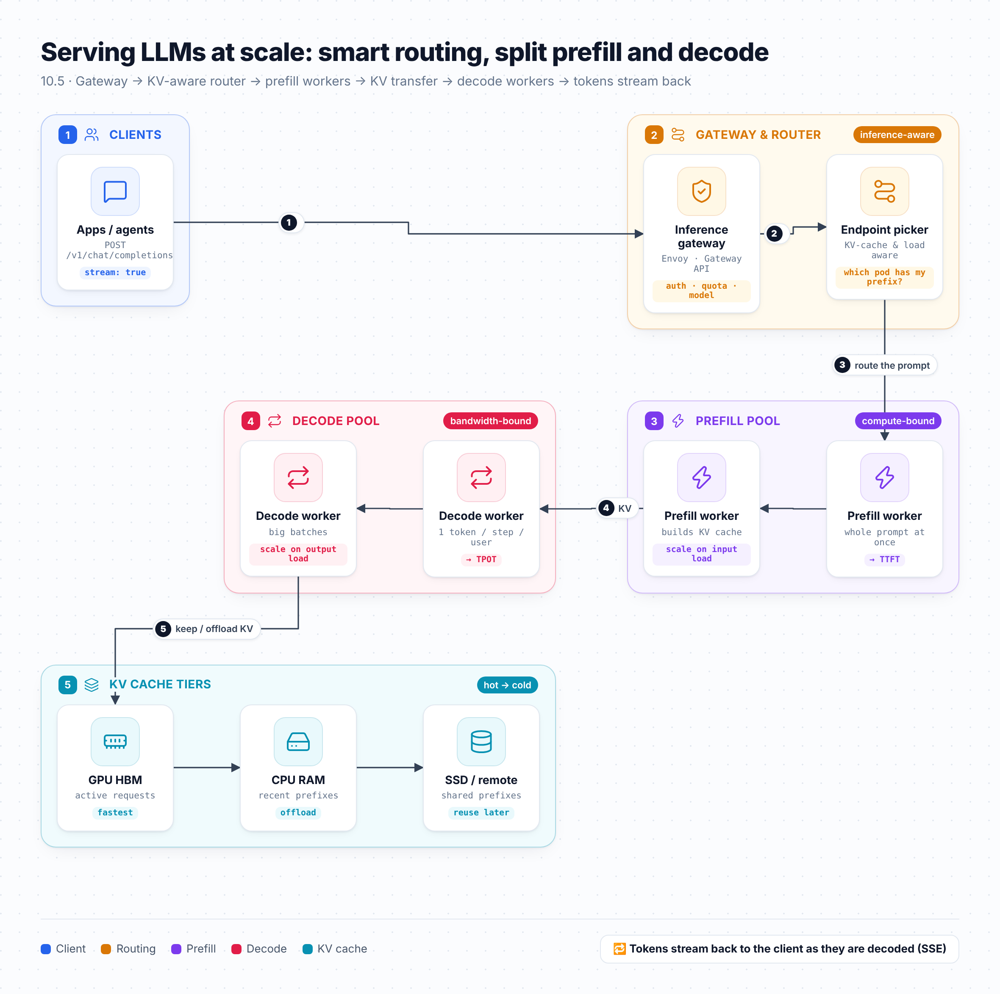
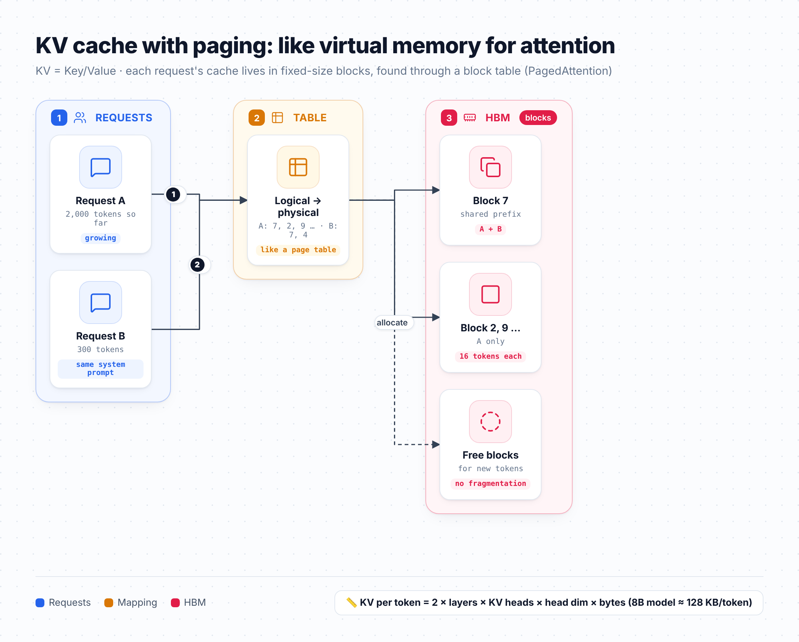
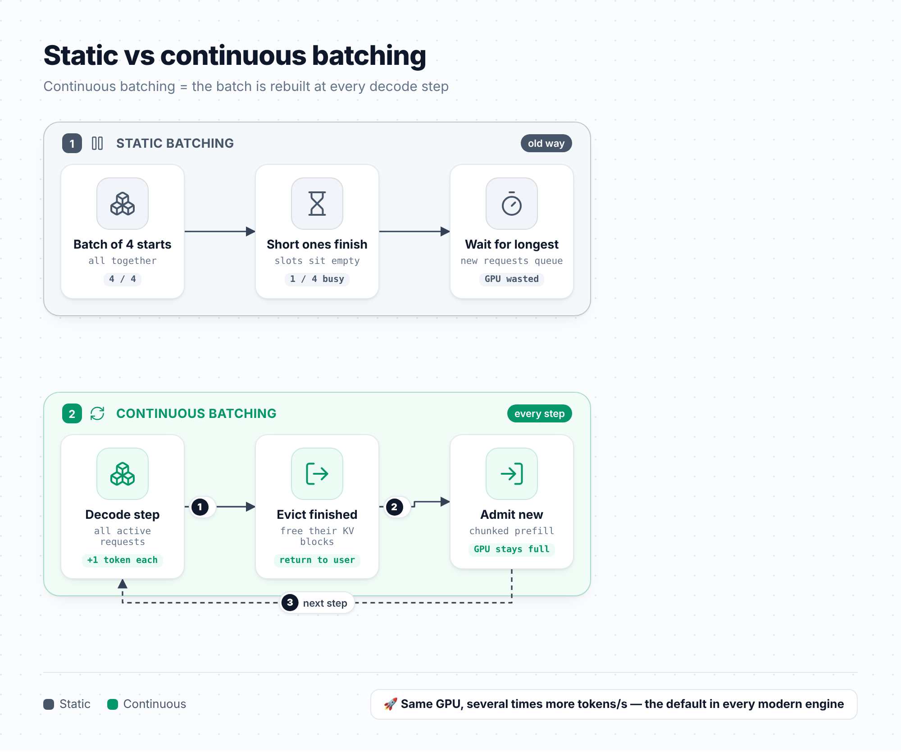
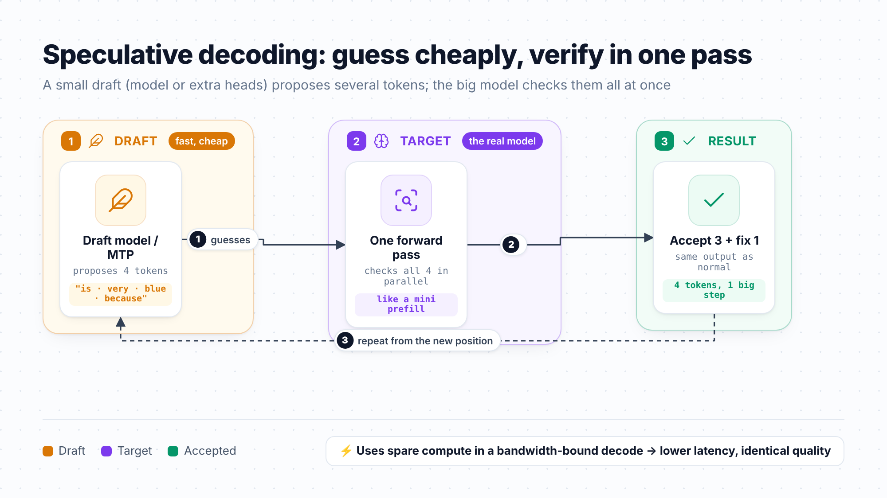

# 10.5 — Inference ve servis: derinlemesine

!!! abstract "Tek cümlede"
    Bir LLM'i servis etmek, **ilk token'a kadar geçen süreyi** ve **çıktı token'ı başına süreyi** düşük tutarken GPU bellek
    bant genişliğini aynı anda çok sayıda kullanıcı için **saniyede token**'a çevirmek demektir. Araçlar şunlar: sanal bellek
    gibi yönetilen bir **KV cache**, GPU'yu dolu tutmak için **sürekli batching**, her adımı ucuzlatmak için **quantization**
    ve **speculative decoding**, tekrarlanan işi atlamak için **prefix caching**. Ölçek büyüyünce de **KV'ye duyarlı
    yönlendirme** ve **ayrı prefill ve decode havuzları**.

## 📖 Terimler ve kısaltmalar

| Terim | Açılımı | Nedir | Nasıl çalışır (tek satır) |
|---|---|---|---|
| **Inference / servis** | — | Eğitilmiş bir modeli kullanıcılar için çalıştırmak | Bir motor ağırlıkları yükler, istekleri kabul eder, token'ları akıtır |
| **Prefill** | — | Tüm prompt'u işlemek | Tüm prompt token'ları paralel işlenir, KV cache kurulur |
| **Decode** | — | Çıktı token'larını üretmek | Adım başına istek başına bir token |
| **TTFT** | Time To First Token | İlk çıktı token'ına kadar geçen gecikme | Kuyruk + prefill |
| **TPOT / ITL** | Time Per Output Token / Inter-Token Latency | Çıktı token'ları arası süre | Bu istek için bir decode adımı |
| **E2E gecikme** | End-to-End | Toplam istek süresi | TTFT + TPOT × (çıktı token sayısı − 1) |
| **Verim (throughput)** | — | Bir kurulumun toplam token/sn'si (ya da istek/sn) | Gecikme SLO'ları bozulana kadar batch boyutuyla büyür |
| **Goodput** | — | Gecikme SLO'sunu karşılayan verim | Kullanıcı için gerçekten sayılan şey |
| **SLO** | Service Level Objective | Bir gecikme/erişilebilirlik hedefi | ör. p95 TTFT < 1 sn, p95 TPOT < 50 ms |
| **KV cache** | Key-Value cache | Geçmiş token'ların saklanan attention K ve V'leri | Bağlam uzunluğu × eşzamanlı istek sayısıyla büyür |
| **GQA / MQA** | Grouped-Query / Multi-Query Attention | Q head'lerinden daha az K/V head'i | KV cache'i birkaç kat küçültür |
| **PagedAttention** | — | Sabit boyutlu bloklarda saklanan KV cache | Bir blok tablosu mantıksal blokları fiziksellere eşler (page table gibi) |
| **Sürekli batching** | Continuous batching | Batch'i her decode adımında yeniden kur | Yeni istekler katılır, bitenler hemen ayrılır |
| **Parçalı prefill** | Chunked prefill | Uzun prompt'ları parçalara böl | Prefill parçalarını decode adımlarıyla karıştırır, decode'lar durmaz |
| **Prefix caching** | — | Ortak bir prompt önekinin KV'sini yeniden kullan | Sistem prompt'u / sohbet geçmişi bir kez hesaplanır |
| **Quantization** | — | Ağırlıkları (belki KV/aktivasyonları da) daha az bitle sakla | FP8, INT8, INT4 (AWQ, GPTQ), FP4 |
| **Speculative decoding** | — | Birkaç token'ı ucuza taslak olarak çıkar, tek büyük adımda doğrula | Çıktı normal decode'la aynı, daha az yavaş adım |
| **MTP** | Multi-Token Prediction | Sıradaki birkaç token'ı tahmin eden ek head'ler | Speculative decoding için yerleşik taslak |
| **P/D ayrıştırma** | Prefill/Decode disaggregation | Prefill ve decode farklı worker'larda | KV cache aralarında RDMA ile aktarılır |
| **KV'ye duyarlı yönlendirme** | KV-aware routing | İsteği önekinin KV'sinin zaten bulunduğu yere gönder | Router hangi pod'da hangi önek olduğunu takip eder |
| **EPP** | Endpoint Picker | Gateway API Inference Extension'daki yönlendirme beyni | Pod'ları KV cache isabeti, kuyruk ve yüke göre puanlar |
| **NIXL** | NVIDIA Inference Xfer Library | Hızlı KV cache aktarım kütüphanesi | KV'yi GPU'lar/node'lar/depolama katmanları arasında taşır |
| **Multi-LoRA** | — | Tek temel modelin üstünde çok sayıda ince ayarlı adaptör | Adaptör istek başına seçilir, temel ağırlıklar ortak |
| **SSE** | Server-Sent Events | HTTP akış formatı | Token(lar) başına bir `data: {...}` parçası |
| **OpenAI uyumlu API** | — | `/v1/chat/completions`, `/v1/completions`, `/v1/embeddings` | Fiilî standart istek/cevap formatı |

## 🗺️ Büyük resim



---

## 1 · Tek bir isteğe ne olur?

1. İstemci `stream: true` ile `POST /v1/chat/completions` gönderir.
2. **Gateway** kimlik doğrular, kotaları uygular, modeli seçer. **Router** bir replika seçer (ideal olarak bu prompt önekini zaten önbellekte tutan bir replika).
3. Motorun **zamanlayıcısı** isteği kuyruğa alır, KV cache'te yer açılınca çalışan batch'e kabul eder.
4. **Prefill**: prompt token'lara çevrilir ve tek büyük paralel geçişte işlenir. KV cache dolar. İlk token çıkar → **TTFT**.
5. **Decode**: her adımda motor, istek başına bir token daha için tüm batch'i çalıştırır → **TPOT**. Her token bir SSE parçası olarak geri akar.
6. Durdurma token'ında ya da `max_tokens`'ta istek batch'ten ayrılır ve KV blokları serbest bırakılır (ya da önek yeniden kullanımı için tutulur).

## 2 · Önemli metrikler

| Metrik | Neye bağlı | Kullanıcı nasıl hisseder |
|---|---|---|
| **TTFT** | Kuyruk süresi + prompt uzunluğu (prefill hesabı) | "Hemen cevap vermeye başlıyor" |
| **TPOT** | Batch boyutu, model boyutu, bellek bant genişliği | "Hızlı yazıyor" (~20–50 ms/token akıcı hissettirir) |
| **Verim** (GPU başına token/sn) | Batch boyutu, KV cache kapasitesi, optimizasyonlar | Milyon token başına maliyet |
| **Goodput** | SLO'lar **içinde** kalan verim | Planlamada kullanılacak gerçek kapasite sayısı |

Temel ödünleşim: **büyük batch → yüksek verim ama yüksek TPOT**. Kapasite planlaması = p95 TTFT ve TPOT'un hâlâ SLO'yu karşıladığı en büyük batch'i (eşzamanlılığı) bulmak.

## 3 · KV cache nedir ve sayfalama nasıl çalışır?

### Nedir?

Bir istekteki her token için her katman, attention **Key** ve **Value** vektörlerini saklar ki her decode adımında yeniden hesaplanmasınlar.

```text
Token başına KV byte'ı = 2 (K ve V) × katman × KV head × head boyutu × değer başına byte
Llama-3-8B (32 katman, 8 KV head, 128 boyut, BF16): 2 × 32 × 8 × 128 × 2 ≈ token başına 128 KB
→ 8.000 token'lık bir sohbet ≈ 1 GB · bunlardan 50 kullanıcı ≈ 16 GB ağırlığın üstüne 50 GB KV cache
```

### Sayfalama nasıl çalışır? (PagedAttention)

1. Ağırlıklardan sonra kalan GPU belleği **sabit boyutlu bloklara** bölünür (ör. her biri 16 token).
2. Her isteğin, mantıksal bloklarını fiziksel bloklara eşleyen bir **blok tablosu** vardır. Tam olarak bir OS page table'ı gibi (Bölüm 3).
3. Bloklar istek büyüdükçe **ihtiyaç anında** ayrılır. Hiç üretilmeyebilecek token'lar için bellek ayrılmaz.
4. **Aynı öneke** sahip istekler **aynı fiziksel bloklara** işaret edebilir (copy-on-write). Prefix caching böyle çalışır.
5. Bellek dolduğunda zamanlayıcı bir isteği **askıya alır (preempt)** ya da blokları CPU RAM'ine/SSD'ye **boşaltır (offload)**.



## 4 · Sürekli batching nedir ve nasıl çalışır?

### Nedir?

Sabit bir batch başlatıp en uzun isteğinin bitmesini beklemek yerine, motor **batch'i her decode adımında yeniden oluşturur**.

### Nasıl çalışır?

1. Her aktif istek için bir decode adımı çalıştır (her birine +1 token).
2. Az önce bitenleri çıkar, KV bloklarını boşalt, kullanıcılara döndür.
3. Bekleyen istekleri boşalan yere kabul et. Prompt'ları **parçalı prefill** ile işlenir ve decode adımlarına karıştırılır, böylece mevcut kullanıcılar takılmaz.
4. Tekrarla. GPU, uzun bir cevabı beklerken hiçbir zaman yarı boş oturmaz.



## 5 · Her adımı ucuzlatmak

| Teknik | Neyi kazandırır | Bedeli |
|---|---|---|
| **Quantization** (FP8 / INT8 / INT4 / FP4 ağırlıklar, FP8 KV cache) | Token başına bellek ve bant genişliği → daha çok token/sn, daha büyük batch'ler | Küçük doğruluk kaybı, değerlendirilmeli |
| **FlashAttention / birleşik kernel'ler / CUDA Graphs** | HBM trafiği ve CPU başlatma yükü | Yok (motorlarda varsayılan) |
| **Prefix caching** | Tekrarlanan sistem prompt'ları, RAG bağlamı, sohbet geçmişi için prefill | Önbellekteki blokları tutacak bellek |
| **Speculative decoding / MTP** | Yavaş decode adımlarının sayısı | Ekstra taslak hesabı; en iyi düşük batch boyutlarında |
| **GQA / MLA** (model mimarisi) | KV cache boyutu | Eğitim anında seçilir |

### Speculative decoding nasıl çalışır?

1. Bir **taslak** (küçük bir model ya da büyük modelin üstünde ek MTP head'leri), sıradaki *k* token'ı hızlıca önerir.
2. Büyük **hedef** model *k* token'ın hepsini **tek bir forward pass**'te kontrol eder (minik bir prefill gibi; ucuzdur çünkü decode bant genişliği sınırlıdır ve boş hesap gücü vardır).
3. Hedefin üreteceğiyle eşleşen en uzun önek **kabul edilir**. İlk uyuşmazlık, hedefin token'ıyla değiştirilir.
4. Çıktı normal decode ile **aynıdır**. Sadece büyük adım başına birkaç token elde edersin.



## 6 · Ölçeği büyütmek: replikalar, bölme, ayrıştırma

| Durum | Ne yaparsın |
|---|---|
| Model tek GPU'ya sığıyor, trafik artıyor | Load balancer arkasında **daha fazla replika** |
| Model tek GPU'ya sığmıyor | Node içinde **tensor parallel** (TP=2/4/8). Çok büyük ya da MoE modeller için node'lar arası pipeline/expert parallel |
| Birçok istek önek paylaşıyor | İstekler KV'lerinin zaten bulunduğu yere düşsün diye **KV/önek duyarlı yönlendirme** (round robin cache isabetlerini yok eder) |
| Uzun prompt'lar herkesin TPOT'unu bozuyor | **P/D ayrıştırma**: prefill havuzu ve decode havuzu, KV RDMA ile aktarılır, her havuz kendi yüküne göre ölçeklenir |
| KV cache sığmıyor | **Katmanlı KV**: HBM → CPU RAM → yerel SSD → ortak depolama |
| Çok sayıda ince ayarlı varyant | **Multi-LoRA**: tek temel model, adaptörler istek başına yüklenir |

Kubernetes'te bu iş **Gateway API Inference Extension**'ın (InferencePool + bir endpoint seçici), **llm-d**'nin (Kubernetes üzerinde dağıtık vLLM/SGLang servisi için CNCF projesi) ve **NVIDIA Dynamo**'nun (motordan bağımsız dağıtık servis framework'ü) işidir. Bkz. [10.6](06-kubernetes.md).

## 7 · Motorlar

| Motor | Güçlü yanları |
|---|---|
| **vLLM** | En geniş model ve donanım desteği, PagedAttention, OpenAI uyumlu, topluluğun varsayılanı |
| **SGLang** | Çok hızlı prefix caching (RadixAttention), yapılandırılmış çıktılar, ajan iş yükleri için güçlü |
| **TensorRT-LLM** | NVIDIA için optimize kernel'ler ve FP8/FP4, ayarlandığında NVIDIA'da en yüksek performans |
| **Triton Inference Server** | Her model tipi için (sadece LLM değil) çok framework'lü sunucu |
| **llama.cpp / Ollama** | CPU'lar, laptoplar, edge cihazlar, GGUF quantize modeller |

> DevOps bağlantısı: bir LLM endpoint'i **kılık değiştirmiş stateful bir servistir**. KV cache yüzünden "hangi pod" önemlidir, yeniden başlatmadan sonra ısınma yavaştır (onlarca GB ağırlık yüklenir) ve otomatik ölçekleme CPU'ya değil LLM sinyallerine (kuyruk uzunluğu, KV kullanımı, TTFT) dayanmalıdır.

---

## 🧪 Kendin dene

```bash
# 1) Herhangi bir model yapılandırması için KV cache hesabı
python3 - <<'EOF'
layers, kv_heads, head_dim, bytes_ = 32, 8, 128, 2      # Llama-3-8B, BF16
per_tok = 2 * layers * kv_heads * head_dim * bytes_
print(f"{per_tok/1024:.0f} KB/token · 8k bağlam = {per_tok*8192/1e9:.2f} GB · 50 kullanıcı = {per_tok*8192*50/1e9:.0f} GB")
EOF

# 2) vLLM ile küçük bir model servis et (GPU) ve motorun kendi metriklerini izle
vllm serve Qwen/Qwen2.5-0.5B-Instruct --max-num-seqs 64 &
curl -N localhost:8000/v1/chat/completions -H 'Content-Type: application/json' \
  -d '{"model":"Qwen/Qwen2.5-0.5B-Instruct","stream":true,"messages":[{"role":"user","content":"10a kadar say"}]}'
curl -s localhost:8000/metrics | grep -E "num_requests_running|num_requests_waiting|kv_cache_usage|time_to_first_token" | head

# 3) Yük testi: farklı eşzamanlılıklarda verim ve gecikme
vllm bench serve --model Qwen/Qwen2.5-0.5B-Instruct --dataset-name random \
  --random-input-len 1000 --random-output-len 200 --num-prompts 200 --max-concurrency 8
#   --max-concurrency 64 ile tekrarla; token/sn, TTFT ve TPOT'u karşılaştır
```

**Görev:** benchmark'ı 1, 8, 32 ve 128 eşzamanlılıkta çalıştır. Çıktı token/sn'yi p95 TPOT'a karşı çiz. 50 ms'lik bir TPOT SLO'su için sınırı nereye koyardın?

---

## 🃏 Hatırlatma kartı

```text
İstek: gateway → router (önek duyarlı) → kuyruk → PREFILL (TTFT) → DECODE adımları (TPOT) → SSE akışı → KV'yi boşalt
E2E ≈ TTFT + TPOT × (çıktı token − 1) · batch ile verim ↑, TPOT da ↑ → goodput'a göre planla
Token başına KV = 2 × katman × KV head × head boyutu × byte (8B ≈ 128 KB) · bloklarda sayfalı, ortak önekler, boşaltma katmanları
Sürekli batching + parçalı prefill GPU'yu dolu tutar
Ucuz adımlar: quantization (FP8/INT4/FP4) · FlashAttention · prefix caching · speculative decoding / MTP
Ölçek: replikalar → büyük modeller için TP → KV duyarlı yönlendirme → P/D ayrıştırma (llm-d, Dynamo, Inference Gateway)
Motorlar: vLLM · SGLang · TensorRT-LLM · Triton · llama.cpp/Ollama
```

---

## ❓ Kendini test et

??? question "1. Kullanıcılar ilk kelimenin 4 saniyede çıktığından ama sonra metnin hızlı aktığından şikâyet ediyor. Hangi metrik ve hangi aşama?"
    Yüksek TTFT: ya kuyrukta bekleme (yetersiz kapasite ya da kötü yönlendirme) ya da yavaş prefill (çok uzun prompt'lar). Prefix caching, parçalı prefill, daha fazla replika ya da P/D ayrıştırma yardımcı olur.

??? question "2. Round-robin yük dağıtımı LLM servisine neden zarar verir?"
    Her sohbetin KV cache'inin (önekinin) nerede durduğunu yok sayar. Bu yüzden istekler prefill'i yeniden hesaplamak zorunda olan pod'lara düşmeye devam eder. KV duyarlı yönlendirme onları öneki zaten tutan pod'a gönderir.

??? question "3. 8 KV head'li, head boyutu 128 olan 32 katmanlı bir model, BF16'da 4k token'lık 100 eşzamanlı istek için ne kadar KV cache'e ihtiyaç duyar?"
    2 × 32 × 8 × 128 × 2 byte = token başına 128 KB → × 4.096 token × 100 istek ≈ 54 GB.

??? question "4. Speculative decoding modelin cevaplarını değiştirir mi?"
    Hayır. Kabul edilen token'lar tam olarak hedef modelin üreteceği token'lardır. Taslak sadece birkaçının tek bir forward pass'te onaylanmasını sağlar.

??? question "5. Prefill ve decode neden farklı GPU'lara ayrılır?"
    Farklı kaynakları zorlarlar (hesaplama ve bellek bant genişliği). Bir arada olduklarında uzun prefill'ler herkesin decode adımlarını takılmaya uğratır. Ayrı havuzlar bağımsız olarak boyutlandırılabilir, ölçeklenebilir ve kendi darboğazlarına göre ayarlanabilir.

---

## 📚 Kaynaklar

- [vLLM dokümanları](https://docs.vllm.ai/) · [PagedAttention makalesi](https://arxiv.org/abs/2309.06180)
- [SGLang dokümanları](https://docs.sglang.ai/) · [TensorRT-LLM dokümanları](https://nvidia.github.io/TensorRT-LLM/)
- [Gateway API Inference Extension](https://gateway-api-inference-extension.sigs.k8s.io/) · [llm-d](https://llm-d.ai/) · [NVIDIA Dynamo](https://docs.nvidia.com/dynamo/latest/)
- [DistServe: prefill ve decode'u ayrıştırmak](https://arxiv.org/abs/2401.09670)
- [Speculative decoding (Leviathan vd.)](https://arxiv.org/abs/2211.17192)

## ✍️ Kendi notlarım

> TTFT ile TPOT'u, KV cache'in neden eşzamanlılığı sınırladığını ve sürekli batching'in ne yaptığını kendi cümlelerinle 5 satırda anlat.

-
