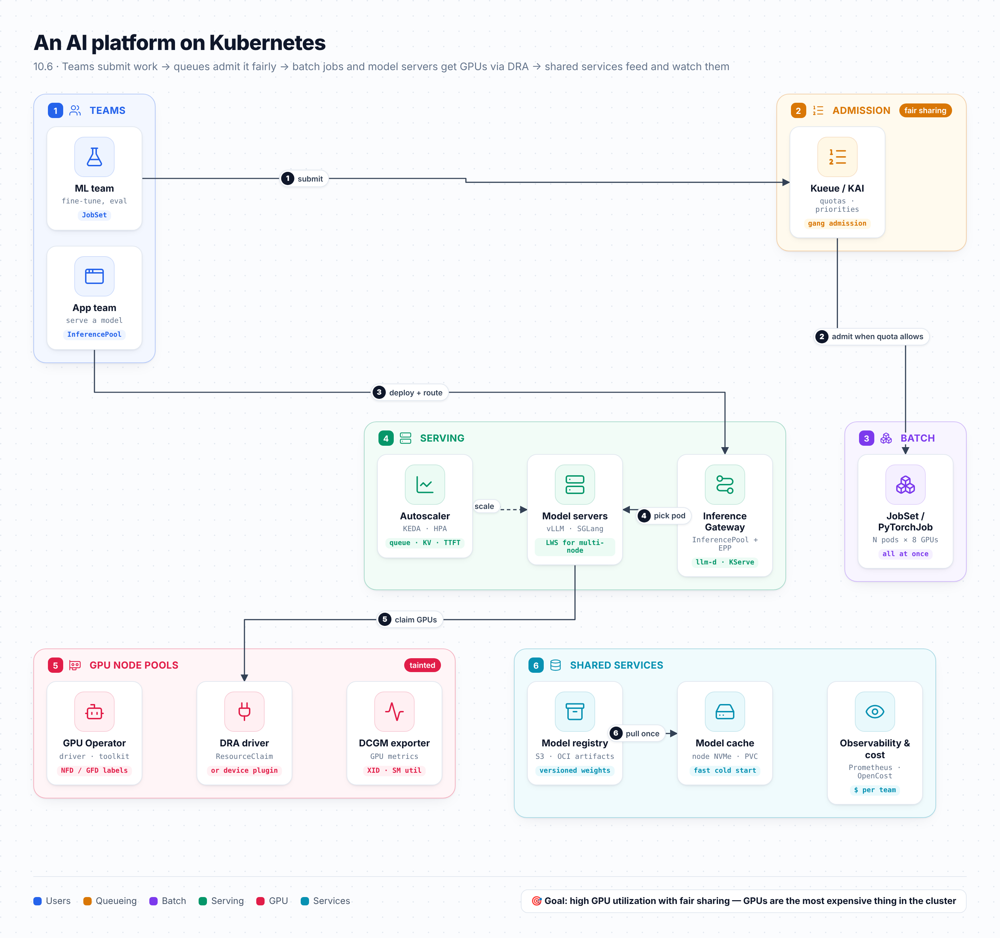
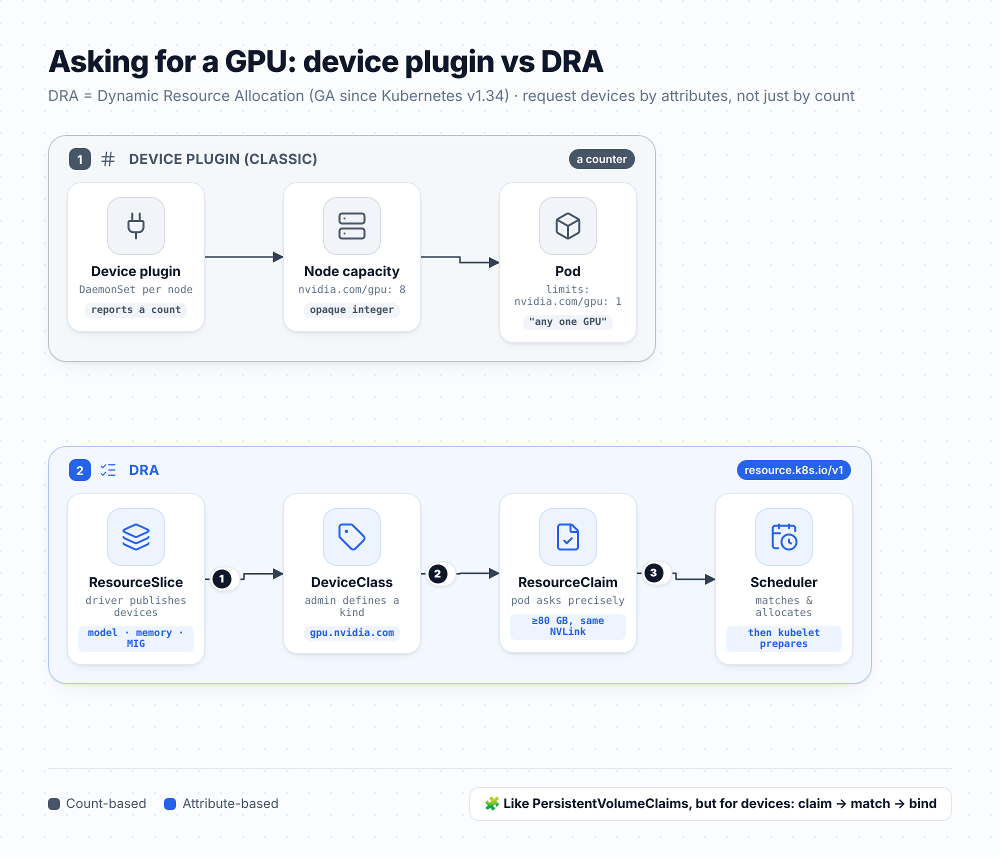
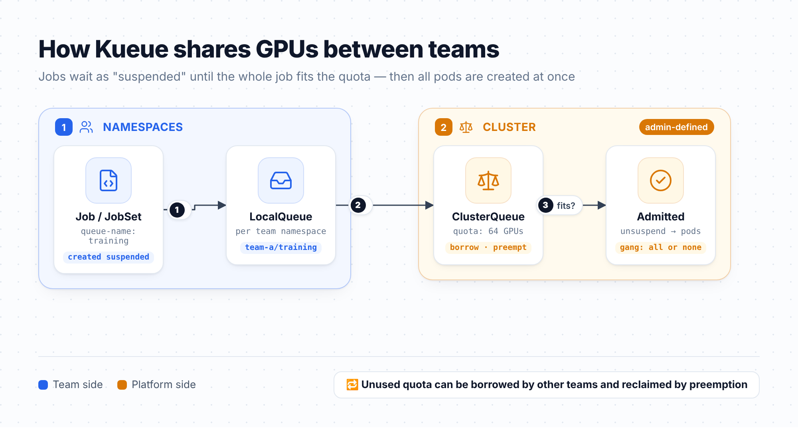

# 10.6 — AI platform on Kubernetes

!!! abstract "In short"
    Kubernetes becomes an AI platform by adding a few layers. The **GPU Operator** prepares GPU nodes, and **DRA** (or
    the older device plugin) lets pods claim GPUs. **Kueue/KAI** queue jobs fairly with **gang scheduling**, and
    **JobSet/LeaderWorkerSet** run multi-pod training and inference. An **inference gateway** routes requests to model
    servers that **autoscale on LLM signals**. The platform team's goal: high GPU utilization, fair sharing, fast cold
    starts, clear cost.

## 📖 Key terms & abbreviations

| Term | Stands for | What it is | How it works (one line) |
|---|---|---|---|
| **GPU Operator** | — | Operator that manages the whole GPU node stack | Installs driver, container toolkit, device plugin / DRA driver, DCGM exporter, MIG manager |
| **NFD / GFD** | Node Feature Discovery / GPU Feature Discovery | Labels nodes with their hardware | e.g. `nvidia.com/gpu.product=H100-SXM` |
| **Device plugin** | — | The classic way to expose devices | Advertises a **count** (`nvidia.com/gpu: 8`) as an extended resource |
| **DRA** | Dynamic Resource Allocation | The new device API (GA since v1.34, `resource.k8s.io/v1`) | Pods claim devices **by attributes**; the scheduler matches and allocates |
| **ResourceSlice** | — | DRA object published by a driver | Lists the devices on a node with their attributes |
| **DeviceClass** | — | DRA object defined by admins | Names a kind of device and its selection rules |
| **ResourceClaim / Template** | — | What a pod asks for | "1 GPU with ≥80 GB" or "2 GPUs on the same NVLink" |
| **Taints / tolerations** | — | Keep normal pods off GPU nodes | GPU nodes are tainted; only GPU workloads tolerate it |
| **Kueue** | — | Kubernetes-native job queueing | LocalQueue → ClusterQueue with quotas, borrowing, preemption |
| **KAI Scheduler** | — | NVIDIA's open-source AI-aware scheduler | Hierarchical queues, gang scheduling, GPU sharing |
| **Gang scheduling** | — | All pods of a job start together or none | Avoids deadlocks and half-started jobs |
| **JobSet** | — | A group of Jobs managed as one unit | Multi-pod distributed training with shared lifecycle |
| **LWS** | LeaderWorkerSet | Groups of pods (leader + workers) as one replica | Multi-node inference of models too big for one node |
| **KubeRay** | — | Operator for Ray clusters | Ray Train / Ray Serve on Kubernetes |
| **KServe** | — | Model serving platform on Kubernetes | `InferenceService` CRDs, autoscaling, canaries |
| **Gateway API Inference Extension** | — | Kubernetes SIG project for LLM routing | `InferencePool` + an **endpoint picker (EPP)** scoring pods by KV cache and load |
| **llm-d** | — | CNCF project for distributed LLM inference | vLLM/SGLang + inference gateway + P/D disaggregation + KV-aware routing |
| **KEDA** | Kubernetes Event-Driven Autoscaling | Autoscaler driven by external metrics | Scales on queue length, KV usage, Prometheus queries |
| **HPA** | Horizontal Pod Autoscaler | Built-in autoscaler | Scales replicas on CPU/memory or custom metrics |
| **Model cache** | — | Keep model weights close to GPUs | Node-local NVMe, shared PVC, or OCI image volumes |
| **DCGM exporter** | Data Center GPU Manager exporter | GPU metrics for Prometheus | Utilization, memory, power, XID errors per GPU/pod |
| **OpenCost** | — | Kubernetes cost allocation | Cost per namespace/team, including GPUs |

## 🗺️ Big picture



---

## 1 · Preparing GPU nodes: what does the GPU Operator do?

### What is it?

An operator that turns a plain node with an NVIDIA card into a ready-to-use GPU node, and keeps it that way.

### How does it work?

1. **NFD/GFD** detect the GPU and label the node (product, memory, MIG capability, driver version).
2. The **driver** container installs `nvidia.ko` for the node's kernel (or uses a pre-installed driver).
3. The **container toolkit** configures containerd so containers can get GPUs (via CDI).
4. The **device plugin** or **DRA driver** advertises the GPUs to Kubernetes.
5. **DCGM exporter** exposes per-GPU metrics, **MIG manager** applies MIG layouts from a node label.
6. A **validator** runs a test workload; only then is the node ready for GPU pods.

> Platform tip: keep GPU nodes in **separate, tainted node pools** per GPU type, and treat driver versions like kernel versions (pin, roll out gradually, `dcgmi diag` before joining).

## 2 · Asking for a GPU: device plugin vs DRA

### What is DRA?

**Dynamic Resource Allocation** replaces "give me *n* of `nvidia.com/gpu`" with a **claim** that describes *which* device you need, similar to how PersistentVolumeClaims describe storage. Core DRA is GA since Kubernetes **v1.34** (`resource.k8s.io/v1`), and NVIDIA's DRA driver for GPUs now lives in the Kubernetes SIGs organization.

### How does it work?

1. The **DRA driver** on each node publishes **ResourceSlices**: every GPU with its attributes (model, memory, MIG profile, NVLink domain…).
2. An admin defines **DeviceClasses** (e.g. `gpu.nvidia.com`).
3. A pod references a **ResourceClaim** (or a template) with requests and selectors, e.g. "1 GPU with ≥80 GB".
4. The **scheduler** finds a node whose devices satisfy the claim, **allocates** them and writes the result to the claim.
5. The **kubelet** asks the driver to prepare the device and the container starts with it.



```yaml
# Classic device plugin
resources:
  limits:
    nvidia.com/gpu: 1
---
# DRA (resource.k8s.io/v1)
apiVersion: resource.k8s.io/v1
kind: ResourceClaimTemplate
metadata: { name: single-gpu }
spec:
  spec:
    devices:
      requests:
      - name: gpu
        exactly:
          deviceClassName: gpu.nvidia.com
---
apiVersion: v1
kind: Pod
metadata: { name: vllm }
spec:
  resourceClaims:
  - name: gpu
    resourceClaimTemplateName: single-gpu
  containers:
  - name: vllm
    image: vllm/vllm-openai
    resources:
      claims:
      - name: gpu
```

## 3 · Sharing GPUs fairly: how do Kueue and gang scheduling work?

### What is it?

The default scheduler places pods one by one and has no idea that 64 pods belong to one training job, or that team A owns half the GPUs. **Kueue** (and AI schedulers like **KAI** or Volcano) add **queues, quotas and all-or-nothing admission**.

### How does it work?

1. A Job/JobSet is created with a label `kueue.x-k8s.io/queue-name: training`. Kueue keeps it **suspended**.
2. It sits in the namespace's **LocalQueue**, which points to a **ClusterQueue** that owns a quota (e.g. 64 GPUs of flavor "H100").
3. When the **whole** job fits the quota (borrowing unused quota from other queues if allowed), Kueue **admits** it and unsuspends it, so all pods are created together.
4. If a higher-priority job needs the GPUs, Kueue can **preempt** borrowed capacity.



```yaml
# (API version depends on your Kueue release)
apiVersion: kueue.x-k8s.io/v1beta1
kind: ClusterQueue
metadata: { name: gpu-cq }
spec:
  namespaceSelector: {}
  resourceGroups:
  - coveredResources: ["nvidia.com/gpu"]
    flavors:
    - name: h100
      resources:
      - name: "nvidia.com/gpu"
        nominalQuota: 64
---
apiVersion: kueue.x-k8s.io/v1beta1
kind: LocalQueue
metadata: { namespace: team-a, name: training }
spec: { clusterQueue: gpu-cq }
```

## 4 · Workload types and their Kubernetes building blocks

| Workload | Building blocks | Notes |
|---|---|---|
| Distributed training / fine-tuning | **JobSet**, PyTorchJob (Kubeflow Trainer), Kueue, topology-aware placement | Gang scheduling, checkpoints to object storage |
| Batch inference / evals | Job / JobSet + Kueue, or Ray | Throughput-oriented, can use spot capacity |
| Online LLM serving (one node) | Deployment + vLLM/SGLang, **Inference Gateway** / KServe | Readiness after model load, KV-aware routing |
| Online serving (multi-node model) | **LeaderWorkerSet** (one replica = leader + workers) | TP inside nodes, PP across |
| Distributed serving at scale | **llm-d** or **NVIDIA Dynamo** | P/D disaggregation, KV cache tiers, KV-aware routing ([10.5](05-inference.md)) |
| Notebooks / dev | JupyterHub, time-sliced or MIG GPUs | Idle culling to free GPUs |

## 5 · Model weights: the cold-start problem

A 70B model is ~140 GB. Pulling that from object storage on every pod start means **minutes** of cold start.

| Approach | How |
|---|---|
| **Node-local cache** | DaemonSet or init container pre-pulls weights to local NVMe |
| **Shared volume** | ReadOnlyMany PVC on a fast parallel filesystem |
| **OCI artifacts / image volumes** | Ship weights as OCI artifacts, reuse the registry and node image cache |
| **Fast loaders** | Streaming loaders (e.g. safetensors streaming) to start serving sooner |

## 6 · Autoscaling LLM servers

| Signal | Why |
|---|---|
| **Queue length / waiting requests** | Direct sign of missing capacity |
| **KV cache utilization** | When near 100%, new requests wait or get preempted |
| **TTFT / TPOT p95** | The SLO you actually promised |
| ~~CPU utilization~~ | Meaningless: the work is on the GPU |

Use **KEDA** or HPA with Prometheus metrics from the engine (`/metrics`), keep a **minimum warm replica count** (cold starts are slow), and scale **prefill and decode pools separately** when disaggregated.

## 7 · Observability and cost

- **DCGM exporter** → Prometheus → Grafana: SM activity, tensor activity, memory, power, XID errors, per pod.
- **Engine metrics**: running/waiting requests, KV usage, TTFT, TPOT, tokens/s.
- **Cost**: GPU-hours per namespace/team (OpenCost/Kubecost), cost per million tokens per model, idle GPU-hours.

> DevOps connection: the classic platform metrics change meaning. "Utilization" means **SM/tensor activity**, "capacity" means **KV cache and tokens/s**, "deploy time" includes **loading 100+ GB of weights**, and a 10% utilization gain on GPUs is often worth more than everything else in the cluster combined.

---

## 🧪 Try it yourself

```bash
# 1) Install the GPU Operator (on a cluster with NVIDIA GPU nodes)
helm repo add nvidia https://helm.ngc.nvidia.com/nvidia && helm repo update
helm install gpu-operator nvidia/gpu-operator -n gpu-operator --create-namespace
kubectl get pods -n gpu-operator
kubectl get nodes -L nvidia.com/gpu.product,nvidia.com/gpu.count

# 2) A GPU smoke test
kubectl run gpu-test --rm -it --restart=Never --image=nvidia/cuda:12.6.3-base-ubuntu24.04 \
  --overrides='{"spec":{"containers":[{"name":"gpu-test","image":"nvidia/cuda:12.6.3-base-ubuntu24.04","command":["nvidia-smi"],"resources":{"limits":{"nvidia.com/gpu":1}}}]}}'

# 3) DRA objects (on a DRA-enabled cluster)
kubectl get deviceclasses
kubectl get resourceslices -o wide

# 4) Kueue: install, then watch admissions
kubectl get clusterqueues,localqueues -A
kubectl get workloads -A        # one Workload per queued job: admitted or pending, and why
```

**Exercise (no GPU needed):** install Kueue on a kind cluster with a fake quota on `cpu`, submit three Jobs that each need 60% of the quota, and watch only one get admitted at a time.

---

## 🃏 Cheat sheet

```text
GPU node: GPU Operator = driver + toolkit (CDI) + device plugin/DRA driver + DCGM exporter + MIG manager · tainted pools
Ask for GPUs: limits nvidia.com/gpu: N (count)  →  DRA: ResourceSlice → DeviceClass → ResourceClaim → scheduler allocates
Fair sharing: Kueue LocalQueue → ClusterQueue (quota, borrow, preempt) · gang admission · KAI / Volcano
Workloads: JobSet (training) · LWS (multi-node serving) · KServe / Inference Gateway / llm-d (online serving)
Cold start: cache weights on node NVMe / PVC / OCI artifacts · keep warm replicas
Autoscale on queue length, KV usage, TTFT/TPOT — not CPU
Watch: DCGM (SM/tensor activity, XID) · engine metrics · GPU-hours and $/1M tokens per team
```

---

## ❓ Test yourself

??? question "1. What can DRA express that `nvidia.com/gpu: 1` can't?"
    Attributes and relationships: a specific model or memory size, a MIG profile, several GPUs on the same NVLink domain, shared claims between pods. The device plugin only exposes a count.

??? question "2. A 64-GPU training job gets 40 pods scheduled and the rest stay Pending. What's wrong, and what fixes it?"
    No gang scheduling: the default scheduler placed pods one by one. The 40 running pods hold GPUs while waiting for the others. Kueue (or KAI/Volcano) admits the job only when all 64 GPUs are available.

??? question "3. Why should GPU nodes be tainted?"
    So that ordinary pods (web apps, sidecars, system jobs) don't land on very expensive GPU nodes and take CPU/memory that GPU workloads need. Only pods that tolerate the taint and request GPUs go there.

??? question "4. Your LLM Deployment scales up but new pods take 8 minutes to become Ready. What do you change?"
    Cache model weights close to the node (local NVMe pre-pull, shared PVC, OCI artifacts), use a streaming loader, keep a minimum number of warm replicas and scale earlier (on queue length rather than on SLO violations).

??? question "5. What does the endpoint picker in the Gateway API Inference Extension do that a normal Service doesn't?"
    It chooses a model server pod per request based on LLM-specific signals: prefix/KV cache locality, queue length, KV cache usage, LoRA adapters loaded. A Service just load-balances connections.

---

## 📚 Sources

- [NVIDIA GPU Operator docs](https://docs.nvidia.com/datacenter/cloud-native/gpu-operator/latest/index.html)
- [Kubernetes: Dynamic Resource Allocation](https://kubernetes.io/docs/concepts/scheduling-eviction/dynamic-resource-allocation/)
- [Kueue docs](https://kueue.sigs.k8s.io/docs/) · [JobSet](https://jobset.sigs.k8s.io/) · [LeaderWorkerSet](https://lws.sigs.k8s.io/)
- [Gateway API Inference Extension](https://gateway-api-inference-extension.sigs.k8s.io/) · [llm-d](https://llm-d.ai/) · [KServe](https://kserve.github.io/website/)
- [KEDA](https://keda.sh/) · [OpenCost](https://www.opencost.io/)

## ✍️ My notes

> Explain how a GPU request travels from a pod spec to a running container on a GPU node, in your own words in 5 lines.
