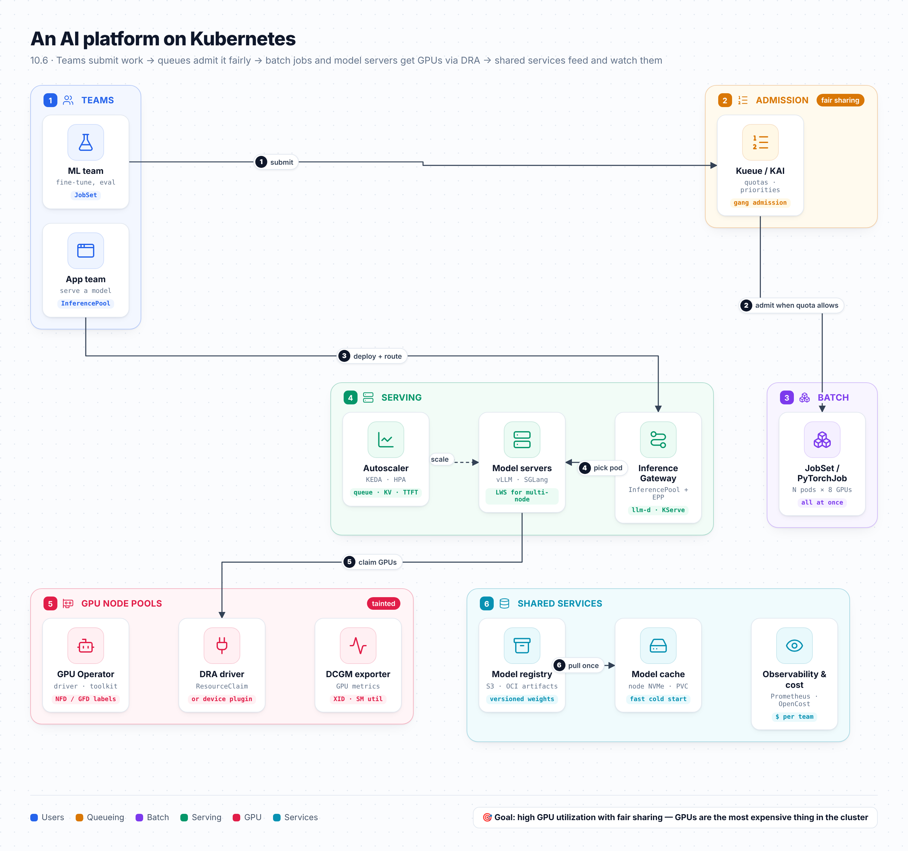
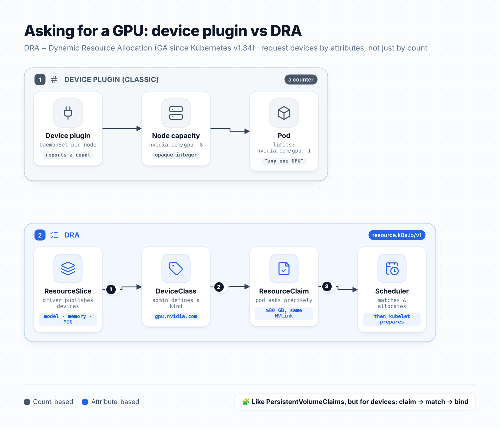
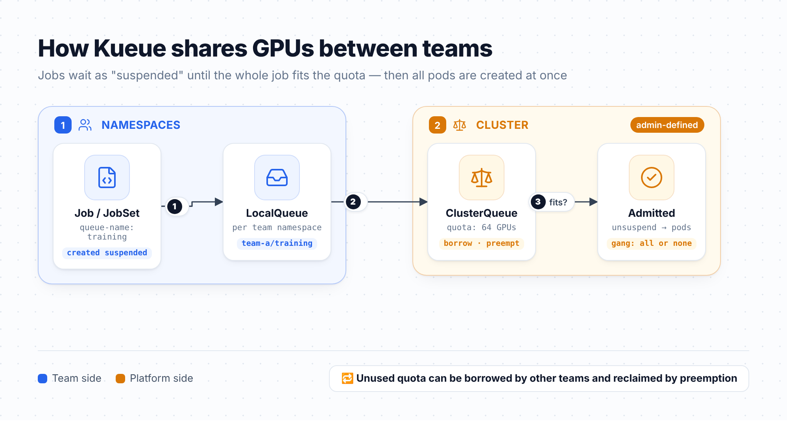

# 10.6 — Kubernetes üzerinde AI platformu

!!! abstract "Tek cümlede"
    Kubernetes birkaç katman eklenerek bir AI platformuna dönüşür. **GPU Operator** GPU node'larını hazırlar (sürücü, toolkit,
    metrikler). **DRA** (ya da eski device plugin) pod'ların GPU talep etmesini sağlar. **Kueue/KAI** işleri **gang scheduling**
    ile kuyruğa alır ve adil kabul eder. **JobSet/LeaderWorkerSet** çok pod'lu eğitimi ve çok node'lu inference'ı çalıştırır.
    Bir **inference gateway** (Gateway API Inference Extension, llm-d, KServe) de istekleri **LLM sinyallerine göre otomatik
    ölçeklenen** model sunucularına yönlendirir. Platform ekibinin işi: yüksek GPU kullanımı, adil paylaşım, hızlı soğuk başlangıç, net maliyet.

## 📖 Terimler ve kısaltmalar

| Terim | Açılımı | Nedir | Nasıl çalışır (tek satır) |
|---|---|---|---|
| **GPU Operator** | — | Tüm GPU node yığınını yöneten operator | Sürücü, container toolkit, device plugin / DRA sürücüsü, DCGM exporter, MIG manager kurar |
| **NFD / GFD** | Node Feature Discovery / GPU Feature Discovery | Node'ları donanımlarıyla etiketler | ör. `nvidia.com/gpu.product=H100-SXM` |
| **Device plugin** | — | Cihazları açmanın klasik yolu | Bir **sayıyı** (`nvidia.com/gpu: 8`) extended resource olarak ilan eder |
| **DRA** | Dynamic Resource Allocation | Yeni cihaz API'si (v1.34'ten beri GA, `resource.k8s.io/v1`) | Pod'lar cihazları **özelliklerine göre** talep eder; scheduler eşler ve ayırır |
| **ResourceSlice** | — | Bir sürücünün yayınladığı DRA nesnesi | Bir node'daki cihazları özellikleriyle listeler |
| **DeviceClass** | — | Yöneticilerin tanımladığı DRA nesnesi | Bir cihaz türünü ve seçim kurallarını adlandırır |
| **ResourceClaim / Template** | — | Bir pod'un istediği şey | "≥80 GB'lık 1 GPU" ya da "aynı NVLink'te 2 GPU" |
| **Taint / toleration** | — | Normal pod'ları GPU node'larından uzak tutar | GPU node'ları taint'lenir; sadece GPU iş yükleri tolere eder |
| **Kueue** | — | Kubernetes'e özgü iş kuyruklama | LocalQueue → kotaları, ödünç alma ve öncelikle kesme olan ClusterQueue |
| **KAI Scheduler** | — | NVIDIA'nın açık kaynak, AI'a duyarlı zamanlayıcısı | Hiyerarşik kuyruklar, gang scheduling, GPU paylaşımı |
| **Gang scheduling** | — | Bir işin tüm pod'ları ya birlikte başlar ya hiç | Kilitlenmeleri ve yarım başlamış işleri önler |
| **JobSet** | — | Tek birim olarak yönetilen bir Job grubu | Ortak yaşam döngülü çok pod'lu dağıtık eğitim |
| **LWS** | LeaderWorkerSet | Tek replika olarak pod grupları (lider + worker'lar) | Tek node'a sığmayan modellerin çok node'lu inference'ı |
| **KubeRay** | — | Ray cluster'ları için operator | Kubernetes üzerinde Ray Train / Ray Serve |
| **KServe** | — | Kubernetes üzerinde model servis platformu | `InferenceService` CRD'leri, otomatik ölçekleme, canary |
| **Gateway API Inference Extension** | — | LLM yönlendirmesi için Kubernetes SIG projesi | `InferencePool` + pod'ları KV cache ve yüke göre puanlayan bir **endpoint seçici (EPP)** |
| **llm-d** | — | Dağıtık LLM inference için CNCF projesi | vLLM/SGLang + inference gateway + P/D ayrıştırma + KV duyarlı yönlendirme |
| **KEDA** | Kubernetes Event-Driven Autoscaling | Dış metriklerle sürülen otomatik ölçekleyici | Kuyruk uzunluğu, KV kullanımı, Prometheus sorgularına göre ölçekler |
| **HPA** | Horizontal Pod Autoscaler | Yerleşik otomatik ölçekleyici | Replikaları CPU/bellek ya da özel metriklere göre ölçekler |
| **Model önbelleği** | Model cache | Model ağırlıklarını GPU'lara yakın tut | Node'a yerel NVMe, ortak PVC ya da OCI imaj volume'ları |
| **DCGM exporter** | Data Center GPU Manager exporter | Prometheus için GPU metrikleri | GPU/pod başına kullanım, bellek, güç, XID hataları |
| **OpenCost** | — | Kubernetes maliyet dağıtımı | GPU'lar dahil namespace/ekip başına maliyet |

## 🗺️ Büyük resim



---

## 1 · GPU node'larını hazırlamak: GPU Operator ne yapar?

### Nedir?

NVIDIA kartı olan sıradan bir node'u kullanıma hazır bir GPU node'una çeviren ve öyle kalmasını sağlayan bir operator.

### Nasıl çalışır?

1. **NFD/GFD** GPU'yu tespit eder ve node'u etiketler (ürün, bellek, MIG yeteneği, sürücü versiyonu).
2. **Sürücü** container'ı, node'un kernel'i için `nvidia.ko`'yu kurar (ya da önceden kurulu bir sürücüyü kullanır).
3. **Container toolkit**, container'ların GPU alabilmesi için containerd'yi yapılandırır (CDI üzerinden).
4. **Device plugin** ya da **DRA sürücüsü** GPU'ları Kubernetes'e ilan eder.
5. **DCGM exporter** GPU başına metrikleri açar. **MIG manager** bir node etiketinden MIG düzenlerini uygular.
6. Bir **validator** test iş yükü çalıştırır. Node ancak ondan sonra GPU pod'ları için hazır olur.

> Platform ipucu: GPU node'larını GPU tipi başına **ayrı, taint'li node havuzlarında** tut ve sürücü versiyonlarını kernel versiyonları gibi yönet: sabitle, kademeli dağıt, havuza katılmadan önce `dcgmi diag` çalıştır.

## 2 · GPU istemek: device plugin ve DRA

### DRA nedir?

**Dynamic Resource Allocation**, "bana *n* tane `nvidia.com/gpu` ver" yerine, *hangi* cihaza ihtiyacın olduğunu tanımlayan bir **talep (claim)** kullanır. Bu, PersistentVolumeClaim'lerin depolamayı tanımlamasına benzer. Temel DRA, Kubernetes **v1.34**'ten beri GA'dir (`resource.k8s.io/v1`). NVIDIA'nın GPU'lar için DRA sürücüsü artık Kubernetes SIGs organizasyonunda duruyor.

### Nasıl çalışır?

1. Her node'daki **DRA sürücüsü** **ResourceSlice**'lar yayınlar: her GPU, özellikleriyle birlikte (model, bellek, MIG profili, NVLink alanı…).
2. Bir yönetici **DeviceClass**'lar tanımlar (ör. `gpu.nvidia.com`).
3. Bir pod, istekler ve seçicilerle bir **ResourceClaim**'e (ya da şablona) referans verir, ör. "≥80 GB'lık 1 GPU".
4. **Scheduler**, cihazları talebi karşılayan bir node bulur, onları **ayırır** ve sonucu talebe yazar.
5. **Kubelet** sürücüden cihazı hazırlamasını ister ve container onunla başlar.



```yaml
# Klasik device plugin
resources:
  limits:
    nvidia.com/gpu: 1
---
# DRA (resource.k8s.io/v1)
apiVersion: resource.k8s.io/v1
kind: ResourceClaimTemplate
metadata: { name: single-gpu }
spec:
  spec:
    devices:
      requests:
      - name: gpu
        exactly:
          deviceClassName: gpu.nvidia.com
---
apiVersion: v1
kind: Pod
metadata: { name: vllm }
spec:
  resourceClaims:
  - name: gpu
    resourceClaimTemplateName: single-gpu
  containers:
  - name: vllm
    image: vllm/vllm-openai
    resources:
      claims:
      - name: gpu
```

## 3 · GPU'ları adil paylaşmak: Kueue ve gang scheduling nasıl çalışır?

### Nedir?

Varsayılan scheduler pod'ları tek tek yerleştirir. 64 pod'un tek bir eğitim işine ait olduğunu ya da GPU'ların yarısının A ekibine ait olduğunu bilmez. **Kueue** (ve **KAI** ya da Volcano gibi AI zamanlayıcıları) **kuyruklar, kotalar ve ya-hep-ya-hiç kabul** ekler.

### Nasıl çalışır?

1. Bir Job/JobSet, `kueue.x-k8s.io/queue-name: training` etiketiyle oluşturulur. Kueue onu **askıda** tutar.
2. İş, namespace'in **LocalQueue**'sunda bekler. LocalQueue, bir kotanın sahibi olan bir **ClusterQueue**'yu gösterir (ör. "H100" türünden 64 GPU).
3. İşin **tamamı** kotaya sığdığında (izin varsa diğer kuyrukların kullanılmayan kotasını ödünç alarak) Kueue onu **kabul eder** ve askıdan çıkarır. Böylece tüm pod'lar birlikte oluşturulur.
4. Daha yüksek öncelikli bir iş GPU'lara ihtiyaç duyarsa Kueue ödünç verilmiş kapasiteyi **öncelikle kesebilir (preempt)**.



```yaml
# (API versiyonu Kueue sürümüne bağlıdır)
apiVersion: kueue.x-k8s.io/v1beta1
kind: ClusterQueue
metadata: { name: gpu-cq }
spec:
  namespaceSelector: {}
  resourceGroups:
  - coveredResources: ["nvidia.com/gpu"]
    flavors:
    - name: h100
      resources:
      - name: "nvidia.com/gpu"
        nominalQuota: 64
---
apiVersion: kueue.x-k8s.io/v1beta1
kind: LocalQueue
metadata: { namespace: team-a, name: training }
spec: { clusterQueue: gpu-cq }
```

## 4 · İş yükü türleri ve Kubernetes yapı taşları

| İş yükü | Yapı taşları | Notlar |
|---|---|---|
| Dağıtık eğitim / fine-tuning | **JobSet**, PyTorchJob (Kubeflow Trainer), Kueue, topolojiye duyarlı yerleştirme | Gang scheduling, nesne depolamaya checkpoint |
| Batch inference / değerlendirme | Job / JobSet + Kueue ya da Ray | Verim odaklı, spot kapasite kullanabilir |
| Online LLM servisi (tek node) | Deployment + vLLM/SGLang, **Inference Gateway** / KServe | Model yüklendikten sonra readiness, KV duyarlı yönlendirme |
| Online servis (çok node'lu model) | **LeaderWorkerSet** (bir replika = lider + worker'lar) | Node içinde TP, node'lar arası PP |
| Ölçekte dağıtık servis | **llm-d** ya da **NVIDIA Dynamo** | P/D ayrıştırma, KV cache katmanları, KV duyarlı yönlendirme ([10.5](05-inference.md)) |
| Notebook / geliştirme | JupyterHub, zaman dilimli ya da MIG GPU'lar | GPU'ları boşaltmak için boşta olanları kapatma |

## 5 · Model ağırlıkları: soğuk başlangıç sorunu

70B'lik bir model ~140 GB'tır. Bunu her pod başlangıcında nesne depolamadan çekmek **dakikalarca** soğuk başlangıç demektir.

| Yaklaşım | Nasıl |
|---|---|
| **Node'a yerel önbellek** | Bir DaemonSet ya da init container ağırlıkları önceden yerel NVMe'ye çeker |
| **Ortak volume** | Hızlı paralel dosya sistemi üzerinde ReadOnlyMany PVC |
| **OCI artifact / imaj volume'ları** | Ağırlıkları OCI artifact olarak gönder, registry'yi ve node imaj önbelleğini yeniden kullan |
| **Hızlı yükleyiciler** | Daha erken servise başlamak için akış halinde yükleyiciler (ör. safetensors streaming) |

## 6 · LLM sunucularını otomatik ölçeklemek

| Sinyal | Neden |
|---|---|
| **Kuyruk uzunluğu / bekleyen istekler** | Eksik kapasitenin doğrudan işareti |
| **KV cache kullanımı** | %100'e yaklaşınca yeni istekler bekler ya da öncelikle kesilir |
| **TTFT / TPOT p95** | Gerçekte söz verdiğin SLO |
| ~~CPU kullanımı~~ | Anlamsız: iş GPU'da yapılıyor |

Motorun Prometheus metrikleriyle (`/metrics`) **KEDA** ya da HPA kullan, **asgari sıcak replika sayısı** tut (soğuk başlangıçlar yavaş) ve ayrıştırılmış kurulumlarda **prefill ve decode havuzlarını ayrı ayrı** ölçekle.

## 7 · Gözlemlenebilirlik ve maliyet

- **DCGM exporter** → Prometheus → Grafana: pod başına SM etkinliği, tensor etkinliği, bellek, güç, XID hataları.
- **Motor metrikleri**: çalışan/bekleyen istekler, KV kullanımı, TTFT, TPOT, token/sn.
- **Maliyet**: namespace/ekip başına GPU-saat (OpenCost/Kubecost), model başına milyon token maliyeti, boşta geçen GPU-saatler.

> DevOps bağlantısı: klasik platform metriklerinin anlamı değişir. "Kullanım" **SM/tensor etkinliği** demektir, "kapasite" **KV cache ve token/sn** demektir, "deploy süresi" **100+ GB ağırlığın yüklenmesini** içerir. GPU'larda %10'luk bir kullanım artışı çoğu zaman cluster'daki diğer her şeyin toplamından daha değerlidir.

---

## 🧪 Kendin dene

```bash
# 1) GPU Operator'ı kur (NVIDIA GPU node'ları olan bir cluster'da)
helm repo add nvidia https://helm.ngc.nvidia.com/nvidia && helm repo update
helm install gpu-operator nvidia/gpu-operator -n gpu-operator --create-namespace
kubectl get pods -n gpu-operator
kubectl get nodes -L nvidia.com/gpu.product,nvidia.com/gpu.count

# 2) Bir GPU duman testi
kubectl run gpu-test --rm -it --restart=Never --image=nvidia/cuda:12.6.3-base-ubuntu24.04 \
  --overrides='{"spec":{"containers":[{"name":"gpu-test","image":"nvidia/cuda:12.6.3-base-ubuntu24.04","command":["nvidia-smi"],"resources":{"limits":{"nvidia.com/gpu":1}}}]}}'

# 3) DRA nesneleri (DRA etkin bir cluster'da)
kubectl get deviceclasses
kubectl get resourceslices -o wide

# 4) Kueue: kur, sonra kabulleri izle
kubectl get clusterqueues,localqueues -A
kubectl get workloads -A        # kuyruktaki her iş için bir Workload: kabul edildi mi, bekliyor mu ve neden
```

**Görev (GPU gerekmez):** `cpu` üzerinde sahte bir kotayla bir kind cluster'ına Kueue kur, her biri kotanın %60'ına ihtiyaç duyan üç Job gönder ve aynı anda sadece birinin kabul edildiğini izle.

---

## 🃏 Hatırlatma kartı

```text
GPU node: GPU Operator = sürücü + toolkit (CDI) + device plugin/DRA sürücüsü + DCGM exporter + MIG manager · taint'li havuzlar
GPU iste: limits nvidia.com/gpu: N (sayı)  →  DRA: ResourceSlice → DeviceClass → ResourceClaim → scheduler ayırır
Adil paylaşım: Kueue LocalQueue → ClusterQueue (kota, ödünç, öncelikle kesme) · gang kabulü · KAI / Volcano
İş yükleri: JobSet (eğitim) · LWS (çok node'lu servis) · KServe / Inference Gateway / llm-d (online servis)
Soğuk başlangıç: ağırlıkları node NVMe / PVC / OCI artifact'te önbellekle · sıcak replika tut
CPU'ya değil kuyruk uzunluğuna, KV kullanımına, TTFT/TPOT'a göre ölçekle
İzle: DCGM (SM/tensor etkinliği, XID) · motor metrikleri · ekip başına GPU-saat ve $/1M token
```

---

## ❓ Kendini test et

??? question "1. DRA, `nvidia.com/gpu: 1`'in ifade edemediği neyi ifade edebilir?"
    Özellikleri ve ilişkileri: belirli bir model ya da bellek boyutu, bir MIG profili, aynı NVLink alanındaki birkaç GPU, pod'lar arasında ortak talepler. Device plugin sadece bir sayı açar.

??? question "2. 64 GPU'luk bir eğitim işinin 40 pod'u zamanlanıyor ve geri kalanı Pending'de kalıyor. Sorun ne ve ne düzeltir?"
    Gang scheduling yok: varsayılan scheduler pod'ları tek tek yerleştirdi. Çalışan 40 pod, diğerlerini beklerken GPU'ları tutuyor. Kueue (ya da KAI/Volcano) işi ancak 64 GPU'nun hepsi müsait olduğunda kabul eder.

??? question "3. GPU node'ları neden taint'lenmeli?"
    Sıradan pod'lar (web uygulamaları, sidecar'lar, sistem işleri) çok pahalı GPU node'larına düşüp GPU iş yüklerinin ihtiyaç duyduğu CPU/belleği almasın diye. Oraya sadece taint'i tolere eden ve GPU isteyen pod'lar gider.

??? question "4. LLM Deployment'ın ölçekleniyor ama yeni pod'ların Ready olması 8 dakika sürüyor. Neyi değiştirirsin?"
    Model ağırlıklarını node'a yakın önbellekle (yerel NVMe'ye önceden çekme, ortak PVC, OCI artifact'ler), akış halinde bir yükleyici kullan, asgari sayıda sıcak replika tut ve daha erken ölçekle (SLO ihlallerine değil kuyruk uzunluğuna göre).

??? question "5. Gateway API Inference Extension'daki endpoint seçici, normal bir Service'in yapmadığı neyi yapar?"
    İstek başına bir model sunucusu pod'unu LLM'e özgü sinyallere göre seçer: önek/KV cache yerelliği, kuyruk uzunluğu, KV cache kullanımı, yüklü LoRA adaptörleri. Bir Service sadece bağlantıları dağıtır.

---

## 📚 Kaynaklar

- [NVIDIA GPU Operator dokümanları](https://docs.nvidia.com/datacenter/cloud-native/gpu-operator/latest/index.html)
- [Kubernetes: Dynamic Resource Allocation](https://kubernetes.io/docs/concepts/scheduling-eviction/dynamic-resource-allocation/)
- [Kueue dokümanları](https://kueue.sigs.k8s.io/docs/) · [JobSet](https://jobset.sigs.k8s.io/) · [LeaderWorkerSet](https://lws.sigs.k8s.io/)
- [Gateway API Inference Extension](https://gateway-api-inference-extension.sigs.k8s.io/) · [llm-d](https://llm-d.ai/) · [KServe](https://kserve.github.io/website/)
- [KEDA](https://keda.sh/) · [OpenCost](https://www.opencost.io/)

## ✍️ Kendi notlarım

> Bir GPU isteğinin pod spec'inden bir GPU node'unda çalışan bir container'a nasıl gittiğini kendi cümlelerinle 5 satırda anlat.

-
