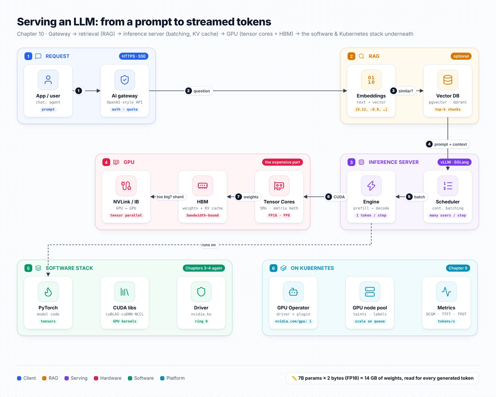

# Chapter 10 — AI infrastructure

!!! abstract "In one sentence"
    An LLM is a huge file of **weights** plus code that does **matrix multiplications**. Serving it means: take a prompt,
    optionally add relevant documents (**RAG**), process the prompt in one big parallel step (**prefill**), then generate
    the answer **one token at a time** (**decode**), each step reading all the weights and a growing **KV cache** from the
    GPU's **HBM** memory. An **inference server** batches many users together to keep the very expensive GPU busy.
    Everything from Chapters 1–9 is still underneath.

## 📖 Key terms & abbreviations

| Term | Stands for | What it is | How it works (one line) |
|---|---|---|---|
| **LLM** | Large Language Model | Neural network that generates text | Predicts the next token, appends it, repeats |
| **GPU** | Graphics Processing Unit | Massively parallel processor | Thousands of lanes + Tensor Cores doing matrix math |
| **HBM** | High Bandwidth Memory | The GPU's own memory | Holds weights and KV cache, read at TB/s |
| **Prefill / decode** | — | The two phases of generation | Whole prompt at once / one token per step |
| **KV cache** | Key-Value cache | Saved attention state of past tokens | Avoids recomputation, grows with context × users |
| **TTFT / TPOT** | Time To First Token / Time Per Output Token | Latency metrics | Queue + prefill / one decode step |
| **RAG** | Retrieval-Augmented Generation | Answering with your documents | Embed → vector search → put chunks in the prompt |
| **CUDA / NCCL** | Compute Unified Device Architecture / NVIDIA Collective Communications Library | GPU programming platform / multi-GPU communication | Kernels on the GPU / all-reduce over NVLink & IB |

> The full A–Z list is in the [📖 AI glossary](glossary.md).

## 🧭 Go deeper

| Page | What you'll learn |
|---|---|
| [10.1 AI fundamentals](01-fundamentals.md) | What an LLM is, tokens, embeddings, attention, MoE, the model lifecycle |
| [10.2 GPU hardware](02-gpu.md) | Inside a GPU, HBM and the roofline, number formats, NVLink, scale-up vs scale-out |
| [10.3 Software stack](03-software.md) | CUDA, cuBLAS/cuDNN/NCCL, drivers, containers, MIG/MPS, DCGM |
| [10.4 Distributed training](04-training.md) | Parallelism, all-reduce, clusters, checkpoints, gang scheduling |
| [10.5 Inference & serving](05-inference.md) | KV cache paging, continuous batching, quantization, speculative decoding, P/D disaggregation |
| [10.6 AI platform on Kubernetes](06-kubernetes.md) | GPU Operator, DRA, Kueue, JobSet/LWS, inference gateway, autoscaling, cost |
| [10.7 Applications](07-applications.md) | RAG, vector DBs, agents, MCP, AI gateways, guardrails, evals |

## 🗺️ Big picture



---

## 1 · Why GPUs?

| | CPU (Chapter 2) | GPU |
|---|---|---|
| Cores | Tens of big, smart cores (branch prediction, out-of-order) | Thousands of small, simple lanes grouped in **SMs** (streaming multiprocessors) |
| Good at | Complex, branchy, sequential logic | The **same math on huge arrays** in parallel |
| Special units | Vector instructions (AVX) | **Tensor Cores**: dedicated matrix-multiply units for FP16/BF16/FP8 |
| Memory | DDR RAM, ~100 GB/s range | **HBM** stacked on the package, several TB/s |

A transformer layer is mostly big matrix multiplications, which is exactly what a GPU is built for.

## 2 · What happens to one prompt

```text
"Why is the sky blue?" → tokenizer → [10445, 374, 279, 13180, 6437, 30] → embeddings
→ N transformer layers (attention + MLP) → probabilities for the next token → sample "The"
→ append, run again → "sky" → … until <end> or max tokens
```

| Phase | What it does | Bottleneck | User-visible metric |
|---|---|---|---|
| **Prefill** | Processes **all prompt tokens at once**, in parallel | **Compute** (tensor cores) | **TTFT**: time to first token |
| **Decode** | Generates **one token per step**, each step depending on the previous one | **Memory bandwidth**: all weights are read for every step | **TPOT / ITL**: time per output token |

Tokens are **streamed** back to the client as they're generated (Server-Sent Events over HTTP, Chapter 6).

## 3 · The memory math

The first question for any model: **does it fit?**

```text
weights ≈ parameters × bytes per parameter
  FP16/BF16 = 2 bytes · FP8/INT8 = 1 byte · INT4 = 0.5 bytes

  7B  × 2 B =  ~14 GB   → fits one 24 GB GPU
  70B × 2 B = ~140 GB   → does NOT fit one 80 GB GPU → quantize (FP8 ≈ 70 GB, INT4 ≈ 35 GB) or split across GPUs
```

On top of the weights comes the **KV cache**: for every token in every active request, each layer stores its attention **keys and values** so they don't have to be recomputed. It grows with **context length × number of concurrent requests** and is usually what limits how many users one GPU can serve.

> Chapter 3 connection: **vLLM's PagedAttention** manages the KV cache in fixed-size **blocks**, like the OS manages memory in pages. That avoids fragmentation and lets many more requests share the GPU.

## 4 · The inference server

| Feature | Why |
|---|---|
| **Continuous batching** | Instead of waiting for a whole batch to finish, new requests join and finished ones leave at every decode step. GPU utilization goes way up. |
| **KV cache management** | Paging, prefix caching (reuse the cache for a shared system prompt), eviction. |
| **Quantization** | FP8/INT4 weights: less memory, more bandwidth per token, small quality cost. |
| **Parallelism** | **Tensor parallel**: split each layer across GPUs in one node (needs fast **NVLink**). **Pipeline parallel**: different layers on different GPUs/nodes. Across nodes you need **InfiniBand/RoCE**. |
| **OpenAI-compatible API** | `/v1/chat/completions`, so clients and gateways work unchanged. |

Common engines: **vLLM**, **SGLang**, **TensorRT-LLM**, plus **Triton Inference Server** for general models. **Ollama / llama.cpp** for laptops and CPUs.

## 5 · The software stack: Chapters 3–4 again

```text
Your app → inference engine (Python) → PyTorch → CUDA libraries (cuBLAS, cuDNN, NCCL)
        → CUDA runtime (user space .so) → ioctl() syscalls → nvidia.ko kernel driver (ring 0) → GPU
```

- **CUDA kernels** are small programs that run on thousands of GPU lanes at once. Libraries ship heavily optimized ones (matrix multiply, attention).
- **NCCL** handles GPU-to-GPU communication (all-reduce, all-gather) over NVLink or the network.
- The user-space CUDA libraries and the kernel driver must be **version-compatible**. That's a classic source of "works on one node, not the other".

## 6 · RAG: giving the model your documents

| Step | When | What |
|---|---|---|
| **Index** | Offline | Split documents into chunks → an **embedding model** turns each chunk into a vector → store in a **vector DB** (pgvector, Qdrant, Milvus…) with an ANN index (e.g. HNSW). |
| **Retrieve** | Per request | Embed the question → find the **top-k most similar chunks** (cosine similarity). |
| **Generate** | Per request | Put those chunks into the prompt as context → the LLM answers using them. |

## 7 · On Kubernetes (Chapter 9)

| Piece | Job |
|---|---|
| **NVIDIA GPU Operator** | Installs and manages the driver, container toolkit, **device plugin** and **DCGM exporter** on GPU nodes. |
| **Device plugin** | Advertises `nvidia.com/gpu` as a schedulable resource. Pods request it: `resources.limits: nvidia.com/gpu: 1`. |
| **GPU node pools** | Separate, **tainted** nodes so only GPU workloads land there. |
| **Sharing** | **MIG** (hardware partitions on supported GPUs) or time-slicing for small models. |
| **Autoscaling** | Scale on **queue length, KV cache usage or tokens/s**, not CPU. Model loading (tens of GB) makes cold starts slow, so cache weights on the node. |

**Metrics that matter:** TTFT, TPOT, tokens/s, request queue length, KV cache utilization, GPU utilization and memory (DCGM), and **cost per million tokens**.

## 8 · Training vs inference (briefly)

Training also stores **gradients and optimizer states** (several times the weight memory), runs on many GPUs at once (data/tensor/pipeline parallel), synchronizes with **NCCL all-reduce** over very fast networks, and writes large **checkpoints** to storage. Inference is the part most platform teams operate day to day.

---

## 🧪 Try it yourself

!!! example "🧪 Ready-made lab"
    Run this chapter's experiments with one command: `./labs/run.sh 10-ai` ([scripts](https://github.com/gaskinimbuspro/silicon-to-cloud/tree/main/labs/10-ai/)). No setup? [Open in Codespaces](https://codespaces.new/gaskinimbuspro/silicon-to-cloud). <!-- s2c-lab -->


```bash
# 1) No GPU needed: run a small model locally (Ollama)
ollama run llama3.2:1b "Explain the KV cache in one sentence"
curl -s http://localhost:11434/v1/chat/completions -H 'Content-Type: application/json' \
  -d '{"model":"llama3.2:1b","messages":[{"role":"user","content":"Hello"}],"stream":false}'

# 2) With an NVIDIA GPU: look at it, then serve a model with vLLM
nvidia-smi                                   # GPUs, memory, utilization, driver/CUDA version
pip install vllm
vllm serve Qwen/Qwen2.5-0.5B-Instruct        # OpenAI-compatible server on :8000
curl -s localhost:8000/v1/chat/completions -H 'Content-Type: application/json' \
  -d '{"model":"Qwen/Qwen2.5-0.5B-Instruct","messages":[{"role":"user","content":"Hi"}]}'

# 3) The memory math in Python
python3 -c "
for p in (7, 13, 70):
    print(f'{p}B: FP16 {p*2} GB · FP8 {p} GB · INT4 {p/2:.0f} GB')"
```

**Exercise:** in the vLLM logs, find how much GPU memory went to the **weights** and how many **KV cache blocks** it could allocate with the rest. Send 20 requests in parallel and watch throughput (tokens/s) vs. latency per request.

---

## 🃏 Cheat sheet

```text
Prompt → tokens → PREFILL (all at once, compute-bound → TTFT)
       → DECODE (1 token/step, reads all weights, bandwidth-bound → TPOT) → stream tokens (SSE)
Memory: weights (params × bytes) + KV cache (context × concurrency) must fit in HBM
Too big? quantize (FP8/INT4) or shard (tensor parallel over NVLink, nodes over InfiniBand)
Server: continuous batching · PagedAttention (KV in pages) · prefix caching · OpenAI API
Stack: app → engine → PyTorch → cuBLAS/cuDNN/NCCL → CUDA runtime → nvidia.ko → GPU
RAG: chunk → embed → vector DB → top-k → into the prompt
K8s: GPU Operator · nvidia.com/gpu · tainted GPU pools · scale on queue/KV, not CPU
```

---

## ❓ Test yourself

??? question "1. Why is decoding usually limited by memory bandwidth rather than compute?"
    Each decode step produces one token per request, but it still has to read all model weights (and the KV cache) from HBM. There's little math per byte read, so the GPU waits for memory. Batching many requests together reuses each weight read for more tokens.

??? question "2. Can a 70B model in FP16 run on a single 80 GB GPU?"
    No. The weights alone are ~140 GB. Options: quantize (FP8 ≈ 70 GB, still tight with KV cache; INT4 ≈ 35 GB) or split the model across several GPUs with tensor parallelism.

??? question "3. What is the KV cache, and why does it limit concurrency?"
    It stores the attention keys and values of all previous tokens of each active request so they aren't recomputed every step. It grows with context length and the number of concurrent requests, and it has to fit in GPU memory next to the weights.

??? question "4. Why scale an LLM service on queue length or KV cache usage instead of CPU?"
    The work happens on the GPU. CPU usage stays low even when the GPU is saturated and requests are queuing, so CPU-based autoscaling would never react.

??? question "5. In RAG, what does the embedding model do, and what does the vector DB do?"
    The embedding model turns text (chunks and questions) into vectors that capture meaning. The vector DB stores the chunk vectors and quickly finds the ones closest to the question's vector, which are then added to the prompt.

---

## 📚 Sources

- [vLLM docs](https://docs.vllm.ai/) · [PagedAttention paper (Kwon et al., 2023)](https://arxiv.org/abs/2309.06180)
- [NVIDIA CUDA C++ Programming Guide](https://docs.nvidia.com/cuda/cuda-programming-guide/)
- [NVIDIA GPU Operator docs](https://docs.nvidia.com/datacenter/cloud-native/gpu-operator/latest/index.html)
- [Hugging Face: LLM inference optimization](https://huggingface.co/docs/transformers/main/en/llm_optims)
- [The Illustrated Transformer (Jay Alammar)](https://jalammar.github.io/illustrated-transformer/)

## ✍️ My notes

> Explain prefill vs decode, and why the KV cache matters, in your own words in 5 lines.

-
