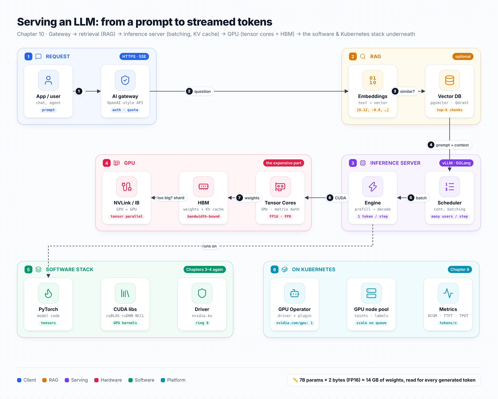

# Bölüm 10 — AI altyapısı

!!! abstract "Tek cümlede"
    Bir LLM, devasa bir **ağırlık (weights)** dosyası ve **matris çarpımları** yapan bir koddan ibarettir. Onu servis etmek şu demektir:
    bir prompt al, istersen ilgili dokümanları ekle (**RAG**), prompt'u tek büyük bir paralel adımda işle (**prefill**), sonra cevabı
    **her seferinde bir token** olarak üret (**decode**). Her adımda tüm ağırlıklar ve büyüyen bir **KV cache**, GPU'nun **HBM**
    belleğinden okunur. Bir **inference sunucusu**, çok pahalı GPU'yu meşgul tutmak için birçok kullanıcıyı bir araya toplar (batch).
    Bölüm 1–9'daki her şey hâlâ altta çalışıyor.



---

## 1 · Neden GPU?

| | CPU (Bölüm 2) | GPU |
|---|---|---|
| Çekirdekler | Onlarca büyük, akıllı çekirdek (dallanma tahmini, sırasız çalıştırma) | **SM**'ler (streaming multiprocessor) halinde gruplanmış binlerce küçük, basit şerit |
| İyi olduğu iş | Karmaşık, dallanmalı, sıralı mantık | Devasa diziler üzerinde **aynı hesabı** paralel yapmak |
| Özel birimler | Vektör komutları (AVX) | **Tensor Core**'lar: FP16/BF16/FP8 için ayrılmış matris çarpım birimleri |
| Bellek | DDR RAM, ~100 GB/sn civarı | Paketin üstüne istiflenmiş **HBM**, birkaç TB/sn |

Bir transformer katmanı çoğunlukla büyük matris çarpımlarından oluşur. GPU tam olarak bunun için yapılmıştır.

## 2 · Tek bir prompt'a ne olur

```text
"Gökyüzü neden mavi?" → tokenizer → [token id'leri] → embedding'ler
→ N transformer katmanı (attention + MLP) → sıradaki token için olasılıklar → "Çünkü" seçilir
→ sona ekle, tekrar çalıştır → "güneş" → … <son> token'ına ya da azami token sayısına kadar
```

| Aşama | Ne yapar | Darboğaz | Kullanıcının gördüğü metrik |
|---|---|---|---|
| **Prefill** | **Tüm prompt token'larını aynı anda**, paralel işler | **Hesaplama** (tensor core'lar) | **TTFT**: ilk token'a kadar geçen süre |
| **Decode** | **Her adımda bir token** üretir, her adım bir öncekine bağlıdır | **Bellek bant genişliği**: her adımda tüm ağırlıklar okunur | **TPOT / ITL**: çıktı token'ı başına süre |

Token'lar üretildikçe istemciye **akış halinde** gönderilir (HTTP üzerinden Server-Sent Events, Bölüm 6).

## 3 · Bellek hesabı

Her model için ilk soru: **sığar mı?**

```text
ağırlıklar ≈ parametre sayısı × parametre başına byte
  FP16/BF16 = 2 byte · FP8/INT8 = 1 byte · INT4 = 0,5 byte

  7B  × 2 B =  ~14 GB   → tek bir 24 GB GPU'ya sığar
  70B × 2 B = ~140 GB   → tek bir 80 GB GPU'ya SIĞMAZ → quantize et (FP8 ≈ 70 GB, INT4 ≈ 35 GB) ya da GPU'lara böl
```

Ağırlıkların üstüne bir de **KV cache** gelir: her aktif istekteki her token için, her katman attention **key ve value**'larını saklar ki tekrar hesaplanmasın. **Bağlam uzunluğu × eşzamanlı istek sayısı** ile büyür ve genelde tek bir GPU'nun kaç kullanıcıya hizmet verebileceğini sınırlayan şey budur.

> Bölüm 3 bağlantısı: **vLLM'in PagedAttention**'ı KV cache'i, işletim sisteminin belleği sayfalar halinde yönettiği gibi sabit boyutlu **bloklar** halinde yönetir. Bu, parçalanmayı önler ve GPU'yu çok daha fazla isteğin paylaşmasını sağlar.

## 4 · Inference sunucusu

| Özellik | Neden |
|---|---|
| **Sürekli batching (continuous batching)** | Tüm bir batch'in bitmesini beklemek yerine, her decode adımında yeni istekler katılır, bitenler ayrılır. GPU kullanımı ciddi şekilde artar. |
| **KV cache yönetimi** | Sayfalama, önek önbellekleme (ortak bir sistem prompt'u için cache'i yeniden kullanmak), tahliye. |
| **Quantization** | FP8/INT4 ağırlıklar: daha az bellek, token başına daha fazla bant genişliği, küçük bir kalite kaybı. |
| **Paralellik** | **Tensor parallel**: her katmanı bir node içindeki GPU'lara böl (hızlı **NVLink** gerekir). **Pipeline parallel**: farklı katmanları farklı GPU/node'lara koy. Node'lar arasında **InfiniBand/RoCE** gerekir. |
| **OpenAI uyumlu API** | `/v1/chat/completions`, böylece istemciler ve gateway'ler değişmeden çalışır. |

Yaygın motorlar: **vLLM**, **SGLang**, **TensorRT-LLM**, genel modeller için de **Triton Inference Server**. Laptoplar ve CPU'lar için **Ollama / llama.cpp**.

## 5 · Yazılım yığını: yine Bölüm 3–4

```text
Uygulaman → inference motoru (Python) → PyTorch → CUDA kütüphaneleri (cuBLAS, cuDNN, NCCL)
        → CUDA runtime (user space .so) → ioctl() syscall'ları → nvidia.ko kernel sürücüsü (ring 0) → GPU
```

- **CUDA kernel'leri**, binlerce GPU şeridinde aynı anda çalışan küçük programlardır. Kütüphaneler bunların çok iyi optimize edilmiş hallerini getirir (matris çarpımı, attention).
- **NCCL**, NVLink ya da ağ üzerinden GPU'dan GPU'ya iletişimi yönetir (all-reduce, all-gather).
- User space CUDA kütüphaneleri ile kernel sürücüsünün **versiyonları uyumlu** olmalıdır. "Bir node'da çalışıyor, diğerinde çalışmıyor" sorununun klasik kaynağı budur.

## 6 · RAG: modele kendi dokümanlarını vermek

| Adım | Ne zaman | Ne |
|---|---|---|
| **İndeksle** | Önceden (offline) | Dokümanları parçalara böl → bir **embedding modeli** her parçayı bir vektöre çevirir → bir ANN indeksiyle (ör. HNSW) bir **vector DB**'de sakla (pgvector, Qdrant, Milvus…). |
| **Getir (retrieve)** | Her istekte | Soruyu embed et → **en benzer k parçayı** bul (kosinüs benzerliği). |
| **Üret (generate)** | Her istekte | O parçaları bağlam olarak prompt'a koy → LLM onları kullanarak cevap verir. |

## 7 · Kubernetes üzerinde (Bölüm 9)

| Parça | Görevi |
|---|---|
| **NVIDIA GPU Operator** | GPU node'larında sürücüyü, container toolkit'i, **device plugin**'i ve **DCGM exporter**'ı kurar ve yönetir. |
| **Device plugin** | `nvidia.com/gpu`'yu zamanlanabilir bir kaynak olarak ilan eder. Pod'lar bunu ister: `resources.limits: nvidia.com/gpu: 1`. |
| **GPU node havuzları** | Ayrı, **taint**'li node'lar. Oraya sadece GPU iş yükleri yerleşir. |
| **Paylaşım** | **MIG** (desteklenen GPU'larda donanım bölümleri) ya da küçük modeller için zaman dilimleme (time-slicing). |
| **Otomatik ölçekleme** | CPU'ya göre değil, **kuyruk uzunluğu, KV cache kullanımı ya da token/sn**'ye göre ölçekle. Model yükleme (onlarca GB) soğuk başlangıçları yavaşlatır, bu yüzden ağırlıkları node'da önbellekle. |

**Önemli metrikler:** TTFT, TPOT, token/sn, istek kuyruğu uzunluğu, KV cache kullanımı, GPU kullanımı ve belleği (DCGM) ve **milyon token başına maliyet**.

## 8 · Eğitim ve inference (kısaca)

Eğitim ayrıca **gradyanları ve optimizer durumlarını** saklar (ağırlık belleğinin birkaç katı), aynı anda çok sayıda GPU'da çalışır (veri/tensor/pipeline paralel), çok hızlı ağlar üzerinden **NCCL all-reduce** ile senkronize olur ve depolamaya büyük **checkpoint**'ler yazar. Platform ekiplerinin günlük olarak işlettiği kısım çoğunlukla inference'tır.

---

## 🧪 Kendin dene

```bash
# 1) GPU gerekmez: küçük bir modeli yerelde çalıştır (Ollama)
ollama run llama3.2:1b "KV cache'i tek cümlede açıkla"
curl -s http://localhost:11434/v1/chat/completions -H 'Content-Type: application/json' \
  -d '{"model":"llama3.2:1b","messages":[{"role":"user","content":"Merhaba"}],"stream":false}'

# 2) NVIDIA GPU varsa: ona bak, sonra vLLM ile bir model servis et
nvidia-smi                                   # GPU'lar, bellek, kullanım, sürücü/CUDA versiyonu
pip install vllm
vllm serve Qwen/Qwen2.5-0.5B-Instruct        # :8000'de OpenAI uyumlu sunucu
curl -s localhost:8000/v1/chat/completions -H 'Content-Type: application/json' \
  -d '{"model":"Qwen/Qwen2.5-0.5B-Instruct","messages":[{"role":"user","content":"Selam"}]}'

# 3) Python'da bellek hesabı
python3 -c "
for p in (7, 13, 70):
    print(f'{p}B: FP16 {p*2} GB · FP8 {p} GB · INT4 {p/2:.0f} GB')"
```

**Görev:** vLLM loglarında GPU belleğinin ne kadarının **ağırlıklara** gittiğini ve kalanla kaç **KV cache bloğu** ayırabildiğini bul. Paralel 20 istek gönder ve verimi (token/sn) istek başına gecikmeyle karşılaştır.

---

## 🃏 Hatırlatma kartı

```text
Prompt → token'lar → PREFILL (hepsi birden, hesaplama sınırlı → TTFT)
       → DECODE (adımda 1 token, tüm ağırlıkları okur, bant genişliği sınırlı → TPOT) → token akışı (SSE)
Bellek: ağırlıklar (parametre × byte) + KV cache (bağlam × eşzamanlılık) HBM'e sığmalı
Çok mu büyük? quantize et (FP8/INT4) ya da böl (NVLink üzerinde tensor parallel, node'lar arası InfiniBand)
Sunucu: sürekli batching · PagedAttention (KV sayfalarda) · önek önbellekleme · OpenAI API
Yığın: uygulama → motor → PyTorch → cuBLAS/cuDNN/NCCL → CUDA runtime → nvidia.ko → GPU
RAG: parçala → embed et → vector DB → en yakın k → prompt'a ekle
K8s: GPU Operator · nvidia.com/gpu · taint'li GPU havuzları · CPU'ya değil kuyruğa/KV'ye göre ölçekle
```

---

## ❓ Kendini test et

??? question "1. Decode neden genelde hesaplamayla değil de bellek bant genişliğiyle sınırlıdır?"
    Her decode adımı istek başına tek bir token üretir, ama yine de tüm model ağırlıklarını (ve KV cache'i) HBM'den okumak zorundadır. Okunan byte başına az hesap düşer, bu yüzden GPU belleği bekler. Birçok isteği bir araya toplamak (batching), her ağırlık okumasını daha fazla token için kullandırır.

??? question "2. FP16'daki 70B'lik bir model tek bir 80 GB GPU'da çalışabilir mi?"
    Hayır. Sadece ağırlıklar ~140 GB. Seçenekler: quantize etmek (FP8 ≈ 70 GB, KV cache ile hâlâ sıkışık; INT4 ≈ 35 GB) ya da modeli tensor parallelism ile birkaç GPU'ya bölmek.

??? question "3. KV cache nedir ve eşzamanlılığı neden sınırlar?"
    Her aktif isteğin önceki tüm token'larının attention key ve value'larını saklar ki her adımda yeniden hesaplanmasınlar. Bağlam uzunluğu ve eşzamanlı istek sayısıyla büyür ve ağırlıkların yanında GPU belleğine sığmak zorundadır.

??? question "4. Bir LLM servisi neden CPU'ya göre değil de kuyruk uzunluğu ya da KV cache kullanımına göre ölçeklenir?"
    İş GPU'da yapılır. GPU doyduğunda ve istekler kuyrukta beklerken bile CPU kullanımı düşük kalır. CPU tabanlı otomatik ölçekleme hiç tepki vermezdi.

??? question "5. RAG'de embedding modeli ne yapar, vector DB ne yapar?"
    Embedding modeli metni (parçaları ve soruları) anlamı yakalayan vektörlere çevirir. Vector DB parça vektörlerini saklar ve sorunun vektörüne en yakın olanları hızlıca bulur. Bunlar sonra prompt'a eklenir.

---

## 📚 Kaynaklar

- [vLLM dokümanları](https://docs.vllm.ai/) · [PagedAttention makalesi (Kwon vd., 2023)](https://arxiv.org/abs/2309.06180)
- [NVIDIA CUDA C++ Programming Guide](https://docs.nvidia.com/cuda/cuda-c-programming-guide/)
- [NVIDIA GPU Operator dokümanları](https://docs.nvidia.com/datacenter/cloud-native/gpu-operator/latest/index.html)
- [Hugging Face: LLM inference optimizasyonu](https://huggingface.co/docs/transformers/main/en/llm_optims)
- [The Illustrated Transformer (Jay Alammar)](https://jalammar.github.io/illustrated-transformer/)

## ✍️ Kendi notlarım

> Prefill ile decode arasındaki farkı ve KV cache'in neden önemli olduğunu kendi cümlelerinle 5 satırda anlat.

-
