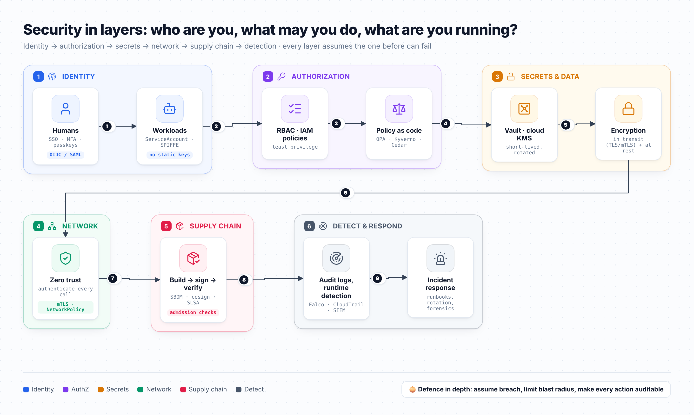
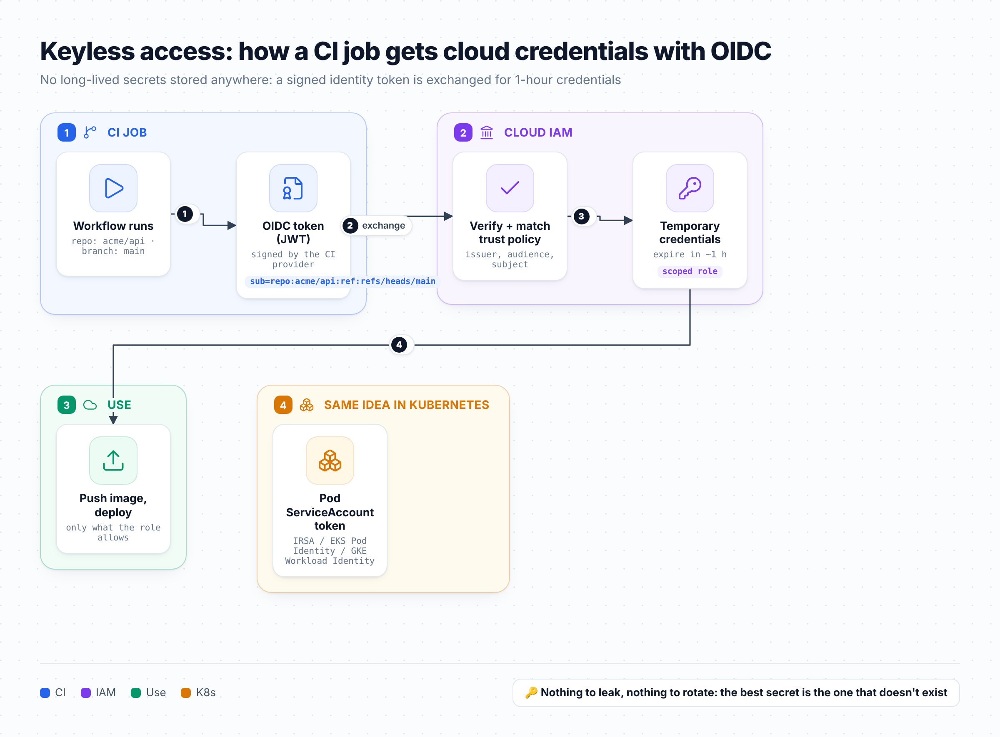
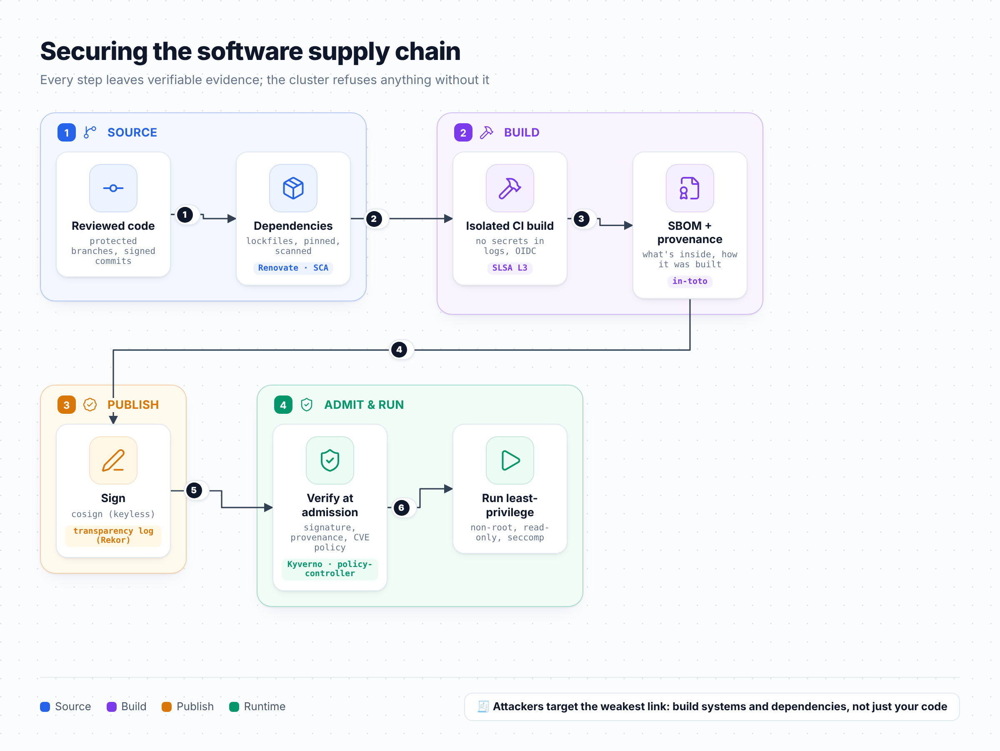

# Chapter 11 — Security: identity, secrets, zero trust & supply chain

!!! abstract "In short"
    Modern security is not one wall around the network but **layers**. Every human and workload proves **who** it is
    (**authentication**) and gets only the permissions it needs (**authorization**, least privilege). It uses
    **short-lived credentials** instead of stored secrets and talks only over **authenticated, encrypted** connections
    (**zero trust**). It runs only **verified** software (**supply chain**) and leaves an **audit trail**, so you can
    detect and respond when, not if, something goes wrong.

## 📖 Key terms & abbreviations

| Term | Stands for | What it is | How it works (one line) |
|---|---|---|---|
| **AuthN / AuthZ** | Authentication / Authorization | Who are you? / What may you do? | Login, tokens / roles, policies |
| **IAM** | Identity and Access Management | Cloud system of identities and permissions | Policies attached to users, roles, service accounts |
| **SSO / MFA** | Single Sign-On / Multi-Factor Authentication | One login for many apps / more than a password | IdP + second factor (passkey, TOTP) |
| **IdP** | Identity Provider | Service that authenticates users | Entra ID, Okta, Google, Keycloak |
| **OIDC** | OpenID Connect | Identity layer on OAuth 2.0 | Signed ID tokens (JWTs) |
| **JWT** | JSON Web Token | Signed claims (`sub`, `aud`, `exp`) | Verified with the issuer's public key |
| **RBAC** | Role-Based Access Control | Permissions grouped into roles | Kubernetes Role/RoleBinding, cloud roles |
| **Least privilege** | — | Only the permissions actually needed | Limits blast radius |
| **Workload identity** | — | Identity for software, not humans | Federated tokens instead of static keys |
| **KMS / HSM** | Key Management Service / Hardware Security Module | Managed encryption keys | Envelope encryption, keys never leave |
| **Zero trust** | — | Never trust the network location | Authenticate and authorize every request |
| **mTLS** | mutual TLS | Both sides present certificates | Service identity + encryption (6.4) |
| **SPIFFE** | Secure Production Identity Framework For Everyone | Standard workload identity (`spiffe://…`) | SPIRE issues short-lived SVIDs |
| **SBOM / SLSA** | Software Bill of Materials / Supply-chain Levels for Software Artifacts | Ingredient list / build-integrity framework | Generated and attested in CI |
| **CVE / CVSS** | Common Vulnerabilities and Exposures / Common Vulnerability Scoring System | Vulnerability IDs / severity scores | Scanners match packages against CVEs |
| **SIEM** | Security Information and Event Management | Central security log analysis | Correlates audit logs, alerts |

## 🗺️ Big picture



---

## 1 · Identity: who are you?

### How does it work?

- **Humans** log in once at an **IdP** (SSO) with **MFA**, ideally phishing-resistant **passkeys/FIDO2**. Apps trust the IdP via **OIDC** or SAML; they receive a signed token instead of handling passwords.
- **Workloads** (pods, CI jobs, functions) also need identities. The old way — an API key in an environment variable — leaks into logs, images and git. The modern way is **workload identity federation**:



1. The platform (GitHub Actions, Kubernetes, a cloud VM) issues the workload a **signed OIDC token** describing *exactly* who it is (`repo:acme/api:ref:refs/heads/main`, or `system:serviceaccount:shop:api`).
2. The cloud's security token service verifies the signature and checks a **trust policy** (issuer, audience, subject).
3. It returns **temporary credentials** (~1 hour) for one narrowly scoped role. Nothing long-lived exists to steal.

## 2 · Authorization: what may you do?

- **RBAC**: permissions → roles → bindings to identities. In Kubernetes: `Role`/`ClusterRole` + `RoleBinding`. Avoid `cluster-admin` for humans and CI; never `*` verbs on `*` resources.
- **Cloud IAM**: policies on roles; prefer managed, scoped roles per service; use **permission boundaries / SCPs / org policies** as guardrails nobody can exceed.
- **Policy as code** (OPA/Gatekeeper, Kyverno, Cedar): rules like "no privileged pods", "images only from our registry", "every namespace has a NetworkPolicy", enforced at admission and tested in CI.
- **Just-in-time access**: elevated rights for an hour with approval, instead of standing admin rights.

## 3 · Secrets

| Approach | Risk | Better |
|---|---|---|
| Secrets in git or images | Leaked forever (history, layers) | Never; scan with gitleaks/trufflehog in CI |
| Kubernetes `Secret` (base64) | Readable by anyone with `get secrets`; etcd plaintext unless encrypted | Enable etcd encryption at rest (KMS provider), tight RBAC |
| External secret store | — | **Vault**, AWS Secrets Manager, GCP Secret Manager, Azure Key Vault + **External Secrets Operator** or CSI driver |
| Static long-lived keys | Leak = full access until noticed | **Workload identity** (no secret at all), or dynamic secrets (Vault issues per-pod DB users that expire) |

**Encrypt** in transit (TLS/mTLS everywhere) and at rest (disk, object storage, DB, backups) with keys in a **KMS**; rotate keys and certificates automatically (6.4).

## 4 · Zero trust networking

The old model trusted everything "inside" the firewall; one compromised laptop or pod could reach everything. **Zero trust**: every request is authenticated and authorized based on **identity**, not IP address.

- **Service-to-service**: mTLS with workload identities (service mesh, SPIFFE/SPIRE), plus authorization policies ("only `orders` may call `payments` `POST /charge`").
- **Network segmentation** still helps: default-deny NetworkPolicies (9.3), private subnets, no public databases, egress allow-lists.
- **Humans to internal tools**: identity-aware proxies (BeyondCorp-style, Cloudflare Access, Tailscale) instead of a flat VPN.

## 5 · Hardening Kubernetes

- **Pod Security Standards** `restricted`: non-root, no privilege escalation, drop all capabilities, seccomp `RuntimeDefault`, read-only root filesystem (3.5).
- **API server**: private endpoint, OIDC login for humans, audit logging on, no anonymous auth.
- **Nodes**: minimal OS (Bottlerocket, Talos, COS), automatic patching, no SSH by default.
- **etcd**: encrypted secrets, backups encrypted, access only from the API server.
- **Multi-tenancy**: namespaces + RBAC + NetworkPolicies + quotas; strong isolation (gVisor/Kata) for untrusted code.

## 6 · Supply chain security



Attackers increasingly target **how software is built** rather than the running app: compromised dependencies (typosquatting, malicious updates), stolen CI tokens, tampered build servers. Defences:

1. **Source**: branch protection, required reviews, signed commits, pinned dependencies with lockfiles, automated updates (Renovate/Dependabot) with review.
2. **Build**: ephemeral, isolated CI runners; OIDC instead of stored cloud keys; pin third-party CI actions by commit SHA.
3. **Evidence**: generate an **SBOM** and **provenance** (who built what, from which commit, how) — **SLSA** levels describe how trustworthy this is.
4. **Sign** images (Sigstore **cosign**, keyless with OIDC) and record signatures in a transparency log.
5. **Verify at admission**: only signed images from your pipeline, with no critical CVEs, may run.

## 7 · Detect and respond

Prevention fails eventually. You need:

- **Audit logs** everywhere (cloud control plane like CloudTrail, Kubernetes audit, IdP sign-ins) shipped to a **SIEM** you can query.
- **Runtime detection** (Falco, Tetragon, cloud threat detection): shell in a container, unexpected outbound connections, crypto miners, reading `/etc/shadow`.
- **Incident response runbooks**: how to revoke credentials, rotate secrets, isolate a node, preserve evidence, communicate.

## 🔧 DevOps connection

- **The CI system is a production system**: it holds the keys to deploy everything. Least privilege for runners, OIDC to clouds, protected environments with approvals.
- **Security in the pipeline, not after it**: secret scanning, SCA (dependency scanning), IaC scanning (Checkov, tfsec, kube-linter), image scanning — fail on criticals, report the rest.
- **Patch cadence** matters more than perfect configuration: automated base-image rebuilds and node upgrades.
- **Make the secure way the easy way**: golden templates, Helm charts and Terraform modules with good defaults.

## 🚨 Incident story: the leaked access key

!!! failure "The alarm"
    On a Sunday night the cloud bill alert fires: **400 GPU instances** are running in a region you never use, mining cryptocurrency.

Try to diagnose it yourself first, then open the clues one by one.

??? info "🔍 Clue 1"
    CloudTrail shows all `RunInstances` calls signed by the access key of an old CI user, `ci-deployer`, from IP addresses you don't own.

??? info "🔍 Clue 2"
    A GitHub search finds the key in a public fork of an internal repo: a developer committed a `.env` file two years ago; the key was never rotated and has `AdministratorAccess`.

??? success "🎯 Root cause"
    A long-lived, over-privileged static credential lived in git history. Bots scan public repositories for keys within minutes of publication.

??? tip "🛠️ Fix and lesson"
    Disable the key, terminate the instances, review CloudTrail for persistence (new users, roles, keys), then remove static keys entirely: **OIDC federation** for CI, workload identity for pods, secret scanning (push protection) on every repo, and budgets/quotas per region. **Lesson:** the best secret is the one that doesn't exist; the second best expires in an hour.

## 🧪 Try it yourself

```bash
# Who am I and what can I do in Kubernetes?
kubectl auth whoami 2>/dev/null; kubectl auth can-i --list | head -20
kubectl auth can-i get secrets --all-namespaces --as=system:serviceaccount:default:default

# Decode a JWT (header + claims) — never paste production tokens into websites
TOKEN=$(kubectl create token default 2>/dev/null) && echo "$TOKEN" | cut -d. -f2 | tr '_-' '/+' | base64 -d 2>/dev/null; echo

# Find secrets in a repo's history
docker run --rm -v "$PWD:/repo" zricethezav/gitleaks:latest detect -s /repo --no-banner | tail -5

# Scan an image and generate an SBOM
docker run --rm aquasec/trivy:latest image --severity CRITICAL,HIGH nginx:latest | tail -15
docker run --rm anchore/syft:latest alpine:3.20 | head -10

# Verify a signed image (keyless)
cosign verify ghcr.io/sigstore/cosign/cosign:latest \
  --certificate-identity-regexp '.*' --certificate-oidc-issuer-regexp '.*' 2>/dev/null | head -c 300; echo
```

## 🃏 Cheat sheet

| Risk | Control |
|---|---|
| Stolen passwords | SSO + phishing-resistant MFA (passkeys) |
| Leaked keys | No static keys: OIDC federation, workload identity, short TTLs |
| Over-privilege | Least-privilege roles, JIT access, guardrail policies |
| Lateral movement | Zero trust: mTLS + authz policies, default-deny NetworkPolicies |
| Container escape | Pod Security `restricted`, no privileged, user namespaces |
| Malicious dependency/image | Lockfiles, SCA, SBOM, signatures verified at admission |
| Undetected breach | Audit logs → SIEM, runtime detection, IR runbooks |

## ❓ Test yourself

??? question "1. What's the difference between authentication and authorization?"
    Authentication proves who you are (login, token, certificate); authorization decides what that identity may do (roles, policies).

??? question "2. Why is OIDC federation from CI to the cloud safer than storing an access key as a CI secret?"
    There's no long-lived secret to leak: each job gets a signed token describing exactly which repo/branch it is, exchanged for credentials that expire in about an hour and only for a scoped role.

??? question "3. Are Kubernetes Secrets encrypted?"
    Only base64-encoded by default; anyone with RBAC `get secrets` can read them, and etcd stores them in plain text unless encryption at rest is configured.

??? question "4. What does 'zero trust' change compared to a classic perimeter network?"
    Being inside the network grants nothing: every request is authenticated and authorized by identity, typically with mTLS and policies, so one compromised host can't reach everything.

??? question "5. What does an SBOM help you answer during a new critical CVE?"
    Which of your images and services contain the affected package and version, so you know what to patch within minutes instead of days.

---

## 📚 Sources

- [NIST SP 800-207 — Zero Trust Architecture](https://csrc.nist.gov/pubs/sp/800/207/final)
- [Kubernetes — Security overview](https://kubernetes.io/docs/concepts/security/) · [Pod Security Standards](https://kubernetes.io/docs/concepts/security/pod-security-standards/)
- [GitHub — Security hardening with OpenID Connect](https://docs.github.com/en/actions/security-for-github-actions/security-hardening-your-deployments/about-security-hardening-with-openid-connect)
- [SPIFFE](https://spiffe.io/) · [Sigstore](https://www.sigstore.dev/) · [SLSA](https://slsa.dev/)
- [OWASP Kubernetes Top 10](https://owasp.org/www-project-kubernetes-top-ten/)
- [CNCF — Cloud Native Security Whitepaper](https://github.com/cncf/tag-security/tree/main/community/resources/security-whitepaper)

## ✍️ My notes

> List every long-lived credential your team has (CI secrets, kubeconfigs, cloud keys, DB passwords). Which ones could be replaced by federation or short-lived credentials?
