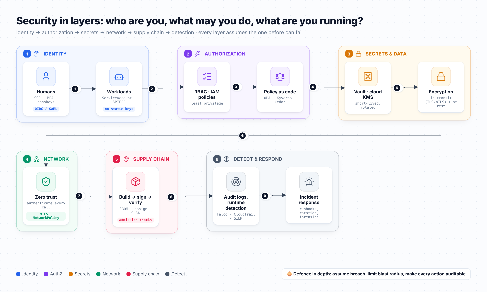
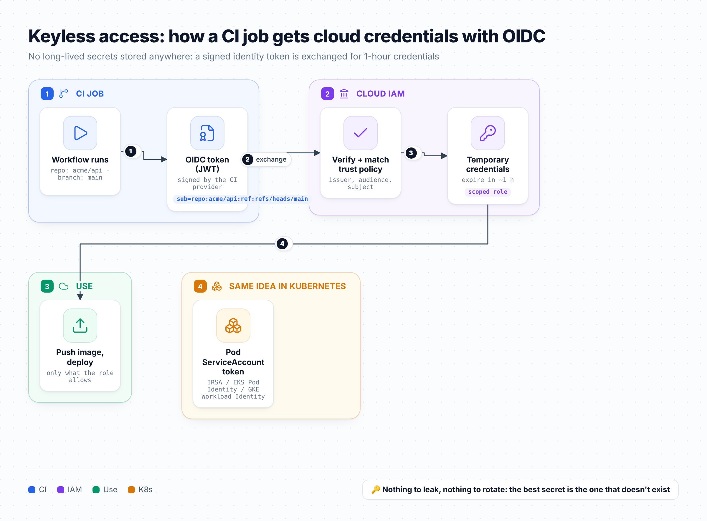
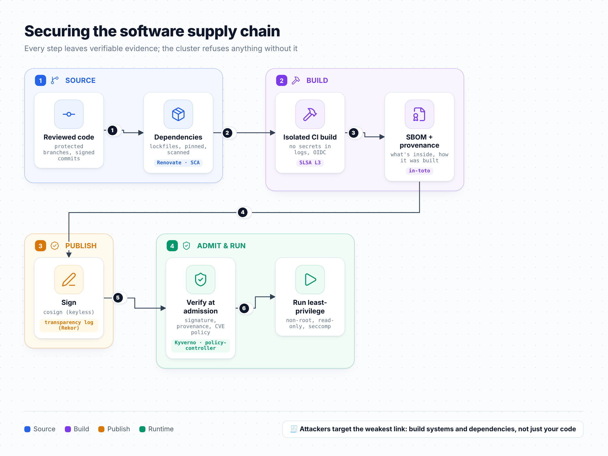

# Bölüm 11 — Güvenlik: kimlik, secret'lar, zero trust ve tedarik zinciri

!!! abstract "Tek cümlede"
    Modern güvenlik ağın etrafında tek bir duvar değil, **katmanlardır**: her insan ve iş yükü **kim** olduğunu kanıtlar
    (**kimlik doğrulama**), sadece ihtiyacı olan yetkileri alır (**yetkilendirme**, en az yetki), saklanan secret'lar
    yerine **kısa ömürlü kimlik bilgileri** kullanır, sadece **kimliği doğrulanmış, şifreli** bağlantılarla konuşur
    (**zero trust**), sadece **doğrulanmış** yazılım çalıştırır (**tedarik zinciri**) ve bir şey ters gittiğinde (gidecek de)
    tespit edip müdahale edebilmen için bir **denetim izi** bırakır.

## 📖 Temel terimler ve kısaltmalar

| Terim | Açılımı | Nedir | Nasıl çalışır (tek satır) |
|---|---|---|---|
| **AuthN / AuthZ** | Authentication / Authorization | Kimsin? / Ne yapabilirsin? | Giriş, token'lar / roller, politikalar |
| **IAM** | Identity and Access Management | Bulutun kimlik ve yetki sistemi | Kullanıcılara, rollere, servis hesaplarına bağlı politikalar |
| **SSO / MFA** | Single Sign-On / Multi-Factor Authentication | Çok uygulama için tek giriş / şifreden fazlası | IdP + ikinci faktör (passkey, TOTP) |
| **IdP** | Identity Provider | Kullanıcıların kimliğini doğrulayan servis | Entra ID, Okta, Google, Keycloak |
| **OIDC** | OpenID Connect | OAuth 2.0 üzerinde kimlik katmanı | İmzalı kimlik token'ları (JWT) |
| **JWT** | JSON Web Token | İmzalı iddialar (`sub`, `aud`, `exp`) | Yayıncının açık anahtarıyla doğrulanır |
| **RBAC** | Role-Based Access Control | Rollere gruplanmış yetkiler | Kubernetes Role/RoleBinding, bulut rolleri |
| **En az yetki** | Least privilege | Sadece gerçekten gereken yetkiler | Etki alanını sınırlar |
| **İş yükü kimliği** | Workload identity | İnsanlar için değil yazılım için kimlik | Statik anahtar yerine federe token'lar |
| **KMS / HSM** | Key Management Service / Hardware Security Module | Yönetilen şifreleme anahtarları | Zarf şifreleme, anahtarlar asla çıkmaz |
| **Zero trust** | — | Ağdaki konuma asla güvenme | Her isteği doğrula ve yetkilendir |
| **mTLS** | mutual TLS | İki taraf da sertifika sunar | Servis kimliği + şifreleme (6.4) |
| **SPIFFE** | Secure Production Identity Framework For Everyone | Standart iş yükü kimliği (`spiffe://…`) | SPIRE kısa ömürlü SVID'ler verir |
| **SBOM / SLSA** | Software Bill of Materials / Supply-chain Levels for Software Artifacts | İçerik listesi / build bütünlüğü çerçevesi | CI'da üretilir ve onaylanır |
| **CVE / CVSS** | Common Vulnerabilities and Exposures / Common Vulnerability Scoring System | Açık kimlikleri / önem puanları | Tarayıcılar paketleri CVE'lerle eşler |
| **SIEM** | Security Information and Event Management | Merkezi güvenlik log analizi | Denetim loglarını ilişkilendirir, alarm verir |

## 🗺️ Büyük resim



---

## 1 · Kimlik: kimsin?

### Nasıl çalışır?

- **İnsanlar** bir **IdP**'de bir kez (SSO) **MFA** ile giriş yapar; ideali oltalamaya dayanıklı **passkey/FIDO2**'dir. Uygulamalar IdP'ye **OIDC** ya da SAML ile güvenir; şifre işlemek yerine imzalı bir token alırlar.
- **İş yüklerinin** (pod'lar, CI işleri, fonksiyonlar) de kimliğe ihtiyacı var. Eski yol (bir ortam değişkenindeki API anahtarı) loglara, imajlara ve git'e sızar. Modern yol **iş yükü kimliği federasyonudur**:



1. Platform (GitHub Actions, Kubernetes, bir bulut VM'i) iş yüküne, onun *tam olarak* kim olduğunu tarif eden **imzalı bir OIDC token'ı** verir (`repo:acme/api:ref:refs/heads/main` ya da `system:serviceaccount:shop:api`).
2. Bulutun güvenlik token servisi imzayı doğrular ve bir **güven politikasını** (issuer, audience, subject) kontrol eder.
3. Dar kapsamlı tek bir rol için **geçici kimlik bilgileri** (~1 saat) döner. Çalınacak uzun ömürlü bir şey yoktur.

## 2 · Yetkilendirme: ne yapabilirsin?

- **RBAC**: yetkiler → roller → kimliklere bağlamalar. Kubernetes'te: `Role`/`ClusterRole` + `RoleBinding`. İnsanlar ve CI için `cluster-admin`'den kaçın; asla `*` kaynaklar üzerinde `*` fiiller verme.
- **Bulut IAM**: rollere politikalar; servis başına yönetilen, kapsamlı rolleri tercih et; kimsenin aşamayacağı korkuluklar olarak **permission boundary / SCP / org politikaları** kullan.
- **Kod olarak politika** (OPA/Gatekeeper, Kyverno, Cedar): "privileged pod yok", "imajlar sadece bizim registry'den", "her namespace'te bir NetworkPolicy var" gibi kurallar; admission'da uygulanır ve CI'da test edilir.
- **Tam zamanında erişim**: kalıcı admin hakları yerine onayla bir saatlik yükseltilmiş haklar.

## 3 · Secret'lar

| Yaklaşım | Risk | Daha iyisi |
|---|---|---|
| Git'te ya da imajlarda secret | Sonsuza dek sızmış (geçmiş, katmanlar) | Asla; CI'da gitleaks/trufflehog ile tara |
| Kubernetes `Secret` (base64) | `get secrets` yetkisi olan herkes okur; şifrelenmezse etcd'de düz metin | etcd'de durağan şifrelemeyi aç (KMS sağlayıcı), sıkı RBAC |
| Harici secret deposu | — | **Vault**, AWS Secrets Manager, GCP Secret Manager, Azure Key Vault + **External Secrets Operator** ya da CSI sürücüsü |
| Statik uzun ömürlü anahtarlar | Sızıntı = fark edilene kadar tam erişim | **İş yükü kimliği** (hiç secret yok) ya da dinamik secret'lar (Vault pod başına süresi dolan DB kullanıcıları verir) |

Aktarımda (her yerde TLS/mTLS) ve durağanda (disk, nesne depolama, DB, yedekler) **KMS**'teki anahtarlarla **şifrele**; anahtarları ve sertifikaları otomatik döndür (6.4).

## 4 · Zero trust ağ

Eski model güvenlik duvarının "içindeki" her şeye güvenirdi; ele geçirilmiş tek bir laptop ya da pod her şeye ulaşabilirdi. **Zero trust**: her istek IP adresine göre değil **kimliğe** göre doğrulanır ve yetkilendirilir.

- **Servisten servise**: iş yükü kimlikleriyle mTLS (service mesh, SPIFFE/SPIRE), artı yetkilendirme politikaları ("`payments` `POST /charge`'ı sadece `orders` çağırabilir").
- **Ağ bölümleme** hâlâ yardımcı: default-deny NetworkPolicy'ler (9.3), private subnet'ler, herkese açık veritabanı yok, çıkış izin listeleri.
- **İnsanlardan iç araçlara**: düz bir VPN yerine kimlik farkında proxy'ler (BeyondCorp tarzı, Cloudflare Access, Tailscale).

## 5 · Kubernetes'i sıkılaştırmak

- **Pod Security Standards** `restricted`: root olmayan kullanıcı, yetki yükseltme yok, tüm capability'leri düşür, seccomp `RuntimeDefault`, salt okunur kök dosya sistemi (3.5).
- **API server**: özel endpoint, insanlar için OIDC girişi, denetim logları açık, anonim kimlik doğrulama yok.
- **Node'lar**: minimal OS (Bottlerocket, Talos, COS), otomatik yamalama, varsayılan olarak SSH yok.
- **etcd**: şifreli secret'lar, şifreli yedekler, erişim sadece API server'dan.
- **Çok kiracılık**: namespace + RBAC + NetworkPolicy + kotalar; güvenilmeyen kod için güçlü izolasyon (gVisor/Kata).

## 6 · Tedarik zinciri güvenliği



Saldırganlar giderek artan şekilde çalışan uygulamadan çok **yazılımın nasıl üretildiğini** hedefliyor: ele geçirilmiş bağımlılıklar (typosquatting, kötü niyetli güncellemeler), çalınmış CI token'ları, kurcalanmış build sunucuları. Savunmalar:

1. **Kaynak**: branch koruması, zorunlu incelemeler, imzalı commit'ler, lockfile'larla sabitlenmiş bağımlılıklar, incelemeyle otomatik güncellemeler (Renovate/Dependabot).
2. **Build**: geçici, izole CI runner'ları; saklanan bulut anahtarları yerine OIDC; üçüncü taraf CI action'larını commit SHA ile sabitle.
3. **Kanıt**: bir **SBOM** ve **provenance** üret (kim neyi, hangi commit'ten, nasıl üretti); **SLSA** seviyeleri bunun ne kadar güvenilir olduğunu tarif eder.
4. İmajları **imzala** (Sigstore **cosign**, OIDC ile anahtarsız) ve imzaları bir şeffaflık loguna kaydet.
5. **Admission'da doğrula**: sadece senin pipeline'ından gelen, kritik CVE'si olmayan imzalı imajlar çalışabilir.

## 7 · Tespit et ve müdahale et

Önleme eninde sonunda başarısız olur. Şunlara ihtiyacın var:

- Her yerde **denetim logları** (CloudTrail gibi bulut control plane'i, Kubernetes audit, IdP girişleri), sorgulayabileceğin bir **SIEM**'e gönderilmiş.
- **Çalışma anı tespiti** (Falco, Tetragon, bulut tehdit tespiti): container'da shell, beklenmedik dış bağlantılar, kripto madencileri, `/etc/shadow` okuma.
- **Olay müdahale runbook'ları**: kimlik bilgileri nasıl iptal edilir, secret'lar nasıl döndürülür, bir node nasıl izole edilir, kanıt nasıl korunur, nasıl iletişim kurulur.

## 🔧 DevOps bağlantısı

- **CI sistemi bir production sistemidir**: her şeyi deploy etmenin anahtarlarını tutar. Runner'lar için en az yetki, buluta OIDC, onaylı korumalı ortamlar.
- **Güvenlik pipeline'dan sonra değil içinde**: secret taraması, SCA (bağımlılık taraması), IaC taraması (Checkov, tfsec, kube-linter), imaj taraması; kritiklerde başarısız ol, gerisini raporla.
- **Yama sıklığı** mükemmel yapılandırmadan daha önemli: otomatik taban imaj yeniden üretimleri ve node yükseltmeleri.
- **Güvenli yolu kolay yol yap**: iyi varsayılanlara sahip altın şablonlar, Helm chart'ları ve Terraform modülleri.

## 🚨 Olay hikâyesi: sızan erişim anahtarı

!!! failure "Alarm"
    Bir pazar gecesi bulut faturası alarmı çalıyor: hiç kullanmadığın bir bölgede kripto para kazan **400 GPU instance'ı** çalışıyor.

Önce kendin teşhis etmeye çalış, sonra ipuçlarını tek tek aç.

??? info "🔍 İpucu 1"
    CloudTrail tüm `RunInstances` çağrılarının eski bir CI kullanıcısının (`ci-deployer`) erişim anahtarıyla, sahip olmadığın IP adreslerinden imzalandığını gösteriyor.

??? info "🔍 İpucu 2"
    Bir GitHub araması anahtarı bir iç repo'nun herkese açık bir fork'unda buluyor: bir geliştirici iki yıl önce bir `.env` dosyası commit etmiş; anahtar hiç döndürülmemiş ve `AdministratorAccess` yetkisine sahip.

??? success "🎯 Kök neden"
    Uzun ömürlü, aşırı yetkili statik bir kimlik bilgisi git geçmişinde yaşıyordu. Botlar herkese açık repo'ları yayından dakikalar sonra anahtarlar için tarar.

??? tip "🛠️ Çözüm ve ders"
    Anahtarı devre dışı bırak, instance'ları sonlandır, kalıcılık için CloudTrail'i incele (yeni kullanıcılar, roller, anahtarlar), sonra statik anahtarları tamamen kaldır: CI için **OIDC federasyonu**, pod'lar için iş yükü kimliği, her repo'da secret taraması (push koruması) ve bölge başına bütçeler/kotalar. **Ders:** en iyi secret var olmayan secret'tır; ikinci en iyisi bir saatte süresi dolandır.

## 🧪 Kendin dene

```bash
# Kubernetes'te kimim ve ne yapabilirim?
kubectl auth whoami 2>/dev/null; kubectl auth can-i --list | head -20
kubectl auth can-i get secrets --all-namespaces --as=system:serviceaccount:default:default

# Bir JWT'yi çöz (başlık + iddialar); production token'larını asla web sitelerine yapıştırma
TOKEN=$(kubectl create token default 2>/dev/null) && echo "$TOKEN" | cut -d. -f2 | tr '_-' '/+' | base64 -d 2>/dev/null; echo

# Bir repo'nun geçmişinde secret ara
docker run --rm -v "$PWD:/repo" zricethezav/gitleaks:latest detect -s /repo --no-banner | tail -5

# Bir imajı tara ve SBOM üret
docker run --rm aquasec/trivy:latest image --severity CRITICAL,HIGH nginx:latest | tail -15
docker run --rm anchore/syft:latest alpine:3.20 | head -10

# İmzalı bir imajı doğrula (anahtarsız)
cosign verify ghcr.io/sigstore/cosign/cosign:latest \
  --certificate-identity-regexp '.*' --certificate-oidc-issuer-regexp '.*' 2>/dev/null | head -c 300; echo
```

## 🃏 Hatırlatma kartı

| Risk | Kontrol |
|---|---|
| Çalınan şifreler | SSO + oltalamaya dayanıklı MFA (passkey) |
| Sızan anahtarlar | Statik anahtar yok: OIDC federasyonu, iş yükü kimliği, kısa TTL'ler |
| Aşırı yetki | En az yetkili roller, JIT erişim, korkuluk politikaları |
| Yanal hareket | Zero trust: mTLS + yetkilendirme politikaları, default-deny NetworkPolicy'ler |
| Container kaçışı | Pod Security `restricted`, privileged yok, user namespace'ler |
| Kötü niyetli bağımlılık/imaj | Lockfile'lar, SCA, SBOM, admission'da doğrulanan imzalar |
| Fark edilmeyen ihlal | Denetim logları → SIEM, çalışma anı tespiti, IR runbook'ları |

## ❓ Kendini test et

??? question "1. Kimlik doğrulama ile yetkilendirme arasındaki fark ne?"
    Kimlik doğrulama kim olduğunu kanıtlar (giriş, token, sertifika); yetkilendirme o kimliğin ne yapabileceğine karar verir (roller, politikalar).

??? question "2. CI'dan buluta OIDC federasyonu, erişim anahtarını CI secret'ı olarak saklamaktan neden daha güvenli?"
    Sızacak uzun ömürlü bir secret yok: her iş tam olarak hangi repo/branch olduğunu tarif eden imzalı bir token alır, bu da yaklaşık bir saatte dolan ve sadece kapsamlı bir rol için geçerli kimlik bilgileriyle değiştirilir.

??? question "3. Kubernetes Secret'ları şifreli mi?"
    Varsayılan olarak sadece base64 kodlu; RBAC'ta `get secrets` yetkisi olan herkes okuyabilir ve durağan şifreleme yapılandırılmazsa etcd onları düz metin saklar.

??? question "4. 'Zero trust' klasik bir çevre ağına göre neyi değiştirir?"
    Ağın içinde olmak hiçbir şey kazandırmaz: her istek genelde mTLS ve politikalarla kimliğe göre doğrulanır ve yetkilendirilir; ele geçirilmiş tek bir makine her şeye ulaşamaz.

??? question "5. Yeni bir kritik CVE sırasında SBOM hangi soruyu cevaplamana yardım eder?"
    Hangi imajlarının ve servislerinin etkilenen paketi ve sürümü içerdiğini; böylece neyi yamalayacağını günler yerine dakikalar içinde bilirsin.

---

## 📚 Kaynaklar

- [NIST SP 800-207 — Zero Trust Architecture](https://csrc.nist.gov/pubs/sp/800/207/final)
- [Kubernetes — Security overview](https://kubernetes.io/docs/concepts/security/) · [Pod Security Standards](https://kubernetes.io/docs/concepts/security/pod-security-standards/)
- [GitHub — Security hardening with OpenID Connect](https://docs.github.com/en/actions/security-for-github-actions/security-hardening-your-deployments/about-security-hardening-with-openid-connect)
- [SPIFFE](https://spiffe.io/) · [Sigstore](https://www.sigstore.dev/) · [SLSA](https://slsa.dev/)
- [OWASP Kubernetes Top 10](https://owasp.org/www-project-kubernetes-top-ten/)
- [CNCF — Cloud Native Security Whitepaper](https://github.com/cncf/tag-security/tree/main/community/resources/security-whitepaper)

## ✍️ Notlarım

> Ekibinin sahip olduğu her uzun ömürlü kimlik bilgisini listele (CI secret'ları, kubeconfig'ler, bulut anahtarları, DB şifreleri). Hangileri federasyon ya da kısa ömürlü kimlik bilgileriyle değiştirilebilir?

-
