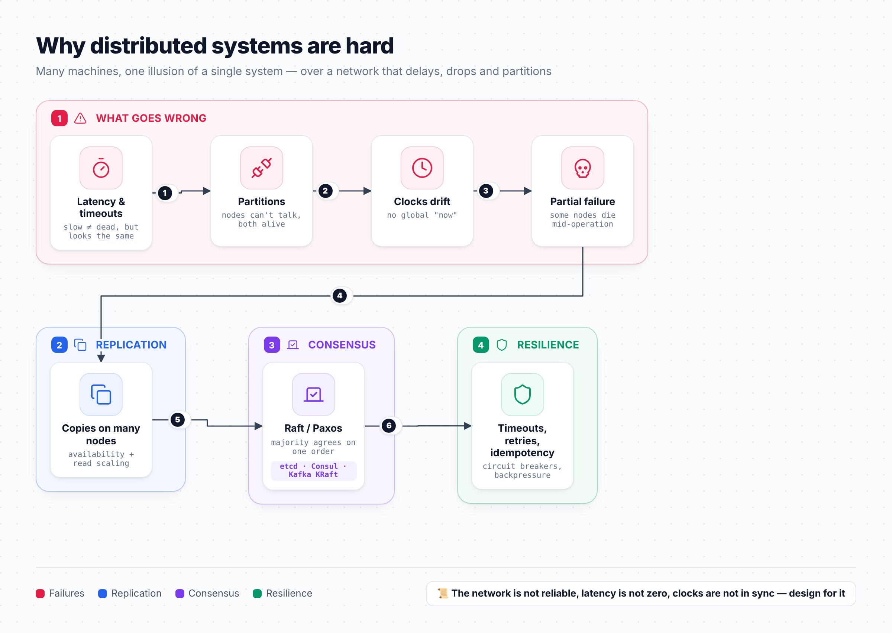
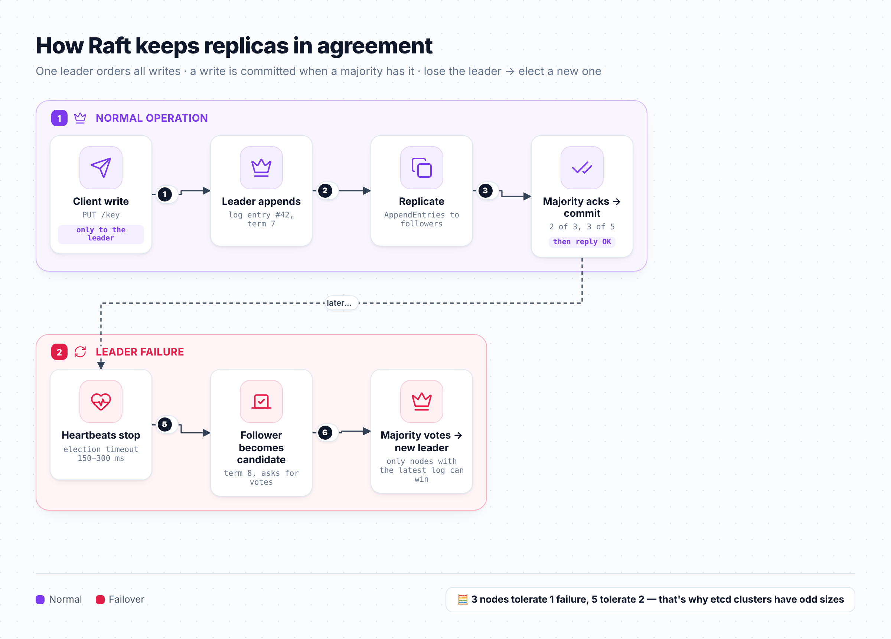
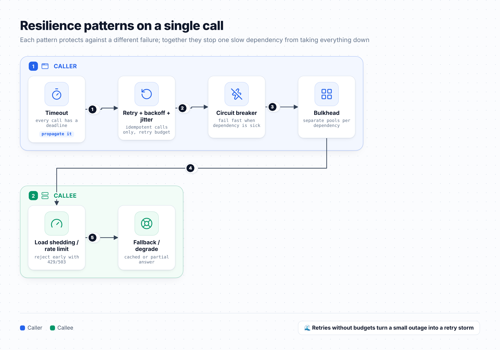

# Chapter 12 — Distributed systems: consensus, consistency & resilience

!!! abstract "In short"
    As soon as a system runs on more than one machine, messages can be **delayed, lost or duplicated**. Machines fail
    **partially**, the network can **partition**, and there is no shared clock. Distributed systems survive this by
    **replicating** data and using **consensus** (Raft, Paxos) to agree on one order of changes. They choose explicitly
    between **consistency and availability** when the network splits, and wrap every remote call in **timeouts, retries,
    idempotency and circuit breakers**.

## 📖 Key terms & abbreviations

| Term | Stands for | What it is | How it works (one line) |
|---|---|---|---|
| **Node / replica** | — | One machine / one copy of the data | Many replicas = availability + read scaling |
| **Partial failure** | — | Some parts fail while others work | You can't tell slow from dead |
| **Network partition** | — | Nodes alive but unable to talk | Split brain if both sides keep writing |
| **CAP** | Consistency, Availability, Partition tolerance | During a partition, choose C or A | Partitions happen, so the choice is real |
| **PACELC** | Partition → A/C, Else → Latency/Consistency | CAP + the normal-case trade-off | Even without failures, consistency costs latency |
| **Linearizability** | — | Strongest consistency: looks like one copy | Every read sees the latest committed write |
| **Eventual consistency** | — | Replicas converge "eventually" | Stale reads possible, high availability |
| **Consensus** | — | Nodes agreeing on a value/order despite failures | Raft, Paxos, Zab |
| **Quorum / majority** | — | More than half of the voters | 2 of 3, 3 of 5 |
| **Leader / term** | — | Node ordering writes / election epoch | Higher term wins |
| **Split brain** | — | Two nodes both acting as leader | Prevented by quorums and fencing |
| **Idempotency** | — | Repeating an operation has no extra effect | Makes retries safe (7.4) |
| **Circuit breaker** | — | Stop calling a failing dependency for a while | Fail fast, let it recover |
| **Backpressure / load shedding** | — | Slow producers / reject excess work early | Protects the system under overload |

## 🗺️ Big picture



---

## 1 · What makes it hard

The **fallacies of distributed computing** are the assumptions that break: the network is reliable, latency is zero, bandwidth is infinite, the topology doesn't change, there is one administrator…

- **Slow vs dead:** a node that doesn't answer in 2 s might be dead, overloaded, or behind a partition. You only have **timeouts**, which are guesses.
- **Partial failure:** your request reached the server, the write happened, but the response was lost. Did it succeed? You don't know → **idempotency** (7.4).
- **No global clock:** wall clocks drift and jump (NTP); "last write wins by timestamp" can silently lose data. Systems use **logical clocks**, versions, or tightly bounded clocks (Spanner's TrueTime).

## 2 · Replication and consistency

| Model | Guarantee | Example systems |
|---|---|---|
| **Linearizable (strong)** | Reads always see the latest write, as if one copy | etcd, ZooKeeper, Spanner, single-leader DB reads from the leader |
| **Sequential / causal** | Everyone sees operations in a consistent (causal) order | Some geo-replicated databases |
| **Read-your-writes** | You see your own updates | Session stickiness to the primary |
| **Eventual** | Replicas converge if writes stop | DNS, DynamoDB default reads, Cassandra (tunable), caches |

**CAP** in practice: when a partition happens, a **CP** system (etcd) refuses writes on the minority side to stay consistent; an **AP** system keeps accepting writes on both sides and reconciles later (conflicts!). **PACELC** adds: even without partitions, stronger consistency costs latency (waiting for replicas, cross-region round trips).

## 3 · Consensus with Raft



### How does it work?

1. One node is **leader** for a **term**; clients send writes to it.
2. The leader appends the write to its log and sends it to followers (`AppendEntries`).
3. When a **majority** has stored it, the entry is **committed**; the leader applies it and replies. A minority can lag or be down.
4. Followers expect **heartbeats**. If they stop, a follower becomes **candidate**, increments the term and asks for votes; a node with an up-to-date log that gets a majority becomes the new leader.
5. A partitioned old leader on the minority side can't commit anything (no majority), so there's no split brain.

That's why **etcd** (and Kubernetes' state) needs **3 or 5 members** spread across zones: 3 tolerate 1 failure, 5 tolerate 2. Losing quorum makes the cluster read-only/unavailable; 2 or 4 members add cost without adding tolerance.

## 4 · Exactly-once is a myth (mostly)

Across a network you get **at-most-once** (may lose) or **at-least-once** (may duplicate). "Exactly-once" = at-least-once delivery + **idempotent processing** (dedupe IDs, upserts, idempotency keys), or transactions within one system (Kafka transactions). Design every handler to survive a duplicate.

## 5 · Resilience patterns



| Pattern | Protects against | Note |
|---|---|---|
| **Timeout** (with deadline propagation) | Waiting forever on a slow dependency | Set below the caller's own timeout |
| **Retry + exponential backoff + jitter** | Transient errors | Idempotent operations only; use a **retry budget** |
| **Circuit breaker** | Hammering a dependency that's down | Open → fail fast; half-open → probe |
| **Bulkhead** | One dependency exhausting all threads/connections | Separate pools per dependency |
| **Load shedding / rate limiting** | Overload collapse | Reject early with 429/503 instead of timing out everything |
| **Fallback / graceful degradation** | Hard failure of a non-critical feature | Cached data, default recommendations |
| **Hedged requests** | Tail latency | Send a second request after p95, use the first answer |

**Retry storms**: if every layer retries 3 times, a single failure at the bottom of a 4-layer stack becomes 3⁴ = 81 calls. Retry at one layer (usually the edge or the mesh), with budgets.

## 🔧 DevOps connection

- **Kubernetes is a distributed system** built on these ideas: etcd (Raft), controllers (reconciliation, eventual consistency), leader election for controllers (Lease objects).
- **Run etcd and ZooKeeper/KRaft with odd member counts across zones**, monitor `etcd_server_has_leader`, leader changes and fsync latency.
- **Multi-region**: decide per data type: strongly consistent (payments) vs eventually consistent (catalog, analytics). Active-active needs conflict resolution.
- **Chaos engineering** (Chaos Mesh, Litmus, AWS FIS): kill pods, add latency, partition networks in staging, and check that timeouts, retries and breakers behave as designed.

## 🚨 Incident story: the retry storm

!!! failure "The alarm"
    A 30-second blip in the user database turns into a **45-minute outage** of the whole site. Even after the database is healthy again, error rates stay at 90%.

Try to diagnose it yourself first, then open the clues one by one.

??? info "🔍 Clue 1"
    Request volume to the user service is **20× normal** during the outage, although user traffic is flat.

??? info "🔍 Clue 2"
    The mobile app retries 3×, the API gateway 3×, the BFF service 3×, and the user service client 3×, all without backoff or jitter and with timeouts longer than the caller's.

??? success "🎯 Root cause"
    Retries multiplied at every layer (up to 81 calls per user request) and arrived in synchronized waves. The recovering database was overloaded by the retry traffic, failed again, and caused more retries: a **metastable failure**.

??? tip "🛠️ Fix and lesson"
    Retry at one layer only, with exponential backoff + jitter and a retry budget (e.g. ≤10% extra traffic); add circuit breakers and load shedding; make timeouts shrink down the stack (deadline propagation). **Lesson:** resilience features can amplify outages if they aren't designed together.

## 🧪 Try it yourself

```bash
# A 3-member etcd cluster in Docker: write, kill the leader, watch a new election
docker network create etcdnet
for i in 1 2 3; do docker run -d --rm --name etcd$i --network etcdnet quay.io/coreos/etcd:v3.6.0 etcd \
  --name etcd$i --initial-advertise-peer-urls http://etcd$i:2380 --listen-peer-urls http://0.0.0.0:2380 \
  --advertise-client-urls http://etcd$i:2379 --listen-client-urls http://0.0.0.0:2379 \
  --initial-cluster etcd1=http://etcd1:2380,etcd2=http://etcd2:2380,etcd3=http://etcd3:2380 --initial-cluster-state new; done
sleep 5; E="docker exec etcd1 etcdctl --endpoints=etcd1:2379,etcd2:2379,etcd3:2379"
$E endpoint status -w table                     # who is leader, which term
$E put greeting hello && $E get greeting
LEADER=$($E endpoint status -w json | python3 -c "import json,sys;print([e['Endpoint'].split(':')[0] for e in json.load(sys.stdin) if e['Status']['leader']==e['Status']['header']['member_id']][0])")
docker stop $LEADER; sleep 3
docker exec $( [ $LEADER = etcd1 ] && echo etcd2 || echo etcd1 ) etcdctl --endpoints=etcd1:2379,etcd2:2379,etcd3:2379 endpoint status -w table 2>/dev/null
# Stop a second member: no quorum, writes fail
docker stop etcd3 etcd2 etcd1 2>/dev/null; docker network rm etcdnet
```

## 🃏 Cheat sheet

| Situation | Remember |
|---|---|
| Quorum size | ⌊n/2⌋ + 1 → 3 nodes tolerate 1, 5 tolerate 2 |
| Partition | CP refuses on minority side; AP accepts and reconciles |
| Retries | Idempotent only, backoff + jitter, one layer, budget |
| Timeouts | Every call; shorter as you go down the stack |
| Duplicates | Expect them: dedupe IDs, upserts |
| Overload | Shed load early (429/503), don't queue forever |

## ❓ Test yourself

??? question "1. Why can't you reliably tell a crashed node from a slow one?"
    Both look like "no answer yet". The only tool is a timeout, which is a guess; that's why systems must handle false failure detection.

??? question "2. What does CAP force you to choose, and when?"
    During a network partition, either stay consistent (refuse some requests) or stay available (accept requests that may conflict). Without a partition, both are possible (but PACELC says consistency still costs latency).

??? question "3. Why does etcd need a majority to commit a write?"
    Any two majorities overlap, so a committed entry is always known to at least one member of any future majority, which prevents two leaders committing conflicting histories.

??? question "4. Why is a 4-member etcd cluster no better than 3 for failures?"
    Quorum of 4 is 3, so it still tolerates only 1 failure, while costing more and adding latency.

??? question "5. How does a retry storm happen, and how do you prevent it?"
    Multiple layers retry without backoff, multiplying load on a struggling dependency. Retry at one layer with exponential backoff, jitter and a retry budget, plus circuit breakers and load shedding.

---

## 📚 Sources

- [Raft — In Search of an Understandable Consensus Algorithm](https://raft.github.io/raft.pdf) · [Raft visualization](https://raft.github.io/)
- [etcd — FAQ (cluster size and fault tolerance)](https://etcd.io/docs/v3.6/faq/)
- [Martin Kleppmann — Designing Data-Intensive Applications](https://dataintensive.net/)
- [AWS Builders' Library — Timeouts, retries and backoff with jitter](https://aws.amazon.com/builders-library/timeouts-retries-and-backoff-with-jitter/)
- [Google SRE Book — Addressing cascading failures](https://sre.google/sre-book/addressing-cascading-failures/)
- [Jepsen — consistency models](https://jepsen.io/consistency)

## ✍️ My notes

> For one critical call path in your system: what are the timeouts at each hop, how many layers retry, and is the operation idempotent?
