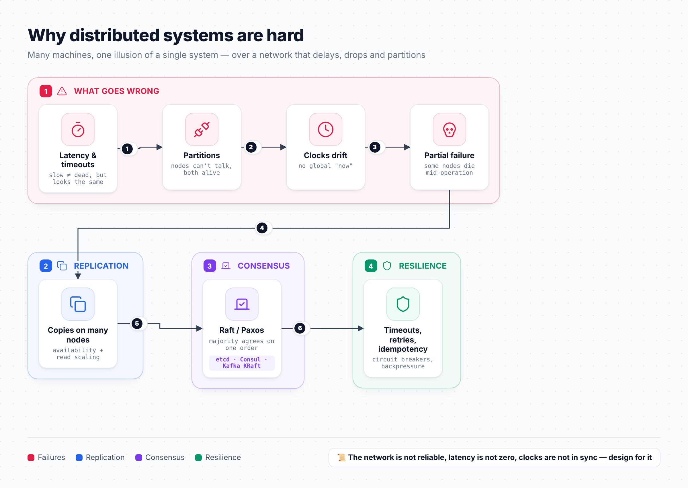
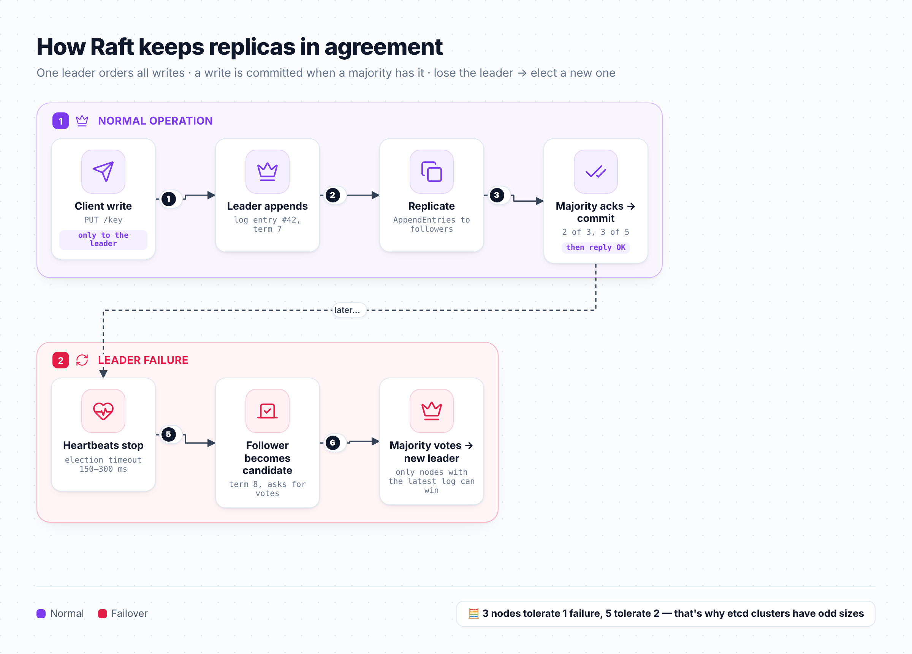
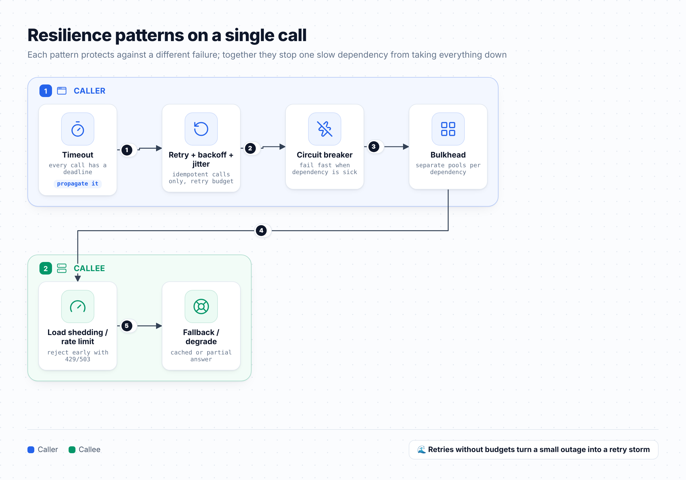

# Bölüm 12 — Dağıtık sistemler: uzlaşı, tutarlılık ve dayanıklılık

!!! abstract "Kısaca"
    Bir sistem birden fazla makinede çalışmaya başladığı anda mesajlar **gecikebilir, kaybolabilir ya da çoğalabilir**.
    Makineler **kısmen** çöker, ağ **bölünebilir** ve ortak bir saat yoktur. Dağıtık sistemler buna veriyi **replike
    ederek** ve değişikliklerin sırasında **uzlaşı** (Raft, Paxos) ile anlaşarak dayanır. Ağ bölündüğünde **tutarlılık
    ile erişilebilirlik** arasında açıkça seçim yaparlar ve her uzak çağrıyı **zaman aşımı, yeniden deneme, idempotency
    ve circuit breaker** ile sararlar.

## 📖 Temel terimler ve kısaltmalar

| Terim | Açılımı | Nedir | Nasıl çalışır (tek satır) |
|---|---|---|---|
| **Node / replika** | — | Bir makine / verinin bir kopyası | Çok replika = erişilebilirlik + okuma ölçekleme |
| **Kısmi hata** | Partial failure | Bazı parçalar çalışırken diğerleri çöker | Yavaşı ölüden ayıramazsın |
| **Ağ bölünmesi** | Network partition | Node'lar canlı ama konuşamıyor | İki taraf da yazmaya devam ederse split brain |
| **CAP** | Consistency, Availability, Partition tolerance | Bölünme sırasında C ya da A'yı seç | Bölünmeler olur, seçim gerçektir |
| **PACELC** | Partition → A/C, Else → Latency/Consistency | CAP + normal durumdaki ödünleşim | Hata olmasa bile tutarlılık gecikmeye mal olur |
| **Linearizability** | — | En güçlü tutarlılık: tek kopya gibi görünür | Her okuma en son commit edilen yazmayı görür |
| **Nihai tutarlılık** | Eventual consistency | Replikalar "eninde sonunda" yakınsar | Eski okumalar mümkün, yüksek erişilebilirlik |
| **Uzlaşı** | Consensus | Node'ların hatalara rağmen bir değer/sırada anlaşması | Raft, Paxos, Zab |
| **Çoğunluk (quorum)** | — | Oy verenlerin yarısından fazlası | 3'te 2, 5'te 3 |
| **Lider / dönem** | Leader / term | Yazmaları sıralayan node / seçim dönemi | Yüksek dönem kazanır |
| **Split brain** | — | İki node'un da lider gibi davranması | Çoğunluklar ve fencing ile önlenir |
| **Idempotency** | — | Bir işlemi tekrarlamanın ek etkisi yok | Yeniden denemeleri güvenli yapar (7.4) |
| **Circuit breaker** | — | Hata veren bir bağımlılığı bir süre çağırmayı kes | Hızlı başarısız ol, toparlanmasına izin ver |
| **Geri basınç / yük atma** | Backpressure / load shedding | Üreticileri yavaşlat / fazla işi erkenden reddet | Aşırı yükte sistemi korur |

## 🗺️ Büyük resim



---

## 1 · Onu zorlaştıran ne

**Dağıtık hesaplamanın yanılgıları** bozulan varsayımlardır: ağ güvenilirdir, gecikme sıfırdır, bant genişliği sonsuzdur, topoloji değişmez, tek bir yönetici vardır…

- **Yavaş ve ölü:** 2 sn'de cevap vermeyen bir node ölü, aşırı yüklü ya da bir bölünmenin arkasında olabilir. Elinde sadece tahmin olan **zaman aşımları** var.
- **Kısmi hata:** isteğin sunucuya ulaştı, yazma oldu ama cevap kayboldu. Başarılı oldu mu? Bilemezsin → **idempotency** (7.4).
- **Global saat yok:** duvar saatleri kayar ve sıçrar (NTP); "zaman damgasına göre son yazma kazanır" sessizce veri kaybettirebilir. Sistemler **mantıksal saatler**, sürümler ya da sıkı sınırlı saatler (Spanner'ın TrueTime'ı) kullanır.

## 2 · Replikasyon ve tutarlılık

| Model | Garanti | Örnek sistemler |
|---|---|---|
| **Linearizable (güçlü)** | Okumalar her zaman en son yazmayı görür, tek kopya gibi | etcd, ZooKeeper, Spanner, liderden okuyan tek liderli DB |
| **Sıralı / nedensel** | Herkes işlemleri tutarlı (nedensel) bir sırada görür | Bazı coğrafi replike veritabanları |
| **Kendi yazdığını oku** | Kendi güncellemelerini görürsün | Primary'ye oturum yapışkanlığı |
| **Nihai** | Yazmalar durursa replikalar yakınsar | DNS, DynamoDB varsayılan okumalar, Cassandra (ayarlanabilir), önbellekler |

Pratikte **CAP**: bir bölünme olunca **CP** bir sistem (etcd) tutarlı kalmak için azınlık tarafında yazmaları reddeder; **AP** bir sistem iki tarafta da yazmaları kabul eder ve sonra uzlaştırır (çakışmalar!). **PACELC** ekler: bölünme olmasa bile güçlü tutarlılık gecikmeye mal olur (replikaları beklemek, bölgeler arası gidiş-dönüşler).

## 3 · Raft ile uzlaşı



### Nasıl çalışır?

1. Bir **dönem** için bir node **liderdir**; istemciler yazmaları ona gönderir.
2. Lider yazmayı log'una ekler ve takipçilere gönderir (`AppendEntries`).
3. **Çoğunluk** onu sakladığında girdi **commit** edilir; lider uygular ve cevap verir. Bir azınlık geride kalabilir ya da kapalı olabilir.
4. Takipçiler **heartbeat** bekler. Durursa bir takipçi **aday** olur, dönemi artırır ve oy ister; güncel log'a sahip ve çoğunluğu alan node yeni lider olur.
5. Azınlık tarafındaki bölünmüş eski lider hiçbir şeyi commit edemez (çoğunluk yok); split brain olmaz.

**etcd**'nin (ve Kubernetes'in durumunun) zone'lara yayılmış **3 ya da 5 üyeye** ihtiyaç duymasının sebebi bu: 3 üye 1 hatayı, 5 üye 2 hatayı tolere eder. Çoğunluğu kaybetmek cluster'ı salt okunur/erişilemez yapar; 2 ya da 4 üye tolerans eklemeden maliyet ekler.

## 4 · Tam bir kez (çoğunlukla) bir efsane

Ağ üzerinde **en fazla bir kez** (kaybedebilir) ya da **en az bir kez** (çoğaltabilir) elde edersin. "Tam bir kez" = en az bir kez teslim + **idempotent işleme** (kimlik ayıklama, upsert, idempotency anahtarları) ya da tek bir sistem içinde transaction'lar (Kafka transaction'ları). Her handler'ı bir tekrardan sağ çıkacak şekilde tasarla.

## 5 · Dayanıklılık desenleri



| Desen | Neye karşı korur | Not |
|---|---|---|
| **Zaman aşımı** (deadline iletimiyle) | Yavaş bir bağımlılığı sonsuza dek beklemek | Çağıranın kendi zaman aşımının altında ayarla |
| **Yeniden deneme + üstel backoff + jitter** | Geçici hatalar | Sadece idempotent işlemler; bir **yeniden deneme bütçesi** kullan |
| **Circuit breaker** | Çökmüş bir bağımlılığı dövmek | Açık → hızlı başarısız ol; yarı açık → yokla |
| **Bulkhead** | Bir bağımlılığın tüm thread/bağlantıları tüketmesi | Bağımlılık başına ayrı havuzlar |
| **Yük atma / hız sınırı** | Aşırı yükte çöküş | Her şeyi zaman aşımına düşürmek yerine 429/503 ile erken reddet |
| **Yedek / düşürülmüş hizmet** | Kritik olmayan bir özelliğin sert hatası | Önbellekteki veri, varsayılan öneriler |
| **Hedged istekler** | Kuyruk gecikmesi | p95'ten sonra ikinci bir istek gönder, ilk cevabı kullan |

**Yeniden deneme fırtınaları**: her katman 3 kez yeniden denerse, 4 katmanlı bir yığının dibindeki tek bir hata 3⁴ = 81 çağrıya dönüşür. Tek bir katmanda (genelde uçta ya da mesh'te), bütçelerle yeniden dene.

## 🔧 DevOps bağlantısı

- **Kubernetes bu fikirler üzerine kurulu dağıtık bir sistemdir**: etcd (Raft), controller'lar (uzlaştırma, nihai tutarlılık), controller'lar için lider seçimi (Lease nesneleri).
- **etcd ve ZooKeeper/KRaft'ı zone'lara yayılmış tek sayılı üyelerle çalıştır**; `etcd_server_has_leader`'ı, lider değişimlerini ve fsync gecikmesini izle.
- **Çok bölgeli**: veri tipine göre karar ver: güçlü tutarlı (ödemeler) ve nihai tutarlı (katalog, analitik). Aktif-aktif çakışma çözümü ister.
- **Kaos mühendisliği** (Chaos Mesh, Litmus, AWS FIS): staging'de pod öldür, gecikme ekle, ağı böl ve zaman aşımlarının, yeniden denemelerin ve breaker'ların tasarlandığı gibi davrandığını kontrol et.

## 🚨 Olay hikâyesi: yeniden deneme fırtınası

!!! failure "Alarm"
    Kullanıcı veritabanındaki 30 saniyelik bir aksaklık tüm sitenin **45 dakikalık kesintisine** dönüşüyor. Veritabanı yeniden sağlıklı olduktan sonra bile hata oranları %90'da kalıyor.

Önce kendin teşhis etmeye çalış, sonra ipuçlarını tek tek aç.

??? info "🔍 İpucu 1"
    Kesinti sırasında kullanıcı servisine gelen istek hacmi **normalin 20 katı**, oysa kullanıcı trafiği sabit.

??? info "🔍 İpucu 2"
    Mobil uygulama 3 kez, API gateway 3 kez, BFF servisi 3 kez ve kullanıcı servisi istemcisi 3 kez yeniden deniyor; hepsi backoff ya da jitter olmadan ve çağıranınkinden uzun zaman aşımlarıyla.

??? success "🎯 Kök neden"
    Yeniden denemeler her katmanda katlandı (kullanıcı isteği başına 81 çağrıya kadar) ve senkronize dalgalar halinde geldi. Toparlanan veritabanı yeniden deneme trafiğiyle aşırı yüklendi, tekrar çöktü ve daha fazla yeniden denemeye yol açtı: **yarı kararlı (metastable) bir hata**.

??? tip "🛠️ Çözüm ve ders"
    Sadece tek bir katmanda, üstel backoff + jitter ve bir yeniden deneme bütçesiyle (ör. ≤ %10 ek trafik) yeniden dene; circuit breaker ve yük atma ekle; zaman aşımlarını yığının aşağısına doğru kısalt (deadline iletimi). **Ders:** dayanıklılık özellikleri birlikte tasarlanmazsa kesintileri büyütebilir.

## 🧪 Kendin dene

```bash
# Docker'da 3 üyeli bir etcd cluster'ı: yaz, lideri öldür, yeni bir seçimi izle
docker network create etcdnet
for i in 1 2 3; do docker run -d --rm --name etcd$i --network etcdnet quay.io/coreos/etcd:v3.6.0 etcd \
  --name etcd$i --initial-advertise-peer-urls http://etcd$i:2380 --listen-peer-urls http://0.0.0.0:2380 \
  --advertise-client-urls http://etcd$i:2379 --listen-client-urls http://0.0.0.0:2379 \
  --initial-cluster etcd1=http://etcd1:2380,etcd2=http://etcd2:2380,etcd3=http://etcd3:2380 --initial-cluster-state new; done
sleep 5; E="docker exec etcd1 etcdctl --endpoints=etcd1:2379,etcd2:2379,etcd3:2379"
$E endpoint status -w table                     # lider kim, hangi dönem
$E put greeting hello && $E get greeting
LEADER=$($E endpoint status -w json | python3 -c "import json,sys;print([e['Endpoint'].split(':')[0] for e in json.load(sys.stdin) if e['Status']['leader']==e['Status']['header']['member_id']][0])")
docker stop $LEADER; sleep 3
docker exec $( [ $LEADER = etcd1 ] && echo etcd2 || echo etcd1 ) etcdctl --endpoints=etcd1:2379,etcd2:2379,etcd3:2379 endpoint status -w table 2>/dev/null
# İkinci bir üyeyi durdur: çoğunluk yok, yazmalar başarısız
docker stop etcd3 etcd2 etcd1 2>/dev/null; docker network rm etcdnet
```

## 🃏 Hatırlatma kartı

| Durum | Hatırla |
|---|---|
| Çoğunluk boyutu | ⌊n/2⌋ + 1 → 3 node 1'i, 5 node 2'yi tolere eder |
| Bölünme | CP azınlık tarafında reddeder; AP kabul eder ve uzlaştırır |
| Yeniden denemeler | Sadece idempotent, backoff + jitter, tek katman, bütçe |
| Zaman aşımları | Her çağrıda; yığının aşağısına doğru daha kısa |
| Tekrarlar | Bekle: kimlik ayıklama, upsert |
| Aşırı yük | Yükü erken at (429/503), sonsuza dek kuyruğa alma |

## ❓ Kendini test et

??? question "1. Çökmüş bir node'u yavaş olandan neden güvenilir şekilde ayıramazsın?"
    İkisi de "henüz cevap yok" gibi görünür. Tek araç bir tahmin olan zaman aşımıdır; sistemlerin yanlış hata tespitini ele alması gerekmesinin sebebi bu.

??? question "2. CAP seni neyi seçmeye zorlar ve ne zaman?"
    Bir ağ bölünmesi sırasında ya tutarlı kal (bazı istekleri reddet) ya da erişilebilir kal (çakışabilecek istekleri kabul et). Bölünme yoksa ikisi de mümkün (ama PACELC tutarlılığın yine de gecikmeye mal olduğunu söyler).

??? question "3. etcd bir yazmayı commit etmek için neden çoğunluğa ihtiyaç duyar?"
    Herhangi iki çoğunluk kesişir; commit edilmiş bir girdi gelecekteki her çoğunluğun en az bir üyesi tarafından bilinir, bu da iki liderin çelişen geçmişleri commit etmesini önler.

??? question "4. 4 üyeli bir etcd cluster'ı hatalar için neden 3'ten daha iyi değil?"
    4'ün çoğunluğu 3'tür; yine sadece 1 hatayı tolere eder, üstelik daha pahalıdır ve gecikme ekler.

??? question "5. Bir yeniden deneme fırtınası nasıl olur, nasıl önlersin?"
    Birden fazla katman backoff olmadan yeniden dener ve zorlanan bir bağımlılık üzerindeki yükü katlar. Tek bir katmanda üstel backoff, jitter ve yeniden deneme bütçesiyle yeniden dene; circuit breaker ve yük atma ekle.

---

## 📚 Kaynaklar

- [Raft — In Search of an Understandable Consensus Algorithm](https://raft.github.io/raft.pdf) · [Raft görselleştirmesi](https://raft.github.io/)
- [etcd — FAQ (cluster size and fault tolerance)](https://etcd.io/docs/v3.6/faq/)
- [Martin Kleppmann — Designing Data-Intensive Applications](https://dataintensive.net/)
- [AWS Builders' Library — Timeouts, retries and backoff with jitter](https://aws.amazon.com/builders-library/timeouts-retries-and-backoff-with-jitter/)
- [Google SRE Book — Addressing cascading failures](https://sre.google/sre-book/addressing-cascading-failures/)
- [Jepsen — consistency models](https://jepsen.io/consistency)

## ✍️ Notlarım

> Sistemindeki kritik bir çağrı yolu için: her duraktaki zaman aşımları ne, kaç katman yeniden deniyor ve işlem idempotent mi?
