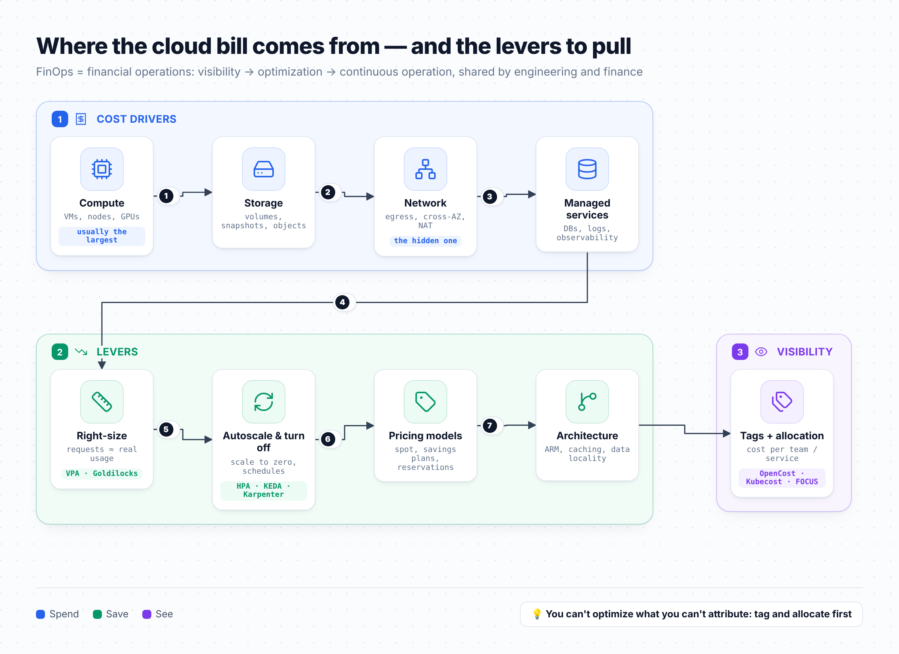
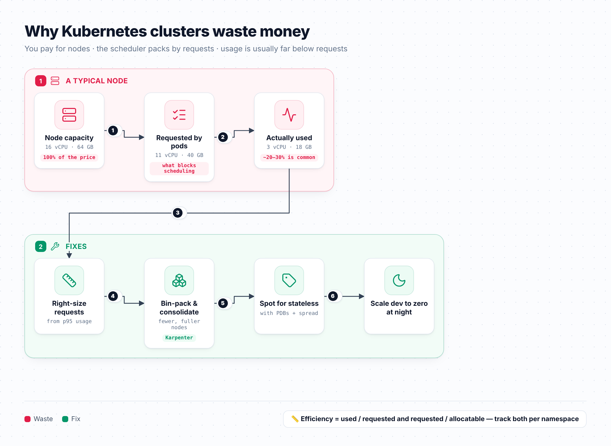

# Chapter 13 — Cloud cost (FinOps): where the money goes and how to keep it

!!! abstract "In short"
    The cloud bills you for **what you reserve, not what you use**. That means the CPUs and memory you requested, the
    disks you provisioned, every gigabyte crossing a **zone, region or NAT gateway**, and every managed service hour.
    **FinOps** makes that cost **visible** (tags, allocation, unit economics) and **optimizes** it (right-sizing,
    autoscaling, spot, commitments). It **operates** continuously, so engineers see cost the way they see latency.

!!! note "About the numbers"
    Prices in this chapter are **approximate public list prices** (mostly AWS us-east-1, late 2026) to show orders of magnitude.
    They differ per provider, region and contract, and they change; check your provider's pricing pages before deciding.

## 📖 Key terms & abbreviations

| Term | Stands for | What it is | How it works (one line) |
|---|---|---|---|
| **FinOps** | Financial Operations | Practice of managing cloud cost together | Inform → Optimize → Operate |
| **On-demand** | — | Pay per second/hour, no commitment | Most flexible, most expensive |
| **RI / Savings Plan / CUD** | Reserved Instance / — / Committed Use Discount | Commit 1–3 years for ~30–70% off | Pay for commitment even if unused |
| **Spot / preemptible** | — | Spare capacity at ~60–90% off | Can be reclaimed with ~2 min notice |
| **Egress** | — | Data leaving a region/cloud | Usually charged per GB; ingress usually free |
| **Cross-AZ traffic** | Availability Zone | Data between zones in a region | Charged both directions (~$0.01/GB each way) |
| **NAT gateway** | Network Address Translation | Outbound internet for private subnets | Hourly + per-GB processing fee |
| **Requests / limits** | — | Kubernetes reserved / max resources | Scheduler packs nodes by **requests** |
| **Right-sizing** | — | Matching resources to real usage | Based on p95 usage + headroom |
| **Bin packing** | — | Fitting pods tightly onto nodes | Fewer, fuller nodes |
| **Showback / chargeback** | — | Showing / billing cost per team | Needs tags and allocation |
| **Unit economics** | — | Cost per business unit | €/1000 requests, €/customer, €/training run |
| **FOCUS** | FinOps Open Cost and Usage Specification | Standard billing data format | Same columns across clouds |
| **OpenCost** | — | CNCF tool for Kubernetes cost allocation | Cost per namespace, workload, label |

## 🗺️ Big picture



---

## 1 · How the bill is built

| Category | Billed by | Typical surprise |
|---|---|---|
| **Compute** (VMs, nodes, GPUs) | Instance size × time running | Idle dev clusters running 24/7 (a week has 168 h, office hours are ~50) |
| **Block storage** (disks) | GB provisioned + IOPS/throughput | Orphaned volumes and snapshots after deleted VMs |
| **Object storage** | GB stored + requests + retrieval | Millions of tiny PUT/GET requests; no lifecycle rules |
| **Data transfer** | GB crossing zone/region/internet | Chatty microservices across zones; egress to users |
| **NAT gateway** | Hours + **every GB processed** | Pulling images or calling cloud APIs through NAT |
| **Load balancers** | Hours + capacity units | One LB per service instead of shared ingress |
| **Managed services** | Instance hours, requests, storage | Oversized databases "just in case"; idle replicas |
| **Logs & metrics** | GB ingested + retained, series count | Debug logging in prod; high-cardinality labels (9.4) |

Rule of thumb: **compute is the biggest line, data transfer is the most surprising one, and observability is the fastest growing.**

## 2 · Why Kubernetes wastes money



### How does it work?

1. The scheduler places pods by their **requests** (3.x, 9.2), not by real usage.
2. Teams set requests high "to be safe" (or copy them from a template), so a pod requesting 2 CPU may use 0.2.
3. Nodes fill up **on paper**, so the cluster autoscaler adds more nodes, which you pay for.
4. Result: average clusters use only a fraction of what they pay for; idle **headroom** + overprovisioned **requests** + **daemonsets** and system pods on every node add up.

Fixes, in order of effort:

- **Right-size requests** from real usage (VPA in recommendation mode, Goldilocks, Kubecost/OpenCost reports): request ≈ p95 usage + headroom; memory limit = request for predictability.
- **Scale pods with load** (HPA / KEDA), and **scale to zero** for dev, preview and batch workloads.
- **Better node choice and packing**: Karpenter or cluster autoscaler with mixed instance types, consolidation, fewer bigger nodes (less per-node overhead).
- **Spot** for stateless, fault-tolerant workloads (with PodDisruptionBudgets and graceful shutdown); on-demand + commitments for the steady baseline.

## 3 · The discount ladder

| Option | Discount vs on-demand | Fits |
|---|---|---|
| On-demand | 0% | Spiky, unknown, short-lived |
| Savings Plans / RIs / CUDs (1–3 yr) | ~30–70% | The **steady baseline** you'll run anyway |
| Spot / preemptible | ~60–90% | Stateless, batch, CI runners, retryable training |
| Newer generation / ARM (Graviton, Axion, Cobalt) | ~10–40% better price-performance | Most containerized workloads after testing |
| **Turning it off** | 100% | Dev/test outside office hours, forgotten resources |

Commit only to what you're sure you'll use **after** right-sizing; otherwise you lock in waste.

## 4 · Network costs: the hidden bill

- **Cross-AZ**: a service calling another in a different zone pays both sides (≈ $0.02/GB round trip). Use topology-aware routing / zone-aware load balancing; keep chatty pairs in the same zone (while keeping HA).
- **NAT gateway**: ≈ $0.045/GB processed on top of hourly cost. Use **VPC endpoints / Private Link** for S3, ECR, and other cloud APIs; pull images through a cache or registry endpoint.
- **Egress to the internet**: ≈ $0.05–0.09/GB. Put a **CDN** in front (6.6), compress (gzip/brotli), cache.
- **Inter-region replication**: decide what really needs to be multi-region.

## 5 · Allocation and visibility

You can't optimize what nobody owns.

1. **Tag/label everything** (`team`, `service`, `env`, `cost-center`), enforced by policy (Chapter 11 policy as code) and IaC defaults.
2. **Kubernetes allocation**: OpenCost/Kubecost split node cost by namespace/label, including idle and shared costs.
3. **Normalize billing data** across clouds with **FOCUS** exports; load into a warehouse/dashboard.
4. **Showback** per team weekly; **budgets and anomaly alerts** per account/project.
5. **Unit economics**: cost per 1,000 requests, per active customer, per GPU-hour of training. A rising bill is fine if the unit cost falls.

## 6 · FinOps as a practice

The FinOps Foundation describes a loop: **Inform** (visibility, allocation) → **Optimize** (rates and usage) → **Operate** (goals, governance, automation). In practice:

- Cost is reviewed in the same place as reliability (dashboards next to SLOs, 9.4).
- Engineers own the cost of what they deploy; finance owns forecasting and commitments, together.
- Automation beats heroics: schedules, TTLs on preview environments, lifecycle rules, right-sizing PRs.

## 🔧 DevOps connection

- **Cost in the pipeline**: Infracost shows the monthly cost change of a Terraform PR before merge.
- **Defaults in templates**: sensible requests, HPA, spot-friendly node pools, log levels, retention.
- **Ephemeral environments** with TTLs; nightly shutdown of non-prod.
- **GPU/AI cost** (Chapter 10): utilization, batching, quantization and right GPU type matter more than anything else; an idle H100 node costs roughly a mid-size car per year.

## 🚨 Incident story: the NAT gateway bill

!!! failure "The alarm"
    The monthly cloud bill jumped **+$18,000**. No new services were launched, and compute cost is flat.

Try to diagnose it yourself first, then open the clues one by one.

??? info "🔍 Clue 1"
    Cost explorer: the increase is all **"NatGateway-Bytes"** in one region, about **400 TB** processed.

??? info "🔍 Clue 2"
    A new log-shipping DaemonSet sends every node's logs to S3, and the ML team's training jobs pull a 30 GB dataset from S3 at every start. The nodes are in private subnets with no S3 gateway endpoint.

??? success "🎯 Root cause"
    All traffic to S3 left through the NAT gateway, which charges per GB processed (~400 TB × $0.045 ≈ $18,000), even though it never left the cloud provider.

??? tip "🛠️ Fix and lesson"
    Add an **S3 gateway VPC endpoint** (free) and interface endpoints for ECR and other APIs, cache the dataset on node-local disk or a shared filesystem, and set an anomaly alert on NAT bytes. **Lesson:** in the cloud, *the path* data takes has a price; look at network diagrams with a cost lens.

## 🧪 Try it yourself

```bash
# Requested vs actually used resources in your cluster
kubectl top nodes
kubectl get pods -A -o custom-columns='NS:.metadata.namespace,POD:.metadata.name,CPU_REQ:.spec.containers[*].resources.requests.cpu,MEM_REQ:.spec.containers[*].resources.requests.memory' | head -20
kubectl top pods -A --sort-by=cpu | head -20
kubectl describe nodes | grep -A6 "Allocated resources"

# Install OpenCost (needs Prometheus) and look at cost per namespace
helm repo add opencost https://opencost.github.io/opencost-helm-chart && helm repo update
# helm install opencost opencost/opencost -n opencost --create-namespace

# Cost estimate of a Terraform change (Infracost, free CLI)
# infracost breakdown --path . ; infracost diff --path .

# Quick back-of-the-envelope: what does an idle node cost per month?
python3 -c "print('m7i.2xlarge ≈ \$%.0f/month' % (0.4032*730))"
```

## 🃏 Cheat sheet

| Waste | Fix |
|---|---|
| Overprovisioned requests | Right-size from p95 usage (VPA recommend, OpenCost) |
| Idle nights/weekends | Schedules, scale to zero, TTLs on previews |
| Steady baseline on on-demand | Savings Plans / CUDs **after** right-sizing |
| Stateless on on-demand | Spot with PDBs and graceful shutdown |
| NAT and cross-AZ traffic | VPC endpoints, zone-aware routing |
| Egress to users | CDN, compression, caching |
| Orphans (disks, IPs, snapshots, LBs) | Regular cleanup jobs, tagging policy |
| Log/metric explosion | Sampling, retention tiers, drop debug in prod |

## ❓ Test yourself

??? question "1. Why can a Kubernetes cluster be 'full' while CPU usage is 15%?"
    The scheduler packs by requests, not usage. If pods request far more than they use, nodes fill up on paper and the autoscaler adds nodes that stay mostly idle.

??? question "2. When should you buy Savings Plans or committed use discounts?"
    For the steady baseline you are confident you'll run for 1–3 years, and only after right-sizing; otherwise you commit to paying for waste.

??? question "3. Which workloads are good candidates for spot instances?"
    Stateless, fault-tolerant or retryable ones: web replicas behind a load balancer, batch jobs, CI runners, checkpointed training. Not single-instance databases.

??? question "4. Why can traffic to S3 from private subnets be expensive, and how do you fix it?"
    Without a VPC endpoint it goes through the NAT gateway, which charges per GB processed. A gateway endpoint for S3 is free and keeps traffic private.

??? question "5. What is unit economics and why does it matter more than the total bill?"
    Cost per business unit (per 1,000 requests, per customer). A growing bill can be healthy if unit cost falls; a flat bill can hide falling efficiency.

---

## 📚 Sources

- [FinOps Foundation — FinOps Framework](https://www.finops.org/framework/)
- [FOCUS — FinOps Open Cost and Usage Specification](https://focus.finops.org/)
- [OpenCost](https://www.opencost.io/) · [Infracost](https://www.infracost.io/)
- [AWS — EC2 On-Demand pricing](https://aws.amazon.com/ec2/pricing/on-demand/) · [NAT gateway pricing](https://aws.amazon.com/vpc/pricing/)
- [AWS Well-Architected — Cost Optimization Pillar](https://docs.aws.amazon.com/wellarchitected/latest/cost-optimization-pillar/welcome.html)
- [Kubernetes — Resource management for pods and containers](https://kubernetes.io/docs/concepts/configuration/manage-resources-containers/)

## ✍️ My notes

> What are your three biggest cost lines this month, who owns each, and what is one unit-cost metric your team could track?
