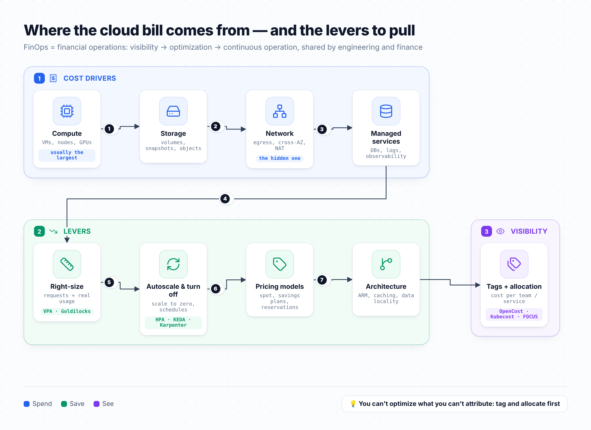
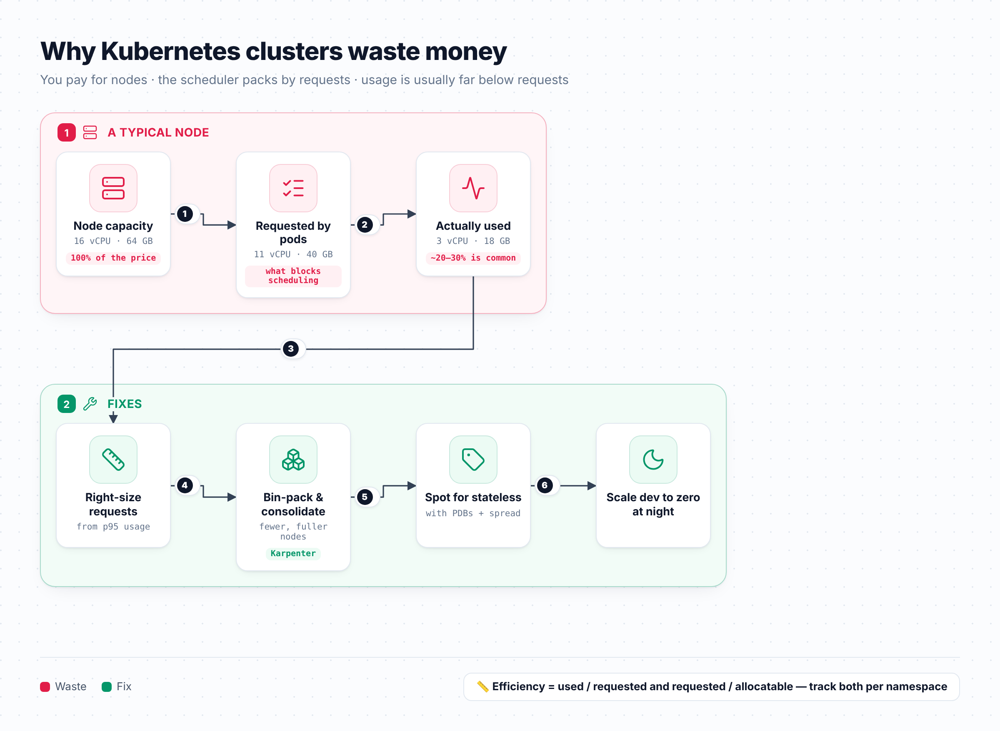

# Bölüm 13 — Bulut maliyeti (FinOps): para nereye gidiyor ve nasıl korunur

!!! abstract "Tek cümlede"
    Bulut seni **kullandığın için değil, ayırdığın için** faturalar: istediğin CPU ve bellek, provizyonladığın diskler,
    bir **zone'u, bölgeyi ya da NAT gateway'i** geçen her gigabayt ve her yönetilen servis saati; **FinOps** bu maliyeti
    **görünür** yapar (etiketler, dağıtım, birim ekonomisi), **optimize** eder (doğru boyutlandırma, otomatik ölçekleme,
    spot, taahhütler, mimari) ve sürekli **işletir**; böylece mühendisler maliyeti gecikmeyi gördükleri gibi görür.

!!! note "Rakamlar hakkında"
    Bu bölümdeki fiyatlar büyüklük sırasını göstermek için **yaklaşık herkese açık liste fiyatlarıdır** (çoğunlukla AWS us-east-1, 2026 sonu).
    Sağlayıcıya, bölgeye ve sözleşmeye göre değişir ve zamanla değişirler; karar vermeden önce sağlayıcının fiyat sayfalarını kontrol et.

## 📖 Temel terimler ve kısaltmalar

| Terim | Açılımı | Nedir | Nasıl çalışır (tek satır) |
|---|---|---|---|
| **FinOps** | Financial Operations | Bulut maliyetini birlikte yönetme pratiği | Bilgilendir → Optimize et → İşlet |
| **On-demand** | — | Saniye/saat başına öde, taahhüt yok | En esnek, en pahalı |
| **RI / Savings Plan / CUD** | Reserved Instance / — / Committed Use Discount | ~%30–70 indirim için 1–3 yıl taahhüt | Kullanılmasa da taahhüdü ödersin |
| **Spot / preemptible** | — | Boş kapasite, ~%60–90 indirimli | ~2 dk uyarıyla geri alınabilir |
| **Egress** | — | Bir bölgeden/buluttan çıkan veri | Genelde GB başına ücretli; giriş genelde ücretsiz |
| **Zone'lar arası trafik** | Availability Zone | Bir bölgedeki zone'lar arası veri | İki yönde de ücretli (her yön ~$0.01/GB) |
| **NAT gateway** | Network Address Translation | Private subnet'ler için dışarı internet | Saatlik + GB başına işleme ücreti |
| **Request / limit** | — | Kubernetes'te ayrılan / en fazla kaynak | Scheduler node'ları **request'lere** göre doldurur |
| **Doğru boyutlandırma** | Right-sizing | Kaynakları gerçek kullanıma eşlemek | p95 kullanım + pay temelinde |
| **Bin packing** | — | Pod'ları node'lara sıkı yerleştirmek | Daha az, daha dolu node |
| **Showback / chargeback** | — | Ekip başına maliyeti göstermek / faturalamak | Etiket ve dağıtım gerekir |
| **Birim ekonomisi** | Unit economics | İş birimi başına maliyet | €/1000 istek, €/müşteri, €/eğitim çalıştırması |
| **FOCUS** | FinOps Open Cost and Usage Specification | Standart faturalama veri formatı | Bulutlar arasında aynı kolonlar |
| **OpenCost** | — | Kubernetes maliyet dağıtımı için CNCF aracı | Namespace, iş yükü, label başına maliyet |

## 🗺️ Büyük resim



---

## 1 · Fatura nasıl oluşur

| Kategori | Neye göre faturalanır | Tipik sürpriz |
|---|---|---|
| **Compute** (VM, node, GPU) | Instance boyutu × çalışma süresi | 7/24 çalışan boşta dev cluster'ları (haftada 168 saat var, mesai ~50) |
| **Blok depolama** (diskler) | Provizyonlanan GB + IOPS/throughput | Silinen VM'lerden kalan sahipsiz diskler ve snapshot'lar |
| **Nesne depolama** | Saklanan GB + istekler + geri alma | Milyonlarca küçük PUT/GET isteği; yaşam döngüsü kuralı yok |
| **Veri transferi** | Zone/bölge/interneti geçen GB | Zone'lar arası geveze mikroservisler; kullanıcılara egress |
| **NAT gateway** | Saat + **işlenen her GB** | İmajları ya da bulut API'lerini NAT üzerinden çekmek |
| **Load balancer'lar** | Saat + kapasite birimleri | Paylaşılan ingress yerine servis başına bir LB |
| **Yönetilen servisler** | Instance saatleri, istekler, depolama | "Ne olur ne olmaz" diye büyük veritabanları; boşta replikalar |
| **Loglar ve metrikler** | Alınan + saklanan GB, seri sayısı | Prod'da debug log; yüksek kardinaliteli label'lar (9.4) |

Pratik kural: **en büyük kalem compute'tur, en sürpriz olanı veri transferidir, en hızlı büyüyeni gözlemlenebilirliktir.**

## 2 · Kubernetes neden para israf eder



### Nasıl çalışır?

1. Scheduler pod'ları gerçek kullanıma göre değil **request'lerine** göre yerleştirir (3.x, 9.2).
2. Ekipler "güvende olmak için" request'leri yüksek ayarlar (ya da bir şablondan kopyalar); 2 CPU isteyen bir pod 0,2 kullanabilir.
3. Node'lar **kâğıt üzerinde** dolar; cluster autoscaler daha fazla node ekler ve onların parasını ödersin.
4. Sonuç: ortalama cluster'lar ödediklerinin sadece bir kısmını kullanır; boşta **pay** + fazla **request'ler** + her node'daki **daemonset**'ler ve sistem pod'ları birikir.

Çözümler, çaba sırasına göre:

- Gerçek kullanımdan **request'leri doğru boyutlandır** (öneri modunda VPA, Goldilocks, Kubecost/OpenCost raporları): request ≈ p95 kullanım + pay; öngörülebilirlik için bellek limiti = request.
- **Pod'ları yükle ölçekle** (HPA / KEDA) ve dev, önizleme ve batch iş yükleri için **sıfıra ölçekle**.
- **Daha iyi node seçimi ve yerleştirme**: karışık instance tipleriyle Karpenter ya da cluster autoscaler, konsolidasyon, daha az ama daha büyük node (node başına daha az ek yük).
- Durumsuz, hataya dayanıklı iş yükleri için **spot** (PodDisruptionBudget ve düzgün kapanışla); sabit taban için on-demand + taahhütler.

## 3 · İndirim merdiveni

| Seçenek | On-demand'e göre indirim | Uygun olduğu yer |
|---|---|---|
| On-demand | %0 | Ani, bilinmeyen, kısa ömürlü |
| Savings Plan / RI / CUD (1–3 yıl) | ~%30–70 | Zaten çalıştıracağın **sabit taban** |
| Spot / preemptible | ~%60–90 | Durumsuz, batch, CI runner'ları, yeniden denenebilir eğitim |
| Yeni nesil / ARM (Graviton, Axion, Cobalt) | ~%10–40 daha iyi fiyat-performans | Test sonrası çoğu container'lı iş yükü |
| **Kapatmak** | %100 | Mesai dışında dev/test, unutulmuş kaynaklar |

Sadece doğru boyutlandırmadan **sonra** kullanacağından emin olduğun şeyi taahhüt et; yoksa israfı kilitlersin.

## 4 · Ağ maliyetleri: gizli fatura

- **Zone'lar arası**: başka bir zone'daki servisi çağıran servis iki tarafı da öder (gidiş-dönüş ≈ $0.02/GB). Topoloji farkında yönlendirme / zone farkında yük dengeleme kullan; geveze çiftleri aynı zone'da tut (HA'yı korurken).
- **NAT gateway**: saatlik ücretin üstüne işlenen GB başına ≈ $0.045. S3, ECR ve diğer bulut API'leri için **VPC endpoint / Private Link** kullan; imajları bir önbellek ya da registry endpoint'i üzerinden çek.
- **İnternete egress**: ≈ $0.05–0.09/GB. Önüne bir **CDN** koy (6.6), sıkıştır (gzip/brotli), önbelleğe al.
- **Bölgeler arası replikasyon**: neyin gerçekten çok bölgeli olması gerektiğine karar ver.

## 5 · Dağıtım ve görünürlük

Kimsenin sahip olmadığı şeyi optimize edemezsin.

1. **Her şeyi etiketle** (`team`, `service`, `env`, `cost-center`); politika (Bölüm 11, kod olarak politika) ve IaC varsayılanlarıyla zorunlu kıl.
2. **Kubernetes dağıtımı**: OpenCost/Kubecost node maliyetini boşta ve paylaşılan maliyetler dahil namespace/label'a göre böler.
3. Faturalama verisini bulutlar arasında **FOCUS** export'larıyla **normalize et**; bir veri ambarına/dashboard'a yükle.
4. Ekip başına haftalık **showback**; hesap/proje başına **bütçe ve anomali alarmları**.
5. **Birim ekonomisi**: 1.000 istek başına, aktif müşteri başına, eğitim GPU-saati başına maliyet. Birim maliyet düşüyorsa artan fatura sorun değildir.

## 6 · Bir pratik olarak FinOps

FinOps Foundation bir döngü tarif eder: **Bilgilendir** (görünürlük, dağıtım) → **Optimize et** (fiyatlar ve kullanım) → **İşlet** (hedefler, yönetişim, otomasyon). Pratikte:

- Maliyet güvenilirlikle aynı yerde gözden geçirilir (SLO'ların yanında dashboard'lar, 9.4).
- Mühendisler deploy ettiklerinin maliyetine sahip çıkar; finans tahmin ve taahhütlere birlikte sahip çıkar.
- Otomasyon kahramanlığı yener: zamanlamalar, önizleme ortamlarında TTL'ler, yaşam döngüsü kuralları, doğru boyutlandırma PR'ları.

## 🔧 DevOps bağlantısı

- **Pipeline'da maliyet**: Infracost bir Terraform PR'ının aylık maliyet değişimini merge'den önce gösterir.
- **Şablonlarda varsayılanlar**: makul request'ler, HPA, spot dostu node havuzları, log seviyeleri, saklama süreleri.
- TTL'li **geçici ortamlar**; prod dışının gece kapatılması.
- **GPU/AI maliyeti** (Bölüm 10): kullanım oranı, batching, quantization ve doğru GPU tipi her şeyden önemli; boşta bir H100 node'u yılda kabaca orta sınıf bir araba fiyatına mal olur.

## 🚨 Olay hikâyesi: NAT gateway faturası

!!! failure "Alarm"
    Aylık bulut faturası **+18.000 $** sıçradı. Yeni servis açılmadı ve compute maliyeti sabit.

Önce kendin teşhis etmeye çalış, sonra ipuçlarını tek tek aç.

??? info "🔍 İpucu 1"
    Cost explorer: artışın tamamı tek bir bölgede **"NatGateway-Bytes"**, yaklaşık **400 TB** işlenmiş.

??? info "🔍 İpucu 2"
    Yeni bir log gönderme DaemonSet'i her node'un loglarını S3'e gönderiyor ve ML ekibinin eğitim işleri her başlangıçta S3'ten 30 GB'lık bir veri seti çekiyor. Node'lar S3 gateway endpoint'i olmayan private subnet'lerde.

??? success "🎯 Kök neden"
    S3'e giden tüm trafik, bulut sağlayıcısından hiç çıkmamasına rağmen, işlenen GB başına ücret alan NAT gateway üzerinden çıktı (~400 TB × $0.045 ≈ $18.000).

??? tip "🛠️ Çözüm ve ders"
    Bir **S3 gateway VPC endpoint'i** (ücretsiz) ve ECR ile diğer API'ler için interface endpoint'ler ekle, veri setini node'un yerel diskinde ya da paylaşılan bir dosya sisteminde önbelleğe al ve NAT baytları için bir anomali alarmı kur. **Ders:** bulutta verinin izlediği *yolun* bir fiyatı vardır; ağ diyagramlarına maliyet gözüyle bak.

## 🧪 Kendin dene

```bash
# Cluster'ında istenen ve gerçekten kullanılan kaynaklar
kubectl top nodes
kubectl get pods -A -o custom-columns='NS:.metadata.namespace,POD:.metadata.name,CPU_REQ:.spec.containers[*].resources.requests.cpu,MEM_REQ:.spec.containers[*].resources.requests.memory' | head -20
kubectl top pods -A --sort-by=cpu | head -20
kubectl describe nodes | grep -A6 "Allocated resources"

# OpenCost'u kur (Prometheus gerekir) ve namespace başına maliyete bak
helm repo add opencost https://opencost.github.io/opencost-helm-chart && helm repo update
# helm install opencost opencost/opencost -n opencost --create-namespace

# Bir Terraform değişikliğinin maliyet tahmini (Infracost, ücretsiz CLI)
# infracost breakdown --path . ; infracost diff --path .

# Hızlı kaba hesap: boşta bir node ayda ne tutar?
python3 -c "print('m7i.2xlarge ≈ \$%.0f/ay' % (0.4032*730))"
```

## 🃏 Hatırlatma kartı

| İsraf | Çözüm |
|---|---|
| Fazla request | p95 kullanımdan doğru boyutlandır (VPA öneri, OpenCost) |
| Boşta geceler/hafta sonları | Zamanlamalar, sıfıra ölçekleme, önizlemelerde TTL |
| On-demand'de sabit taban | Doğru boyutlandırmadan **sonra** Savings Plan / CUD |
| On-demand'de durumsuz iş | PDB ve düzgün kapanışla spot |
| NAT ve zone'lar arası trafik | VPC endpoint'leri, zone farkında yönlendirme |
| Kullanıcılara egress | CDN, sıkıştırma, önbellek |
| Sahipsizler (diskler, IP'ler, snapshot'lar, LB'ler) | Düzenli temizlik işleri, etiketleme politikası |
| Log/metrik patlaması | Örnekleme, saklama katmanları, prod'da debug'ı kapat |

## ❓ Kendini test et

??? question "1. CPU kullanımı %15'ken bir Kubernetes cluster'ı neden 'dolu' olabilir?"
    Scheduler kullanıma göre değil request'lere göre yerleştirir. Pod'lar kullandıklarından çok daha fazlasını isterse node'lar kâğıt üzerinde dolar ve autoscaler çoğunlukla boşta kalan node'lar ekler.

??? question "2. Savings Plan ya da taahhütlü kullanım indirimi ne zaman alınmalı?"
    1–3 yıl çalıştıracağından emin olduğun sabit taban için ve sadece doğru boyutlandırmadan sonra; yoksa israfın parasını ödemeyi taahhüt edersin.

??? question "3. Hangi iş yükleri spot instance için iyi adaydır?"
    Durumsuz, hataya dayanıklı ya da yeniden denenebilir olanlar: load balancer arkasındaki web replikaları, batch işler, CI runner'ları, checkpoint'li eğitim. Tek instance'lı veritabanları değil.

??? question "4. Private subnet'lerden S3'e trafik neden pahalı olabilir ve nasıl düzeltilir?"
    VPC endpoint olmadan işlenen GB başına ücret alan NAT gateway'den geçer. S3 için gateway endpoint ücretsizdir ve trafiği özel tutar.

??? question "5. Birim ekonomisi nedir ve neden toplam faturadan daha önemlidir?"
    İş birimi başına maliyet (1.000 istek başına, müşteri başına). Birim maliyet düşüyorsa büyüyen fatura sağlıklı olabilir; sabit bir fatura düşen verimliliği gizleyebilir.

---

## 📚 Kaynaklar

- [FinOps Foundation — FinOps Framework](https://www.finops.org/framework/)
- [FOCUS — FinOps Open Cost and Usage Specification](https://focus.finops.org/)
- [OpenCost](https://www.opencost.io/) · [Infracost](https://www.infracost.io/)
- [AWS — EC2 On-Demand pricing](https://aws.amazon.com/ec2/pricing/on-demand/) · [NAT gateway pricing](https://aws.amazon.com/vpc/pricing/)
- [AWS Well-Architected — Cost Optimization Pillar](https://docs.aws.amazon.com/wellarchitected/latest/cost-optimization-pillar/welcome.html)
- [Kubernetes — Resource management for pods and containers](https://kubernetes.io/docs/concepts/configuration/manage-resources-containers/)

## ✍️ Notlarım

> Bu ayki en büyük üç maliyet kalemin ne, her birinin sahibi kim ve ekibinin takip edebileceği bir birim maliyet metriği ne olabilir?

-
