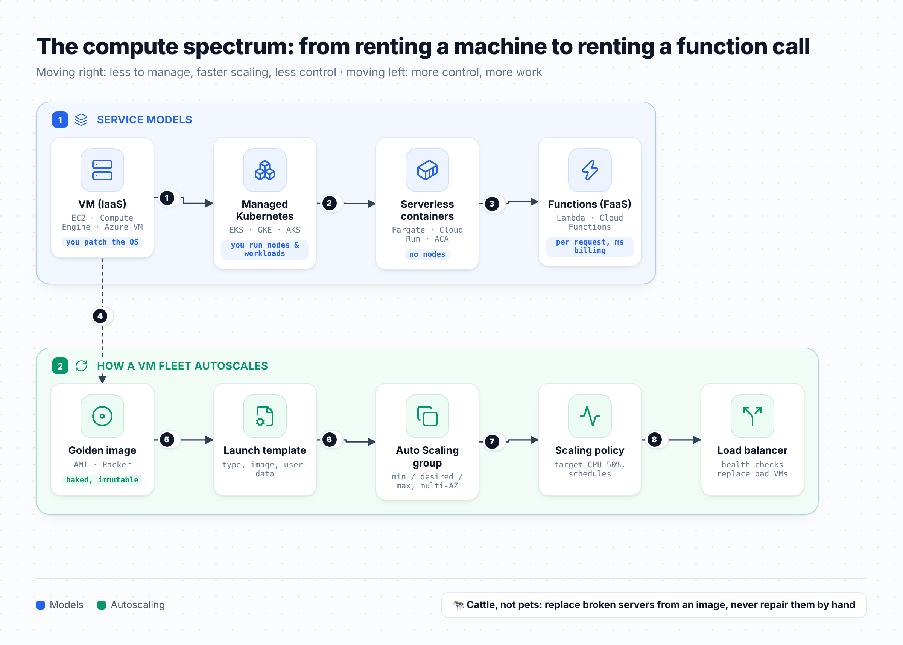

# 14.1 — Compute: VMs, containers & serverless

!!! abstract "In short"
    Cloud compute is a spectrum: **VMs** give you a whole machine (and its patching), **managed Kubernetes** runs your
    containers on nodes you still size, **serverless containers** and **functions** hide servers completely and bill per
    request. Whichever you choose, production compute is built from **immutable images**, kept alive by **health checks
    and autoscaling** across zones, and sized from **measurements**, not guesses.

## 📖 Key terms & abbreviations

| Term | Stands for | What it is | How it works (one line) |
|---|---|---|---|
| **Instance type** | — | VM size and shape | `m7i.large` = family m (general), gen 7, Intel, size large |
| **vCPU** | virtual CPU | One hardware thread on the host | 2 vCPU ≈ 1 physical core with SMT |
| **Instance family** | — | CPU:RAM ratio and specialty | General (m), compute (c), memory (r), GPU (p/g), burstable (t) |
| **AMI / image** | Amazon Machine Image | Disk template a VM boots from | Built by Packer/image pipelines |
| **user-data / cloud-init** | — | Script run at first boot | Bootstraps config, joins a cluster |
| **ASG / MIG / VMSS** | Auto Scaling Group / Managed Instance Group / VM Scale Set | Self-healing fleet of identical VMs | min/desired/max + health checks |
| **Health check** | — | Probe that decides if an instance is good | Failing instances are replaced |
| **Immutable infrastructure** | — | Never change running servers | New image → rolling replace |
| **Spot** | — | Spare capacity at a discount | ~2 min interruption notice (13) |
| **Graviton / Axion / Cobalt** | — | Cloud providers' ARM CPUs | Often better price-performance (4.x multi-arch) |
| **FaaS** | Function as a Service | Code run per event | Lambda, Cloud Run functions, Azure Functions |
| **Cold start** | — | Delay when a new instance starts | Runtime boot + code init; ms to seconds |
| **Nitro / hypervisor** | — | Virtualization layer | Offloads network/storage to cards (3.x, 2.x) |

## 🗺️ Big picture



---

## 1 · Virtual machines and instance types

### How does it work?

A VM is a slice of a physical server: the **hypervisor** (on AWS the Nitro system, with networking and storage offloaded to dedicated cards) gives it vCPUs, RAM, virtual NICs and disks. You pick an **instance type**: the family sets the CPU:memory ratio (general 1:4, compute 1:2, memory 1:8), the generation sets the CPU, the size scales both.

- **Burstable** (`t` types) accumulate CPU credits when idle and spend them under load; fine for small, spiky workloads, painful when credits run out.
- **ARM** instances are usually 10–40% cheaper for the same work; build **multi-arch images** (9.1) and test.
- **Local NVMe** (instance store) is fast but **ephemeral**: gone when the instance stops.
- **Placement**: spread instances across AZs; use placement groups only for HPC/AI networking needs.

## 2 · Images and immutable servers

Configuring servers by hand (or by SSHing in with scripts) creates **snowflakes**: each one slightly different, impossible to recreate. The cloud way:

1. **Bake** an image with Packer or an image pipeline: OS patches, agents, runtime.
2. Keep **boot-time config** small (cloud-init/user-data: fetch secrets via the instance role, register with a service).
3. **Never patch in place**: build a new image, roll it out by replacing instances (an ASG instance refresh).
4. Disable SSH; use Session Manager / IAP / serial console for emergencies, all audited.

## 3 · Self-healing fleets: Auto Scaling groups

An **ASG** (AWS), **MIG** (GCP) or **VMSS** (Azure) keeps N identical instances from a **launch template** across zones:

- **Health checks**: EC2 status + load balancer health; failing instances are terminated and replaced automatically.
- **Scaling policies**: target tracking (keep CPU at 50%, or requests per target at 1,000), step scaling, scheduled scaling (scale up at 08:00), predictive scaling.
- **Lifecycle hooks**: drain connections, ship logs before termination.
- **Instance refresh / rolling update**: replaces instances gradually with a new template version.
- **Mixed instances**: several types + on-demand base + spot above it, to survive spot interruptions.

## 4 · Containers: managed Kubernetes vs serverless containers

| | Managed Kubernetes (EKS/GKE/AKS) | Serverless containers (Cloud Run, Fargate, Container Apps) |
|---|---|---|
| You manage | Nodes (or Autopilot/Karpenter), add-ons, upgrades | Just the container + config |
| Flexibility | Anything: DaemonSets, GPUs, operators, service mesh | HTTP/jobs, limited sidecars and privileges |
| Scaling | HPA + node autoscaling (15.4) | Per request, can scale to zero |
| Billing | Nodes per second (+ control plane fee) | vCPU-seconds and GB-seconds while running |
| Good for | Platforms with many services and teams | A few services, small teams, spiky traffic |

## 5 · Functions (FaaS)

A function runs your handler per **event** (HTTP request, queue message, file upload, schedule). The platform starts execution environments on demand and freezes or discards them when idle.

- **Cold starts**: first request to a new environment pays runtime + init time (tens of ms for Go/Rust, up to seconds for large JVM apps). Mitigate with small packages, provisioned concurrency, or SnapStart-like snapshots.
- **Limits**: max duration (Lambda: 15 min), memory, payload size, concurrency per account.
- **Great for**: event glue (S3 upload → thumbnail), webhooks, scheduled jobs, low-traffic APIs. **Poor for**: long-running, steady high-traffic or latency-critical services where per-request pricing costs more than containers.

## 6 · Choosing

1. Is it a long-running service with steady traffic and many teams? → **containers on Kubernetes**.
2. A few stateless HTTP services or jobs, small team? → **serverless containers**.
3. Small event-driven glue code? → **functions**.
4. Legacy software, special kernels/licenses, or appliances? → **VMs in an ASG**.
5. Stateful databases? → **managed database services** (14.2), not any of the above.

## 🔧 DevOps connection

- **Golden image pipeline** (Packer + CI, signed, scanned) is the VM equivalent of a container build.
- **Quotas**: new accounts have low vCPU/GPU quotas; request increases before launch day.
- **Right-sizing** starts with metrics: p95 CPU and memory over weeks, not one busy afternoon (13).
- **IMDSv2** (instance metadata with session tokens) blocks SSRF attacks that steal instance credentials; enforce it.

## 🧪 Try it yourself

```bash
# Compare instance shapes and prices (AWS CLI, read-only)
aws ec2 describe-instance-types --filters Name=instance-type,Values='m7i.large,m7g.large,c7g.large,r7g.large' \
  --query 'InstanceTypes[].[InstanceType,VCpuInfo.DefaultVCpus,MemoryInfo.SizeInMiB,ProcessorInfo.SupportedArchitectures[0]]' --output table

# Inside any EC2 instance: who am I? (IMDSv2)
TOKEN=$(curl -sX PUT http://169.254.169.254/latest/api/token -H "X-aws-ec2-metadata-token-ttl-seconds: 60")
curl -sH "X-aws-ec2-metadata-token: $TOKEN" http://169.254.169.254/latest/meta-data/instance-type; echo

# Deploy a container to Cloud Run (scales to zero)
gcloud run deploy hello --image us-docker.pkg.dev/cloudrun/container/hello --region europe-west4 --allow-unauthenticated

# Measure a cold start: first call vs second call
URL=$(gcloud run services describe hello --region europe-west4 --format='value(status.url)')
for i in 1 2; do curl -so /dev/null -w "%{time_total}s\n" $URL; done
```

## 🃏 Cheat sheet

| Need | Pick |
|---|---|
| General web/API | General purpose (m), ARM if possible |
| CPU-heavy (encoding, builds) | Compute optimized (c) |
| Caches, in-memory DBs | Memory optimized (r/x) |
| Small, mostly idle | Burstable (t), watch credits |
| Training/inference | GPU (p/g, a3/g2) — see Chapter 10 |
| Fleet that heals itself | ASG/MIG + LB health checks |
| Change a server | Build a new image, roll it out |

## ❓ Test yourself

??? question "1. What does each part of `m7g.xlarge` mean?"
    `m` = general purpose family, `7` = generation, `g` = Graviton (ARM) processor, `xlarge` = size (4 vCPUs, 16 GiB for this family).

??? question "2. Why bake images instead of configuring servers after boot with SSH scripts?"
    Baked images are identical, tested and fast to boot; servers configured by hand drift into unique snowflakes that can't be reproduced or safely replaced.

??? question "3. How does an Auto Scaling group heal a broken instance?"
    Health checks (instance status and load balancer checks) mark it unhealthy; the group terminates it and launches a replacement from the launch template to keep the desired count.

??? question "4. What is a cold start and how can you reduce it?"
    The delay when a new execution environment starts (runtime boot + initialization). Reduce it with small packages and fast runtimes, lazy initialization, provisioned/minimum instances or snapshot-based start.

??? question "5. When are functions more expensive than containers?"
    For steady, high-traffic workloads: per-request and per-ms pricing adds up beyond the cost of always-on containers or VMs that serve many requests concurrently.

---

## 📚 Sources

- [AWS — Amazon EC2 instance types](https://aws.amazon.com/ec2/instance-types/)
- [AWS — Amazon EC2 Auto Scaling user guide](https://docs.aws.amazon.com/autoscaling/ec2/userguide/what-is-amazon-ec2-auto-scaling.html)
- [Google Cloud — Cloud Run overview](https://cloud.google.com/run/docs/overview/what-is-cloud-run)
- [AWS Lambda — Execution environment lifecycle](https://docs.aws.amazon.com/lambda/latest/dg/lambda-runtime-environment.html)
- [HashiCorp Packer](https://developer.hashicorp.com/packer)

## ✍️ My notes

> Pick one of your services: would it be cheaper and simpler on VMs, Kubernetes, serverless containers or functions? Why?
