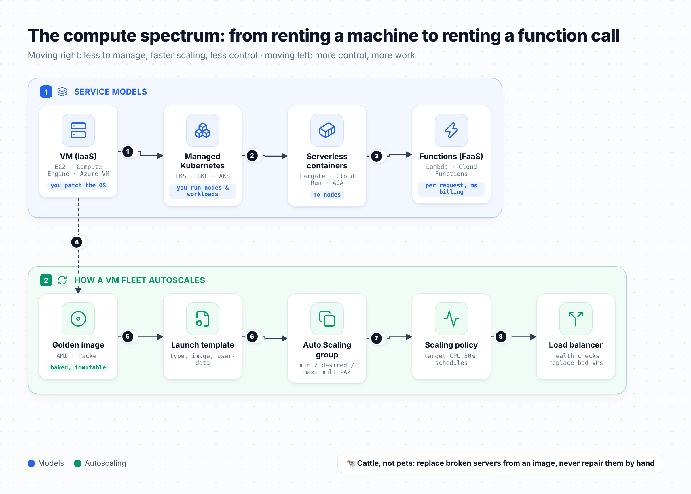

# 14.1 — Compute: VM'ler, container'lar ve sunucusuz

!!! abstract "Tek cümlede"
    Bulut compute bir yelpazedir: **VM'ler** sana bütün bir makine (ve onun yamalarını) verir, **yönetilen Kubernetes**
    container'larını hâlâ senin boyutladığın node'larda çalıştırır, **sunucusuz container'lar** ve **fonksiyonlar**
    sunucuları tamamen gizler ve istek başına faturalar; hangisini seçersen seç, production compute **değişmez imajlardan**
    kurulur, zone'lar arasında **sağlık kontrolleri ve otomatik ölçekleme** ile ayakta tutulur ve tahminle değil
    **ölçümle** boyutlandırılır.

## 📖 Temel terimler ve kısaltmalar

| Terim | Açılımı | Nedir | Nasıl çalışır (tek satır) |
|---|---|---|---|
| **Instance tipi** | Instance type | VM boyutu ve şekli | `m7i.large` = m ailesi (genel), 7. nesil, Intel, large boyut |
| **vCPU** | virtual CPU | Sunucudaki bir donanım thread'i | 2 vCPU ≈ SMT ile 1 fiziksel çekirdek |
| **Instance ailesi** | Instance family | CPU:RAM oranı ve uzmanlık | Genel (m), compute (c), bellek (r), GPU (p/g), patlamalı (t) |
| **AMI / imaj** | Amazon Machine Image | Bir VM'in boot ettiği disk şablonu | Packer/imaj pipeline'larıyla üretilir |
| **user-data / cloud-init** | — | İlk boot'ta çalışan betik | Yapılandırmayı kurar, cluster'a katılır |
| **ASG / MIG / VMSS** | Auto Scaling Group / Managed Instance Group / VM Scale Set | Kendini iyileştiren özdeş VM filosu | min/istenen/max + sağlık kontrolleri |
| **Sağlık kontrolü** | Health check | Bir instance'ın iyi olup olmadığına karar veren yoklama | Başarısız instance'lar değiştirilir |
| **Değişmez altyapı** | Immutable infrastructure | Çalışan sunucuları asla değiştirme | Yeni imaj → kademeli değiştirme |
| **Spot** | — | İndirimli boş kapasite | ~2 dk kesinti uyarısı (13) |
| **Graviton / Axion / Cobalt** | — | Bulut sağlayıcılarının ARM CPU'ları | Genelde daha iyi fiyat-performans (4.x çok mimari) |
| **FaaS** | Function as a Service | Olay başına çalışan kod | Lambda, Cloud Run functions, Azure Functions |
| **Soğuk başlangıç** | Cold start | Yeni bir instance başlarken oluşan gecikme | Runtime boot + kod başlatma; ms'den saniyelere |
| **Nitro / hypervisor** | — | Sanallaştırma katmanı | Ağ/depolamayı kartlara devreder (3.x, 2.x) |

## 🗺️ Büyük resim



---

## 1 · Sanal makineler ve instance tipleri

### Nasıl çalışır?

Bir VM fiziksel bir sunucunun dilimidir: **hypervisor** (AWS'te ağ ve depolamanın özel kartlara devredildiği Nitro sistemi) ona vCPU, RAM, sanal NIC ve diskler verir. Bir **instance tipi** seçersin: aile CPU:bellek oranını (genel 1:4, compute 1:2, bellek 1:8), nesil CPU'yu, boyut ikisini birden belirler.

- **Patlamalı** (`t` tipleri) boştayken CPU kredisi biriktirir ve yük altında harcar; küçük, ani iş yükleri için iyidir, krediler bitince acı verir.
- **ARM** instance'lar aynı iş için genelde %10–40 daha ucuzdur; **çok mimarili imajlar** üret (9.1) ve test et.
- **Yerel NVMe** (instance store) hızlıdır ama **geçicidir**: instance durunca gider.
- **Yerleşim**: instance'ları AZ'lere yay; placement group'ları sadece HPC/AI ağ ihtiyaçları için kullan.

## 2 · İmajlar ve değişmez sunucular

Sunucuları elle (ya da SSH ile girip betiklerle) yapılandırmak **kar tanesi** sunucular yaratır: her biri biraz farklı, yeniden oluşturulması imkânsız. Bulut yolu:

1. Packer ya da bir imaj pipeline'ıyla bir imaj **pişir**: OS yamaları, ajanlar, runtime.
2. **Boot anı yapılandırmasını** küçük tut (cloud-init/user-data: secret'ları instance rolüyle çek, bir servise kaydol).
3. **Asla yerinde yamalama**: yeni bir imaj üret, instance'ları değiştirerek yay (bir ASG instance refresh).
4. SSH'ı kapat; acil durumlar için Session Manager / IAP / seri konsol kullan, hepsi denetlenir.

## 3 · Kendini iyileştiren filolar: Auto Scaling grupları

Bir **ASG** (AWS), **MIG** (GCP) ya da **VMSS** (Azure), bir **launch template**'ten N özdeş instance'ı zone'lar arasında tutar:

- **Sağlık kontrolleri**: EC2 durumu + load balancer sağlığı; başarısız instance'lar otomatik sonlandırılır ve değiştirilir.
- **Ölçekleme politikaları**: hedef takibi (CPU'yu %50'de tut ya da hedef başına istekleri 1.000'de), adımlı ölçekleme, zamanlanmış ölçekleme (08:00'de büyüt), tahmine dayalı ölçekleme.
- **Yaşam döngüsü kancaları**: sonlandırmadan önce bağlantıları boşalt, logları gönder.
- **Instance refresh / kademeli güncelleme**: instance'ları yeni bir template sürümüyle yavaş yavaş değiştirir.
- **Karışık instance'lar**: birkaç tip + on-demand taban + üstünde spot; spot kesintilerinden sağ çıkmak için.

## 4 · Container'lar: yönetilen Kubernetes ve sunucusuz container'lar

| | Yönetilen Kubernetes (EKS/GKE/AKS) | Sunucusuz container'lar (Cloud Run, Fargate, Container Apps) |
|---|---|---|
| Senin yönettiğin | Node'lar (ya da Autopilot/Karpenter), eklentiler, yükseltmeler | Sadece container + yapılandırma |
| Esneklik | Her şey: DaemonSet, GPU, operator, service mesh | HTTP/işler, sınırlı sidecar ve yetkiler |
| Ölçekleme | HPA + node ölçekleme (15.4) | İstek başına, sıfıra ölçeklenebilir |
| Faturalama | Saniye başına node'lar (+ control plane ücreti) | Çalışırken vCPU-saniye ve GB-saniye |
| Uygun olduğu yer | Çok servisli ve çok ekipli platformlar | Birkaç servis, küçük ekipler, ani trafik |

## 5 · Fonksiyonlar (FaaS)

Bir fonksiyon handler'ını her **olayda** çalıştırır (HTTP isteği, kuyruk mesajı, dosya yükleme, zamanlama). Platform çalışma ortamlarını talep üzerine başlatır, boştayken dondurur ya da atar.

- **Soğuk başlangıçlar**: yeni bir ortama gelen ilk istek runtime + başlatma süresini öder (Go/Rust için onlarca ms, büyük JVM uygulamaları için saniyelere kadar). Küçük paketler, provisioned concurrency ya da SnapStart benzeri snapshot'larla azalt.
- **Limitler**: en uzun süre (Lambda: 15 dk), bellek, yük boyutu, hesap başına eşzamanlılık.
- **Harika olduğu yerler**: olay yapıştırıcısı (S3 yükleme → küçük resim), webhook'lar, zamanlanmış işler, düşük trafikli API'ler. **Kötü olduğu yerler**: uzun süren, sabit yüksek trafikli ya da gecikmeye kritik servisler; istek başına fiyatlandırma container'lardan pahalıya gelir.

## 6 · Seçim

1. Sabit trafikli, çok ekipli uzun süre çalışan bir servis mi? → **Kubernetes'te container'lar**.
2. Birkaç durumsuz HTTP servisi ya da iş, küçük ekip mi? → **sunucusuz container'lar**.
3. Küçük, olay güdümlü yapıştırıcı kod mu? → **fonksiyonlar**.
4. Eski yazılım, özel kernel/lisans ya da appliance mı? → **ASG'de VM'ler**.
5. Durum tutan veritabanları mı? → yukarıdakilerin hiçbiri değil, **yönetilen veritabanı servisleri** (14.2).

## 🔧 DevOps bağlantısı

- **Altın imaj pipeline'ı** (Packer + CI, imzalı, taranmış) bir container build'inin VM karşılığıdır.
- **Kotalar**: yeni hesapların vCPU/GPU kotaları düşüktür; lansman gününden önce artış iste.
- **Doğru boyutlandırma** ölçümle başlar: tek bir yoğun öğleden sonra değil, haftalar boyunca p95 CPU ve bellek (13).
- **IMDSv2** (oturum token'lı instance metadata) instance kimlik bilgilerini çalan SSRF saldırılarını engeller; zorunlu kıl.

## 🧪 Kendin dene

```bash
# Instance şekillerini karşılaştır (AWS CLI, salt okunur)
aws ec2 describe-instance-types --filters Name=instance-type,Values='m7i.large,m7g.large,c7g.large,r7g.large' \
  --query 'InstanceTypes[].[InstanceType,VCpuInfo.DefaultVCpus,MemoryInfo.SizeInMiB,ProcessorInfo.SupportedArchitectures[0]]' --output table

# Herhangi bir EC2 instance'ının içinde: ben kimim? (IMDSv2)
TOKEN=$(curl -sX PUT http://169.254.169.254/latest/api/token -H "X-aws-ec2-metadata-token-ttl-seconds: 60")
curl -sH "X-aws-ec2-metadata-token: $TOKEN" http://169.254.169.254/latest/meta-data/instance-type; echo

# Cloud Run'a bir container deploy et (sıfıra ölçeklenir)
gcloud run deploy hello --image us-docker.pkg.dev/cloudrun/container/hello --region europe-west4 --allow-unauthenticated

# Soğuk başlangıcı ölç: ilk çağrı ve ikinci çağrı
URL=$(gcloud run services describe hello --region europe-west4 --format='value(status.url)')
for i in 1 2; do curl -so /dev/null -w "%{time_total}s\n" $URL; done
```

## 🃏 Hatırlatma kartı

| İhtiyaç | Seçim |
|---|---|
| Genel web/API | Genel amaçlı (m), mümkünse ARM |
| CPU yoğun (encoding, build) | Compute optimize (c) |
| Önbellekler, bellek içi DB'ler | Bellek optimize (r/x) |
| Küçük, çoğunlukla boşta | Patlamalı (t), kredileri izle |
| Eğitim/çıkarım | GPU (p/g, a3/g2), bkz. Bölüm 10 |
| Kendini iyileştiren filo | ASG/MIG + LB sağlık kontrolleri |
| Bir sunucuyu değiştirmek | Yeni imaj üret, yay |

## ❓ Kendini test et

??? question "1. `m7g.xlarge`'ın her parçası ne anlama geliyor?"
    `m` = genel amaçlı aile, `7` = nesil, `g` = Graviton (ARM) işlemci, `xlarge` = boyut (bu ailede 4 vCPU, 16 GiB).

??? question "2. Sunucuları boot'tan sonra SSH betikleriyle yapılandırmak yerine neden imaj pişirmeli?"
    Pişirilmiş imajlar özdeş, test edilmiş ve hızlı boot eder; elle yapılandırılan sunucular yeniden üretilemeyen ve güvenle değiştirilemeyen benzersiz kar tanelerine dönüşür.

??? question "3. Bir Auto Scaling grubu bozuk bir instance'ı nasıl iyileştirir?"
    Sağlık kontrolleri (instance durumu ve load balancer kontrolleri) onu sağlıksız işaretler; grup onu sonlandırır ve istenen sayıyı korumak için launch template'ten yenisini başlatır.

??? question "4. Soğuk başlangıç nedir ve nasıl azaltılır?"
    Yeni bir çalışma ortamı başlarken oluşan gecikme (runtime boot + başlatma). Küçük paketler ve hızlı runtime'lar, tembel başlatma, provisioned/minimum instance'lar ya da snapshot tabanlı başlatmayla azaltılır.

??? question "5. Fonksiyonlar container'lardan ne zaman daha pahalıdır?"
    Sabit, yüksek trafikli iş yüklerinde: istek ve ms başına fiyatlandırma, aynı anda çok isteğe hizmet veren sürekli açık container ya da VM'lerin maliyetini aşar.

---

## 📚 Kaynaklar

- [AWS — Amazon EC2 instance types](https://aws.amazon.com/ec2/instance-types/)
- [AWS — Amazon EC2 Auto Scaling user guide](https://docs.aws.amazon.com/autoscaling/ec2/userguide/what-is-amazon-ec2-auto-scaling.html)
- [Google Cloud — Cloud Run overview](https://cloud.google.com/run/docs/overview/what-is-cloud-run)
- [AWS Lambda — Execution environment lifecycle](https://docs.aws.amazon.com/lambda/latest/dg/lambda-runtime-environment.html)
- [HashiCorp Packer](https://developer.hashicorp.com/packer)

## ✍️ Notlarım

> Servislerinden birini seç: VM'lerde, Kubernetes'te, sunucusuz container'larda ya da fonksiyonlarda daha ucuz ve basit olur muydu? Neden?

-
