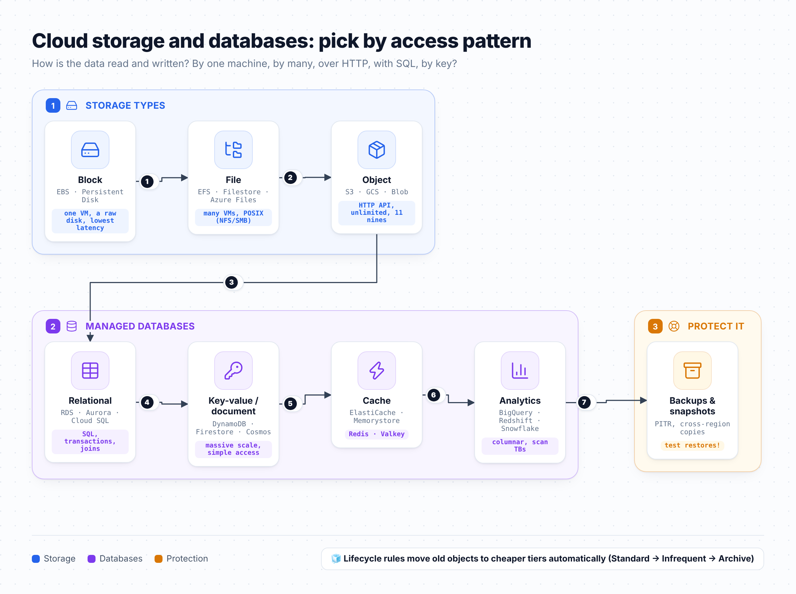

# 14.2 — Storage & databases in the cloud

!!! abstract "In one sentence"
    Choose storage by **how data is accessed**: **block** volumes are raw disks for one machine, **file** shares are POSIX
    folders for many machines, **object** storage is an HTTP key-value store with virtually unlimited size and very high
    durability; choose a **managed database** by data model and scale (relational for transactions, key-value/document for
    massive simple access, cache for speed, warehouse for analytics); and protect everything with **backups you have
    actually restored**.

## 📖 Key terms & abbreviations

| Term | Stands for | What it is | How it works (one line) |
|---|---|---|---|
| **Block storage** | — | Network-attached virtual disk | EBS, Persistent Disk; one VM (mostly) |
| **IOPS** | I/O Operations Per Second | Small random I/O capacity | gp3: baseline 3,000, provisioned up to 16,000 |
| **Throughput** | — | MB/s for large sequential I/O | Separate limit from IOPS |
| **File storage** | — | Shared filesystem over NFS/SMB | EFS, Filestore, Azure Files |
| **Object storage** | — | Flat bucket of objects via HTTP API | S3, GCS, Azure Blob |
| **Durability / availability** | — | Chance data survives / is reachable | S3 Standard: 11 nines / 99.99% |
| **Storage class** | — | Price/latency tier for objects | Standard → Infrequent Access → Glacier/Archive |
| **Lifecycle rule** | — | Automatic transition or deletion by age | "Move to IA after 30 days, delete after 365" |
| **Multi-AZ (DB)** | — | Synchronous standby in another zone | Automatic failover, ~1–2 min |
| **Read replica** | — | Asynchronous copy for reads | Scales reads, may lag (12) |
| **PITR** | Point-In-Time Recovery | Restore to any second in the retention window | Snapshots + transaction logs |
| **Snapshot** | — | Incremental copy of a volume/DB | Stored in object storage |
| **Valkey** | — | Open-source Redis fork | Default engine in several managed caches |

## 🗺️ Big picture



---

## 1 · Block, file and object

### How does it work?

- **Block** volumes (EBS, Persistent Disk) look like a local disk to the OS but live on a storage network. They're replicated **within one AZ**, so a volume can only attach to instances in its zone; cross-AZ protection comes from **snapshots** or application replication. Performance is provisioned: size, IOPS and throughput.
- **File** storage (EFS, Filestore) is an NFS/SMB server managed for you, mountable by many instances or pods at once (Kubernetes `ReadWriteMany`, 15.2). Convenient, but higher latency and cost than block.
- **Object** storage (S3, GCS) stores whole objects under keys in a bucket via HTTP (`PUT`, `GET`, `LIST`). No in-place edits, no real directories, practically unlimited, replicated across AZs by default. It's where backups, logs, data lakes, static websites, ML datasets and container image layers end up.

| | Block | File | Object |
|---|---|---|---|
| Access | One VM, kernel filesystem | Many clients, NFS/SMB | Anyone with permission, HTTP |
| Latency | < 1 ms | ms | 10–100 ms first byte |
| Scope | One AZ | Region (multi-AZ) | Region (or multi-region) |
| Typical use | Databases on VMs, boot disks | Shared content, legacy apps | Backups, data lakes, assets, logs |

## 2 · Object storage in practice

- **Storage classes**: Standard (hot), Infrequent Access (cheaper storage, retrieval fee), Archive/Glacier (cheapest, minutes to hours to retrieve). **Intelligent-Tiering** moves objects automatically.
- **Lifecycle rules** transition and expire objects; also clean up incomplete multipart uploads and old versions.
- **Versioning + Object Lock** protect against accidental deletes and ransomware (immutable backups).
- **Security**: block public access at the account level, bucket policies with least privilege, encryption by default (SSE-KMS), access via VPC endpoints (13).
- **Consistency**: S3 provides strong read-after-write consistency for all operations since 2020.

## 3 · Managed relational databases

RDS, Aurora, Cloud SQL, AlloyDB and Azure Database run PostgreSQL/MySQL for you: provisioning, patching, backups, monitoring, failover.

- **Multi-AZ**: a synchronous standby in another zone; on failure, DNS flips to the standby (≈ 1–2 minutes). Applications must **reconnect** (connection pools with retries, 12).
- **Read replicas**: asynchronous copies for read scaling and analytics; reads may be stale.
- **Aurora / AlloyDB**: storage separated from compute, replicated 6 ways across 3 AZs, faster failover, up to 15 readers.
- **Connections are expensive** (one process per connection in PostgreSQL): use a pooler (PgBouncer, RDS Proxy).
- **Global scale** with strong consistency: Spanner, CockroachDB, Aurora DSQL; with trade-offs in latency and cost (12).

## 4 · NoSQL, caches and analytics

- **Key-value / document** (DynamoDB, Firestore, Cosmos DB): predictable single-digit-ms access at any scale, if you design keys around access patterns. No joins, limited queries; partition keys must spread load evenly (hot partitions throttle).
- **Caches** (ElastiCache/Memorystore with Redis or Valkey): microsecond reads for sessions, rate limits, computed results (7.2). Treat as disposable; the database is the source of truth.
- **Warehouses** (BigQuery, Redshift, Snowflake): columnar storage, scan terabytes for analytics; never point dashboards at the production OLTP database.

## 5 · Backups and recovery

1. **Automated backups + PITR** with retention matching your RPO (e.g. 7–35 days).
2. **Copy backups to another region/account** with Object Lock or vault lock, so a compromised prod account can't delete them.
3. **Test restores regularly** (monthly, automated): restore, run checks, measure time = your real RTO.
4. Back up the things that aren't databases too: object buckets (versioning/replication), Kubernetes state (Velero, 15.5), secrets and IaC state.

## 🔧 DevOps connection

- **State is the hard part** of every migration and outage; keep stateful services managed and stateless services disposable.
- **Monitor storage limits**: disk full, IOPS throttling (`VolumeQueueLength`), DB connections, replica lag, DynamoDB throttles.
- **Schema migrations** must be backward compatible during rolling deploys: expand → migrate → contract (16.2).
- Watch the **egress and request costs** of object storage for chatty workloads (13).

## 🧪 Try it yourself

```bash
# Object storage basics with the AWS CLI
B=s2c-demo-$RANDOM; aws s3 mb s3://$B
echo "hello" > hello.txt && aws s3 cp hello.txt s3://$B/a/b/hello.txt
aws s3 ls s3://$B --recursive
aws s3api put-bucket-versioning --bucket $B --versioning-configuration Status=Enabled
aws s3api put-bucket-lifecycle-configuration --bucket $B --lifecycle-configuration \
 '{"Rules":[{"ID":"tiering","Status":"Enabled","Filter":{},"Transitions":[{"Days":30,"StorageClass":"STANDARD_IA"}],"Expiration":{"Days":365}}]}'
aws s3 rb s3://$B --force

# Feel block storage latency on any Linux VM (random 4k reads)
sudo fio --name=rand --filename=/tmp/f --size=1G --rw=randread --bs=4k --iodepth=32 --direct=1 --runtime=20 --time_based | grep -E "IOPS|lat \("

# What is my database really doing? (PostgreSQL)
psql -c "select state, count(*) from pg_stat_activity group by 1;"
```

## 🃏 Cheat sheet

| Data | Store |
|---|---|
| OS disk, DB on a VM | Block (gp3/pd-balanced) |
| Shared files for many pods | File (EFS/Filestore), `ReadWriteMany` |
| Backups, logs, uploads, datasets | Object + lifecycle + versioning |
| Orders, payments, users | Managed relational, Multi-AZ |
| Huge scale, simple key access | DynamoDB / Firestore / Cosmos |
| Sessions, hot reads | Redis/Valkey cache |
| Analytics, reports | Warehouse, not the prod DB |

## ❓ Test yourself

??? question "1. Why can't an EBS volume attach to an instance in another availability zone?"
    Block volumes are replicated within a single AZ's storage network; to move data across zones you use snapshots (stored regionally) or application-level replication.

??? question "2. What's the difference between durability and availability for S3?"
    Durability is the probability your data isn't lost (11 nines); availability is the probability you can access it at a given moment (99.99% for Standard).

??? question "3. What does a Multi-AZ database give you that a read replica doesn't?"
    A synchronous standby with automatic failover and no data loss; a read replica is asynchronous, used for read scaling, and may lag behind.

??? question "4. Why do you need a connection pooler in front of PostgreSQL in Kubernetes?"
    Each connection is a backend process with memory cost; many pods with many connections can exhaust the database. A pooler multiplexes them onto fewer connections.

??? question "5. Why must backups be copied to another account?"
    If attackers or a bad script get admin access to the production account, they can delete backups stored there; a separate, locked account preserves them.

---

## 📚 Sources

- [Amazon S3 — Storage classes](https://aws.amazon.com/s3/storage-classes/) · [S3 strong consistency](https://aws.amazon.com/s3/consistency/)
- [Amazon EBS volume types](https://docs.aws.amazon.com/ebs/latest/userguide/ebs-volume-types.html)
- [Amazon RDS — Multi-AZ deployments](https://docs.aws.amazon.com/AmazonRDS/latest/UserGuide/Concepts.MultiAZ.html)
- [Google Cloud — Choose a storage option](https://cloud.google.com/architecture/storage-advisor)
- [Amazon DynamoDB — Best practices for designing partition keys](https://docs.aws.amazon.com/amazondynamodb/latest/developerguide/bp-partition-key-design.html)

## ✍️ My notes

> When was the last time your team restored a production database backup? How long did it take?

-
