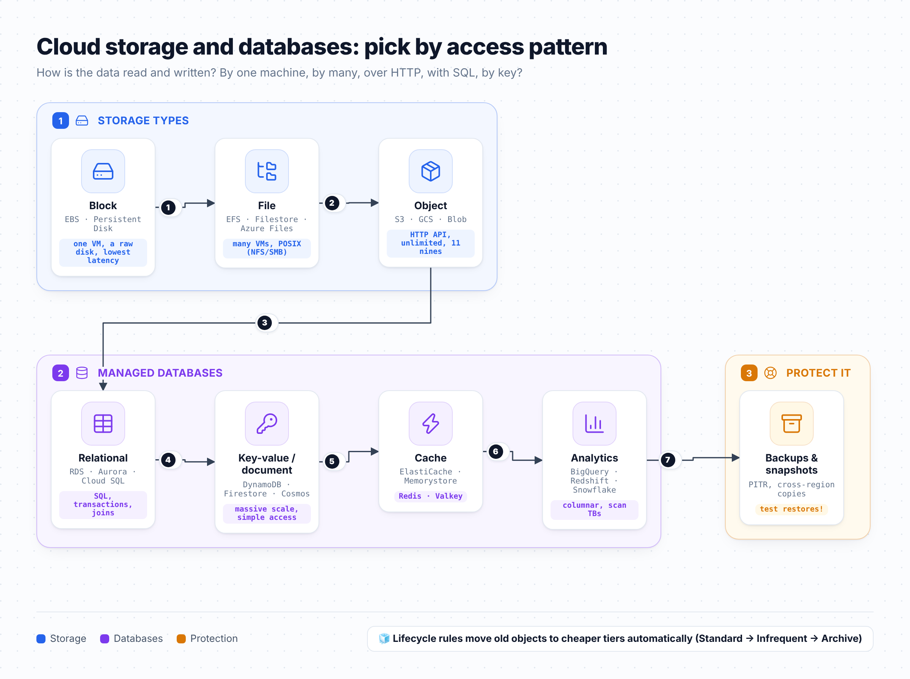

# 14.2 — Bulutta depolama ve veritabanları

!!! abstract "Kısaca"
    Depolamayı **verinin nasıl erişildiğine** göre seç: **blok** volume'lar tek bir makine için ham disklerdir,
    **dosya** paylaşımları çok makine için POSIX klasörleridir, **nesne** depolama neredeyse sınırsız boyutlu ve çok
    yüksek dayanıklılıklı bir HTTP anahtar-değer deposudur. **Yönetilen veritabanını** veri modeline ve ölçeğe göre seç
    (transaction için ilişkisel, devasa basit erişim için anahtar-değer/doküman, hız için önbellek, analitik için ambar)
    ve her şeyi **gerçekten geri yüklediğin yedeklerle** koru.

## 📖 Temel terimler ve kısaltmalar

| Terim | Açılımı | Nedir | Nasıl çalışır (tek satır) |
|---|---|---|---|
| **Blok depolama** | Block storage | Ağa bağlı sanal disk | EBS, Persistent Disk; (çoğunlukla) tek VM |
| **IOPS** | I/O Operations Per Second | Küçük rastgele I/O kapasitesi | gp3: taban 3.000, 16.000'e kadar provizyonlanır |
| **Throughput** | — | Büyük sıralı I/O için MB/s | IOPS'tan ayrı bir limit |
| **Dosya depolama** | File storage | NFS/SMB üzerinden paylaşılan dosya sistemi | EFS, Filestore, Azure Files |
| **Nesne depolama** | Object storage | HTTP API ile düz bir nesne bucket'ı | S3, GCS, Azure Blob |
| **Dayanıklılık / erişilebilirlik** | Durability / availability | Verinin hayatta kalma / ulaşılabilme olasılığı | S3 Standard: 11 dokuz / %99,99 |
| **Depolama sınıfı** | Storage class | Nesneler için fiyat/gecikme katmanı | Standard → Seyrek Erişim → Glacier/Arşiv |
| **Yaşam döngüsü kuralı** | Lifecycle rule | Yaşa göre otomatik geçiş ya da silme | "30 gün sonra IA'ya taşı, 365 gün sonra sil" |
| **Multi-AZ (DB)** | — | Başka bir zone'da senkron yedek | Otomatik failover, ~1–2 dk |
| **Okuma replikası** | Read replica | Okumalar için asenkron kopya | Okumaları ölçekler, geride kalabilir (12) |
| **PITR** | Point-In-Time Recovery | Saklama penceresindeki herhangi bir saniyeye geri dön | Snapshot'lar + transaction logları |
| **Snapshot** | — | Bir volume/DB'nin artımlı kopyası | Nesne depolamada saklanır |
| **Valkey** | — | Açık kaynak Redis fork'u | Birçok yönetilen önbellekte varsayılan motor |

## 🗺️ Büyük resim



---

## 1 · Blok, dosya ve nesne

### Nasıl çalışır?

- **Blok** volume'lar (EBS, Persistent Disk) OS'e yerel bir disk gibi görünür ama bir depolama ağında yaşar. **Tek bir AZ içinde** replike edilirler; bir volume sadece kendi zone'undaki instance'lara bağlanabilir; zone'lar arası koruma **snapshot'lardan** ya da uygulama replikasyonundan gelir. Performans provizyonlanır: boyut, IOPS ve throughput.
- **Dosya** depolama (EFS, Filestore) senin için yönetilen bir NFS/SMB sunucusudur; aynı anda çok instance ya da pod tarafından mount edilebilir (Kubernetes `ReadWriteMany`, 15.2). Kullanışlı ama bloktan daha yüksek gecikmeli ve pahalı.
- **Nesne** depolama (S3, GCS) bütün nesneleri bir bucket'ta anahtarlar altında HTTP ile saklar (`PUT`, `GET`, `LIST`). Yerinde düzenleme yok, gerçek dizin yok, pratikte sınırsız, varsayılan olarak AZ'ler arasında replike. Yedekler, loglar, veri gölleri, statik siteler, ML veri setleri ve container imaj katmanları burada biter.

| | Blok | Dosya | Nesne |
|---|---|---|---|
| Erişim | Tek VM, kernel dosya sistemi | Çok istemci, NFS/SMB | Yetkisi olan herkes, HTTP |
| Gecikme | < 1 ms | ms | İlk bayt 10–100 ms |
| Kapsam | Tek AZ | Bölge (çok AZ) | Bölge (ya da çok bölge) |
| Tipik kullanım | VM'deki veritabanları, boot diskleri | Paylaşılan içerik, eski uygulamalar | Yedekler, veri gölleri, varlıklar, loglar |

## 2 · Pratikte nesne depolama

- **Depolama sınıfları**: Standard (sıcak), Seyrek Erişim (ucuz depolama, geri alma ücreti), Arşiv/Glacier (en ucuz, geri alması dakikalar ile saatler). **Intelligent-Tiering** nesneleri otomatik taşır.
- **Yaşam döngüsü kuralları** nesneleri taşır ve süresini doldurur; yarım kalmış multipart yüklemeleri ve eski sürümleri de temizler.
- **Versiyonlama + Object Lock** yanlışlıkla silmeye ve fidye yazılımına karşı korur (değişmez yedekler).
- **Güvenlik**: herkese açık erişimi hesap seviyesinde engelle, en az yetkili bucket politikaları, varsayılan şifreleme (SSE-KMS), VPC endpoint'leri üzerinden erişim (13).
- **Tutarlılık**: S3, 2020'den beri tüm işlemler için güçlü yazma-sonrası-okuma tutarlılığı sağlar.

## 3 · Yönetilen ilişkisel veritabanları

RDS, Aurora, Cloud SQL, AlloyDB ve Azure Database PostgreSQL/MySQL'i senin için çalıştırır: provizyon, yama, yedek, izleme, failover.

- **Multi-AZ**: başka bir zone'da senkron bir yedek; hata olunca DNS yedeğe döner (≈ 1–2 dakika). Uygulamaların **yeniden bağlanması** gerekir (yeniden denemeli bağlantı havuzları, 12).
- **Okuma replikaları**: okuma ölçekleme ve analitik için asenkron kopyalar; okumalar eski olabilir.
- **Aurora / AlloyDB**: compute'tan ayrılmış depolama, 3 AZ'de 6 kopya replike, daha hızlı failover, 15'e kadar okuyucu.
- **Bağlantılar pahalıdır** (PostgreSQL'de bağlantı başına bir süreç): bir havuzlayıcı kullan (PgBouncer, RDS Proxy).
- Güçlü tutarlılıkla **global ölçek**: Spanner, CockroachDB, Aurora DSQL; gecikme ve maliyette ödünleşimlerle (12).

## 4 · NoSQL, önbellekler ve analitik

- **Anahtar-değer / doküman** (DynamoDB, Firestore, Cosmos DB): anahtarları erişim desenlerine göre tasarlarsan her ölçekte öngörülebilir tek haneli ms erişim. Join yok, sınırlı sorgular; partition anahtarları yükü eşit yaymalı (sıcak partition'lar kısılır).
- **Önbellekler** (Redis ya da Valkey ile ElastiCache/Memorystore): oturumlar, hız limitleri, hesaplanmış sonuçlar için mikrosaniye okumalar (7.2). Atılabilir say; gerçeğin kaynağı veritabanıdır.
- **Ambarlar** (BigQuery, Redshift, Snowflake): kolon bazlı depolama, analitik için terabaytları tarar; dashboard'ları asla production OLTP veritabanına bağlama.

## 5 · Yedekler ve kurtarma

1. RPO'na uyan saklama süresiyle **otomatik yedekler + PITR** (ör. 7–35 gün).
2. **Yedekleri başka bir bölgeye/hesaba kopyala**, Object Lock ya da vault lock ile; ele geçirilmiş bir prod hesabı onları silemesin.
3. **Geri yüklemeleri düzenli test et** (aylık, otomatik): geri yükle, kontrolleri çalıştır, süreyi ölç = gerçek RTO'n.
4. Veritabanı olmayan şeyleri de yedekle: nesne bucket'ları (versiyonlama/replikasyon), Kubernetes durumu (Velero, 15.5), secret'lar ve IaC state'i.

## 🔧 DevOps bağlantısı

- Her taşımanın ve kesintinin **zor kısmı durumdur**; durum tutan servisleri yönetilen, durumsuz servisleri atılabilir tut.
- **Depolama limitlerini izle**: disk dolması, IOPS kısılması (`VolumeQueueLength`), DB bağlantıları, replika gecikmesi, DynamoDB kısılmaları.
- **Şema taşımaları** kademeli deploy'lar sırasında geriye uyumlu olmalı: genişlet → taşı → daralt (16.2).
- Geveze iş yükleri için nesne depolamanın **egress ve istek maliyetlerini** izle (13).

## 🧪 Kendin dene

```bash
# AWS CLI ile nesne depolama temelleri
B=s2c-demo-$RANDOM; aws s3 mb s3://$B
echo "hello" > hello.txt && aws s3 cp hello.txt s3://$B/a/b/hello.txt
aws s3 ls s3://$B --recursive
aws s3api put-bucket-versioning --bucket $B --versioning-configuration Status=Enabled
aws s3api put-bucket-lifecycle-configuration --bucket $B --lifecycle-configuration \
 '{"Rules":[{"ID":"tiering","Status":"Enabled","Filter":{},"Transitions":[{"Days":30,"StorageClass":"STANDARD_IA"}],"Expiration":{"Days":365}}]}'
aws s3 rb s3://$B --force

# Herhangi bir Linux VM'de blok depolama gecikmesini hisset (rastgele 4k okuma)
sudo fio --name=rand --filename=/tmp/f --size=1G --rw=randread --bs=4k --iodepth=32 --direct=1 --runtime=20 --time_based | grep -E "IOPS|lat \("

# Veritabanım gerçekte ne yapıyor? (PostgreSQL)
psql -c "select state, count(*) from pg_stat_activity group by 1;"
```

## 🃏 Hatırlatma kartı

| Veri | Depo |
|---|---|
| OS diski, VM'de DB | Blok (gp3/pd-balanced) |
| Çok pod için paylaşılan dosyalar | Dosya (EFS/Filestore), `ReadWriteMany` |
| Yedekler, loglar, yüklemeler, veri setleri | Nesne + yaşam döngüsü + versiyonlama |
| Siparişler, ödemeler, kullanıcılar | Yönetilen ilişkisel, Multi-AZ |
| Devasa ölçek, basit anahtar erişimi | DynamoDB / Firestore / Cosmos |
| Oturumlar, sıcak okumalar | Redis/Valkey önbellek |
| Analitik, raporlar | Ambar, prod DB değil |

## ❓ Kendini test et

??? question "1. Bir EBS volume'u neden başka bir erişilebilirlik zone'undaki instance'a bağlanamaz?"
    Blok volume'lar tek bir AZ'nin depolama ağı içinde replike edilir; veriyi zone'lar arasında taşımak için (bölgesel saklanan) snapshot'lar ya da uygulama seviyesinde replikasyon kullanılır.

??? question "2. S3 için dayanıklılık ile erişilebilirlik arasındaki fark ne?"
    Dayanıklılık verinin kaybolmama olasılığıdır (11 dokuz); erişilebilirlik belli bir anda ona ulaşabilme olasılığıdır (Standard için %99,99).

??? question "3. Multi-AZ bir veritabanı okuma replikasının vermediği neyi verir?"
    Otomatik failover'lı ve veri kaybı olmayan senkron bir yedek; okuma replikası asenkrondur, okuma ölçeklemesi için kullanılır ve geride kalabilir.

??? question "4. Kubernetes'te PostgreSQL'in önünde neden bir bağlantı havuzlayıcısına ihtiyaç var?"
    Her bağlantı bellek maliyeti olan bir backend sürecidir; çok bağlantılı çok sayıda pod veritabanını tüketebilir. Havuzlayıcı onları daha az bağlantıya çoğullar.

??? question "5. Yedekler neden başka bir hesaba kopyalanmalı?"
    Saldırganlar ya da kötü bir betik production hesabında admin erişimi elde ederse orada saklanan yedekleri silebilir; ayrı, kilitli bir hesap onları korur.

---

## 📚 Kaynaklar

- [Amazon S3 — Storage classes](https://aws.amazon.com/s3/storage-classes/) · [S3 strong consistency](https://aws.amazon.com/s3/consistency/)
- [Amazon EBS volume types](https://docs.aws.amazon.com/ebs/latest/userguide/ebs-volume-types.html)
- [Amazon RDS — Multi-AZ deployments](https://docs.aws.amazon.com/AmazonRDS/latest/UserGuide/Concepts.MultiAZ.html)
- [Google Cloud — Choose a storage option](https://cloud.google.com/architecture/storage-advisor)
- [Amazon DynamoDB — Best practices for designing partition keys](https://docs.aws.amazon.com/amazondynamodb/latest/developerguide/bp-partition-key-design.html)

## ✍️ Notlarım

> Ekibin en son ne zaman bir production veritabanı yedeğini geri yükledi? Ne kadar sürdü?
