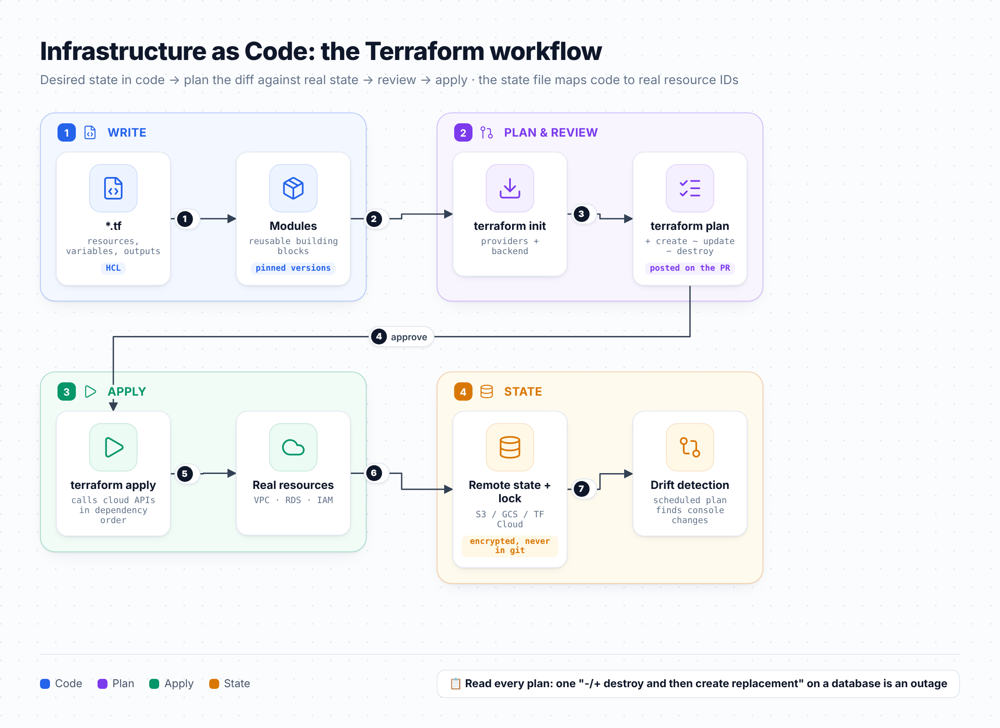

# 14.3 — Infrastructure as Code with Terraform

!!! abstract "In short"
    With **Terraform** (or its open-source fork **OpenTofu**) you describe the infrastructure you want in `.tf` files.
    `plan` compares that **desired state** with the **state file** and the real cloud, and shows exactly what will be
    created, changed or destroyed. `apply` then calls the provider APIs in **dependency order**. Kept in git, reviewed
    in pull requests, with **remote, locked state** and reusable **modules**, infrastructure becomes repeatable,
    auditable and recoverable.

## 📖 Key terms & abbreviations

| Term | Stands for | What it is | How it works (one line) |
|---|---|---|---|
| **HCL** | HashiCorp Configuration Language | Terraform's declarative language | Blocks: `resource`, `variable`, `output`, `module` |
| **Provider** | — | Plugin that talks to an API | `aws`, `google`, `azurerm`, `kubernetes`, `github` |
| **Resource** | — | One managed object | `aws_s3_bucket.logs` |
| **Data source** | — | Read-only lookup | Find an AMI, an existing VPC |
| **State** | — | Map from code to real resource IDs + attributes | `terraform.tfstate`, JSON |
| **Backend** | — | Where state is stored | S3 (+ lock), GCS, Azure Blob, HCP Terraform |
| **Lock** | — | Prevents two applies at once | S3 lockfile / DynamoDB, GCS native |
| **Plan / apply** | — | Preview diff / execute it | `+` create, `~` update, `-/+` replace, `-` destroy |
| **Module** | — | Reusable group of resources | Inputs (variables) → outputs |
| **Drift** | — | Reality differs from code | Console changes, other tools |
| **Import** | — | Adopt an existing resource into state | `import` block, then plan shows no changes |
| **OpenTofu** | — | Linux Foundation fork of Terraform (MPL) | Same language, drop-in for most uses |
| **Policy as code** | — | Rules checked on plans | OPA/Conftest, Checkov, Sentinel |

## 🗺️ Big picture



---

## 1 · The model: desired state, real state, recorded state

### How does it work?

```hcl
terraform {
  required_providers { aws = { source = "hashicorp/aws", version = "~> 6.0" } }
  backend "s3" {
    bucket       = "acme-tfstate"
    key          = "prod/network.tfstate"
    region       = "eu-central-1"
    use_lockfile = true
  }
}

resource "aws_vpc" "main" { cidr_block = "10.20.0.0/16" }

resource "aws_subnet" "private_a" {
  vpc_id            = aws_vpc.main.id        # reference = dependency edge
  cidr_block        = "10.20.1.0/24"
  availability_zone = "eu-central-1a"
}
```

1. **init** downloads providers (pinned in `.terraform.lock.hcl`) and configures the backend.
2. **plan** reads state, **refreshes** it from the real APIs, builds a **dependency graph** from references (subnet depends on VPC), and diffs desired vs real.
3. **apply** executes the plan, in parallel where the graph allows, and writes the new IDs and attributes into state.

**State exists** because the cloud doesn't know which resources "belong" to this code; state is the mapping (`aws_vpc.main` → `vpc-0abc…`). It can contain secrets (DB passwords, keys): keep it **encrypted, access-controlled, never in git**.

## 2 · Reading a plan (the most important skill)

| Symbol | Meaning | Watch out |
|---|---|---|
| `+` | create | Costs, naming, quotas |
| `~` | update in place | Usually safe |
| `-/+` | **destroy then create** (replacement) | On a database, disk or cluster: data loss/outage. Caused by "ForceNew" attributes (e.g. changing a DB's name or AZ) |
| `-` | destroy | Was it intended? |
| `<=` | read data source | — |

Protect critical resources with `lifecycle { prevent_destroy = true }`, deletion protection on databases, and `create_before_destroy` where replacements are needed.

## 3 · Structure: modules, environments, state boundaries

- **Modules** package a pattern (a VPC, an EKS cluster, a service with its IAM role) with inputs and outputs; pin versions (`source = "git::…?ref=v1.4.0"` or a registry version).
- **Split state** by blast radius and change rate: network, cluster, data, each application, per environment. One giant state = slow plans and huge risk; too many = dependency spaghetti. Pass values via outputs + `terraform_remote_state` or data sources.
- **Environments**: separate directories (or Terragrunt/stacks) per env with the same modules and different variables; avoid one workspace accidentally pointing at prod.
- **Variables**: typed, with validation; secrets come from a secret manager or environment variables, never committed `.tfvars`.

## 4 · Terraform in CI/CD

1. On PR: `fmt -check`, `validate`, `tflint`, security/policy scans (Checkov, Trivy config, Conftest), **plan** posted as a PR comment, cost diff (Infracost, 13).
2. Review the plan, not just the code.
3. On merge: **apply the reviewed plan file** (`plan -out` → `apply plan.tfplan`) with a CI role obtained through **OIDC** (11), one environment at a time, with approvals for prod.
4. Nightly **drift detection**: `plan -detailed-exitcode` exits 2 if reality changed → alert.

Tools: Atlantis, HCP Terraform, Spacelift, env0, or plain GitHub Actions.

## 5 · Drift, imports and refactoring

- **Drift**: someone changed something in the console. Either bring code in line, or let apply revert it. Prevent with read-only console access in prod.
- **Import** existing resources: write the resource, add an `import { to = aws_s3_bucket.logs, id = "acme-logs" }` block, plan until "no changes".
- **Refactor** without destroying: `moved { from = … to = … }` blocks when renaming or moving into modules; `removed` blocks to stop managing something without deleting it.

## 6 · Alternatives

| Tool | Style | Notes |
|---|---|---|
| Terraform / OpenTofu | Declarative HCL, any provider | Most widely used; OpenTofu adds state encryption |
| Pulumi | General-purpose languages (TS, Python, Go) | Loops/abstractions in real code |
| CloudFormation / CDK | AWS-native | No state file to manage; CDK compiles code to templates |
| Bicep | Azure-native | Clean syntax over ARM |
| Crossplane | Kubernetes CRDs reconcile cloud resources | GitOps for infrastructure (15.3) |

## 🔧 DevOps connection

- **Infrastructure changes are deployments**: same review, testing, gradual rollout and rollback thinking as application code.
- Keep **modules boring and well documented**; they are your platform's API (16.4).
- **Version everything**: Terraform/OpenTofu, providers, modules. Upgrade on purpose.
- Bootstrapping problem: the state bucket and CI role are created once by a small "bootstrap" stack.

## 🧪 Try it yourself

```bash
# No cloud account needed: manage local files and a Docker container with Terraform/OpenTofu
mkdir tfdemo && cd tfdemo
cat > main.tf <<'EOF'
terraform {
  required_providers { docker = { source = "kreuzwerker/docker", version = "~> 3.0" } }
}
resource "docker_image" "nginx" { name = "nginx:alpine" }
resource "docker_container" "web" {
  name  = "tf-web"
  image = docker_image.nginx.image_id
  ports {
    internal = 80
    external = 8088
  }
}
output "url" { value = "http://localhost:8088" }
EOF
terraform init && terraform plan          # or: tofu init && tofu plan
terraform apply -auto-approve && curl -sI localhost:8088 | head -1
docker rm -f tf-web; terraform plan       # drift! plan wants to recreate it
terraform state list && terraform show | head -20
terraform destroy -auto-approve
```

## 🃏 Cheat sheet

| Command | Use |
|---|---|
| `init -upgrade` | Download/upgrade providers and modules |
| `fmt -recursive` / `validate` | Style and syntax |
| `plan -out=p.tfplan` | Save the exact plan to apply |
| `apply p.tfplan` | Apply what was reviewed |
| `state list` / `state show X` | Inspect state |
| `plan -refresh-only` | See drift without changing anything |
| `import` / `moved` / `removed` blocks | Adopt, rename, forget resources |
| `force-unlock ID` | Only if a crashed run left a lock |

## ❓ Test yourself

??? question "1. Why does Terraform need a state file?"
    To map each resource in code to the real object it created (IDs and attributes), so it can compute diffs, update and destroy the right things; the cloud API alone doesn't know which resources belong to your configuration.

??? question "2. What does `-/+` in a plan mean and why is it dangerous?"
    Replacement: the resource will be destroyed and recreated because an immutable attribute changed. On stateful resources like databases or disks it means data loss or downtime.

??? question "3. Why use remote state with locking?"
    So the whole team and CI share one source of truth, and two applies can't run at the same time and corrupt state.

??? question "4. How do you bring a manually created bucket under Terraform management without recreating it?"
    Write the matching resource block and an `import` block (or `terraform import`), then run plan until it shows no changes.

??? question "5. What should a CI pipeline do on a Terraform pull request?"
    Format and validate, lint and policy/security scan, run plan and post it (plus cost diff) on the PR for review; apply only the reviewed plan after merge, using short-lived OIDC credentials.

---

## 📚 Sources

- [Terraform documentation](https://developer.hashicorp.com/terraform/docs) · [OpenTofu documentation](https://opentofu.org/docs/)
- [Terraform — State](https://developer.hashicorp.com/terraform/language/state) · [S3 backend](https://developer.hashicorp.com/terraform/language/backend/s3)
- [Terraform — Import blocks](https://developer.hashicorp.com/terraform/language/import) · [Refactoring with moved blocks](https://developer.hashicorp.com/terraform/language/modules/develop/refactoring)
- [Google Cloud — Best practices for Terraform](https://cloud.google.com/docs/terraform/best-practices/general-style-structure)
- [Checkov](https://www.checkov.io/) · [Infracost](https://www.infracost.io/)

## ✍️ My notes

> Which resources in your environment were created by hand? What would it take to import them?
