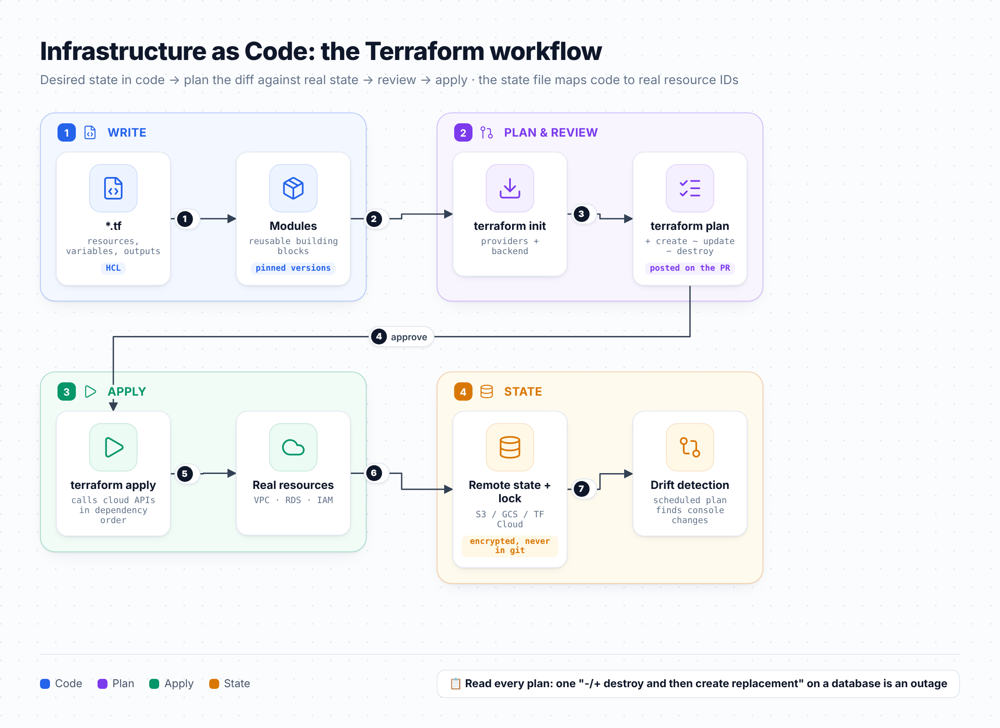

# 14.3 — Terraform ile kod olarak altyapı

!!! abstract "Tek cümlede"
    **Terraform** (ya da açık kaynak fork'u **OpenTofu**) ile istediğin altyapıyı `.tf` dosyalarında tarif edersin;
    `plan` bu **istenen durumu** **state dosyası** ve gerçek bulutla karşılaştırır, tam olarak neyin oluşturulacağını,
    değişeceğini ya da yok edileceğini gösterir, `apply` de provider API'lerini **bağımlılık sırasıyla** çağırır; git'te
    tutulan, pull request'lerde incelenen, **uzak ve kilitli state** ve yeniden kullanılabilir **modüllerle** altyapıyı
    tekrarlanabilir, denetlenebilir ve kurtarılabilir yapar.

## 📖 Temel terimler ve kısaltmalar

| Terim | Açılımı | Nedir | Nasıl çalışır (tek satır) |
|---|---|---|---|
| **HCL** | HashiCorp Configuration Language | Terraform'un bildirimsel dili | Bloklar: `resource`, `variable`, `output`, `module` |
| **Provider** | — | Bir API ile konuşan eklenti | `aws`, `google`, `azurerm`, `kubernetes`, `github` |
| **Kaynak** | Resource | Yönetilen tek bir nesne | `aws_s3_bucket.logs` |
| **Data source** | — | Salt okunur sorgu | Bir AMI'yi, var olan bir VPC'yi bul |
| **State** | — | Koddan gerçek kaynak ID'lerine + özelliklere eşleme | `terraform.tfstate`, JSON |
| **Backend** | — | State'in saklandığı yer | S3 (+ kilit), GCS, Azure Blob, HCP Terraform |
| **Kilit** | Lock | Aynı anda iki apply'ı engeller | S3 lockfile / DynamoDB, GCS yerel |
| **Plan / apply** | — | Farkı önizle / uygula | `+` oluştur, `~` güncelle, `-/+` değiştir, `-` yok et |
| **Modül** | Module | Yeniden kullanılabilir kaynak grubu | Girdiler (değişkenler) → çıktılar |
| **Kayma** | Drift | Gerçeğin koddan farklı olması | Konsol değişiklikleri, başka araçlar |
| **Import** | — | Var olan bir kaynağı state'e almak | `import` bloğu, sonra plan değişiklik göstermez |
| **OpenTofu** | — | Terraform'un Linux Foundation fork'u (MPL) | Aynı dil, çoğu kullanımda doğrudan yerine geçer |
| **Kod olarak politika** | Policy as code | Planlar üzerinde kontrol edilen kurallar | OPA/Conftest, Checkov, Sentinel |

## 🗺️ Büyük resim



---

## 1 · Model: istenen durum, gerçek durum, kayıtlı durum

### Nasıl çalışır?

```hcl
terraform {
  required_providers { aws = { source = "hashicorp/aws", version = "~> 6.0" } }
  backend "s3" {
    bucket       = "acme-tfstate"
    key          = "prod/network.tfstate"
    region       = "eu-central-1"
    use_lockfile = true
  }
}

resource "aws_vpc" "main" { cidr_block = "10.20.0.0/16" }

resource "aws_subnet" "private_a" {
  vpc_id            = aws_vpc.main.id        # referans = bağımlılık kenarı
  cidr_block        = "10.20.1.0/24"
  availability_zone = "eu-central-1a"
}
```

1. **init** provider'ları indirir (`.terraform.lock.hcl`'de sabitlenir) ve backend'i yapılandırır.
2. **plan** state'i okur, gerçek API'lerden **yeniler**, referanslardan bir **bağımlılık grafiği** kurar (subnet VPC'ye bağlı) ve istenen ile gerçeğin farkını çıkarır.
3. **apply** planı uygular, grafiğin izin verdiği yerlerde paralel olarak, ve yeni ID'leri ve özellikleri state'e yazar.

**State'in var olma sebebi**, bulutun hangi kaynakların bu koda "ait" olduğunu bilmemesidir; state eşlemedir (`aws_vpc.main` → `vpc-0abc…`). Secret'lar içerebilir (DB şifreleri, anahtarlar): **şifreli, erişim kontrollü, asla git'te değil** tut.

## 2 · Bir planı okumak (en önemli beceri)

| Sembol | Anlamı | Dikkat |
|---|---|---|
| `+` | oluştur | Maliyet, isimlendirme, kotalar |
| `~` | yerinde güncelle | Genelde güvenli |
| `-/+` | **yok et sonra oluştur** (değiştirme) | Bir veritabanında, diskte ya da cluster'da: veri kaybı/kesinti. "ForceNew" özellikleri sebep olur (ör. bir DB'nin adını ya da AZ'sini değiştirmek) |
| `-` | yok et | Bilerek mi? |
| `<=` | data source oku | — |

Kritik kaynakları `lifecycle { prevent_destroy = true }`, veritabanlarında silme koruması ve değiştirme gereken yerlerde `create_before_destroy` ile koru.

## 3 · Yapı: modüller, ortamlar, state sınırları

- **Modüller** bir deseni (bir VPC, bir EKS cluster'ı, IAM rolüyle bir servis) girdiler ve çıktılarla paketler; sürümleri sabitle (`source = "git::…?ref=v1.4.0"` ya da bir registry sürümü).
- **State'i böl**: etki alanına ve değişim hızına göre: ağ, cluster, veri, her uygulama, ortam başına. Tek dev state = yavaş planlar ve büyük risk; çok fazlası = bağımlılık spagettisi. Değerleri çıktılar + `terraform_remote_state` ya da data source'larla aktar.
- **Ortamlar**: aynı modüllerle ve farklı değişkenlerle ortam başına ayrı dizinler (ya da Terragrunt/stack'ler); bir workspace'in yanlışlıkla prod'u göstermesinden kaçın.
- **Değişkenler**: tipli, doğrulamalı; secret'lar bir secret yöneticisinden ya da ortam değişkenlerinden gelir, asla commit edilmiş `.tfvars` değil.

## 4 · CI/CD'de Terraform

1. PR'da: `fmt -check`, `validate`, `tflint`, güvenlik/politika taramaları (Checkov, Trivy config, Conftest), PR yorumu olarak yazılan **plan**, maliyet farkı (Infracost, 13).
2. Sadece kodu değil planı incele.
3. Merge'de: **incelenen plan dosyasını uygula** (`plan -out` → `apply plan.tfplan`); **OIDC** ile alınan bir CI rolüyle (11), her seferinde bir ortam, prod için onaylarla.
4. Gece **kayma tespiti**: gerçek değiştiyse `plan -detailed-exitcode` 2 ile çıkar → alarm.

Araçlar: Atlantis, HCP Terraform, Spacelift, env0 ya da düz GitHub Actions.

## 5 · Kayma, import ve yeniden yapılandırma

- **Kayma**: biri konsolda bir şeyi değiştirdi. Ya kodu ona uydur ya da apply'ın geri almasına izin ver. Prod'da salt okunur konsol erişimiyle önle.
- Var olan kaynakları **import et**: kaynağı yaz, bir `import { to = aws_s3_bucket.logs, id = "acme-logs" }` bloğu ekle, "no changes" görene kadar plan çalıştır.
- Yok etmeden **yeniden yapılandır**: yeniden adlandırırken ya da modüllere taşırken `moved { from = … to = … }` blokları; bir şeyi silmeden yönetmeyi bırakmak için `removed` blokları.

## 6 · Alternatifler

| Araç | Stil | Notlar |
|---|---|---|
| Terraform / OpenTofu | Bildirimsel HCL, her provider | En yaygın; OpenTofu state şifreleme ekler |
| Pulumi | Genel amaçlı diller (TS, Python, Go) | Gerçek kodda döngüler/soyutlamalar |
| CloudFormation / CDK | AWS'ye özgü | Yönetilecek state dosyası yok; CDK kodu şablonlara derler |
| Bicep | Azure'a özgü | ARM üzerinde temiz sözdizimi |
| Crossplane | Bulut kaynaklarını uzlaştıran Kubernetes CRD'leri | Altyapı için GitOps (15.3) |

## 🔧 DevOps bağlantısı

- **Altyapı değişiklikleri birer deploy'dur**: uygulama koduyla aynı inceleme, test, kademeli yayılım ve geri alma düşüncesi.
- **Modülleri sıkıcı ve iyi belgelenmiş** tut; onlar platformunun API'sidir (16.4).
- **Her şeyi sürümle**: Terraform/OpenTofu, provider'lar, modüller. Bilerek yükselt.
- Önyükleme problemi: state bucket'ı ve CI rolü küçük bir "bootstrap" stack'iyle bir kez oluşturulur.

## 🧪 Kendin dene

```bash
# Bulut hesabı gerekmez: Terraform/OpenTofu ile yerel dosyaları ve bir Docker container'ını yönet
mkdir tfdemo && cd tfdemo
cat > main.tf <<'EOF'
terraform {
  required_providers { docker = { source = "kreuzwerker/docker", version = "~> 3.0" } }
}
resource "docker_image" "nginx" { name = "nginx:alpine" }
resource "docker_container" "web" {
  name  = "tf-web"
  image = docker_image.nginx.image_id
  ports {
    internal = 80
    external = 8088
  }
}
output "url" { value = "http://localhost:8088" }
EOF
terraform init && terraform plan          # ya da: tofu init && tofu plan
terraform apply -auto-approve && curl -sI localhost:8088 | head -1
docker rm -f tf-web; terraform plan       # kayma! plan onu yeniden oluşturmak istiyor
terraform state list && terraform show | head -20
terraform destroy -auto-approve
```

## 🃏 Hatırlatma kartı

| Komut | Kullanım |
|---|---|
| `init -upgrade` | Provider ve modülleri indir/yükselt |
| `fmt -recursive` / `validate` | Stil ve sözdizimi |
| `plan -out=p.tfplan` | Uygulanacak planı aynen kaydet |
| `apply p.tfplan` | İncelenen şeyi uygula |
| `state list` / `state show X` | State'i incele |
| `plan -refresh-only` | Hiçbir şey değiştirmeden kaymayı gör |
| `import` / `moved` / `removed` blokları | Kaynakları sahiplen, yeniden adlandır, unut |
| `force-unlock ID` | Sadece çöken bir çalıştırma kilit bıraktıysa |

## ❓ Kendini test et

??? question "1. Terraform neden bir state dosyasına ihtiyaç duyar?"
    Koddaki her kaynağı oluşturduğu gerçek nesneye (ID'ler ve özellikler) eşlemek için; böylece farkları hesaplayabilir, doğru şeyleri güncelleyip yok edebilir. Bulut API'si tek başına hangi kaynakların senin yapılandırmana ait olduğunu bilmez.

??? question "2. Bir planda `-/+` ne demek ve neden tehlikeli?"
    Değiştirme: değişmez bir özellik değiştiği için kaynak yok edilip yeniden oluşturulacak. Veritabanı ya da disk gibi durum tutan kaynaklarda veri kaybı ya da kesinti demektir.

??? question "3. Neden kilitli uzak state kullanılır?"
    Bütün ekip ve CI tek bir doğruluk kaynağını paylaşsın ve iki apply aynı anda çalışıp state'i bozamasın diye.

??? question "4. Elle oluşturulmuş bir bucket'ı yeniden oluşturmadan Terraform yönetimine nasıl alırsın?"
    Eşleşen kaynak bloğunu ve bir `import` bloğunu yaz (ya da `terraform import`), sonra plan değişiklik göstermeyene kadar çalıştır.

??? question "5. Bir Terraform pull request'inde CI pipeline'ı ne yapmalı?"
    Biçimlendir ve doğrula, lint ve politika/güvenlik taraması yap, planı çalıştırıp (maliyet farkıyla birlikte) incelenmek üzere PR'a yaz; merge'den sonra kısa ömürlü OIDC kimlik bilgileriyle sadece incelenen planı uygula.

---

## 📚 Kaynaklar

- [Terraform documentation](https://developer.hashicorp.com/terraform/docs) · [OpenTofu documentation](https://opentofu.org/docs/)
- [Terraform — State](https://developer.hashicorp.com/terraform/language/state) · [S3 backend](https://developer.hashicorp.com/terraform/language/backend/s3)
- [Terraform — Import blocks](https://developer.hashicorp.com/terraform/language/import) · [Refactoring with moved blocks](https://developer.hashicorp.com/terraform/language/modules/develop/refactoring)
- [Google Cloud — Best practices for Terraform](https://cloud.google.com/docs/terraform/best-practices/general-style-structure)
- [Checkov](https://www.checkov.io/) · [Infracost](https://www.infracost.io/)

## ✍️ Notlarım

> Ortamındaki hangi kaynaklar elle oluşturuldu? Onları import etmek için ne gerekir?

-
