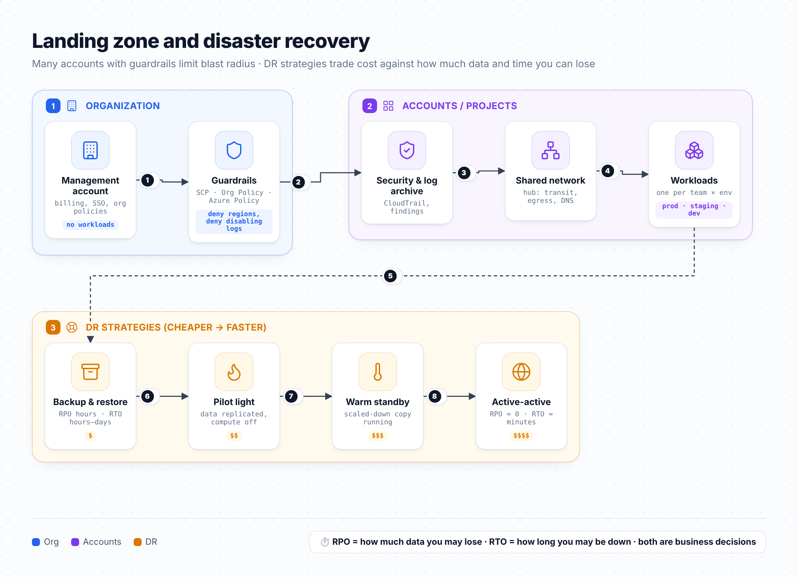

# 14.4 — Accounts, landing zones & disaster recovery

!!! abstract "In one sentence"
    A **landing zone** is the foundation every workload lands on: an **organization** of many **accounts/projects**
    (per team and environment) so mistakes and breaches stay small, **single sign-on** for people, organization-wide
    **guardrails** nobody can switch off, shared **networking** and central **logging and security**; on top of it,
    **disaster recovery** is a deliberate choice of how much data (**RPO**) and time (**RTO**) you can afford to lose,
    from cheap backups to expensive active-active, proven by regular **game days**.

## 📖 Key terms & abbreviations

| Term | Stands for | What it is | How it works (one line) |
|---|---|---|---|
| **Organization** | — | Top container for all accounts | AWS Organizations, GCP Organization, Azure Management Groups |
| **OU** | Organizational Unit | Folder of accounts sharing policies | `Prod`, `NonProd`, `Security`, `Sandbox` |
| **Account / project / subscription** | — | Isolation and billing boundary | Separate IAM, quotas, resources |
| **SCP / Org Policy** | Service Control Policy | Guardrail on everything in an OU | "Deny leaving eu-* regions", even for admins |
| **IAM Identity Center** | — | SSO into many accounts | Permission sets → short-lived roles |
| **Account vending** | — | Automated creation of new accounts | Control Tower AFT, Terraform |
| **Hub-and-spoke** | — | Central network hub, workload VPCs as spokes | Transit Gateway, Shared VPC, Virtual WAN |
| **Log archive** | — | Central, immutable audit logs | Org-wide CloudTrail, write-once bucket |
| **RPO** | Recovery Point Objective | Max acceptable data loss | "≤ 5 minutes of transactions" |
| **RTO** | Recovery Time Objective | Max acceptable downtime | "Back within 1 hour" |
| **Pilot light / warm standby** | — | DR with minimal / scaled-down copy | Cheaper than active-active, slower |
| **Active-active** | — | Two+ regions serving traffic | Lowest RTO/RPO, hardest data story |
| **Game day** | — | Planned failure exercise | Practise failover, measure real RTO |

## 🗺️ Big picture



---

## 1 · Why many accounts

### How does it work?

An account (AWS), project (GCP) or subscription (Azure) is a **hard boundary**: IAM, quotas, resource limits and billing are per account. One shared account means one leaked key or one bad `terraform destroy` can reach everything. A typical structure:

- **Management** account: billing, organization, SSO. No workloads, very few people.
- **Security** and **Log archive** accounts: org-wide audit logs (write-once), security tooling and findings; workload admins can't touch them.
- **Shared services / Network**: transit hub, egress, DNS, CI runners, artifact registries.
- **Workload accounts**: per team (or product) × environment (`payments-prod`, `payments-staging`), so prod is separate from experiments.
- **Sandbox** accounts: free experimentation with budgets and auto-cleanup.

## 2 · Guardrails and access

- **People** log in through **SSO** (IAM Identity Center, Entra ID, Google Workspace) with MFA and get **short-lived role sessions** via permission sets; no IAM users with passwords or keys (11).
- **Guardrails** (SCPs, Org Policies, Azure Policy) apply to everyone in an OU, including account admins:
    - only approved regions (data residency)
    - can't disable CloudTrail/GuardDuty or delete the log archive
    - no public S3 buckets, no IAM user keys
    - require encryption, require tags
- **Detective controls** (AWS Config, Security Hub, Policy Analyzer) find what preventive rules can't block.
- **Account vending**: new accounts are created by code with the baseline already applied: SSO, logging, networking, budgets.

## 3 · Shared networking

- **Hub-and-spoke**: workload VPCs (spokes) attach to a hub (Transit Gateway, Cloud WAN, GCP Shared VPC / NCC, Azure Virtual WAN) that holds central egress, inspection firewalls, on-prem VPN/Direct Connect and shared DNS (5.4).
- **IP address planning** up front: non-overlapping CIDRs per account and region (IPAM), or you can't connect them later.
- **Private endpoints** for cloud APIs reduce NAT costs and exposure (13).

## 4 · Disaster recovery strategies

| Strategy | What runs in the DR region | Typical RPO | Typical RTO | Cost |
|---|---|---|---|---|
| **Backup & restore** | Nothing; backups copied there | Hours (last backup) | Hours–days | $ |
| **Pilot light** | Data replicated; core infra defined in IaC, scaled to zero | Minutes | Tens of minutes–hours | $$ |
| **Warm standby** | Small but working copy of the whole stack | Seconds–minutes | Minutes | $$$ |
| **Active-active** | Full stack serving traffic in both | ≈ 0 (with careful data design) | ≈ 0–minutes | $$$$ |

Choose **per service**, based on business impact: the payment system may need warm standby, the internal wiki needs backups. Remember what disasters actually look like: much more often a bad deploy, a deleted table or ransomware than a whole region going down. **Backups with point-in-time recovery in another account** protect against the common ones.

## 5 · Proving it: runbooks and game days

1. Write the **runbook**: who decides to fail over, the exact steps (DNS/traffic switch, promote replica, scale up), how to fail back.
2. **Automate** as much as possible (IaC for the DR region, scripts for promotion).
3. Run **game days**: restore a production backup into a fresh account; fail over a service; measure the real RTO and RPO.
4. Fix what broke (expired credentials, missing quotas in the DR region, hard-coded endpoints), and repeat each quarter.

## 🔧 DevOps connection

- The landing zone is a **platform product** (16.4): teams request an account and get a ready, compliant environment in minutes.
- **IaC everything** in the landing zone too (Control Tower + AFT, Terraform modules, Cloud Foundation Toolkit), so it can be rebuilt and audited.
- **Quotas and capacity** in the DR region must be reserved or at least requested in advance; GPUs especially (10).
- **Dependencies count**: your DR plan fails if the IdP, DNS provider, container registry or CI system is only in the failed region.

## 🧪 Try it yourself

```bash
# AWS Organizations: what does my org look like? (needs org read permission)
aws organizations list-roots --query 'Roots[].Id' --output text
aws organizations list-organizational-units-for-parent --parent-id $(aws organizations list-roots --query 'Roots[0].Id' --output text) \
  --query 'OrganizationalUnits[].Name'
aws organizations list-policies --filter SERVICE_CONTROL_POLICY --query 'Policies[].Name'

# A classic guardrail SCP: deny everything outside two EU regions (except global services)
cat > region-guardrail.json <<'EOF'
{"Version":"2012-10-17","Statement":[{"Sid":"DenyOutsideEU","Effect":"Deny",
 "NotAction":["iam:*","organizations:*","sts:*","support:*","cloudfront:*","route53:*","budgets:*"],
 "Resource":"*","Condition":{"StringNotEquals":{"aws:RequestedRegion":["eu-central-1","eu-west-1"]}}}]}
EOF
python3 -m json.tool region-guardrail.json > /dev/null && echo "valid JSON"

# DR drill: restore an RDS snapshot into a new instance and time it
# time aws rds restore-db-instance-from-db-snapshot --db-instance-identifier drill-$(date +%s) --db-snapshot-identifier <snapshot>
```

## 🃏 Cheat sheet

| Goal | Do |
|---|---|
| Limit blast radius | Account per team × env, prod separate |
| People access | SSO + MFA + short-lived roles, no IAM users |
| Rules nobody can bypass | SCPs / Org Policies on OUs |
| Audit | Org-wide trail to an immutable log-archive account |
| Connect VPCs | Hub-and-spoke, planned non-overlapping CIDRs |
| Survive deletes & ransomware | PITR + cross-account, locked backups |
| Survive a region | Pilot light / warm standby / active-active per service |
| Know it works | Quarterly game days with measured RTO/RPO |

## ❓ Test yourself

??? question "1. Why use separate accounts for prod and dev instead of one account with tags?"
    Accounts are hard isolation boundaries for IAM, quotas and blast radius; tags and naming conventions don't stop a dev-side mistake or compromised key from touching prod.

??? question "2. What can an SCP do that IAM policies in the account can't?"
    It sets a ceiling for everyone in the account, including its administrators, so rules like "never disable CloudTrail" or "only EU regions" can't be bypassed locally.

??? question "3. What's the difference between pilot light and warm standby?"
    Pilot light keeps data replicated and infrastructure ready but compute mostly off; warm standby runs a small working copy of the whole stack, so it recovers faster but costs more.

??? question "4. Which disasters are more common than a full region outage, and what protects against them?"
    Bad deployments, accidental deletes, data corruption and ransomware. Point-in-time recovery, versioning, and immutable backups in a separate account protect against them.

??? question "5. Why run game days?"
    Untested DR plans fail on details (expired credentials, missing quotas, hard-coded endpoints); exercises reveal them and measure the real RTO and RPO.

---

## 📚 Sources

- [AWS — Organizing your environment using multiple accounts](https://docs.aws.amazon.com/whitepapers/latest/organizing-your-aws-environment/organizing-your-aws-environment.html)
- [AWS — Service control policies](https://docs.aws.amazon.com/organizations/latest/userguide/orgs_manage_policies_scps.html)
- [Google Cloud — Landing zone design](https://cloud.google.com/architecture/landing-zones)
- [Azure — Cloud Adoption Framework landing zones](https://learn.microsoft.com/en-us/azure/cloud-adoption-framework/ready/landing-zone/)
- [AWS — Disaster recovery options in the cloud](https://docs.aws.amazon.com/whitepapers/latest/disaster-recovery-workloads-on-aws/disaster-recovery-options-in-the-cloud.html)

## ✍️ My notes

> For your most important service: what are the agreed RPO and RTO, and when were they last proven?

-
