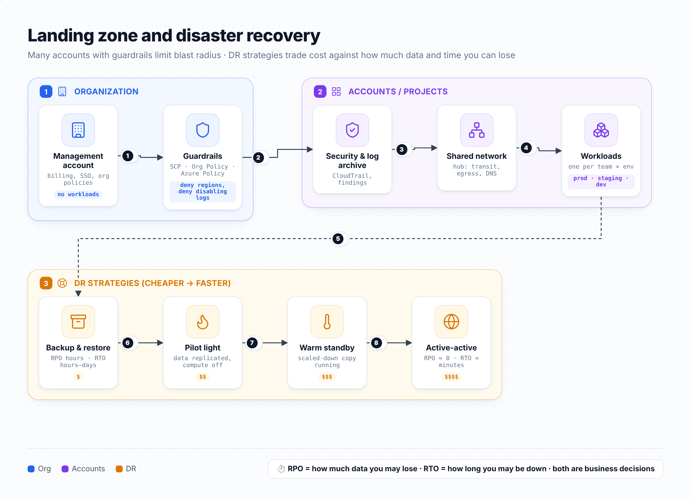

# 14.4 — Hesaplar, landing zone'lar ve felaket kurtarma

!!! abstract "Kısaca"
    Bir **landing zone**, her iş yükünün üzerine kurulduğu temeldir. Çok sayıda **hesap/projeden** (ekip ve ortam
    başına) oluşan bir **organizasyondur**; böylece hatalar ve ihlaller küçük kalır. Üstüne **tek oturum açma**,
    kimsenin kapatamayacağı organizasyon çapında **korkuluklar**, paylaşılan **ağ** ve merkezi **loglama ve güvenlik**
    ekler. **Felaket kurtarma** ise ne kadar veri (**RPO**) ve zaman (**RTO**) kaybedebileceğine dair bilinçli bir
    seçimdir ve düzenli **game day'lerle** kanıtlanır.

## 📖 Temel terimler ve kısaltmalar

| Terim | Açılımı | Nedir | Nasıl çalışır (tek satır) |
|---|---|---|---|
| **Organizasyon** | Organization | Tüm hesapların en üst kabı | AWS Organizations, GCP Organization, Azure Management Groups |
| **OU** | Organizational Unit | Politikaları paylaşan hesap klasörü | `Prod`, `NonProd`, `Security`, `Sandbox` |
| **Hesap / proje / abonelik** | Account / project / subscription | İzolasyon ve faturalama sınırı | Ayrı IAM, kotalar, kaynaklar |
| **SCP / Org Policy** | Service Control Policy | Bir OU'daki her şey üzerinde korkuluk | "eu-* bölgeleri dışına çıkmayı reddet", admin'ler için bile |
| **IAM Identity Center** | — | Çok hesaba SSO | Yetki setleri → kısa ömürlü roller |
| **Hesap üretimi** | Account vending | Yeni hesapların otomatik oluşturulması | Control Tower AFT, Terraform |
| **Hub-and-spoke** | — | Merkezi ağ hub'ı, iş yükü VPC'leri kollar | Transit Gateway, Shared VPC, Virtual WAN |
| **Log arşivi** | Log archive | Merkezi, değişmez denetim logları | Org çapında CloudTrail, tek yazımlık bucket |
| **RPO** | Recovery Point Objective | Kabul edilebilir en fazla veri kaybı | "≤ 5 dakikalık transaction" |
| **RTO** | Recovery Time Objective | Kabul edilebilir en uzun kesinti | "1 saat içinde geri" |
| **Pilot ışığı / ılık yedek** | Pilot light / warm standby | Minimal / küçültülmüş kopyalı DR | Aktif-aktiften ucuz, daha yavaş |
| **Aktif-aktif** | Active-active | Trafiğe hizmet veren iki+ bölge | En düşük RTO/RPO, en zor veri hikâyesi |
| **Game day** | — | Planlı hata tatbikatı | Failover'ı pratik et, gerçek RTO'yu ölç |

## 🗺️ Büyük resim



---

## 1 · Neden çok hesap

### Nasıl çalışır?

Bir hesap (AWS), proje (GCP) ya da abonelik (Azure) **sert bir sınırdır**: IAM, kotalar, kaynak limitleri ve faturalama hesap başınadır. Tek bir paylaşılan hesap, sızan tek bir anahtarın ya da kötü bir `terraform destroy`'un her şeye ulaşabilmesi demektir. Tipik bir yapı:

- **Yönetim** hesabı: faturalama, organizasyon, SSO. İş yükü yok, çok az kişi.
- **Güvenlik** ve **Log arşivi** hesapları: org çapında denetim logları (tek yazımlık), güvenlik araçları ve bulgular; iş yükü admin'leri dokunamaz.
- **Paylaşılan servisler / Ağ**: transit hub, çıkış, DNS, CI runner'ları, artefakt registry'leri.
- **İş yükü hesapları**: ekip (ya da ürün) × ortam başına (`payments-prod`, `payments-staging`); prod deneylerden ayrı olsun diye.
- **Sandbox** hesapları: bütçeli ve otomatik temizlikli serbest deney alanı.

## 2 · Korkuluklar ve erişim

- **İnsanlar** MFA'lı **SSO** (IAM Identity Center, Entra ID, Google Workspace) ile girer ve yetki setleri üzerinden **kısa ömürlü rol oturumları** alır; şifreli ya da anahtarlı IAM kullanıcısı yok (11).
- **Korkuluklar** (SCP, Org Policy, Azure Policy) bir OU'daki herkese, hesap admin'leri dahil uygulanır:
    - sadece onaylı bölgeler (veri yerelliği)
    - CloudTrail/GuardDuty kapatılamaz, log arşivi silinemez
    - herkese açık S3 bucket'ı yok, IAM kullanıcı anahtarı yok
    - şifreleme zorunlu, etiketler zorunlu
- **Tespit edici kontroller** (AWS Config, Security Hub, Policy Analyzer) önleyici kuralların engelleyemediklerini bulur.
- **Hesap üretimi**: yeni hesaplar kodla, temel yapı zaten uygulanmış olarak oluşturulur: SSO, loglama, ağ, bütçeler.

## 3 · Paylaşılan ağ

- **Hub-and-spoke**: iş yükü VPC'leri (kollar) merkezi çıkışı, denetim güvenlik duvarlarını, şirket içi VPN/Direct Connect'i ve paylaşılan DNS'i tutan bir hub'a (Transit Gateway, Cloud WAN, GCP Shared VPC / NCC, Azure Virtual WAN) bağlanır (5.4).
- Baştan **IP adresi planlaması**: hesap ve bölge başına çakışmayan CIDR'lar (IPAM); yoksa sonra onları bağlayamazsın.
- Bulut API'leri için **özel endpoint'ler** NAT maliyetlerini ve dışa açıklığı azaltır (13).

## 4 · Felaket kurtarma stratejileri

| Strateji | DR bölgesinde ne çalışır | Tipik RPO | Tipik RTO | Maliyet |
|---|---|---|---|---|
| **Yedekle ve geri yükle** | Hiçbir şey; yedekler oraya kopyalanır | Saatler (son yedek) | Saatler–günler | $ |
| **Pilot ışığı** | Veri replike; temel altyapı IaC'de tanımlı, sıfıra ölçeklenmiş | Dakikalar | Onlarca dakika–saatler | $$ |
| **Ilık yedek** | Tüm yığının küçük ama çalışan bir kopyası | Saniyeler–dakikalar | Dakikalar | $$$ |
| **Aktif-aktif** | İkisinde de trafiğe hizmet veren tam yığın | ≈ 0 (dikkatli veri tasarımıyla) | ≈ 0–dakikalar | $$$$ |

**Servis başına** iş etkisine göre seç: ödeme sistemi ılık yedeğe ihtiyaç duyabilir, iç wiki için yedekler yeter. Felaketlerin gerçekte neye benzediğini hatırla: bütün bir bölgenin çökmesinden çok daha sık kötü bir deploy, silinmiş bir tablo ya da fidye yazılımıdır. **Başka bir hesapta zamanda geri dönüşlü yedekler** yaygın olanlara karşı korur.

## 5 · Kanıtlamak: runbook'lar ve game day'ler

1. **Runbook'u** yaz: failover'a kim karar verir, tam adımlar (DNS/trafik değişimi, replikayı terfi ettir, büyüt), nasıl geri dönülür.
2. Mümkün olduğunca **otomatikleştir** (DR bölgesi için IaC, terfi için betikler).
3. **Game day'ler** yap: bir production yedeğini yeni bir hesaba geri yükle; bir servisi failover et; gerçek RTO ve RPO'yu ölç.
4. Bozulanı düzelt (süresi dolmuş kimlik bilgileri, DR bölgesinde eksik kotalar, sabit kodlanmış endpoint'ler) ve her çeyrek tekrarla.

## 🔧 DevOps bağlantısı

- Landing zone bir **platform ürünüdür** (16.4): ekipler bir hesap ister ve dakikalar içinde hazır, uyumlu bir ortam alır.
- Landing zone'da da **her şey IaC** (Control Tower + AFT, Terraform modülleri, Cloud Foundation Toolkit); yeniden kurulabilsin ve denetlenebilsin.
- DR bölgesindeki **kotalar ve kapasite** önceden ayrılmalı ya da en azından istenmeli; özellikle GPU'lar (10).
- **Bağımlılıklar da sayılır**: IdP, DNS sağlayıcısı, container registry ya da CI sistemi sadece çöken bölgedeyse DR planın başarısız olur.

## 🧪 Kendin dene

```bash
# AWS Organizations: org'um neye benziyor? (org okuma yetkisi gerekir)
aws organizations list-roots --query 'Roots[].Id' --output text
aws organizations list-organizational-units-for-parent --parent-id $(aws organizations list-roots --query 'Roots[0].Id' --output text) \
  --query 'OrganizationalUnits[].Name'
aws organizations list-policies --filter SERVICE_CONTROL_POLICY --query 'Policies[].Name'

# Klasik bir korkuluk SCP'si: iki AB bölgesi dışındaki her şeyi reddet (global servisler hariç)
cat > region-guardrail.json <<'EOF'
{"Version":"2012-10-17","Statement":[{"Sid":"DenyOutsideEU","Effect":"Deny",
 "NotAction":["iam:*","organizations:*","sts:*","support:*","cloudfront:*","route53:*","budgets:*"],
 "Resource":"*","Condition":{"StringNotEquals":{"aws:RequestedRegion":["eu-central-1","eu-west-1"]}}}]}
EOF
python3 -m json.tool region-guardrail.json > /dev/null && echo "geçerli JSON"

# DR tatbikatı: bir RDS snapshot'ını yeni bir instance'a geri yükle ve süresini ölç
# time aws rds restore-db-instance-from-db-snapshot --db-instance-identifier drill-$(date +%s) --db-snapshot-identifier <snapshot>
```

## 🃏 Hatırlatma kartı

| Hedef | Yap |
|---|---|
| Etki alanını sınırla | Ekip × ortam başına hesap, prod ayrı |
| İnsan erişimi | SSO + MFA + kısa ömürlü roller, IAM kullanıcısı yok |
| Kimsenin aşamayacağı kurallar | OU'larda SCP / Org Policy |
| Denetim | Değişmez bir log arşivi hesabına org çapında trail |
| VPC'leri bağla | Hub-and-spoke, planlı ve çakışmayan CIDR'lar |
| Silmelerden ve fidye yazılımından kurtul | PITR + hesaplar arası, kilitli yedekler |
| Bir bölgeden kurtul | Servis başına pilot ışığı / ılık yedek / aktif-aktif |
| Çalıştığını bil | Ölçülen RTO/RPO ile üç ayda bir game day |

## ❓ Kendini test et

??? question "1. Neden etiketli tek bir hesap yerine prod ve dev için ayrı hesaplar kullanılır?"
    Hesaplar IAM, kotalar ve etki alanı için sert izolasyon sınırlarıdır; etiketler ve isimlendirme kuralları dev tarafındaki bir hatanın ya da ele geçirilmiş bir anahtarın prod'a dokunmasını durdurmaz.

??? question "2. Bir SCP, hesaptaki IAM politikalarının yapamadığı neyi yapabilir?"
    Hesaptaki herkes için, admin'leri dahil, bir tavan koyar; böylece "CloudTrail'i asla kapatma" ya da "sadece AB bölgeleri" gibi kurallar yerel olarak aşılamaz.

??? question "3. Pilot ışığı ile ılık yedek arasındaki fark ne?"
    Pilot ışığı veriyi replike ve altyapıyı hazır tutar ama compute çoğunlukla kapalıdır; ılık yedek tüm yığının küçük çalışan bir kopyasını çalıştırır; daha hızlı kurtarır ama daha pahalıdır.

??? question "4. Hangi felaketler tam bir bölge kesintisinden daha yaygındır ve onlara karşı ne korur?"
    Kötü deploy'lar, yanlışlıkla silmeler, veri bozulması ve fidye yazılımı. Zamanda geri dönüş, versiyonlama ve ayrı bir hesaptaki değişmez yedekler onlara karşı korur.

??? question "5. Neden game day yapılır?"
    Test edilmemiş DR planları detaylarda başarısız olur (süresi dolmuş kimlik bilgileri, eksik kotalar, sabit kodlanmış endpoint'ler); tatbikatlar bunları ortaya çıkarır ve gerçek RTO ile RPO'yu ölçer.

---

## 📚 Kaynaklar

- [AWS — Organizing your environment using multiple accounts](https://docs.aws.amazon.com/whitepapers/latest/organizing-your-aws-environment/organizing-your-aws-environment.html)
- [AWS — Service control policies](https://docs.aws.amazon.com/organizations/latest/userguide/orgs_manage_policies_scps.html)
- [Google Cloud — Landing zone design](https://cloud.google.com/architecture/landing-zones)
- [Azure — Cloud Adoption Framework landing zones](https://learn.microsoft.com/en-us/azure/cloud-adoption-framework/ready/landing-zone/)
- [AWS — Disaster recovery options in the cloud](https://docs.aws.amazon.com/whitepapers/latest/disaster-recovery-workloads-on-aws/disaster-recovery-options-in-the-cloud.html)

## ✍️ Notlarım

> En önemli servisin için: üzerinde anlaşılmış RPO ve RTO ne ve en son ne zaman kanıtlandı?
