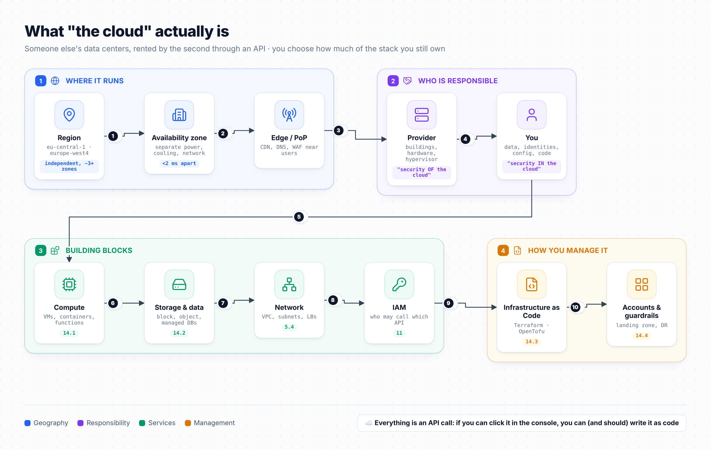

# Chapter 14 — Cloud platforms: what you are really renting

!!! abstract "In short"
    A public cloud is a huge pool of data centers grouped into **regions** and **availability zones**, all exposed
    through **APIs**. You rent compute, storage, databases and networks by the second. The provider secures the
    buildings and hardware; **you** secure your data, identities and configuration (**shared responsibility**). Because
    everything is an API call, the professional way to use it is **as code**, in **accounts with guardrails**, spread
    across **zones**.

## 📖 Key terms & abbreviations

| Term | Stands for | What it is | How it works (one line) |
|---|---|---|---|
| **Region** | — | A geographic area with several data centers | `eu-central-1` (Frankfurt), `europe-west4` (Netherlands) |
| **AZ** | Availability Zone | One or more isolated data centers in a region | Own power/cooling/network, low-latency links between AZs |
| **Edge / PoP** | Point of Presence | Small sites close to users | CDN, DNS, WAF, DDoS protection |
| **IaaS / PaaS / SaaS** | Infrastructure / Platform / Software as a Service | How much of the stack the provider runs | VM → managed runtime → finished app |
| **Serverless** | — | You don't manage servers or capacity | Pay per request/duration, scales to zero |
| **Shared responsibility** | — | Split of security duties | Provider: "of" the cloud; you: "in" the cloud |
| **Control plane / data plane** | — | APIs that manage resources / the traffic itself | Control plane outages block changes, not always traffic |
| **Managed service** | — | Provider runs the software for you | RDS, EKS, Pub/Sub: patching, backups, HA included |
| **IaC** | Infrastructure as Code | Infrastructure described in files | Terraform/OpenTofu, CloudFormation, Bicep, Pulumi |
| **Landing zone** | — | Pre-built multi-account foundation | Accounts, SSO, networking, logging, guardrails |
| **Quota / limit** | — | Max resources per account/region | vCPUs, IPs, API rate limits; raise before launch |
| **RPO / RTO** | Recovery Point / Time Objective | Data you may lose / downtime you may have | Drive backup and DR design |
| **SLA** | Service Level Agreement | Provider's uptime promise | e.g. 99.99% for multi-AZ; credits, not compensation |

## 🗺️ Big picture



---

## 1 · Regions, zones and the edge

### How does it work?

- A **region** is independent: its own control plane APIs and data. Data stays in a region unless you copy it out, which matters for latency, cost and **data residency** (GDPR, KVKK).
- Each region has **≥ 3 availability zones**: separate buildings with separate power and network, close enough (< ~2 ms) for synchronous replication. **Spread across AZs** is the default for anything in production: a load balancer + instances/pods in 3 AZs + a multi-AZ database.
- **Edge locations** (hundreds worldwide) run the CDN, DNS and WAF close to users (6.6).
- Picking a region: latency to users, legal requirements, service availability (new GPU types, new services arrive region by region), and price (can differ 10–30%).

## 2 · Shared responsibility and service models

| | On-premises | IaaS (VM) | Managed K8s / PaaS | Serverless / SaaS |
|---|---|---|---|---|
| Data, identities, access | You | You | You | You |
| Application code & config | You | You | You | You (config) |
| Runtime, OS patches | You | **You** | Shared (nodes) | Provider |
| Virtualization, hardware | You | Provider | Provider | Provider |
| Buildings, power | You | Provider | Provider | Provider |

The **top rows are always yours**. Most cloud breaches are not exotic attacks on the provider but customer-side mistakes: public buckets, leaked keys, over-privileged roles (Chapter 11).

## 3 · The building blocks and their names

| Need | AWS | Azure | Google Cloud | Read more |
|---|---|---|---|---|
| Virtual machines | EC2 | Virtual Machines | Compute Engine | 14.1 |
| Kubernetes | EKS | AKS | GKE | 9, 15 |
| Serverless containers | Fargate, App Runner | Container Apps | Cloud Run | 14.1 |
| Functions | Lambda | Functions | Cloud Run functions | 14.1 |
| Block / object storage | EBS / S3 | Managed Disks / Blob | Persistent Disk / Cloud Storage | 14.2 |
| Relational DB | RDS, Aurora | Azure SQL, PostgreSQL Flexible | Cloud SQL, AlloyDB, Spanner | 14.2 |
| Private network | VPC | VNet | VPC (global) | 5.4 |
| Identity & access | IAM, IAM Identity Center | Entra ID, RBAC | Cloud IAM | 11 |
| Queues / events | SQS, SNS, EventBridge | Service Bus, Event Grid | Pub/Sub, Eventarc | 7.4 |
| Monitoring | CloudWatch | Azure Monitor | Cloud Monitoring/Logging | 9.5 |
| IaC (native) | CloudFormation, CDK | Bicep / ARM | Infrastructure Manager | 14.3 |

Concepts transfer between clouds; names and details (e.g. GCP VPCs are global, AWS VPCs are regional) don't.

## 4 · Operating it like an engineer

- **Everything as code** (14.3): reviewed, repeatable, recoverable. The console is for looking, not changing.
- **Many accounts, not one** (14.4): separate prod/dev and teams to limit blast radius, with organization-wide guardrails.
- **Design for failure**: multi-AZ by default, backups you have **restored**, a DR plan with explicit RPO/RTO (14.4).
- **Know your limits**: quotas, API rate limits, and the bill (Chapter 13).

## 🔧 DevOps connection

- Cloud skills interviewers expect: VPC design (5.4), IAM and OIDC (11), compute choices (14.1), storage and DB trade-offs (14.2), Terraform (14.3), multi-AZ and DR (14.4), cost (13).
- **Managed first**: running your own PostgreSQL, Kafka or Kubernetes control plane on VMs is rarely worth it unless you have a strong reason.
- **Avoid single points**: one AZ, one NAT gateway, one manually created "pet" server, one person who knows the console clicks.

## 🚨 Incident story: the zone that went dark

!!! failure "The alarm"
    At 14:02 the checkout API returns 100% errors. The cloud status page reports "increased error rates in one availability zone" in your region.

Try to diagnose it yourself first, then open the clues one by one.

??? info "🔍 Clue 1"
    The web tier runs in an Auto Scaling group across 3 AZs and is healthy. All errors are database connection timeouts.

??? info "🔍 Clue 2"
    The PostgreSQL instance was created by hand two years ago "for a quick test" as **single-AZ**, and its automated backups are kept for 1 day. Nobody ever tested a restore.

??? success "🎯 Root cause"
    The application was multi-AZ but its state was not. When the database's zone failed, there was no standby to fail over to, and a restore into another AZ took 2 hours.

??? tip "🛠️ Fix and lesson"
    Recreate the database as **Multi-AZ** with Terraform, increase backup retention and enable point-in-time recovery, add a scheduled restore test, and add a policy check that rejects single-AZ databases in prod accounts. **Lesson:** you are only as available as your least available dependency, usually the stateful one.

## 🧭 Go deeper

| Page | What's inside |
|---|---|
| **[14.1 — Compute: VMs, containers & serverless](01-compute.md)** | Instance families and sizing, images and immutable servers, Auto Scaling groups and health checks, managed Kubernetes vs serverless containers vs functions, cold starts, spot capacity and how to choose. |
| **[14.2 — Storage & databases](02-storage-databases.md)** | Block, file and object storage, durability vs availability, S3 storage classes and lifecycle rules, managed relational and NoSQL databases, read replicas and Multi-AZ, caches, backups and point-in-time recovery. |
| **[14.3 — Infrastructure as Code with Terraform](03-terraform.md)** | Providers, resources and state, the plan/apply loop, remote state and locking, modules and environments, drift, imports, CI pipelines for Terraform, OpenTofu and alternatives, and the classic mistakes. |
| **[14.4 — Accounts, landing zones & disaster recovery](04-landing-zones-dr.md)** | Multi-account organizations, SSO, guardrail policies, hub-and-spoke networking, centralized logging, RPO/RTO, backup & restore vs pilot light vs warm standby vs active-active, and game days. |

## 🧪 Try it yourself

```bash
# AWS CLI (free tier is enough): where am I, what exists?
aws sts get-caller-identity
aws ec2 describe-availability-zones --query 'AvailabilityZones[].ZoneName' --output text
aws ec2 describe-instance-types --instance-types t4g.small m7i.large \
  --query 'InstanceTypes[].[InstanceType,VCpuInfo.DefaultVCpus,MemoryInfo.SizeInMiB]' --output table
aws service-quotas get-service-quota --service-code ec2 --quota-code L-1216C47A   # running on-demand vCPUs

# Same questions on Google Cloud
gcloud compute zones list --filter="region:europe-west4"

# Latency to different regions from where you sit
for r in eu-central-1 eu-west-1 us-east-1; do
  printf "%-14s " $r; curl -so /dev/null -w "%{time_connect}s\n" https://ec2.$r.amazonaws.com; done
```

## 🃏 Cheat sheet

| Question | Rule of thumb |
|---|---|
| How many AZs? | 3 for production, everything stateless spread, stateful Multi-AZ |
| Which region? | Close to users, legal residency, has the services you need |
| VM, containers or functions? | Default: containers on managed K8s or serverless containers; functions for event glue |
| Who patches what? | The more managed, the less you patch; data and IAM are always yours |
| How to change things? | Through IaC + PR, never console clicks in prod |
| How to recover? | Backups + tested restores + documented RPO/RTO |

## ❓ Test yourself

??? question "1. What's the difference between a region and an availability zone?"
    A region is a geographic area with independent APIs and data; an availability zone is an isolated data center (or group) inside a region with its own power and network, close enough to the others for synchronous replication.

??? question "2. Under the shared responsibility model, who is responsible for a public S3 bucket leaking data?"
    The customer. The provider secures the infrastructure; configuration, access control and data are always the customer's responsibility.

??? question "3. Why is 'multi-AZ' usually enough for high availability, and when do you need multi-region?"
    AZs have independent failure domains, so spreading across them survives data-center failures at low latency and cost. Multi-region is needed for regional outages, strict RTO/RPO, data residency or global latency, at much higher complexity.

??? question "4. Why should production changes go through Infrastructure as Code instead of the console?"
    Code is reviewed, versioned, repeatable and can rebuild the environment after a disaster; console changes are invisible, unreproducible and drift from what everyone thinks exists.

??? question "5. What do RPO and RTO mean?"
    RPO is how much data (time) you can afford to lose; RTO is how long the service can be unavailable. Together they decide the backup and DR strategy and its cost.

---

## 📚 Sources

- [AWS — Global infrastructure: regions and availability zones](https://aws.amazon.com/about-aws/global-infrastructure/regions_az/)
- [AWS — Shared responsibility model](https://aws.amazon.com/compliance/shared-responsibility-model/)
- [Google Cloud — Geography and regions](https://cloud.google.com/docs/geography-and-regions)
- [Azure — Availability zones overview](https://learn.microsoft.com/en-us/azure/reliability/availability-zones-overview)
- [AWS Well-Architected Framework](https://docs.aws.amazon.com/wellarchitected/latest/framework/welcome.html)
- [Google Cloud — Architecture Framework](https://cloud.google.com/architecture/framework)

## ✍️ My notes

> Draw your main production system: which parts are spread across zones, which are single, and what happens if one zone disappears?
