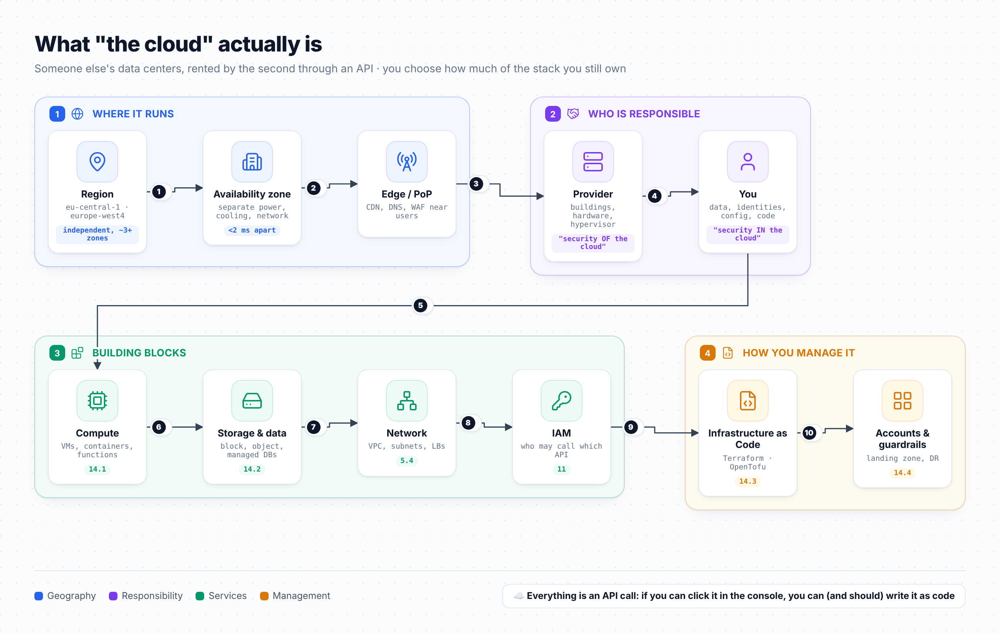

# Bölüm 14 — Bulut platformları: gerçekte ne kiralıyorsun

!!! abstract "Kısaca"
    Herkese açık bir bulut, **bölgelere** ve **erişilebilirlik zone'larına** gruplanmış, tamamen **API'ler** üzerinden
    sunulan devasa bir veri merkezi havuzudur: compute, depolama, veritabanı ve ağı saniye bazında kiralarsın. Sağlayıcı
    binaları ve donanımı korur, **sen** de verini, kimliklerini ve yapılandırmanı korursun (**paylaşılan sorumluluk**).
    Her şey bir API çağrısı olduğu için onu kullanmanın profesyonel yolu **kod olarak** (Terraform), **korkuluklu
    hesaplar** içinde ve tek bir hatanın seni düşürmemesi için **zone'lara** yayarak kullanmaktır.

## 📖 Temel terimler ve kısaltmalar

| Terim | Açılımı | Nedir | Nasıl çalışır (tek satır) |
|---|---|---|---|
| **Bölge** | Region | Birkaç veri merkezi olan coğrafi alan | `eu-central-1` (Frankfurt), `europe-west4` (Hollanda) |
| **AZ** | Availability Zone | Bir bölgedeki bir ya da daha fazla izole veri merkezi | Kendi enerji/soğutma/ağı, AZ'ler arası düşük gecikmeli bağlantı |
| **Edge / PoP** | Point of Presence | Kullanıcılara yakın küçük noktalar | CDN, DNS, WAF, DDoS koruması |
| **IaaS / PaaS / SaaS** | Infrastructure / Platform / Software as a Service | Yığının ne kadarını sağlayıcı çalıştırır | VM → yönetilen runtime → hazır uygulama |
| **Sunucusuz** | Serverless | Sunucu ya da kapasite yönetmezsin | İstek/süre başına öde, sıfıra ölçeklenir |
| **Paylaşılan sorumluluk** | Shared responsibility | Güvenlik görevlerinin paylaşımı | Sağlayıcı: bulutun güvenliği; sen: buluttaki güvenlik |
| **Control plane / data plane** | — | Kaynakları yöneten API'ler / trafiğin kendisi | Control plane kesintisi değişiklikleri engeller, trafiği her zaman değil |
| **Yönetilen servis** | Managed service | Yazılımı senin için sağlayıcı çalıştırır | RDS, EKS, Pub/Sub: yama, yedek, HA dahil |
| **IaC** | Infrastructure as Code | Dosyalarla tarif edilen altyapı | Terraform/OpenTofu, CloudFormation, Bicep, Pulumi |
| **Landing zone** | — | Önceden kurulmuş çok hesaplı temel | Hesaplar, SSO, ağ, loglama, korkuluklar |
| **Kota / limit** | Quota / limit | Hesap/bölge başına en fazla kaynak | vCPU, IP, API hız limitleri; lansmandan önce artır |
| **RPO / RTO** | Recovery Point / Time Objective | Kaybedebileceğin veri / yaşayabileceğin kesinti | Yedek ve DR tasarımını belirler |
| **SLA** | Service Level Agreement | Sağlayıcının erişilebilirlik sözü | Örn. çok AZ için %99,99; tazminat değil kredi |

## 🗺️ Büyük resim



---

## 1 · Bölgeler, zone'lar ve edge

### Nasıl çalışır?

- Bir **bölge** bağımsızdır: kendi control plane API'leri ve verisi vardır. Sen kopyalamadıkça veri bölgede kalır; bu gecikme, maliyet ve **veri yerelliği** (GDPR, KVKK) için önemlidir.
- Her bölgede **≥ 3 erişilebilirlik zone'u** vardır: ayrı enerji ve ağa sahip ayrı binalar, senkron replikasyon için yeterince yakın (< ~2 ms). Production'daki her şey için varsayılan **AZ'lere yaymaktır**: bir load balancer + 3 AZ'de instance/pod'lar + çok AZ'li bir veritabanı.
- **Edge noktaları** (dünyada yüzlerce) CDN, DNS ve WAF'ı kullanıcılara yakın çalıştırır (6.6).
- Bölge seçimi: kullanıcılara gecikme, yasal gereksinimler, servis mevcudiyeti (yeni GPU tipleri ve servisler bölge bölge gelir) ve fiyat (%10–30 farklı olabilir).

## 2 · Paylaşılan sorumluluk ve servis modelleri

| | Şirket içi | IaaS (VM) | Yönetilen K8s / PaaS | Sunucusuz / SaaS |
|---|---|---|---|---|
| Veri, kimlikler, erişim | Sen | Sen | Sen | Sen |
| Uygulama kodu ve yapılandırma | Sen | Sen | Sen | Sen (yapılandırma) |
| Runtime, OS yamaları | Sen | **Sen** | Paylaşılan (node'lar) | Sağlayıcı |
| Sanallaştırma, donanım | Sen | Sağlayıcı | Sağlayıcı | Sağlayıcı |
| Binalar, enerji | Sen | Sağlayıcı | Sağlayıcı | Sağlayıcı |

**Üst satırlar her zaman senindir.** Bulut ihlallerinin çoğu sağlayıcıya yapılan egzotik saldırılar değil, müşteri tarafı hatalardır: herkese açık bucket'lar, sızan anahtarlar, aşırı yetkili roller (Bölüm 11).

## 3 · Yapı taşları ve isimleri

| İhtiyaç | AWS | Azure | Google Cloud | Devamı |
|---|---|---|---|---|
| Sanal makineler | EC2 | Virtual Machines | Compute Engine | 14.1 |
| Kubernetes | EKS | AKS | GKE | 9, 15 |
| Sunucusuz container'lar | Fargate, App Runner | Container Apps | Cloud Run | 14.1 |
| Fonksiyonlar | Lambda | Functions | Cloud Run functions | 14.1 |
| Blok / nesne depolama | EBS / S3 | Managed Disks / Blob | Persistent Disk / Cloud Storage | 14.2 |
| İlişkisel DB | RDS, Aurora | Azure SQL, PostgreSQL Flexible | Cloud SQL, AlloyDB, Spanner | 14.2 |
| Özel ağ | VPC | VNet | VPC (global) | 5.4 |
| Kimlik ve erişim | IAM, IAM Identity Center | Entra ID, RBAC | Cloud IAM | 11 |
| Kuyruklar / olaylar | SQS, SNS, EventBridge | Service Bus, Event Grid | Pub/Sub, Eventarc | 7.4 |
| İzleme | CloudWatch | Azure Monitor | Cloud Monitoring/Logging | 9.5 |
| IaC (yerel) | CloudFormation, CDK | Bicep / ARM | Infrastructure Manager | 14.3 |

Kavramlar bulutlar arasında aktarılır; isimler ve detaylar (ör. GCP VPC'leri global, AWS VPC'leri bölgesel) aktarılmaz.

## 4 · Bir mühendis gibi işletmek

- **Her şey kod olarak** (14.3): incelenmiş, tekrarlanabilir, kurtarılabilir. Konsol bakmak içindir, değiştirmek için değil.
- **Tek değil çok hesap** (14.4): etki alanını sınırlamak için prod/dev'i ve ekipleri ayır; organizasyon çapında korkuluklar kullan.
- **Hataya göre tasarla**: varsayılan olarak çok AZ, **geri yüklediğin** yedekler, açık RPO/RTO'lu bir DR planı (14.4).
- **Limitlerini bil**: kotalar, API hız limitleri ve fatura (Bölüm 13).

## 🔧 DevOps bağlantısı

- Mülakatçıların beklediği bulut becerileri: VPC tasarımı (5.4), IAM ve OIDC (11), compute seçimleri (14.1), depolama ve DB ödünleşimleri (14.2), Terraform (14.3), çok AZ ve DR (14.4), maliyet (13).
- **Önce yönetilen**: kendi PostgreSQL, Kafka ya da Kubernetes control plane'ini VM'lerde çalıştırmak güçlü bir sebebin yoksa nadiren buna değer.
- **Tekil noktalardan kaçın**: tek AZ, tek NAT gateway, elle oluşturulmuş tek bir "evcil" sunucu, konsol tıklamalarını bilen tek bir kişi.

## 🚨 Olay hikâyesi: kararan zone

!!! failure "Alarm"
    14:02'de ödeme API'si %100 hata dönüyor. Bulut durum sayfası bölgende "bir erişilebilirlik zone'unda artan hata oranları" bildiriyor.

Önce kendin teşhis etmeye çalış, sonra ipuçlarını tek tek aç.

??? info "🔍 İpucu 1"
    Web katmanı 3 AZ'ye yayılmış bir Auto Scaling grubunda çalışıyor ve sağlıklı. Tüm hatalar veritabanı bağlantı zaman aşımları.

??? info "🔍 İpucu 2"
    PostgreSQL instance'ı iki yıl önce "hızlı bir test için" elle **tek AZ'li** olarak oluşturulmuş ve otomatik yedekleri 1 gün saklanıyor. Kimse hiç geri yükleme denememiş.

??? success "🎯 Kök neden"
    Uygulama çok AZ'liydi ama durumu değildi. Veritabanının zone'u çökünce geçilecek bir yedek yoktu ve başka bir AZ'ye geri yükleme 2 saat sürdü.

??? tip "🛠️ Çözüm ve ders"
    Veritabanını Terraform ile **Multi-AZ** olarak yeniden oluştur, yedek saklama süresini artır ve zamanda geri dönüşü (PITR) aç, zamanlanmış bir geri yükleme testi ekle ve prod hesaplarında tek AZ'li veritabanlarını reddeden bir politika kontrolü ekle. **Ders:** en az erişilebilir bağımlılığın kadar erişilebilirsin; genelde o da durum tutan olandır.

## 🧭 Daha derine in

| Sayfa | Neler var |
|---|---|
| **[14.1 — Compute: VM'ler, container'lar ve sunucusuz](01-compute.md)** | Instance aileleri ve boyutlandırma, imajlar ve değişmez sunucular, Auto Scaling grupları ve sağlık kontrolleri, yönetilen Kubernetes, sunucusuz container'lar ve fonksiyonlar, soğuk başlangıçlar, spot kapasite ve nasıl seçilir. |
| **[14.2 — Depolama ve veritabanları](02-storage-databases.md)** | Blok, dosya ve nesne depolama, dayanıklılık ve erişilebilirlik, S3 depolama sınıfları ve yaşam döngüsü kuralları, yönetilen ilişkisel ve NoSQL veritabanları, okuma replikaları ve Multi-AZ, önbellekler, yedekler ve zamanda geri dönüş. |
| **[14.3 — Terraform ile kod olarak altyapı](03-terraform.md)** | Provider'lar, kaynaklar ve state, plan/apply döngüsü, uzak state ve kilitleme, modüller ve ortamlar, kayma, import, Terraform için CI pipeline'ları, OpenTofu ve alternatifler, klasik hatalar. |
| **[14.4 — Hesaplar, landing zone'lar ve felaket kurtarma](04-landing-zones-dr.md)** | Çok hesaplı organizasyonlar, SSO, korkuluk politikaları, hub-and-spoke ağ, merkezi loglama, RPO/RTO, yedekle-geri yükle, pilot ışığı, ılık yedek ve aktif-aktif, game day'ler. |

## 🧪 Kendin dene

```bash
# AWS CLI (ücretsiz katman yeterli): neredeyim, ne var?
aws sts get-caller-identity
aws ec2 describe-availability-zones --query 'AvailabilityZones[].ZoneName' --output text
aws ec2 describe-instance-types --instance-types t4g.small m7i.large \
  --query 'InstanceTypes[].[InstanceType,VCpuInfo.DefaultVCpus,MemoryInfo.SizeInMiB]' --output table
aws service-quotas get-service-quota --service-code ec2 --quota-code L-1216C47A   # çalışan on-demand vCPU'lar

# Aynı sorular Google Cloud'da
gcloud compute zones list --filter="region:europe-west4"

# Bulunduğun yerden farklı bölgelere gecikme
for r in eu-central-1 eu-west-1 us-east-1; do
  printf "%-14s " $r; curl -so /dev/null -w "%{time_connect}s\n" https://ec2.$r.amazonaws.com; done
```

## 🃏 Hatırlatma kartı

| Soru | Pratik kural |
|---|---|
| Kaç AZ? | Production için 3; durumsuz her şey yayılmış, durum tutanlar Multi-AZ |
| Hangi bölge? | Kullanıcılara yakın, yasal yerellik, ihtiyacın olan servisler var |
| VM mi, container mı, fonksiyon mu? | Varsayılan: yönetilen K8s'te ya da sunucusuz container; olay yapıştırıcısı için fonksiyon |
| Kim neyi yamalar? | Ne kadar yönetilense o kadar az yamalarsın; veri ve IAM her zaman senin |
| Değişiklik nasıl yapılır? | IaC + PR ile; prod'da asla konsol tıklaması |
| Nasıl kurtarılır? | Yedekler + test edilmiş geri yüklemeler + yazılı RPO/RTO |

## ❓ Kendini test et

??? question "1. Bölge ile erişilebilirlik zone'u arasındaki fark ne?"
    Bölge bağımsız API'lere ve veriye sahip coğrafi bir alandır; erişilebilirlik zone'u bir bölge içinde kendi enerji ve ağına sahip, senkron replikasyon için diğerlerine yeterince yakın izole bir veri merkezidir (ya da grubu).

??? question "2. Paylaşılan sorumluluk modelinde herkese açık bir S3 bucket'ından veri sızmasından kim sorumlu?"
    Müşteri. Sağlayıcı altyapıyı korur; yapılandırma, erişim kontrolü ve veri her zaman müşterinin sorumluluğundadır.

??? question "3. Yüksek erişilebilirlik için 'çok AZ' neden genelde yeterli ve ne zaman çok bölge gerekir?"
    AZ'lerin bağımsız hata alanları vardır; onlara yaymak veri merkezi hatalarından düşük gecikme ve maliyetle sağ çıkarır. Çok bölge; bölgesel kesintiler, sıkı RTO/RPO, veri yerelliği ya da global gecikme için gerekir ve çok daha karmaşıktır.

??? question "4. Production değişiklikleri neden konsol yerine kod olarak altyapıyla yapılmalı?"
    Kod incelenir, sürümlenir, tekrarlanabilir ve bir felaketten sonra ortamı yeniden kurabilir; konsol değişiklikleri görünmez, tekrar üretilemez ve herkesin var sandığından uzaklaşır.

??? question "5. RPO ve RTO ne demek?"
    RPO ne kadar veri (zaman) kaybetmeyi göze alabileceğindir; RTO servisin ne kadar süre erişilemez kalabileceğidir. Birlikte yedek ve DR stratejisini ve maliyetini belirlerler.

---

## 📚 Kaynaklar

- [AWS — Global infrastructure: regions and availability zones](https://aws.amazon.com/about-aws/global-infrastructure/regions_az/)
- [AWS — Shared responsibility model](https://aws.amazon.com/compliance/shared-responsibility-model/)
- [Google Cloud — Geography and regions](https://cloud.google.com/docs/geography-and-regions)
- [Azure — Availability zones overview](https://learn.microsoft.com/en-us/azure/reliability/availability-zones-overview)
- [AWS Well-Architected Framework](https://docs.aws.amazon.com/wellarchitected/latest/framework/welcome.html)
- [Google Cloud — Architecture Framework](https://cloud.google.com/architecture/framework)

## ✍️ Notlarım

> Ana production sistemini çiz: hangi parçalar zone'lara yayılmış, hangileri tekil ve bir zone ortadan kalkarsa ne olur?
