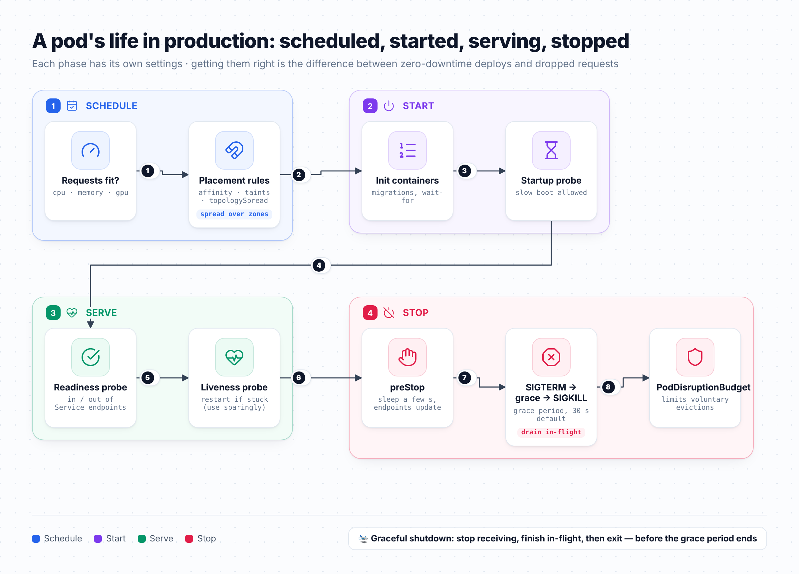

# 15.1 — Workloads, probes & scheduling

!!! abstract "In short"
    A production workload is a **controller** (Deployment, StatefulSet, DaemonSet, Job) plus a pod template.
    **Requests** and **placement rules** decide where it runs. **Startup and readiness probes** decide when it gets
    traffic, and **liveness** decides when it's restarted. **SIGTERM handling, preStop and the grace period** decide
    whether it shuts down without dropping a single request.

## 📖 Key terms & abbreviations

| Term | Stands for | What it is | How it works (one line) |
|---|---|---|---|
| **ReplicaSet** | — | Keeps N identical pods | Created and managed by a Deployment |
| **maxSurge / maxUnavailable** | — | Rolling update speed | Extra pods allowed / pods allowed down |
| **Startup probe** | — | "Has it finished booting?" | Other probes wait until it succeeds |
| **Readiness probe** | — | "Can it take traffic now?" | Fail → removed from Service endpoints |
| **Liveness probe** | — | "Is it stuck?" | Fail → container restarted |
| **QoS class** | Quality of Service | Guaranteed, Burstable, BestEffort | Decides eviction order under pressure |
| **Node affinity** | — | Prefer/require nodes by labels | `zone`, `instance-type`, `gpu=true` |
| **Pod (anti-)affinity** | — | Place near / away from other pods | Co-locate cache, separate replicas |
| **Taint / toleration** | — | Node repels pods / pod accepts the taint | Dedicated GPU or system nodes |
| **Topology spread** | — | Even distribution over a topology key | `maxSkew: 1` across zones |
| **PriorityClass** | — | Importance of pods | Higher priority can preempt lower |
| **Grace period** | — | Time between SIGTERM and SIGKILL | `terminationGracePeriodSeconds`, default 30 |

## 🗺️ Big picture



---

## 1 · Deployments and rollouts

### How does it work?

Changing a Deployment's pod template creates a **new ReplicaSet**; the controller scales it up and the old one down in steps limited by `maxSurge` (extra pods above desired) and `maxUnavailable` (pods allowed to be missing). A new pod counts as available only after it's **Ready** for `minReadySeconds`.

```yaml
spec:
  replicas: 4
  revisionHistoryLimit: 5
  strategy:
    rollingUpdate: { maxSurge: 25%, maxUnavailable: 0 }   # never below capacity
  minReadySeconds: 10
  progressDeadlineSeconds: 300                            # mark failed if stuck
```

`kubectl rollout status|history|undo` follows and reverts. For canary/blue-green use Argo Rollouts or Flagger (9.4, 16.2).

## 2 · Other controllers

- **StatefulSet**: pods `name-0..N` with stable DNS via a headless Service and one PVC each from `volumeClaimTemplates`; ordered or parallel start; partitioned rolling updates for careful upgrades (15.2).
- **DaemonSet**: one pod per (matching) node, rolled node by node; tolerate taints to run on every node.
- **Job**: runs pods until `completions` succeed, retries up to `backoffLimit`, `activeDeadlineSeconds`, indexed jobs for parallel work, `ttlSecondsAfterFinished` for cleanup.
- **CronJob**: creates Jobs on a schedule (`timeZone` supported); set `concurrencyPolicy: Forbid` for jobs that mustn't overlap and `startingDeadlineSeconds`.

## 3 · Designing probes

| Probe | Good check | Bad check |
|---|---|---|
| **Startup** | Same endpoint as readiness, generous `failureThreshold × periodSeconds` (e.g. 30 × 5 s) | Missing for slow JVM apps → killed by liveness while starting |
| **Readiness** | Can serve requests: initialized, critical caches warm, not draining | Checks every downstream dependency → whole fleet goes unready when the DB blips |
| **Liveness** | Process is wedged (deadlock, event loop stuck): a cheap in-process check | Calls the DB, or same as readiness with tight timeouts → restart storms under load |

Many services need **no liveness probe** at all: a crashed process restarts anyway. Add one only for known "alive but stuck" failure modes.

## 4 · Graceful shutdown

When a pod is deleted, two things happen **in parallel**: the kubelet sends SIGTERM (after running `preStop`), and the endpoint controller removes the pod from Services, which takes a moment to reach kube-proxy and ingress controllers. So:

1. `preStop: exec sleep 5` (or a native `sleep` action) keeps the pod serving until endpoints are updated.
2. On SIGTERM, stop accepting new work, finish in-flight requests, close connections, flush.
3. Keep total time below `terminationGracePeriodSeconds`; after it the container is SIGKILLed (exit 137).
4. Make sure the app is **PID 1 or uses an init** (`tini`, `exec` in the entrypoint) so it actually receives the signal (3.1).

## 5 · Placement: requests, affinity, taints, spread

- **Requests** are what the scheduler packs on; QoS follows from requests/limits: **Guaranteed** (requests = limits), **Burstable**, **BestEffort** (none, evicted first).
- **nodeSelector / node affinity** for hardware or zones; **taints** keep general pods off special nodes (`nvidia.com/gpu=present:NoSchedule`), pods that belong there **tolerate** them.
- **topologySpreadConstraints** with `topology.kubernetes.io/zone` and `kubernetes.io/hostname` keep replicas apart; prefer them over pod anti-affinity at scale.
- **PriorityClasses**: critical system and production pods can preempt batch work when capacity is short.
- **PodDisruptionBudget** (`minAvailable` or `maxUnavailable`) protects against drains, upgrades and consolidation removing too many at once.

## 🔧 DevOps connection

- Bake these into your **service template/chart**: probes, preStop, PDB, spread, security context, sensible defaults (16.4).
- Load-test **during a rolling deploy** and during a node drain; 0 errors is the bar.
- Alert on `kube_deployment_status_replicas_unavailable`, restart counts and rollouts stuck past `progressDeadlineSeconds`.

## 🧪 Try it yourself

```bash
kind create cluster --name wl
cat <<'EOF' | kubectl apply -f -
apiVersion: apps/v1
kind: Deployment
metadata: { name: web }
spec:
  replicas: 3
  selector: { matchLabels: { app: web } }
  strategy: { rollingUpdate: { maxSurge: 1, maxUnavailable: 0 } }
  template:
    metadata: { labels: { app: web } }
    spec:
      terminationGracePeriodSeconds: 20
      topologySpreadConstraints:
        - { maxSkew: 1, topologyKey: kubernetes.io/hostname, whenUnsatisfiable: ScheduleAnyway, labelSelector: { matchLabels: { app: web } } }
      containers:
        - name: web
          image: nginx:1.27-alpine
          resources: { requests: { cpu: 50m, memory: 32Mi }, limits: { memory: 64Mi } }
          startupProbe:   { httpGet: { path: /, port: 80 }, periodSeconds: 2, failureThreshold: 15 }
          readinessProbe: { httpGet: { path: /, port: 80 }, periodSeconds: 5 }
          lifecycle: { preStop: { sleep: { seconds: 5 } } }
EOF
kubectl rollout status deploy/web
kubectl set image deploy/web web=nginx:1.28-alpine && kubectl rollout status deploy/web
kubectl rollout history deploy/web && kubectl rollout undo deploy/web
kubectl get pod -l app=web -o jsonpath='{range .items[*]}{.metadata.name}{" "}{.status.qosClass}{"\n"}{end}'
kind delete cluster --name wl
```

## 🃏 Cheat sheet

| Setting | Default to |
|---|---|
| `maxUnavailable` | 0 for user-facing services |
| startupProbe | For anything booting > 10 s |
| readinessProbe | Always, local readiness only |
| livenessProbe | Only for known hang modes, cheap check |
| preStop | 5–10 s sleep |
| Grace period | > preStop + longest request |
| Spread | Zone + hostname, `maxSkew: 1` |
| PDB | `maxUnavailable: 1` (or 25%) |

## ❓ Test yourself

??? question "1. What do `maxSurge: 25%` and `maxUnavailable: 0` mean for a 4-replica Deployment?"
    During the rollout up to 1 extra pod may exist (5 total), and the number of available pods never drops below 4: a new pod must be ready before an old one is removed.

??? question "2. Why can a liveness probe that checks the database make an outage worse?"
    If the database slows down, every pod fails liveness and is restarted at the same time, losing caches and connections and adding load exactly when the system is struggling.

??? question "3. Why is a startup probe useful?"
    It gives slow-starting apps time to boot without loosening liveness and readiness probes; those only start once the startup probe succeeds.

??? question "4. What happens between `kubectl delete pod` and the container stopping?"
    The pod is marked terminating; in parallel the endpoint is removed from Services and the kubelet runs preStop then sends SIGTERM; after the grace period any remaining process gets SIGKILL.

??? question "5. What's the difference between a taint and node affinity?"
    A taint on a node repels pods that don't tolerate it (node chooses); node affinity on a pod attracts it to nodes with certain labels (pod chooses). Dedicated nodes usually use both.

---

## 📚 Sources

- [Kubernetes — Deployments](https://kubernetes.io/docs/concepts/workloads/controllers/deployment/)
- [Kubernetes — Pod lifecycle and termination](https://kubernetes.io/docs/concepts/workloads/pods/pod-lifecycle/)
- [Kubernetes — Taints and tolerations](https://kubernetes.io/docs/concepts/scheduling-eviction/taint-and-toleration/)
- [Kubernetes — Pod topology spread constraints](https://kubernetes.io/docs/concepts/scheduling-eviction/topology-spread-constraints/)
- [Kubernetes — Pod quality of service classes](https://kubernetes.io/docs/concepts/workloads/pods/pod-qos/)

## ✍️ My notes

> Does your most important service have a liveness probe? What exactly does it check, and could it restart all pods at once?
