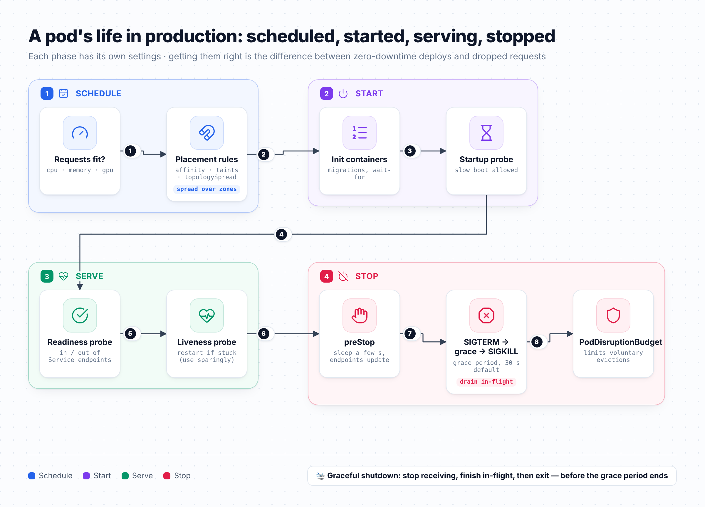

# 15.1 — Workload'lar, probe'lar ve zamanlama

!!! abstract "Tek cümlede"
    Bir production iş yükü bir **controller** (Deployment, StatefulSet, DaemonSet, Job) artı yaşam döngüsü ayarları
    güvenilirliği belirleyen bir pod şablonudur: **request'ler** ve **yerleşim kuralları** nerede çalışacağına, **startup ve
    readiness probe'ları** ne zaman trafik alacağına, **liveness** ne zaman yeniden başlatılacağına, **SIGTERM ele alımı,
    preStop ve bekleme süresi** de tek bir istek düşürmeden kapanıp kapanmayacağına karar verir.

## 📖 Temel terimler ve kısaltmalar

| Terim | Açılımı | Nedir | Nasıl çalışır (tek satır) |
|---|---|---|---|
| **ReplicaSet** | — | N özdeş pod'u tutar | Bir Deployment tarafından oluşturulur ve yönetilir |
| **maxSurge / maxUnavailable** | — | Kademeli güncelleme hızı | İzin verilen ek pod / izin verilen eksik pod |
| **Startup probe** | — | "Açılışı bitti mi?" | Diğer probe'lar o başarılı olana kadar bekler |
| **Readiness probe** | — | "Şu an trafik alabilir mi?" | Başarısız → Service endpoint'lerinden çıkarılır |
| **Liveness probe** | — | "Takıldı mı?" | Başarısız → container yeniden başlatılır |
| **QoS sınıfı** | Quality of Service | Guaranteed, Burstable, BestEffort | Baskı altında tahliye sırasını belirler |
| **Node affinity** | — | Label'lara göre node tercih et/zorunlu kıl | `zone`, `instance-type`, `gpu=true` |
| **Pod (anti-)affinity** | — | Diğer pod'ların yanına / uzağına yerleştir | Önbelleği yan yana koy, replikaları ayır |
| **Taint / toleration** | — | Node pod'ları iter / pod taint'i kabul eder | Özel GPU ya da sistem node'ları |
| **Topoloji yayılımı** | Topology spread | Bir topoloji anahtarına eşit dağılım | Zone'lar arasında `maxSkew: 1` |
| **PriorityClass** | — | Pod'ların önemi | Yüksek öncelik düşüğü yerinden edebilir |
| **Bekleme süresi** | Grace period | SIGTERM ile SIGKILL arasındaki süre | `terminationGracePeriodSeconds`, varsayılan 30 |

## 🗺️ Büyük resim



---

## 1 · Deployment'lar ve rollout'lar

### Nasıl çalışır?

Bir Deployment'ın pod şablonunu değiştirmek **yeni bir ReplicaSet** oluşturur; controller onu büyütür, eskisini küçültür; adımlar `maxSurge` (istenenin üstündeki ek pod) ve `maxUnavailable` (eksik olmasına izin verilen pod) ile sınırlıdır. Yeni bir pod ancak `minReadySeconds` boyunca **Ready** kaldıktan sonra erişilebilir sayılır.

```yaml
spec:
  replicas: 4
  revisionHistoryLimit: 5
  strategy:
    rollingUpdate: { maxSurge: 25%, maxUnavailable: 0 }   # asla kapasitenin altına inme
  minReadySeconds: 10
  progressDeadlineSeconds: 300                            # takılırsa başarısız işaretle
```

`kubectl rollout status|history|undo` takip eder ve geri alır. Canary/blue-green için Argo Rollouts ya da Flagger kullan (9.4, 16.2).

## 2 · Diğer controller'lar

- **StatefulSet**: headless bir Service ile sabit DNS'e sahip `name-0..N` pod'ları ve `volumeClaimTemplates`'ten her birine bir PVC; sıralı ya da paralel başlatma; dikkatli yükseltmeler için bölümlenmiş kademeli güncellemeler (15.2).
- **DaemonSet**: (eşleşen) her node'da bir pod, node node yayılır; her node'da çalışmak için taint'leri tolere eder.
- **Job**: `completions` başarılı olana kadar pod çalıştırır, `backoffLimit`'e kadar yeniden dener, `activeDeadlineSeconds`, paralel iş için indexed job'lar, temizlik için `ttlSecondsAfterFinished`.
- **CronJob**: bir takvime göre Job oluşturur (`timeZone` desteklenir); çakışmaması gereken işler için `concurrencyPolicy: Forbid` ve `startingDeadlineSeconds` ayarla.

## 3 · Probe tasarımı

| Probe | İyi kontrol | Kötü kontrol |
|---|---|---|
| **Startup** | Readiness ile aynı endpoint, cömert `failureThreshold × periodSeconds` (ör. 30 × 5 sn) | Yavaş JVM uygulamalarında yok → başlarken liveness tarafından öldürülür |
| **Readiness** | İstek karşılayabilir: başlatılmış, kritik önbellekler ısınmış, boşaltılmıyor | Her alt bağımlılığı kontrol eder → DB bir anlık sarsılınca bütün filo unready olur |
| **Liveness** | Süreç kilitlenmiş (deadlock, event loop takılmış): ucuz, süreç içi bir kontrol | DB'yi çağırır ya da sıkı zaman aşımlarıyla readiness ile aynıdır → yük altında yeniden başlatma fırtınaları |

Birçok servisin hiç **liveness probe'a ihtiyacı yoktur**: çöken süreç zaten yeniden başlar. Sadece bilinen "canlı ama takılı" hata modları için ekle.

## 4 · Düzgün kapanış

Bir pod silindiğinde iki şey **paralel** olur: kubelet (`preStop`'u çalıştırdıktan sonra) SIGTERM gönderir ve endpoint controller pod'u Service'lerden çıkarır; bu da kube-proxy'ye ve ingress controller'lara ulaşmak için biraz zaman alır. O yüzden:

1. `preStop: exec sleep 5` (ya da yerel bir `sleep` aksiyonu) endpoint'ler güncellenene kadar pod'u hizmette tutar.
2. SIGTERM'de yeni iş almayı bırak, süren istekleri bitir, bağlantıları kapat, flush et.
3. Toplam süreyi `terminationGracePeriodSeconds`'ın altında tut; sonrasında container SIGKILL alır (çıkış 137).
4. Uygulamanın sinyali gerçekten alması için **PID 1 olduğundan ya da bir init kullandığından** emin ol (`tini`, entrypoint'te `exec`) (3.1).

## 5 · Yerleşim: request'ler, affinity, taint'ler, yayılım

- **Request'ler** scheduler'ın yerleştirdiği şeydir; QoS request/limit'lerden gelir: **Guaranteed** (request = limit), **Burstable**, **BestEffort** (hiçbiri yok, ilk tahliye edilen).
- Donanım ya da zone'lar için **nodeSelector / node affinity**; **taint'ler** genel pod'ları özel node'lardan uzak tutar (`nvidia.com/gpu=present:NoSchedule`), oraya ait pod'lar onları **tolere eder**.
- `topology.kubernetes.io/zone` ve `kubernetes.io/hostname` ile **topologySpreadConstraints** replikaları ayrı tutar; büyük ölçekte pod anti-affinity yerine bunları tercih et.
- **PriorityClass'lar**: kapasite azken kritik sistem ve production pod'ları batch işleri yerinden edebilir.
- **PodDisruptionBudget** (`minAvailable` ya da `maxUnavailable`) drain'lerin, yükseltmelerin ve konsolidasyonun aynı anda çok fazlasını kaldırmasına karşı korur.

## 🔧 DevOps bağlantısı

- Bunları **servis şablonuna/chart'ına** göm: probe'lar, preStop, PDB, yayılım, güvenlik bağlamı, makul varsayılanlar (16.4).
- **Kademeli bir deploy sırasında** ve bir node drain'i sırasında yük testi yap; çıta 0 hatadır.
- `kube_deployment_status_replicas_unavailable`, yeniden başlatma sayıları ve `progressDeadlineSeconds`'ı geçen takılı rollout'lar için alarm kur.

## 🧪 Kendin dene

```bash
kind create cluster --name wl
cat <<'EOF' | kubectl apply -f -
apiVersion: apps/v1
kind: Deployment
metadata: { name: web }
spec:
  replicas: 3
  selector: { matchLabels: { app: web } }
  strategy: { rollingUpdate: { maxSurge: 1, maxUnavailable: 0 } }
  template:
    metadata: { labels: { app: web } }
    spec:
      terminationGracePeriodSeconds: 20
      topologySpreadConstraints:
        - { maxSkew: 1, topologyKey: kubernetes.io/hostname, whenUnsatisfiable: ScheduleAnyway, labelSelector: { matchLabels: { app: web } } }
      containers:
        - name: web
          image: nginx:1.27-alpine
          resources: { requests: { cpu: 50m, memory: 32Mi }, limits: { memory: 64Mi } }
          startupProbe:   { httpGet: { path: /, port: 80 }, periodSeconds: 2, failureThreshold: 15 }
          readinessProbe: { httpGet: { path: /, port: 80 }, periodSeconds: 5 }
          lifecycle: { preStop: { sleep: { seconds: 5 } } }
EOF
kubectl rollout status deploy/web
kubectl set image deploy/web web=nginx:1.28-alpine && kubectl rollout status deploy/web
kubectl rollout history deploy/web && kubectl rollout undo deploy/web
kubectl get pod -l app=web -o jsonpath='{range .items[*]}{.metadata.name}{" "}{.status.qosClass}{"\n"}{end}'
kind delete cluster --name wl
```

## 🃏 Hatırlatma kartı

| Ayar | Varsayılan |
|---|---|
| `maxUnavailable` | Kullanıcıya dönük servisler için 0 |
| startupProbe | 10 sn'den uzun açılan her şey için |
| readinessProbe | Her zaman, sadece yerel hazırlık |
| livenessProbe | Sadece bilinen takılma modları için, ucuz kontrol |
| preStop | 5–10 sn bekleme |
| Bekleme süresi | > preStop + en uzun istek |
| Yayılım | Zone + hostname, `maxSkew: 1` |
| PDB | `maxUnavailable: 1` (ya da %25) |

## ❓ Kendini test et

??? question "1. 4 replikalı bir Deployment için `maxSurge: 25%` ve `maxUnavailable: 0` ne anlama gelir?"
    Rollout sırasında en fazla 1 ek pod olabilir (toplam 5) ve erişilebilir pod sayısı asla 4'ün altına düşmez: eskisi kaldırılmadan önce yeni bir pod hazır olmalıdır.

??? question "2. Veritabanını kontrol eden bir liveness probe neden bir kesintiyi kötüleştirebilir?"
    Veritabanı yavaşlarsa her pod liveness'ta başarısız olur ve aynı anda yeniden başlatılır; önbellekler ve bağlantılar kaybolur ve sistem zorlandığı anda tam da ek yük gelir.

??? question "3. Startup probe neden faydalı?"
    Liveness ve readiness probe'larını gevşetmeden yavaş açılan uygulamalara boot süresi verir; onlar ancak startup probe başarılı olunca başlar.

??? question "4. `kubectl delete pod` ile container'ın durması arasında ne olur?"
    Pod sonlanıyor olarak işaretlenir; paralelde endpoint Service'lerden çıkarılır ve kubelet preStop'u çalıştırıp SIGTERM gönderir; bekleme süresinden sonra kalan süreç SIGKILL alır.

??? question "5. Taint ile node affinity arasındaki fark ne?"
    Node üzerindeki taint onu tolere etmeyen pod'ları iter (node seçer); pod üzerindeki node affinity onu belli label'lara sahip node'lara çeker (pod seçer). Özel node'lar genelde ikisini birden kullanır.

---

## 📚 Kaynaklar

- [Kubernetes — Deployments](https://kubernetes.io/docs/concepts/workloads/controllers/deployment/)
- [Kubernetes — Pod lifecycle and termination](https://kubernetes.io/docs/concepts/workloads/pods/pod-lifecycle/)
- [Kubernetes — Taints and tolerations](https://kubernetes.io/docs/concepts/scheduling-eviction/taint-and-toleration/)
- [Kubernetes — Pod topology spread constraints](https://kubernetes.io/docs/concepts/scheduling-eviction/topology-spread-constraints/)
- [Kubernetes — Pod quality of service classes](https://kubernetes.io/docs/concepts/workloads/pods/pod-qos/)

## ✍️ Notlarım

> En önemli servisinin bir liveness probe'u var mı? Tam olarak neyi kontrol ediyor ve tüm pod'ları aynı anda yeniden başlatabilir mi?

-
