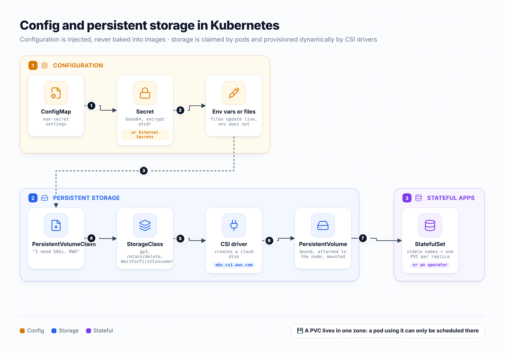

# 15.2 — Configuration & persistent storage

!!! abstract "In short"
    The same image runs in every environment because **configuration is injected** at runtime. It comes from
    **ConfigMaps** and **Secrets** (as env vars or files), ideally synced from a real secret manager. Data that must
    outlive a pod lives on a **PersistentVolume** that the pod **claims** through a **PVC**. A **StorageClass** and its
    **CSI driver** create it as a cloud disk in the **right zone** and attach it wherever the pod runs.

## 📖 Key terms & abbreviations

| Term | Stands for | What it is | How it works (one line) |
|---|---|---|---|
| **ConfigMap** | — | Key-value config object | Mounted as files or env vars |
| **Secret** | — | Config for sensitive values | base64 in the API; encrypt etcd at rest |
| **External Secrets Operator** | ESO | Syncs secrets from Vault/cloud managers | `ExternalSecret` → Kubernetes Secret |
| **Secrets Store CSI** | — | Mounts secrets directly from a manager | No Kubernetes Secret object needed |
| **PV** | PersistentVolume | A piece of storage in the cluster | Backed by a cloud disk, NFS, local disk |
| **PVC** | PersistentVolumeClaim | A request for storage | Size + access mode + class |
| **StorageClass** | — | How to provision volumes | Provisioner, parameters, reclaim policy |
| **Access modes** | RWO / ROX / RWX / RWOP | Who can mount it | Block disks are RWO (one node) |
| **CSI** | Container Storage Interface | Standard storage driver API | Controller (create/attach) + node (mount) plugins |
| **WaitForFirstConsumer** | — | Delay provisioning until a pod is scheduled | Disk created in the pod's zone |
| **Reclaim policy** | — | What happens to a PV when the PVC is deleted | `Delete` or `Retain` |
| **VolumeSnapshot** | — | Point-in-time copy of a volume | Via CSI snapshot support |

## 🗺️ Big picture



---

## 1 · ConfigMaps and Secrets

### How does it work?

```yaml
envFrom:
  - configMapRef: { name: app-config }        # every key becomes an env var
volumeMounts:
  - { name: tls, mountPath: /etc/tls, readOnly: true }
volumes:
  - name: tls
    secret: { secretName: app-tls }            # every key becomes a file
```

- **Env vars** are read once at process start; changing the ConfigMap does nothing until the pod restarts.
- **Mounted files** are updated by the kubelet within about a minute (not with `subPath`); the app must re-read them.
- To roll pods on config change, put a **hash of the config in a pod annotation** (Helm `checksum/config`, Kustomize `configMapGenerator` name suffixes) or use Reloader.
- **Secrets** are only base64-encoded; protect them with RBAC (`get secrets` is powerful), **encryption at rest** with a KMS provider, and avoid printing env vars in logs (11).
- Better: keep the source of truth in **Vault / AWS Secrets Manager / GCP Secret Manager** and sync with **External Secrets** or mount with the **Secrets Store CSI driver**, authenticating with workload identity (no static keys).

## 2 · Volumes, claims and classes

1. A pod references a **PVC** (`claimName: data`).
2. The PVC asks for `50Gi`, `ReadWriteOnce`, class `gp3`.
3. The **StorageClass** names a **provisioner** (`ebs.csi.aws.com`, `pd.csi.storage.gke.io`) and parameters (type, IOPS, encryption, KMS key).
4. With `volumeBindingMode: WaitForFirstConsumer`, provisioning waits until the scheduler picks a node, so the disk is created **in that node's zone**.
5. The CSI controller creates the disk, a **PV** is bound to the PVC; the CSI node plugin attaches and mounts it into the pod.

| Access mode | Meaning | Typical backend |
|---|---|---|
| RWO | Read-write by one node | Block disks (EBS, PD) |
| RWOP | Read-write by one pod | Block disks, strict single writer |
| RWX | Read-write by many nodes | NFS/EFS/Filestore, CephFS |
| ROX | Read-only by many nodes | Shared datasets |

## 3 · Living with volumes

- **Zones**: an RWO disk exists in one zone; a pod using it can only run there. If that zone loses capacity, the pod stays `Pending`. Replication across zones is the application's job (database replicas) or a regional disk.
- **Expansion**: `allowVolumeExpansion: true`, then edit the PVC size; filesystems grow online on most CSI drivers. Shrinking is not supported.
- **Snapshots**: `VolumeSnapshot` objects with a `VolumeSnapshotClass`; restore by creating a PVC with `dataSource`.
- **Reclaim policy**: `Delete` removes the disk when the PVC goes away; use `Retain` for important data, so a deleted namespace doesn't delete your database.
- **Ephemeral storage**: `emptyDir` (node disk or memory), counted against `ephemeral-storage` requests; exceeding it gets the pod evicted.

## 4 · StatefulSets and databases

StatefulSets give each replica a stable name and its own PVC (`data-db-0`, `data-db-1`), which stays even if the pod is rescheduled. That's the foundation, but running a database also needs replication setup, failover, backups, upgrades and monitoring. Options:

- **Managed database outside the cluster** (RDS, Cloud SQL): simplest, usually the right default (14.2).
- **Operators** that encode this knowledge (CloudNativePG, Percona, Strimzi for Kafka, Redis operators) when you need databases in the cluster (15.3).
- **Hand-written StatefulSets** for databases: rarely a good idea.

## 🔧 DevOps connection

- **One image, many environments**: config differences belong in overlays/values (15.3), never in separate images.
- **Monitor volumes**: `kubelet_volume_stats_used_bytes / capacity_bytes` alerts before disks fill; IOPS limits on cloud disks (14.2).
- **Back up PVs** with CSI snapshots or Velero (15.5), and rehearse restores.
- **Don't put secrets in Helm values in git**; reference external secrets instead (or encrypt with SOPS/Sealed Secrets).

## 🧪 Try it yourself

```bash
kind create cluster --name st
# Config as a file that updates live
kubectl create configmap app-config --from-literal=GREETING=hello
cat <<'EOF' | kubectl apply -f -
apiVersion: v1
kind: Pod
metadata: { name: cfg }
spec:
  containers:
    - name: c
      image: busybox:1.37
      command: ["sh", "-c", "while true; do echo env=$GREETING file=$(cat /cfg/GREETING); sleep 5; done"]
      envFrom: [{ configMapRef: { name: app-config } }]
      volumeMounts: [{ name: cfg, mountPath: /cfg }]
  volumes: [{ name: cfg, configMap: { name: app-config } }]
EOF
sleep 10; kubectl create configmap app-config --from-literal=GREETING=merhaba -o yaml --dry-run=client | kubectl apply -f -
sleep 70; kubectl logs cfg --tail=2             # file changed, env did not

# Dynamic provisioning with kind's default StorageClass
kubectl get storageclass
kubectl create -f - <<'EOF'
apiVersion: v1
kind: PersistentVolumeClaim
metadata: { name: data }
spec: { accessModes: [ReadWriteOnce], resources: { requests: { storage: 1Gi } } }
EOF
kubectl get pvc data                            # Pending until a pod uses it (WaitForFirstConsumer)
kind delete cluster --name st
```

## 🃏 Cheat sheet

| Need | Use |
|---|---|
| Plain settings | ConfigMap (files if you want live reload) |
| Credentials | External Secrets / CSI from a secret manager |
| Restart on config change | Checksum annotation, generator suffix, Reloader |
| Disk for one pod | PVC RWO, class with `WaitForFirstConsumer` |
| Shared files | RWX (EFS/Filestore/NFS) |
| Protect important data | `reclaimPolicy: Retain` + snapshots |
| Database | Managed service, or a mature operator |

## ❓ Test yourself

??? question "1. You change a ConfigMap used via `envFrom`. Why doesn't the app see the new value?"
    Environment variables are set when the container starts; they aren't updated in a running process. Restart the pods (e.g. via a config checksum annotation) or mount the ConfigMap as files.

??? question "2. Why are Kubernetes Secrets not enough on their own?"
    They're only base64-encoded, readable by anyone with `get secrets`, and stored in etcd unencrypted unless configured. Use encryption at rest, tight RBAC and ideally an external secret manager.

??? question "3. What does `WaitForFirstConsumer` solve?"
    It delays creating the disk until the pod is scheduled, so the volume is created in the same zone as the node; otherwise the disk could land in a zone where the pod can't run.

??? question "4. Why can a pod with an RWO PVC get stuck in `Pending` after a zone failure?"
    The disk lives in the failed zone and can only attach to nodes there; the scheduler can't place the pod anywhere else.

??? question "5. Why use `Retain` as the reclaim policy for important volumes?"
    With `Delete`, deleting the PVC (or its namespace) also deletes the underlying disk; `Retain` keeps the disk so the data can be recovered.

---

## 📚 Sources

- [Kubernetes — ConfigMaps](https://kubernetes.io/docs/concepts/configuration/configmap/) · [Secrets](https://kubernetes.io/docs/concepts/configuration/secret/)
- [Kubernetes — Persistent volumes](https://kubernetes.io/docs/concepts/storage/persistent-volumes/) · [Storage classes](https://kubernetes.io/docs/concepts/storage/storage-classes/)
- [Kubernetes — Volume snapshots](https://kubernetes.io/docs/concepts/storage/volume-snapshots/)
- [External Secrets Operator](https://external-secrets.io/)
- [CloudNativePG](https://cloudnative-pg.io/)

## ✍️ My notes

> Where does each secret in your cluster really come from, and who can read it?
