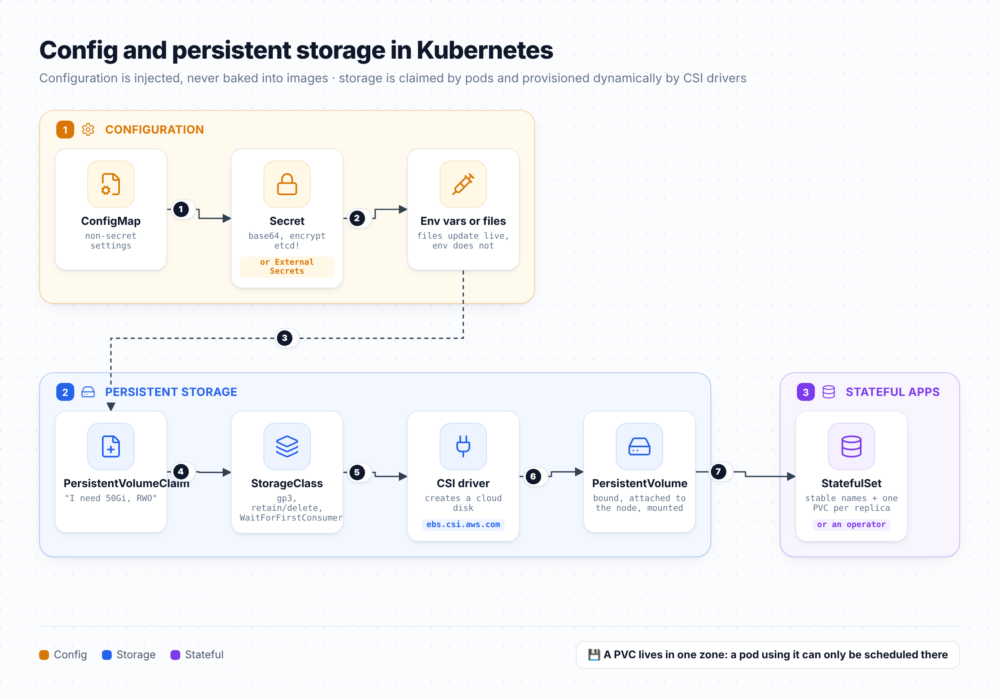

# 15.2 — Yapılandırma ve kalıcı depolama

!!! abstract "Tek cümlede"
    Aynı imaj her ortamda çalışır çünkü **yapılandırma** çalışma anında **ConfigMap** ve **Secret'lardan** (ortam
    değişkeni ya da dosya olarak) **enjekte edilir**, ideal olarak gerçek bir secret yöneticisinden senkronlanır; bir
    pod'dan uzun yaşaması gereken veri, pod'un bir **PVC** ile **talep ettiği** bir **PersistentVolume** üzerinde yaşar; bunu
    bir **StorageClass** ve onun **CSI sürücüsü** **doğru zone'da** bir bulut diski olarak oluşturur ve pod hangi node'a
    düşerse ona takar.

## 📖 Temel terimler ve kısaltmalar

| Terim | Açılımı | Nedir | Nasıl çalışır (tek satır) |
|---|---|---|---|
| **ConfigMap** | — | Anahtar-değer yapılandırma nesnesi | Dosya ya da env olarak mount edilir |
| **Secret** | — | Hassas değerler için yapılandırma | API'de base64; etcd'yi durağanda şifrele |
| **External Secrets Operator** | ESO | Vault/bulut yöneticilerinden secret senkronlar | `ExternalSecret` → Kubernetes Secret |
| **Secrets Store CSI** | — | Secret'ları doğrudan yöneticiden mount eder | Kubernetes Secret nesnesi gerekmez |
| **PV** | PersistentVolume | Cluster'daki bir depolama parçası | Bulut diski, NFS, yerel disk destekli |
| **PVC** | PersistentVolumeClaim | Depolama talebi | Boyut + erişim modu + sınıf |
| **StorageClass** | — | Volume'ların nasıl oluşturulacağı | Provisioner, parametreler, geri alma politikası |
| **Erişim modları** | RWO / ROX / RWX / RWOP | Kim mount edebilir | Blok diskler RWO'dur (tek node) |
| **CSI** | Container Storage Interface | Standart depolama sürücüsü API'si | Controller (oluştur/tak) + node (mount) eklentileri |
| **WaitForFirstConsumer** | — | Pod zamanlanana kadar oluşturmayı ertele | Disk pod'un zone'unda oluşur |
| **Geri alma politikası** | Reclaim policy | PVC silinince PV'ye ne olur | `Delete` ya da `Retain` |
| **VolumeSnapshot** | — | Bir volume'un zamandaki kopyası | CSI snapshot desteğiyle |

## 🗺️ Büyük resim



---

## 1 · ConfigMap ve Secret'lar

### Nasıl çalışır?

```yaml
envFrom:
  - configMapRef: { name: app-config }        # her anahtar bir env değişkeni olur
volumeMounts:
  - { name: tls, mountPath: /etc/tls, readOnly: true }
volumes:
  - name: tls
    secret: { secretName: app-tls }            # her anahtar bir dosya olur
```

- **Env değişkenleri** süreç başlarken bir kez okunur; ConfigMap'i değiştirmek pod yeniden başlayana kadar hiçbir şey yapmaz.
- **Mount edilen dosyalar** kubelet tarafından yaklaşık bir dakika içinde güncellenir (`subPath` ile değil); uygulamanın onları yeniden okuması gerekir.
- Yapılandırma değişince pod'ları yenilemek için **yapılandırmanın hash'ini bir pod annotation'ına** koy (Helm `checksum/config`, Kustomize `configMapGenerator` isim ekleri) ya da Reloader kullan.
- **Secret'lar** sadece base64 kodludur; onları RBAC (`get secrets` güçlüdür), KMS sağlayıcısıyla **durağan şifreleme** ile koru ve env değişkenlerini loglara yazdırmaktan kaçın (11).
- Daha iyisi: gerçeğin kaynağını **Vault / AWS Secrets Manager / GCP Secret Manager**'da tut, **External Secrets** ile senkronla ya da **Secrets Store CSI sürücüsüyle** mount et; kimlik doğrulamayı iş yükü kimliğiyle yap (statik anahtar yok).

## 2 · Volume'lar, claim'ler ve sınıflar

1. Bir pod bir **PVC**'ye referans verir (`claimName: data`).
2. PVC `50Gi`, `ReadWriteOnce`, `gp3` sınıfı ister.
3. **StorageClass** bir **provisioner** (`ebs.csi.aws.com`, `pd.csi.storage.gke.io`) ve parametreleri (tip, IOPS, şifreleme, KMS anahtarı) belirtir.
4. `volumeBindingMode: WaitForFirstConsumer` ile oluşturma, scheduler bir node seçene kadar bekler; disk **o node'un zone'unda** oluşturulur.
5. CSI controller diski oluşturur, bir **PV** PVC'ye bağlanır; CSI node eklentisi onu takar ve pod'a mount eder.

| Erişim modu | Anlamı | Tipik arka uç |
|---|---|---|
| RWO | Tek node tarafından okuma-yazma | Blok diskler (EBS, PD) |
| RWOP | Tek pod tarafından okuma-yazma | Blok diskler, katı tek yazar |
| RWX | Çok node tarafından okuma-yazma | NFS/EFS/Filestore, CephFS |
| ROX | Çok node tarafından salt okuma | Paylaşılan veri setleri |

## 3 · Volume'larla yaşamak

- **Zone'lar**: bir RWO disk tek bir zone'da var olur; onu kullanan pod sadece orada çalışabilir. O zone kapasite kaybederse pod `Pending` kalır. Zone'lar arası replikasyon uygulamanın işidir (veritabanı replikaları) ya da bölgesel bir disk.
- **Büyütme**: `allowVolumeExpansion: true`, sonra PVC boyutunu düzenle; çoğu CSI sürücüsünde dosya sistemleri çevrimiçi büyür. Küçültme desteklenmez.
- **Snapshot'lar**: bir `VolumeSnapshotClass` ile `VolumeSnapshot` nesneleri; `dataSource` ile bir PVC oluşturarak geri yükle.
- **Geri alma politikası**: `Delete` PVC gidince diski kaldırır; önemli veriler için `Retain` kullan; silinen bir namespace veritabanını silmesin.
- **Geçici depolama**: `emptyDir` (node diski ya da bellek), `ephemeral-storage` request'lerine sayılır; aşılırsa pod tahliye edilir.

## 4 · StatefulSet'ler ve veritabanları

StatefulSet'ler her replikaya sabit bir isim ve pod yeniden zamanlansa bile kalan kendi PVC'sini verir (`data-db-0`, `data-db-1`). Bu temeldir, ama bir veritabanını çalıştırmak replikasyon kurulumu, failover, yedekler, yükseltmeler ve izleme de ister. Seçenekler:

- **Cluster dışında yönetilen veritabanı** (RDS, Cloud SQL): en basiti, genelde doğru varsayılan (14.2).
- Cluster'da veritabanına ihtiyacın varsa bu bilgiyi kodlayan **operator'ler** (CloudNativePG, Percona, Kafka için Strimzi, Redis operator'leri) (15.3).
- Veritabanları için **elle yazılmış StatefulSet'ler**: nadiren iyi bir fikir.

## 🔧 DevOps bağlantısı

- **Tek imaj, çok ortam**: yapılandırma farkları overlay/values'ta durur (15.3), asla ayrı imajlarda değil.
- **Volume'ları izle**: diskler dolmadan `kubelet_volume_stats_used_bytes / capacity_bytes` alarmları; bulut disklerinde IOPS limitleri (14.2).
- **PV'leri yedekle**: CSI snapshot'ları ya da Velero ile (15.5) ve geri yüklemeyi prova et.
- **Secret'ları git'teki Helm values'una koyma**; bunun yerine harici secret'lara referans ver (ya da SOPS/Sealed Secrets ile şifrele).

## 🧪 Kendin dene

```bash
kind create cluster --name st
# Canlı güncellenen dosya olarak yapılandırma
kubectl create configmap app-config --from-literal=GREETING=hello
cat <<'EOF' | kubectl apply -f -
apiVersion: v1
kind: Pod
metadata: { name: cfg }
spec:
  containers:
    - name: c
      image: busybox:1.37
      command: ["sh", "-c", "while true; do echo env=$GREETING file=$(cat /cfg/GREETING); sleep 5; done"]
      envFrom: [{ configMapRef: { name: app-config } }]
      volumeMounts: [{ name: cfg, mountPath: /cfg }]
  volumes: [{ name: cfg, configMap: { name: app-config } }]
EOF
sleep 10; kubectl create configmap app-config --from-literal=GREETING=merhaba -o yaml --dry-run=client | kubectl apply -f -
sleep 70; kubectl logs cfg --tail=2             # dosya değişti, env değişmedi

# kind'in varsayılan StorageClass'ıyla dinamik oluşturma
kubectl get storageclass
kubectl create -f - <<'EOF'
apiVersion: v1
kind: PersistentVolumeClaim
metadata: { name: data }
spec: { accessModes: [ReadWriteOnce], resources: { requests: { storage: 1Gi } } }
EOF
kubectl get pvc data                            # bir pod kullanana kadar Pending (WaitForFirstConsumer)
kind delete cluster --name st
```

## 🃏 Hatırlatma kartı

| İhtiyaç | Kullan |
|---|---|
| Düz ayarlar | ConfigMap (canlı yenileme istersen dosya olarak) |
| Kimlik bilgileri | Bir secret yöneticisinden External Secrets / CSI |
| Yapılandırma değişince yeniden başlat | Checksum annotation, generator eki, Reloader |
| Tek pod için disk | PVC RWO, `WaitForFirstConsumer`'lı sınıf |
| Paylaşılan dosyalar | RWX (EFS/Filestore/NFS) |
| Önemli veriyi koru | `reclaimPolicy: Retain` + snapshot'lar |
| Veritabanı | Yönetilen servis ya da olgun bir operator |

## ❓ Kendini test et

??? question "1. `envFrom` ile kullanılan bir ConfigMap'i değiştirdin. Uygulama neden yeni değeri görmüyor?"
    Ortam değişkenleri container başlarken ayarlanır; çalışan bir süreçte güncellenmez. Pod'ları yeniden başlat (ör. bir yapılandırma checksum annotation'ıyla) ya da ConfigMap'i dosya olarak mount et.

??? question "2. Kubernetes Secret'ları tek başına neden yeterli değil?"
    Sadece base64 kodludurlar, `get secrets` yetkisi olan herkes okuyabilir ve yapılandırılmazsa etcd'de şifresiz saklanırlar. Durağan şifreleme, sıkı RBAC ve ideal olarak harici bir secret yöneticisi kullan.

??? question "3. `WaitForFirstConsumer` neyi çözer?"
    Diski oluşturmayı pod zamanlanana kadar erteler; volume node ile aynı zone'da oluşturulur. Yoksa disk pod'un çalışamayacağı bir zone'a düşebilir.

??? question "4. RWO PVC'li bir pod bir zone hatasından sonra neden `Pending`'de takılabilir?"
    Disk çöken zone'da yaşar ve sadece oradaki node'lara takılabilir; scheduler pod'u başka bir yere yerleştiremez.

??? question "5. Önemli volume'lar için geri alma politikası olarak neden `Retain` kullanılır?"
    `Delete` ile PVC'yi (ya da namespace'ini) silmek alttaki diski de siler; `Retain` diski tutar, böylece veri kurtarılabilir.

---

## 📚 Kaynaklar

- [Kubernetes — ConfigMaps](https://kubernetes.io/docs/concepts/configuration/configmap/) · [Secrets](https://kubernetes.io/docs/concepts/configuration/secret/)
- [Kubernetes — Persistent volumes](https://kubernetes.io/docs/concepts/storage/persistent-volumes/) · [Storage classes](https://kubernetes.io/docs/concepts/storage/storage-classes/)
- [Kubernetes — Volume snapshots](https://kubernetes.io/docs/concepts/storage/volume-snapshots/)
- [External Secrets Operator](https://external-secrets.io/)
- [CloudNativePG](https://cloudnative-pg.io/)

## ✍️ Notlarım

> Cluster'ındaki her secret gerçekte nereden geliyor ve kim okuyabiliyor?

-
