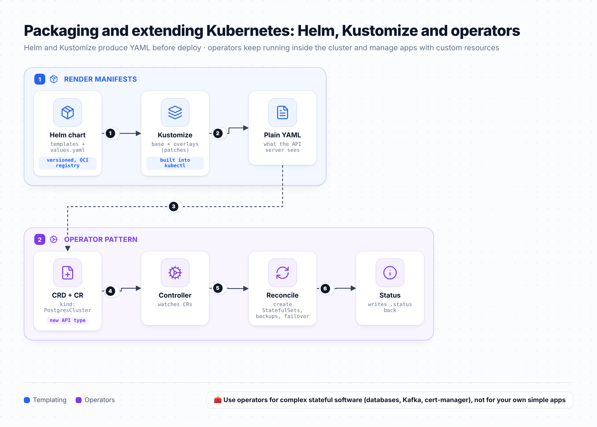

# 15.3 — Helm, Kustomize & operators

!!! abstract "In short"
    **Helm** packages an application as a **chart** of templates rendered with **values** and tracks installs as
    **releases**; **Kustomize** starts from plain YAML and applies **overlays** per environment without templates. Both
    just produce manifests, typically applied by **GitOps**. **Operators** go further: a **CRD** adds a new API type
    (`PostgresCluster`) and a **controller** keeps running in the cluster, reconciling that resource into StatefulSets,
    backups and failovers, which encodes a human operator's knowledge as software.

## 📖 Key terms & abbreviations

| Term | Stands for | What it is | How it works (one line) |
|---|---|---|---|
| **Chart** | — | Helm package | `Chart.yaml`, `values.yaml`, `templates/` |
| **Values** | — | Inputs to a chart | Defaults overridden by `-f prod.yaml` / `--set` |
| **Release** | — | One installation of a chart | Name + namespace + revision history |
| **Hook** | — | Job run at install/upgrade phases | `pre-upgrade` DB migration |
| **OCI registry** | Open Container Initiative | Store charts like images | `helm push chart.tgz oci://…` |
| **Base / overlay** | — | Kustomize shared config / per-env patches | `overlays/prod` patches `base` |
| **Generator** | — | Creates ConfigMaps/Secrets with hash suffix | Triggers rollouts on change |
| **CRD** | CustomResourceDefinition | Adds a new resource type to the API | Schema, versions, validation |
| **CR** | Custom Resource | An instance of a CRD | `kind: Certificate` |
| **Operator** | — | Controller for a CRD with domain knowledge | Reconcile loop: observe → diff → act |
| **Finalizer** | — | Blocks deletion until cleanup is done | Operator removes it when finished |
| **Crossplane** | — | Operators for cloud resources | Kubernetes API for databases, buckets |

## 🗺️ Big picture



---

## 1 · Helm

### How does it work?

`helm install shop ./chart -f values-prod.yaml` renders `templates/*.yaml` with Go templates and the merged values, sends the manifests to the API server, and stores the release (rendered manifest + values) as a Secret in the namespace. `helm upgrade` computes a 3-way diff (old manifest, new manifest, live state) and applies it; `helm rollback` goes back to a stored revision.

```yaml
# templates/deployment.yaml (excerpt)
spec:
  replicas: {{ .Values.replicas }}
  template:
    metadata:
      annotations:
        checksum/config: {{ include (print $.Template.BasePath "/configmap.yaml") . | sha256sum }}
    spec:
      containers:
        - name: app
          image: "{{ .Values.image.repository }}@{{ .Values.image.digest }}"
          resources: {{- toYaml .Values.resources | nindent 12 }}
```

- **Good for** distributing software (cert-manager, ingress controllers, Prometheus) and internal "service charts" with many options.
- **Pitfalls**: templating YAML with whitespace is fragile; huge values files become an untyped API (use `values.schema.json`); hooks and CRD upgrades need care; never `helm install` by hand into prod: render and deliver with GitOps.

## 2 · Kustomize

```text
base/            deployment.yaml service.yaml kustomization.yaml
overlays/dev/    kustomization.yaml  (replicas: 1, image tag, small resources)
overlays/prod/   kustomization.yaml  (replicas: 6, HPA, PDB patch, prod ConfigMap)
```

`kubectl apply -k overlays/prod` (or `kustomize build`) merges strategic patches / JSON patches onto the base. **No templates**: every file is valid YAML you can read. Generators add a content hash to ConfigMap names, so changes roll pods automatically. It's built into kubectl and supported natively by Argo CD and Flux.

## 3 · Which one?

| Situation | Choose |
|---|---|
| Installing third-party software | Its Helm chart (pin the version) |
| Your own services, few env differences | Kustomize, or one internal Helm chart for all services |
| Many teams, one golden service template | Internal Helm chart with a schema |
| Tweaking a third-party chart's output | Helm + Kustomize post-render (Argo CD/Flux support it) |
| Logic-heavy config (loops, functions) | cdk8s, Jsonnet/Tanka, or CUE/KCL, carefully |

Whatever you choose, **render in CI**, validate (kubeconform, policy checks), diff, and let GitOps apply.

## 4 · CRDs and operators

### How does it work?

1. A **CRD** registers a new type with an OpenAPI schema, e.g. `postgresql.cnpg.io/v1 Cluster`.
2. You apply a **custom resource**: `instances: 3, storage: 100Gi, backup: s3://…`.
3. The operator's **controller watches** these resources and reconciles: creates pods/PVCs, configures replication, schedules backups, performs failover and rolling minor upgrades, updates `.status`.
4. Deleting the CR runs cleanup guarded by **finalizers**.

Well-known operators: **cert-manager** (TLS certificates), **CloudNativePG** / Percona (databases), **Strimzi** (Kafka), **Prometheus Operator** (monitoring), **External Secrets** (15.2), **Argo Rollouts** (progressive delivery), **Crossplane** (cloud resources as Kubernetes objects, 14.3).

**Before adopting one**, check: maturity and maintainers, upgrade path of the operator itself, CRD version migrations, what happens if the operator is down (workloads should keep running), backup/restore story, RBAC it needs.

## 🔧 DevOps connection

- A **golden service chart** (probes, PDB, HPA, security context, monitoring) is one of the highest-leverage platform artifacts (16.4).
- Pin chart versions and image **digests**; promote the same rendered artifacts across environments (9.4).
- Track **deprecated API versions** in charts before cluster upgrades (`pluto`, `kubent`, 15.5).
- Operators are **production software you run**: monitor them, upgrade them, read their release notes.

## 🧪 Try it yourself

```bash
kind create cluster --name pkg
# Helm: scaffold, render, install, upgrade, roll back
helm create demo && helm template demo ./demo --set replicaCount=2 | grep -A3 "kind: Deployment"
helm install demo ./demo && helm upgrade demo ./demo --set replicaCount=3
helm history demo && helm rollback demo 1 && kubectl get deploy demo

# Kustomize: base + overlay
mkdir -p k/base k/prod
kubectl create deployment web --image=nginx:alpine --dry-run=client -o yaml > k/base/deploy.yaml
printf "resources: [deploy.yaml]\n" > k/base/kustomization.yaml
cat > k/prod/kustomization.yaml <<'EOF'
resources: [../base]
replicas: [{ name: web, count: 5 }]
images: [{ name: nginx, newTag: 1.28-alpine }]
configMapGenerator: [{ name: web-config, literals: [MODE=prod] }]
EOF
kubectl kustomize k/prod | grep -E "replicas|image|name: web-config"

# An operator: cert-manager and a self-signed certificate
helm install cert-manager oci://quay.io/jetstack/charts/cert-manager -n cert-manager --create-namespace --set crds.enabled=true --wait
kubectl get crd | grep cert-manager
kind delete cluster --name pkg
```

## 🃏 Cheat sheet

| Command | Use |
|---|---|
| `helm template … -f values.yaml` | See exactly what will be applied |
| `helm upgrade --install --atomic` | Upgrade or install, roll back on failure |
| `helm history / rollback` | Revisions and undo |
| `helm diff upgrade` (plugin) | Preview changes |
| `kubectl kustomize dir` | Render an overlay |
| `kubectl get crd` / `kubectl explain <kind>` | Discover custom APIs |
| `kubectl get <cr> -o yaml` → `.status` | What the operator thinks |

## ❓ Test yourself

??? question "1. Where does Helm store information about a release?"
    In the release's namespace, as a Secret per revision containing the rendered manifest, values and metadata; that's what `helm history` and `rollback` use.

??? question "2. What's the main difference between Helm and Kustomize?"
    Helm renders templates with values (and manages releases); Kustomize patches plain YAML bases with overlays, without templates or release tracking.

??? question "3. Why add a checksum of the ConfigMap to the pod template annotations?"
    So a config change changes the pod template, triggering a rolling update; otherwise pods keep running with old config.

??? question "4. What is the operator pattern?"
    A CRD defines a new resource type and a controller continuously reconciles those resources to the desired state, automating operational tasks like provisioning, failover, backups and upgrades.

??? question "5. What should you check before running an operator in production?"
    Maturity and maintenance, how the operator and its CRDs are upgraded, the RBAC it needs, behaviour when the operator is down, and its backup/restore and failure handling.

---

## 📚 Sources

- [Helm documentation](https://helm.sh/docs/) · [Chart best practices](https://helm.sh/docs/chart_best_practices/)
- [Kustomize — Kubernetes docs](https://kubernetes.io/docs/tasks/manage-kubernetes-objects/kustomization/)
- [Kubernetes — Operator pattern](https://kubernetes.io/docs/concepts/extend-kubernetes/operator/)
- [Kubernetes — Custom resources](https://kubernetes.io/docs/concepts/extend-kubernetes/api-extension/custom-resources/)
- [cert-manager](https://cert-manager.io/docs/) · [Crossplane](https://docs.crossplane.io/)

## ✍️ My notes

> List the operators in your cluster (`kubectl get crd`). Who owns each one, and when was it last upgraded?
