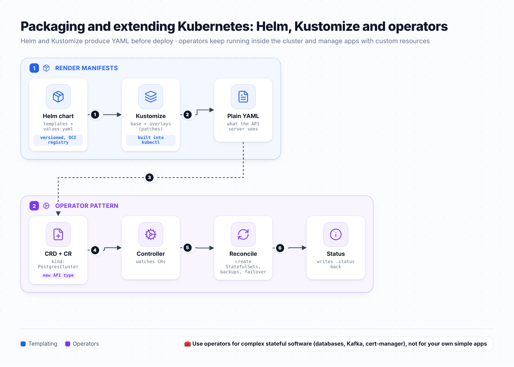

# 15.3 — Helm, Kustomize ve operator'ler

!!! abstract "Tek cümlede"
    **Helm** bir uygulamayı **değerlerle** üretilen şablonlardan oluşan bir **chart** olarak paketler ve kurulumları
    **release** olarak izler; **Kustomize** düz YAML'dan başlar ve ortam başına şablonsuz **overlay'ler** uygular; ikisi de
    sadece manifest üretir, genelde **GitOps** ile uygulanır; **operator'ler** bir adım öteye gider: bir **CRD** yeni bir
    API tipi (`PostgresCluster`) ekler ve bir **controller** cluster'da çalışmaya devam ederek o kaynağı StatefulSet'lere,
    yedeklere ve failover'lara uzlaştırır; insan bir operatörün bilgisini yazılım olarak kodlar.

## 📖 Temel terimler ve kısaltmalar

| Terim | Açılımı | Nedir | Nasıl çalışır (tek satır) |
|---|---|---|---|
| **Chart** | — | Helm paketi | `Chart.yaml`, `values.yaml`, `templates/` |
| **Values** | — | Bir chart'ın girdileri | Varsayılanlar `-f prod.yaml` / `--set` ile ezilir |
| **Release** | — | Bir chart'ın bir kurulumu | İsim + namespace + revizyon geçmişi |
| **Hook** | — | Kurulum/yükseltme aşamalarında çalışan Job | `pre-upgrade` DB migration'ı |
| **OCI registry** | Open Container Initiative | Chart'ları imaj gibi sakla | `helm push chart.tgz oci://…` |
| **Base / overlay** | — | Kustomize ortak yapılandırma / ortam başına yamalar | `overlays/prod`, `base`'i yamalar |
| **Generator** | — | Hash ekli ConfigMap/Secret oluşturur | Değişince rollout tetikler |
| **CRD** | CustomResourceDefinition | API'ye yeni kaynak tipi ekler | Şema, sürümler, doğrulama |
| **CR** | Custom Resource | Bir CRD'nin örneği | `kind: Certificate` |
| **Operator** | — | Alan bilgisine sahip bir CRD controller'ı | Uzlaştırma döngüsü: gözle → farkı bul → uygula |
| **Finalizer** | — | Temizlik bitene kadar silmeyi engeller | Operator bitince kaldırır |
| **Crossplane** | — | Bulut kaynakları için operator'ler | Veritabanları, bucket'lar için Kubernetes API'si |

## 🗺️ Büyük resim



---

## 1 · Helm

### Nasıl çalışır?

`helm install shop ./chart -f values-prod.yaml`, `templates/*.yaml`'ı Go şablonları ve birleştirilmiş değerlerle üretir, manifest'leri API server'a gönderir ve release'i (üretilmiş manifest + değerler) namespace'te bir Secret olarak saklar. `helm upgrade` 3 yönlü bir fark (eski manifest, yeni manifest, canlı durum) hesaplar ve uygular; `helm rollback` saklanan bir revizyona döner.

```yaml
# templates/deployment.yaml (kesit)
spec:
  replicas: {{ .Values.replicas }}
  template:
    metadata:
      annotations:
        checksum/config: {{ include (print $.Template.BasePath "/configmap.yaml") . | sha256sum }}
    spec:
      containers:
        - name: app
          image: "{{ .Values.image.repository }}@{{ .Values.image.digest }}"
          resources: {{- toYaml .Values.resources | nindent 12 }}
```

- **İyi olduğu yerler**: yazılım dağıtmak (cert-manager, ingress controller'lar, Prometheus) ve çok seçenekli iç "servis chart'ları".
- **Tuzaklar**: boşluklarla YAML şablonlamak kırılgandır; dev values dosyaları tipsiz bir API'ye dönüşür (`values.schema.json` kullan); hook'lar ve CRD yükseltmeleri dikkat ister; prod'a asla elle `helm install` yapma: üret ve GitOps ile teslim et.

## 2 · Kustomize

```text
base/            deployment.yaml service.yaml kustomization.yaml
overlays/dev/    kustomization.yaml  (replicas: 1, imaj etiketi, küçük kaynaklar)
overlays/prod/   kustomization.yaml  (replicas: 6, HPA, PDB yaması, prod ConfigMap)
```

`kubectl apply -k overlays/prod` (ya da `kustomize build`) stratejik yamaları / JSON yamalarını base'in üstüne birleştirir. **Şablon yok**: her dosya okuyabileceğin geçerli YAML'dır. Generator'lar ConfigMap isimlerine içerik hash'i ekler; değişiklikler pod'ları otomatik yeniler. kubectl'e gömülüdür ve Argo CD ile Flux tarafından yerel olarak desteklenir.

## 3 · Hangisi?

| Durum | Seçim |
|---|---|
| Üçüncü taraf yazılım kurmak | Onun Helm chart'ı (sürümü sabitle) |
| Kendi servislerin, az ortam farkı | Kustomize ya da tüm servisler için tek iç Helm chart'ı |
| Çok ekip, tek altın servis şablonu | Şemalı iç Helm chart'ı |
| Üçüncü taraf bir chart'ın çıktısını ince ayarlamak | Helm + Kustomize post-render (Argo CD/Flux destekler) |
| Mantık ağırlıklı yapılandırma (döngüler, fonksiyonlar) | cdk8s, Jsonnet/Tanka ya da CUE/KCL, dikkatli |

Hangisini seçersen seç, **CI'da üret**, doğrula (kubeconform, politika kontrolleri), farkı gör ve GitOps uygulasın.

## 4 · CRD'ler ve operator'ler

### Nasıl çalışır?

1. Bir **CRD** OpenAPI şemasıyla yeni bir tip kaydeder, ör. `postgresql.cnpg.io/v1 Cluster`.
2. Bir **custom resource** uygularsın: `instances: 3, storage: 100Gi, backup: s3://…`.
3. Operator'ün **controller'ı** bu kaynakları **izler** ve uzlaştırır: pod/PVC oluşturur, replikasyonu yapılandırır, yedekleri zamanlar, failover ve kademeli minor yükseltmeler yapar, `.status`'u günceller.
4. CR'ı silmek **finalizer'larla** korunan temizliği çalıştırır.

Bilinen operator'ler: **cert-manager** (TLS sertifikaları), **CloudNativePG** / Percona (veritabanları), **Strimzi** (Kafka), **Prometheus Operator** (izleme), **External Secrets** (15.2), **Argo Rollouts** (kademeli teslim), **Crossplane** (Kubernetes nesneleri olarak bulut kaynakları, 14.3).

**Benimsemeden önce** kontrol et: olgunluk ve bakımcılar, operator'ün kendi yükseltme yolu, CRD sürüm geçişleri, operator kapalıyken ne olur (iş yükleri çalışmaya devam etmeli), yedek/geri yükleme hikâyesi, ihtiyaç duyduğu RBAC.

## 🔧 DevOps bağlantısı

- Bir **altın servis chart'ı** (probe'lar, PDB, HPA, güvenlik bağlamı, izleme) en yüksek kaldıraçlı platform çıktılarından biridir (16.4).
- Chart sürümlerini ve imaj **digest'lerini** sabitle; aynı üretilmiş çıktıları ortamlar arasında terfi ettir (9.4).
- Cluster yükseltmelerinden önce chart'lardaki **kaldırılan API sürümlerini** takip et (`pluto`, `kubent`, 15.5).
- Operator'ler **çalıştırdığın production yazılımlarıdır**: izle, yükselt, sürüm notlarını oku.

## 🧪 Kendin dene

```bash
kind create cluster --name pkg
# Helm: iskelet kur, üret, kur, yükselt, geri al
helm create demo && helm template demo ./demo --set replicaCount=2 | grep -A3 "kind: Deployment"
helm install demo ./demo && helm upgrade demo ./demo --set replicaCount=3
helm history demo && helm rollback demo 1 && kubectl get deploy demo

# Kustomize: base + overlay
mkdir -p k/base k/prod
kubectl create deployment web --image=nginx:alpine --dry-run=client -o yaml > k/base/deploy.yaml
printf "resources: [deploy.yaml]\n" > k/base/kustomization.yaml
cat > k/prod/kustomization.yaml <<'EOF'
resources: [../base]
replicas: [{ name: web, count: 5 }]
images: [{ name: nginx, newTag: 1.28-alpine }]
configMapGenerator: [{ name: web-config, literals: [MODE=prod] }]
EOF
kubectl kustomize k/prod | grep -E "replicas|image|name: web-config"

# Bir operator: cert-manager ve kendinden imzalı bir sertifika
helm install cert-manager oci://quay.io/jetstack/charts/cert-manager -n cert-manager --create-namespace --set crds.enabled=true --wait
kubectl get crd | grep cert-manager
kind delete cluster --name pkg
```

## 🃏 Hatırlatma kartı

| Komut | Kullanım |
|---|---|
| `helm template … -f values.yaml` | Tam olarak neyin uygulanacağını gör |
| `helm upgrade --install --atomic` | Yükselt ya da kur, hata olursa geri al |
| `helm history / rollback` | Revizyonlar ve geri alma |
| `helm diff upgrade` (eklenti) | Değişiklikleri önizle |
| `kubectl kustomize dir` | Bir overlay'i üret |
| `kubectl get crd` / `kubectl explain <kind>` | Özel API'leri keşfet |
| `kubectl get <cr> -o yaml` → `.status` | Operator ne düşünüyor |

## ❓ Kendini test et

??? question "1. Helm bir release hakkındaki bilgiyi nerede saklar?"
    Release'in namespace'inde, revizyon başına üretilmiş manifest'i, değerleri ve meta veriyi içeren bir Secret olarak; `helm history` ve `rollback` bunu kullanır.

??? question "2. Helm ile Kustomize arasındaki temel fark ne?"
    Helm şablonları değerlerle üretir (ve release'leri yönetir); Kustomize düz YAML base'lerini şablon ya da release takibi olmadan overlay'lerle yamalar.

??? question "3. ConfigMap'in checksum'ını neden pod şablonu annotation'larına eklenir?"
    Yapılandırma değişikliği pod şablonunu değiştirsin ve kademeli bir güncelleme tetiklensin diye; yoksa pod'lar eski yapılandırmayla çalışmaya devam eder.

??? question "4. Operator deseni nedir?"
    Bir CRD yeni bir kaynak tipi tanımlar ve bir controller o kaynakları sürekli istenen duruma uzlaştırır; provizyon, failover, yedekler ve yükseltmeler gibi operasyonel görevleri otomatikleştirir.

??? question "5. Bir operator'ü production'da çalıştırmadan önce neyi kontrol etmelisin?"
    Olgunluk ve bakım, operator'ün ve CRD'lerinin nasıl yükseltildiği, ihtiyaç duyduğu RBAC, operator kapalıyken davranış ve yedek/geri yükleme ile hata ele alımı.

---

## 📚 Kaynaklar

- [Helm documentation](https://helm.sh/docs/) · [Chart best practices](https://helm.sh/docs/chart_best_practices/)
- [Kustomize — Kubernetes docs](https://kubernetes.io/docs/tasks/manage-kubernetes-objects/kustomization/)
- [Kubernetes — Operator pattern](https://kubernetes.io/docs/concepts/extend-kubernetes/operator/)
- [Kubernetes — Custom resources](https://kubernetes.io/docs/concepts/extend-kubernetes/api-extension/custom-resources/)
- [cert-manager](https://cert-manager.io/docs/) · [Crossplane](https://docs.crossplane.io/)

## ✍️ Notlarım

> Cluster'ındaki operator'leri listele (`kubectl get crd`). Her birinin sahibi kim ve en son ne zaman yükseltildi?

-
