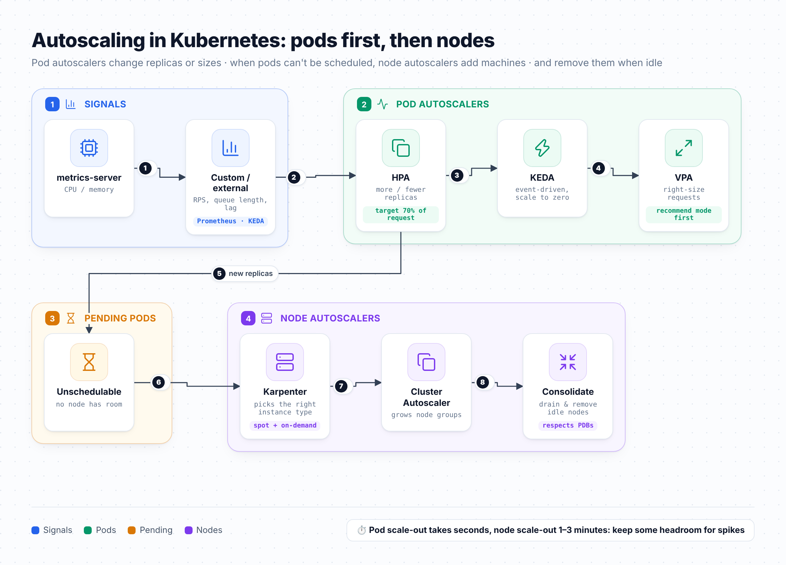

# 15.4 — Autoscaling pods and nodes

!!! abstract "In short"
    Kubernetes scales in **two layers**. **Pod autoscalers** change how many replicas run (**HPA**, **KEDA**) or how big
    they are (**VPA**). When new pods don't fit, **node autoscalers** (**Cluster Autoscaler**, **Karpenter**) add
    machines and later **consolidate** them away. It only works well with **realistic requests**, fast-starting pods and
    a little **headroom**, because new nodes take minutes.

## 📖 Key terms & abbreviations

| Term | Stands for | What it is | How it works (one line) |
|---|---|---|---|
| **metrics-server** | — | Cluster-wide CPU/memory usage | Source for `kubectl top` and resource HPA |
| **HPA** | Horizontal Pod Autoscaler | Adjusts replica count | `desired = ceil(current × metric / target)` |
| **Utilization target** | — | % of the **request** to aim for | `averageUtilization: 70` |
| **Custom / external metrics** | — | Non-CPU signals | RPS, latency, queue depth via adapters |
| **Stabilization window** | — | Wait before scaling down/up | Avoids flapping (`behavior`) |
| **KEDA** | Kubernetes Event-Driven Autoscaling | Scalers for 60+ event sources | Can scale to and from zero |
| **VPA** | Vertical Pod Autoscaler | Recommends/sets requests | Off / Initial / Recreate / InPlaceOrRecreate |
| **Cluster Autoscaler** | CA | Scales node groups | Reacts to pending pods |
| **Karpenter** | — | Provisions nodes directly | Picks instance type per pending pods |
| **Consolidation** | — | Removing/replacing underused nodes | Evicts pods respecting PDBs |
| **Overprovisioning** | — | Low-priority placeholder pods | Reserve headroom for fast scale-up |
| **Cooldown** | — | Delay between scaling actions | Prevents oscillation |

## 🗺️ Big picture



---

## 1 · HPA: more replicas

### How does it work?

Every ~15 s the HPA controller reads metrics and computes:

`desiredReplicas = ceil(currentReplicas × currentMetric / targetMetric)`

With 4 pods at 140% of their CPU **request** and a target of 70%: `ceil(4 × 140/70) = 8`. Then `minReplicas`/`maxReplicas` and the **behavior** policies apply.

```yaml
apiVersion: autoscaling/v2
kind: HorizontalPodAutoscaler
spec:
  scaleTargetRef: { apiVersion: apps/v1, kind: Deployment, name: api }
  minReplicas: 3
  maxReplicas: 50
  metrics:
    - type: Resource
      resource: { name: cpu, target: { type: Utilization, averageUtilization: 70 } }
  behavior:
    scaleUp:   { policies: [{ type: Percent, value: 100, periodSeconds: 30 }] }
    scaleDown: { stabilizationWindowSeconds: 300 }
```

- Utilization is relative to **requests**: no requests → no CPU-based HPA; inflated requests → the HPA never scales.
- CPU is a proxy. For I/O-bound or queue-driven work, scale on **requests per second, in-flight requests or queue length** (Prometheus Adapter, KEDA).
- Don't combine HPA and VPA on the same CPU/memory metric.

## 2 · KEDA: event-driven and scale to zero

KEDA watches external sources (Kafka lag, SQS/RabbitMQ queue length, Prometheus queries, cron, HTTP traffic) and feeds them to an HPA it manages; it also handles **0 ↔ 1** activation, which the HPA alone can't. Ideal for workers, batch consumers and dev environments.

## 3 · VPA: right-sizing

VPA watches actual usage and recommends requests (target, lower/upper bounds). Modes:

- **Off**: recommendations only; read them (`kubectl describe vpa`) or feed a dashboard (Goldilocks). The safe default.
- **Initial**: sets requests when pods are created.
- **Recreate / InPlaceOrRecreate**: updates running pods; in-place resize (pods change resources without restart, beta and enabled by default since Kubernetes 1.33) reduces disruption.

Right-sized requests are the base of everything else: correct HPA math, good bin packing, lower cost (13).

## 4 · Node autoscaling

| | Cluster Autoscaler | Karpenter |
|---|---|---|
| Model | Scales predefined node groups (ASG/MIG) | Creates individual nodes from NodePools |
| Instance choice | Fixed per group | Chooses from many types per pending pods |
| Speed | Group API + boot | Direct fleet API + boot (usually faster) |
| Cost optimisation | Scale-down of empty/underused nodes | Consolidation: delete or **replace with cheaper** nodes |
| Clouds | All major | AWS natively, Azure (AKS NAP), others via providers |

Both react to **pending pods**; new nodes need 1–3 minutes (boot, join, pull images, CNI ready). Consolidation evicts pods, so **PDBs** and graceful shutdown (15.1) matter. Use `karpenter.sh/do-not-disrupt` or disruption budgets for jobs that mustn't be interrupted.

## 5 · Headroom and spot

- **Overprovisioning**: a Deployment of low-priority "pause" pods reserves capacity; real pods preempt them instantly, and the autoscaler then replaces the evicted placeholders with new nodes in the background.
- **Spot** nodes for stateless and batch workloads: diversify instance types, handle the interruption notice (node termination handler / Karpenter interruption queue), keep a baseline on on-demand (13).
- **Scale-up is only as fast as your slowest step**: big images, slow startup, init containers, cold caches. Measure "pending → ready" time.

## 🔧 DevOps connection

- Load-test the scaling path: from 1× to 5× traffic in 2 minutes, watch HPA events, pending pods, node launches and error rates.
- Alert on HPA at `maxReplicas`, pods pending > 5 min, and nodes not becoming ready.
- Set **ResourceQuotas** and **LimitRanges** per namespace so one team's autoscaler can't consume the cluster.
- Scale predictable peaks **ahead of time** (KEDA cron scaler, scheduled minReplicas).

## 🧪 Try it yourself

```bash
kind create cluster --name as
# metrics-server for kind (insecure TLS to kubelets is fine for a lab)
kubectl apply -f https://github.com/kubernetes-sigs/metrics-server/releases/latest/download/components.yaml
kubectl -n kube-system patch deploy metrics-server --type=json -p '[{"op":"add","path":"/spec/template/spec/containers/0/args/-","value":"--kubelet-insecure-tls"}]'

kubectl create deployment php --image=registry.k8s.io/hpa-example
kubectl set resources deploy php --requests=cpu=200m && kubectl expose deploy php --port=80
kubectl autoscale deploy php --cpu-percent=50 --min=1 --max=10
kubectl run load --image=busybox:1.37 --restart=Never -- sh -c "while true; do wget -q -O- http://php; done"
kubectl get hpa php -w            # watch replicas climb; Ctrl-C after a few minutes
kubectl delete pod load; kubectl get hpa php -w   # and slowly come back down (stabilization window)
kind delete cluster --name as
```

## 🃏 Cheat sheet

| Symptom | Likely cause |
|---|---|
| HPA shows `<unknown>` | No metrics-server / adapter, or no requests |
| Never scales up | Requests far above usage, target too high |
| Flapping | No stabilization window, metric too noisy |
| Scaled pods stay Pending | No node autoscaler, quota, or constraints (zone PVC, taints) |
| Slow to absorb spikes | Node boot + image pull; add headroom, smaller images |
| Cost keeps rising | Requests too high, consolidation blocked by PDBs/annotations |

## ❓ Test yourself

??? question "1. 5 pods run at 90% of their CPU request; the target is 60%. How many replicas will the HPA want?"
    ceil(5 × 90 / 60) = ceil(7.5) = 8 replicas (within min/max).

??? question "2. Why does CPU-based HPA depend on correct requests?"
    Utilization is measured as a percentage of the request. If requests are much higher than real usage, utilization never reaches the target and the HPA doesn't scale (and nodes are wasted).

??? question "3. What can KEDA do that the HPA alone can't?"
    Scale on many external event sources out of the box and scale workloads to zero and back up when events arrive.

??? question "4. How does Karpenter differ from Cluster Autoscaler?"
    Instead of growing predefined node groups, it looks at pending pods and launches the best-fitting instance types directly, and actively consolidates by removing or replacing nodes with cheaper ones.

??? question "5. Why keep headroom even with fast autoscalers?"
    New nodes take minutes to boot, join and pull images; without spare capacity, sudden spikes hit before new capacity is ready.

---

## 📚 Sources

- [Kubernetes — Horizontal Pod Autoscaling](https://kubernetes.io/docs/tasks/run-application/horizontal-pod-autoscale/)
- [Kubernetes — Resize CPU and memory resources assigned to containers](https://kubernetes.io/docs/tasks/configure-pod-container/resize-container-resources/)
- [KEDA documentation](https://keda.sh/docs/)
- [Karpenter documentation](https://karpenter.sh/docs/)
- [Kubernetes Cluster Autoscaler FAQ](https://github.com/kubernetes/autoscaler/blob/master/cluster-autoscaler/FAQ.md)

## ✍️ My notes

> How long does it take in your cluster from "traffic doubles" to "new pods are serving"? Which step is the slowest?
