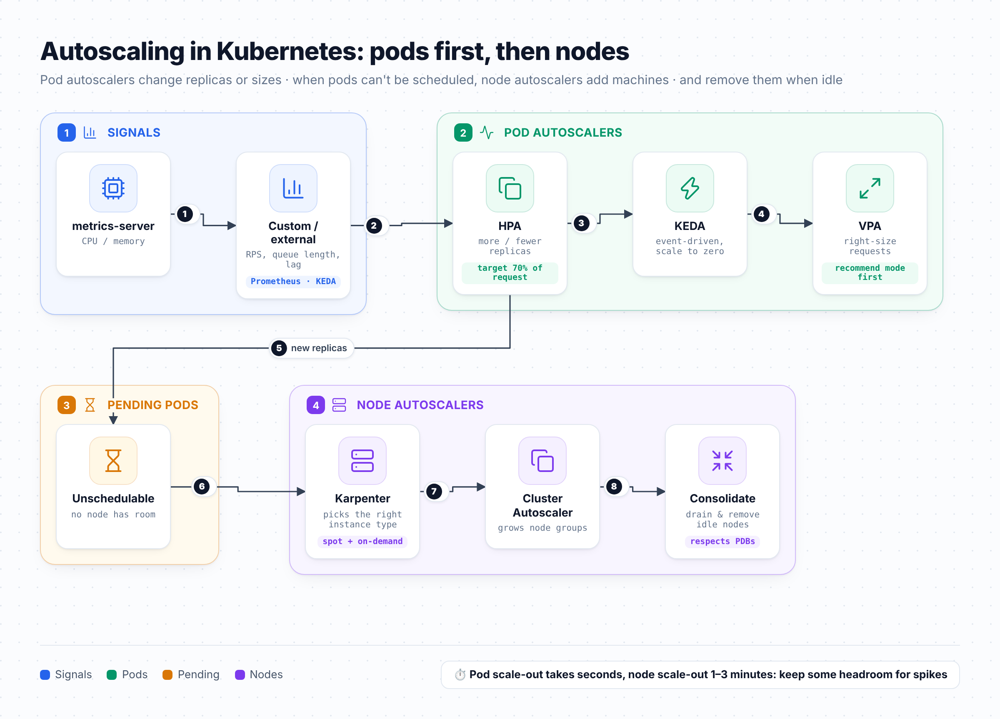

# 15.4 — Pod ve node'ları otomatik ölçekleme

!!! abstract "Kısaca"
    Kubernetes **iki katmanda** ölçeklenir: **pod ölçekleyicileri** metriklere göre kaç replika çalışacağını (**HPA**,
    **KEDA**) ya da ne kadar büyük olacaklarını (**VPA**) değiştirir. Yeni pod'lar sığmazsa **node ölçekleyicileri**
    (**Cluster Autoscaler**, **Karpenter**) makine ekler ve sonra onları **konsolide ederek** kaldırır. Bu ancak
    **request'ler gerçekçiyse**, pod'lar hızlı açılıyorsa ve biraz **pay** bırakırsan iyi çalışır, çünkü yeni node'lar
    dakikalar sürer.

## 📖 Temel terimler ve kısaltmalar

| Terim | Açılımı | Nedir | Nasıl çalışır (tek satır) |
|---|---|---|---|
| **metrics-server** | — | Cluster çapında CPU/bellek kullanımı | `kubectl top` ve kaynak HPA'sı için kaynak |
| **HPA** | Horizontal Pod Autoscaler | Replika sayısını ayarlar | `istenen = ceil(mevcut × metrik / hedef)` |
| **Kullanım hedefi** | Utilization target | Hedeflenen **request** yüzdesi | `averageUtilization: 70` |
| **Özel / harici metrikler** | Custom / external metrics | CPU dışı sinyaller | Adapter'larla RPS, gecikme, kuyruk derinliği |
| **Stabilizasyon penceresi** | Stabilization window | Küçültmeden/büyütmeden önce bekle | Salınımı önler (`behavior`) |
| **KEDA** | Kubernetes Event-Driven Autoscaling | 60+ olay kaynağı için ölçekleyiciler | Sıfıra ve sıfırdan ölçekleyebilir |
| **VPA** | Vertical Pod Autoscaler | Request'leri önerir/ayarlar | Off / Initial / Recreate / InPlaceOrRecreate |
| **Cluster Autoscaler** | CA | Node gruplarını ölçekler | Bekleyen pod'lara tepki verir |
| **Karpenter** | — | Node'ları doğrudan oluşturur | Bekleyen pod'lara göre instance tipi seçer |
| **Konsolidasyon** | Consolidation | Az kullanılan node'ları kaldırmak/değiştirmek | PDB'lere uyarak pod'ları tahliye eder |
| **Fazla provizyon** | Overprovisioning | Düşük öncelikli yer tutucu pod'lar | Hızlı büyüme için pay ayırır |
| **Bekleme** | Cooldown | Ölçekleme aksiyonları arasındaki gecikme | Salınımı engeller |

## 🗺️ Büyük resim



---

## 1 · HPA: daha çok replika

### Nasıl çalışır?

HPA controller'ı ~15 sn'de bir metrikleri okur ve hesaplar:

`istenenReplika = ceil(mevcutReplika × mevcutMetrik / hedefMetrik)`

CPU **request'inin** %140'ında çalışan 4 pod ve %70 hedefle: `ceil(4 × 140/70) = 8`. Sonra `minReplicas`/`maxReplicas` ve **behavior** politikaları uygulanır.

```yaml
apiVersion: autoscaling/v2
kind: HorizontalPodAutoscaler
spec:
  scaleTargetRef: { apiVersion: apps/v1, kind: Deployment, name: api }
  minReplicas: 3
  maxReplicas: 50
  metrics:
    - type: Resource
      resource: { name: cpu, target: { type: Utilization, averageUtilization: 70 } }
  behavior:
    scaleUp:   { policies: [{ type: Percent, value: 100, periodSeconds: 30 }] }
    scaleDown: { stabilizationWindowSeconds: 300 }
```

- Kullanım **request'lere** görelidir: request yok → CPU tabanlı HPA yok; şişirilmiş request'ler → HPA asla ölçeklemez.
- CPU bir vekildir. I/O ya da kuyruk güdümlü işlerde **saniye başına istek, süren istek ya da kuyruk uzunluğuna** göre ölçekle (Prometheus Adapter, KEDA).
- Aynı CPU/bellek metriğinde HPA ve VPA'yı birleştirme.

## 2 · KEDA: olay güdümlü ve sıfıra ölçekleme

KEDA harici kaynakları (Kafka gecikmesi, SQS/RabbitMQ kuyruk uzunluğu, Prometheus sorguları, cron, HTTP trafiği) izler ve onları yönettiği bir HPA'ya besler; tek başına HPA'nın yapamadığı **0 ↔ 1** aktivasyonunu da yönetir. Worker'lar, batch tüketiciler ve dev ortamları için ideal.

## 3 · VPA: doğru boyutlandırma

VPA gerçek kullanımı izler ve request'leri önerir (hedef, alt/üst sınırlar). Modlar:

- **Off**: sadece öneriler; oku (`kubectl describe vpa`) ya da bir dashboard'a besle (Goldilocks). Güvenli varsayılan.
- **Initial**: pod'lar oluşturulurken request'leri ayarlar.
- **Recreate / InPlaceOrRecreate**: çalışan pod'ları günceller; yerinde boyutlandırma (pod'lar yeniden başlamadan kaynak değiştirir; Kubernetes 1.33'ten beri beta ve varsayılan açık) kesintiyi azaltır.

Doğru boyutlu request'ler diğer her şeyin temelidir: doğru HPA hesabı, iyi yerleştirme, daha düşük maliyet (13).

## 4 · Node ölçekleme

| | Cluster Autoscaler | Karpenter |
|---|---|---|
| Model | Önceden tanımlı node gruplarını ölçekler (ASG/MIG) | NodePool'lardan tek tek node oluşturur |
| Instance seçimi | Grup başına sabit | Bekleyen pod'lara göre birçok tip arasından seçer |
| Hız | Grup API'si + boot | Doğrudan filo API'si + boot (genelde daha hızlı) |
| Maliyet optimizasyonu | Boş/az kullanılan node'ları küçültme | Konsolidasyon: sil ya da **daha ucuzuyla değiştir** |
| Bulutlar | Tüm büyükler | AWS yerel, Azure (AKS NAP), diğerleri provider'larla |

İkisi de **bekleyen pod'lara** tepki verir; yeni node'lar 1–3 dakika ister (boot, katılma, imaj çekme, CNI hazır). Konsolidasyon pod'ları tahliye eder; **PDB'ler** ve düzgün kapanış (15.1) önemlidir. Kesilmemesi gereken işler için `karpenter.sh/do-not-disrupt` ya da kesinti bütçeleri kullan.

## 5 · Pay ve spot

- **Fazla provizyon**: düşük öncelikli "pause" pod'larından oluşan bir Deployment kapasite ayırır; gerçek pod'lar onları anında yerinden eder, autoscaler da arka planda tahliye edilen yer tutucular için yeni node'lar ekler.
- Durumsuz ve batch iş yükleri için **spot** node'lar: instance tiplerini çeşitlendir, kesinti uyarısını ele al (node termination handler / Karpenter kesinti kuyruğu), tabanı on-demand'de tut (13).
- **Büyüme en yavaş adımın kadar hızlıdır**: büyük imajlar, yavaş açılış, init container'lar, soğuk önbellekler. "Pending → ready" süresini ölç.

## 🔧 DevOps bağlantısı

- Ölçekleme yolunu yük testine sok: 2 dakikada 1×'ten 5× trafiğe; HPA olaylarını, bekleyen pod'ları, node başlatmalarını ve hata oranlarını izle.
- `maxReplicas`'a ulaşan HPA, 5 dk'dan uzun bekleyen pod'lar ve hazır olmayan node'lar için alarm kur.
- Namespace başına **ResourceQuota** ve **LimitRange** ayarla; bir ekibin autoscaler'ı cluster'ı tüketemesin.
- Öngörülebilir zirveleri **önceden** ölçekle (KEDA cron ölçekleyicisi, zamanlanmış minReplicas).

## 🧪 Kendin dene

```bash
kind create cluster --name as
# kind için metrics-server (lab için kubelet'lere güvensiz TLS sorun değil)
kubectl apply -f https://github.com/kubernetes-sigs/metrics-server/releases/latest/download/components.yaml
kubectl -n kube-system patch deploy metrics-server --type=json -p '[{"op":"add","path":"/spec/template/spec/containers/0/args/-","value":"--kubelet-insecure-tls"}]'

kubectl create deployment php --image=registry.k8s.io/hpa-example
kubectl set resources deploy php --requests=cpu=200m && kubectl expose deploy php --port=80
kubectl autoscale deploy php --cpu-percent=50 --min=1 --max=10
kubectl run load --image=busybox:1.37 --restart=Never -- sh -c "while true; do wget -q -O- http://php; done"
kubectl get hpa php -w            # replikaların arttığını izle; birkaç dakika sonra Ctrl-C
kubectl delete pod load; kubectl get hpa php -w   # ve yavaşça geri indiğini (stabilizasyon penceresi)
kind delete cluster --name as
```

## 🃏 Hatırlatma kartı

| Belirti | Olası sebep |
|---|---|
| HPA `<unknown>` gösteriyor | metrics-server / adapter yok ya da request yok |
| Hiç büyümüyor | Request'ler kullanımın çok üstünde, hedef çok yüksek |
| Salınım | Stabilizasyon penceresi yok, metrik çok gürültülü |
| Ölçeklenen pod'lar Pending kalıyor | Node ölçekleyici yok, kota ya da kısıtlar (zone PVC'si, taint'ler) |
| Ani artışları yavaş karşılıyor | Node boot + imaj çekme; pay ekle, imajları küçült |
| Maliyet artmaya devam ediyor | Request'ler çok yüksek, konsolidasyon PDB/annotation'larla engellenmiş |

## ❓ Kendini test et

??? question "1. 5 pod CPU request'lerinin %90'ında çalışıyor; hedef %60. HPA kaç replika ister?"
    ceil(5 × 90 / 60) = ceil(7,5) = 8 replika (min/max içinde).

??? question "2. CPU tabanlı HPA neden doğru request'lere bağlı?"
    Kullanım request'in yüzdesi olarak ölçülür. Request'ler gerçek kullanımdan çok yüksekse kullanım hedefe hiç ulaşmaz ve HPA ölçeklemez (node'lar da israf olur).

??? question "3. KEDA tek başına HPA'nın yapamadığı neyi yapabilir?"
    Birçok harici olay kaynağına göre hazır ölçekleme yapabilir ve iş yüklerini sıfıra indirip olaylar gelince tekrar büyütebilir.

??? question "4. Karpenter, Cluster Autoscaler'dan nasıl farklı?"
    Önceden tanımlı node gruplarını büyütmek yerine bekleyen pod'lara bakar ve en uygun instance tiplerini doğrudan başlatır; node'ları kaldırarak ya da daha ucuzlarıyla değiştirerek aktif konsolide eder.

??? question "5. Hızlı autoscaler'larla bile neden pay bırakılır?"
    Yeni node'ların boot etmesi, katılması ve imaj çekmesi dakikalar sürer; boş kapasite olmadan ani artışlar yeni kapasite hazır olmadan gelir.

---

## 📚 Kaynaklar

- [Kubernetes — Horizontal Pod Autoscaling](https://kubernetes.io/docs/tasks/run-application/horizontal-pod-autoscale/)
- [Kubernetes — Resize CPU and memory resources assigned to containers](https://kubernetes.io/docs/tasks/configure-pod-container/resize-container-resources/)
- [KEDA documentation](https://keda.sh/docs/)
- [Karpenter documentation](https://karpenter.sh/docs/)
- [Kubernetes Cluster Autoscaler FAQ](https://github.com/kubernetes/autoscaler/blob/master/cluster-autoscaler/FAQ.md)

## ✍️ Notlarım

> Cluster'ında "trafik ikiye katlanıyor"dan "yeni pod'lar hizmet veriyor"a kadar ne kadar sürüyor? En yavaş adım hangisi?
