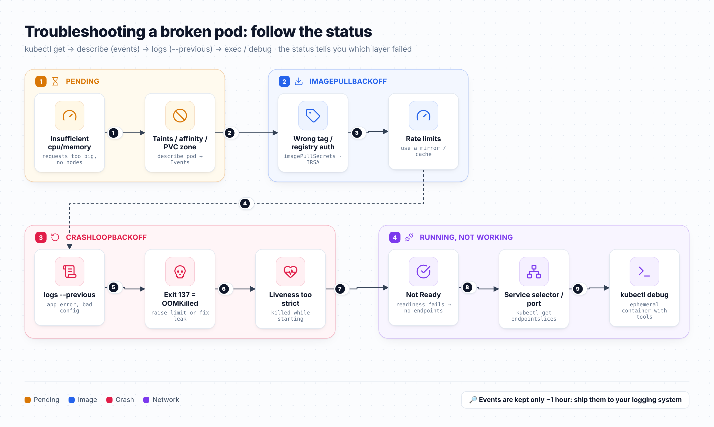

# 15.5 — Troubleshooting, upgrades & backups

!!! abstract "In short"
    Kubernetes tells you what's wrong if you read it in order. The **pod status** points to the failing layer,
    **events** explain why, **logs** (including `--previous`) show the app's side, and **kubectl debug** lets you look
    inside. Healthy clusters also need **upgrades** every few months within the supported **version skew**, after
    removing **deprecated APIs**. And **backups** (etcd, Velero, snapshots) that you have actually restored.

## 📖 Key terms & abbreviations

| Term | Stands for | What it is | How it works (one line) |
|---|---|---|---|
| **Events** | — | Short-lived records of what controllers did | `kubectl events`, kept ~1 h by default |
| **Exit code** | — | Container's process result | 0 ok, 1 app error, 137 SIGKILL/OOM, 143 SIGTERM |
| **OOMKilled** | Out Of Memory | Kernel killed the container for exceeding its memory limit | cgroup memory.max (3.3) |
| **CrashLoopBackOff** | — | Container keeps exiting; restarts are delayed exponentially | 10 s → 5 min |
| **ImagePullBackOff** | — | Image can't be pulled; retries with backoff | Name/tag, auth, registry limits |
| **Ephemeral container** | — | Debug container added to a running pod | `kubectl debug -it pod --image=…` |
| **EndpointSlice** | — | List of ready pod IPs for a Service | Empty = no ready pods match |
| **Node conditions** | — | Ready, MemoryPressure, DiskPressure, PIDPressure | Pressure → evictions |
| **Version skew** | — | Allowed version gaps between components | kubelet up to 3 minors older than API server |
| **Deprecated API** | — | API version scheduled for removal | Must migrate manifests before upgrading |
| **etcd snapshot** | — | Backup of the cluster's state store | Self-managed clusters; managed ones do it for you |
| **Velero** | — | Backs up Kubernetes objects + volumes | To object storage, restore to any cluster |

## 🗺️ Big picture



---

## 1 · The method

### How does it work?

```bash
kubectl get pods -o wide                       # 1. status, restarts, node, IP
kubectl describe pod <pod>                     # 2. conditions, last state, exit code, EVENTS at the bottom
kubectl logs <pod> -c <container> --previous   # 3. what the app said before it died
kubectl get events --sort-by=.lastTimestamp    # 4. the wider picture (nodes, PVCs, scheduler)
kubectl debug -it <pod> --image=nicolaka/netshoot --target=<container>   # 5. look from inside
```

Work from the outside in: is it **scheduled**? Is the **image** there? Does the **process** stay up? Is it **ready**? Can traffic **reach** it?

## 2 · Status by status

| Status | Typical causes | Check / fix |
|---|---|---|
| **Pending** | Not enough CPU/memory for requests; taints without tolerations; affinity/spread unsatisfiable; PVC in another zone or unbound; quota exceeded | Events: `0/6 nodes are available: 3 Insufficient cpu, 3 node(s) had untolerated taint…`; fix requests, add capacity, check node autoscaler |
| **ImagePullBackOff / ErrImagePull** | Typo in name/tag, private registry without credentials, architecture mismatch (arm64 vs amd64), registry rate limits | `describe` message; test pull on the node; imagePullSecrets or node IAM; pull-through cache |
| **CrashLoopBackOff** | App error at startup, missing config/secret, wrong command, liveness killing a slow start, dependency unreachable | `logs --previous`, exit code, try the command in `kubectl debug --copy-to` with a shell |
| **OOMKilled (exit 137)** | Memory limit too low or a leak; JVM/Node heap not matching the limit | `describe` → Last State: OOMKilled; raise the limit, set heap to ~75% of limit, profile |
| **Running but not Ready** | Readiness probe failing, app still warming up, dependency down | `describe` probe failures; `kubectl get endpointslices -l kubernetes.io/service-name=<svc>` |
| **Ready but unreachable** | Service selector/port mismatch, NetworkPolicy, DNS, ingress config | `kubectl port-forward`, curl from a debug pod, `nslookup svc.ns.svc.cluster.local` (9.3, 6.2) |
| **Evicted** | Node DiskPressure/MemoryPressure, ephemeral storage exceeded | Node conditions, container logs filling disk, `ephemeral-storage` requests |
| **Terminating forever** | Finalizers waiting on something, node gone | `kubectl get pod -o yaml` → finalizers; investigate the owner before forcing |

## 3 · Nodes and the cluster

- `kubectl get nodes` + `describe node`: conditions, allocatable vs allocated, taints.
- `kubectl debug node/<node> -it --image=busybox` gives a shell with the host filesystem at `/host` (journal, kubelet and containerd logs) without SSH.
- Control plane health: API server latency and errors, etcd leader changes and fsync latency (12), webhook timeouts (a broken admission webhook can block all deployments).
- **CoreDNS** problems show up as timeouts everywhere: check its pods, cache hit rate and `ndots` behaviour (6.2).

## 4 · Upgrades

Kubernetes releases about **3 minor versions per year**; each gets roughly **14 months** of patches. Managed services (EKS, GKE, AKS) eventually upgrade you automatically or charge for extended support.

1. **Read the changelog** and the deprecation guide for every minor you cross; scan manifests and Helm releases for removed APIs (`pluto`, `kubent`, API server metrics `apiserver_requested_deprecated_apis`).
2. Upgrade **add-ons** first if needed (CNI, CSI, ingress, cert-manager, operators) to versions supporting the target.
3. Upgrade the **control plane** one minor at a time (1.32 → 1.33 → 1.34), never skipping.
4. Upgrade **nodes**: surge new nodes and drain old ones (PDBs and graceful shutdown make it painless, 15.1), or blue/green node pools.
5. Do it in **staging first**, keep upgrades routine (every quarter) rather than heroic (every two years).

Version skew: kubelets may be up to **3 minor versions older** than the API server, never newer; kubectl ±1.

## 5 · Backups

- **etcd** holds all cluster state. Managed control planes back it up for you; on self-managed clusters take regular `etcdctl snapshot save` backups, encrypt them and store off-cluster.
- **Velero** backs up Kubernetes objects (per namespace or label) and volumes (CSI snapshots or file-level copies) to object storage and restores them into the same or another cluster: for disasters, migrations and "someone deleted the namespace".
- **GitOps** makes stateless parts reproducible from git (9.4); backups are mainly for **state** and for things created outside git.
- **Test restores** into a fresh cluster on a schedule (14.4).

## 🔧 DevOps connection

- Put the method into a **runbook** with copy-paste commands and link it from alerts.
- Ship **events and logs** to your logging system; events disappear after an hour.
- Track **upgrade debt** as a metric: versions behind latest, months until end of support.
- Use `kubectl` plugins and tools that speed things up: `k9s`, `stern` (multi-pod logs), `kubectl-neat`, `krew`.

## 🧪 Try it yourself

```bash
kind create cluster --name ts
# 1. Pending: request more CPU than exists
kubectl run big --image=nginx:alpine --overrides='{"spec":{"containers":[{"name":"big","image":"nginx:alpine","resources":{"requests":{"cpu":"64"}}}]}}'
# 2. ImagePullBackOff: a tag that doesn't exist
kubectl run typo --image=nginx:does-not-exist
# 3. CrashLoopBackOff: a command that exits
kubectl run crash --image=busybox:1.37 -- sh -c "echo starting; exit 3"
# 4. OOMKilled: allocate more than the limit
kubectl run oom --image=polinux/stress --overrides='{"spec":{"containers":[{"name":"oom","image":"polinux/stress","args":["--vm","1","--vm-bytes","200M"],"resources":{"limits":{"memory":"64Mi"}}}]}}'
sleep 40; kubectl get pods
for p in big typo crash oom; do echo "== $p"; kubectl describe pod $p | grep -E "Reason|Exit Code|Warning" | head -4; done
kubectl logs crash --previous
kubectl debug node/ts-control-plane -it --image=busybox:1.37 -- chroot /host sh -c "crictl ps | head -5"
kind delete cluster --name ts
```

## 🃏 Cheat sheet

| Exit code | Meaning |
|---|---|
| 0 | Completed normally |
| 1 / 2 | Application error / misuse |
| 126 / 127 | Not executable / command not found |
| 137 | SIGKILL: OOMKilled or killed after grace period |
| 139 | SIGSEGV: segmentation fault |
| 143 | SIGTERM: asked to stop |

| Need | Command |
|---|---|
| Why not scheduled | `describe pod` → Events |
| Why it died | `logs --previous`, Last State |
| Who receives traffic | `get endpointslices` |
| Shell without one in the image | `kubectl debug -it pod --image=netshoot --target=c` |
| Node logs without SSH | `kubectl debug node/X -it --image=busybox` |

## ❓ Test yourself

??? question "1. A pod is `Pending`. Where do you look first and what are common causes?"
    The events in `kubectl describe pod`: insufficient CPU/memory for its requests, taints without tolerations, unsatisfiable affinity/spread, an unbound PVC or one in another zone, or a namespace quota.

??? question "2. A container shows exit code 137. What happened?"
    It was killed with SIGKILL, most often by the OOM killer for exceeding its memory limit (`Reason: OOMKilled`), or because it didn't stop within the termination grace period.

??? question "3. Why use `kubectl logs --previous` for a CrashLoopBackOff?"
    The current container may have just restarted and logged nothing useful; `--previous` shows the output of the instance that crashed.

??? question "4. A Service returns connection errors but the pods are Running. What do you check?"
    Whether the pods are Ready and appear in the Service's EndpointSlices, whether the selector and target port match, NetworkPolicies, and DNS resolution from a debug pod.

??? question "5. Why can't you jump from Kubernetes 1.31 directly to 1.34?"
    The control plane must be upgraded one minor version at a time to keep components within the supported skew and allow storage/API migrations; removed APIs must also be migrated at each step.

---

## 📚 Sources

- [Kubernetes — Debug pods](https://kubernetes.io/docs/tasks/debug/debug-application/debug-pods/) · [Debug running pods](https://kubernetes.io/docs/tasks/debug/debug-application/debug-running-pod/)
- [Kubernetes — Version skew policy](https://kubernetes.io/releases/version-skew-policy/)
- [Kubernetes — Deprecated API migration guide](https://kubernetes.io/docs/reference/using-api/deprecation-guide/)
- [Kubernetes — Operating etcd clusters (backup)](https://kubernetes.io/docs/tasks/administer-cluster/configure-upgrade-etcd/)
- [Velero documentation](https://velero.io/docs/)

## ✍️ My notes

> Which Kubernetes version are your clusters on, and when does its support end?
