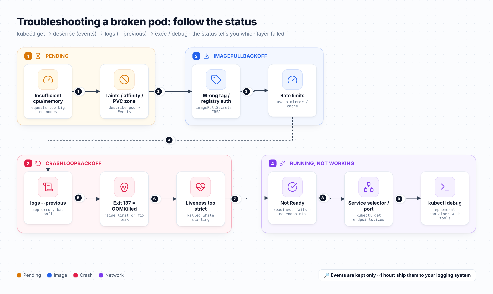

# 15.5 — Sorun giderme, yükseltmeler ve yedekler

!!! abstract "Kısaca"
    Sırayla okursan Kubernetes neyin yanlış olduğunu söyler: **pod durumu** bozulan katmanı gösterir (zamanlama, imaj,
    süreç, hazırlık, ağ), **olaylar** nedenini açıklar, **loglar** (`--previous` dahil) uygulamanın tarafını gösterir ve
    **kubectl debug** içeriden bakmanı sağlar. Cluster'ları sağlıklı tutmak ayrıca **kaldırılan API'leri** temizledikten
    sonra desteklenen **sürüm uyumu** içinde birkaç ayda bir **yükseltmek** ve gerçekten geri yüklediğin **yedeklere**
    (etcd, Velero, volume snapshot'ları) sahip olmak demektir.

## 📖 Temel terimler ve kısaltmalar

| Terim | Açılımı | Nedir | Nasıl çalışır (tek satır) |
|---|---|---|---|
| **Olaylar** | Events | Controller'ların yaptıklarının kısa ömürlü kayıtları | `kubectl events`, varsayılan ~1 saat tutulur |
| **Çıkış kodu** | Exit code | Container sürecinin sonucu | 0 tamam, 1 uygulama hatası, 137 SIGKILL/OOM, 143 SIGTERM |
| **OOMKilled** | Out Of Memory | Kernel container'ı bellek limitini aştığı için öldürdü | cgroup memory.max (3.3) |
| **CrashLoopBackOff** | — | Container sürekli çıkıyor; yeniden başlatmalar üstel geciktiriliyor | 10 sn → 5 dk |
| **ImagePullBackOff** | — | İmaj çekilemiyor; backoff ile yeniden deneniyor | İsim/etiket, yetki, registry limitleri |
| **Geçici container** | Ephemeral container | Çalışan bir pod'a eklenen debug container'ı | `kubectl debug -it pod --image=…` |
| **EndpointSlice** | — | Bir Service için hazır pod IP'lerinin listesi | Boş = eşleşen hazır pod yok |
| **Node durumları** | Node conditions | Ready, MemoryPressure, DiskPressure, PIDPressure | Baskı → tahliyeler |
| **Sürüm uyumu** | Version skew | Bileşenler arası izin verilen sürüm farkları | kubelet, API server'dan en fazla 3 minor eski |
| **Kaldırılan API** | Deprecated API | Kaldırılması planlanan API sürümü | Yükseltmeden önce manifest'leri taşımak gerekir |
| **etcd snapshot'ı** | — | Cluster'ın durum deposunun yedeği | Kendi yönettiğin cluster'lar; yönetilenlerde sağlayıcı yapar |
| **Velero** | — | Kubernetes nesnelerini + volume'ları yedekler | Nesne depolamaya, herhangi bir cluster'a geri yükler |

## 🗺️ Büyük resim



---

## 1 · Yöntem

### Nasıl çalışır?

```bash
kubectl get pods -o wide                       # 1. durum, yeniden başlatmalar, node, IP
kubectl describe pod <pod>                     # 2. durumlar, son hal, çıkış kodu, en altta OLAYLAR
kubectl logs <pod> -c <container> --previous   # 3. ölmeden önce uygulama ne dedi
kubectl get events --sort-by=.lastTimestamp    # 4. daha geniş resim (node'lar, PVC'ler, scheduler)
kubectl debug -it <pod> --image=nicolaka/netshoot --target=<container>   # 5. içeriden bak
```

Dışarıdan içeriye çalış: **zamanlandı** mı? **İmaj** var mı? **Süreç** ayakta kalıyor mu? **Hazır** mı? Trafik ona **ulaşabiliyor** mu?

## 2 · Durum durum

| Durum | Tipik sebepler | Kontrol / çözüm |
|---|---|---|
| **Pending** | Request'ler için yetersiz CPU/bellek; toleration'sız taint'ler; karşılanamayan affinity/yayılım; başka zone'da ya da bağlanmamış PVC; kota aşımı | Olaylar: `0/6 nodes are available: 3 Insufficient cpu, 3 node(s) had untolerated taint…`; request'leri düzelt, kapasite ekle, node ölçekleyiciyi kontrol et |
| **ImagePullBackOff / ErrImagePull** | İsim/etikette yazım hatası, kimlik bilgisi olmayan özel registry, mimari uyumsuzluğu (arm64 ve amd64), registry hız limitleri | `describe` mesajı; node'da çekmeyi dene; imagePullSecrets ya da node IAM; pull-through önbellek |
| **CrashLoopBackOff** | Açılışta uygulama hatası, eksik config/secret, yanlış komut, yavaş açılışı öldüren liveness, erişilemeyen bağımlılık | `logs --previous`, çıkış kodu, komutu shell'li `kubectl debug --copy-to` içinde dene |
| **OOMKilled (çıkış 137)** | Bellek limiti çok düşük ya da sızıntı; JVM/Node heap'i limitle uyumsuz | `describe` → Last State: OOMKilled; limiti artır, heap'i limitin ~%75'ine ayarla, profille |
| **Running ama Ready değil** | Readiness probe başarısız, uygulama hâlâ ısınıyor, bağımlılık kapalı | `describe` probe hataları; `kubectl get endpointslices -l kubernetes.io/service-name=<svc>` |
| **Ready ama ulaşılamıyor** | Service seçici/port uyumsuzluğu, NetworkPolicy, DNS, ingress yapılandırması | `kubectl port-forward`, debug pod'dan curl, `nslookup svc.ns.svc.cluster.local` (9.3, 6.2) |
| **Evicted** | Node DiskPressure/MemoryPressure, geçici depolama aşıldı | Node durumları, diski dolduran container logları, `ephemeral-storage` request'leri |
| **Sonsuza dek Terminating** | Bir şeyi bekleyen finalizer'lar, node yok | `kubectl get pod -o yaml` → finalizer'lar; zorlamadan önce sahibini araştır |

## 3 · Node'lar ve cluster

- `kubectl get nodes` + `describe node`: durumlar, ayrılabilir ve ayrılmış kaynaklar, taint'ler.
- `kubectl debug node/<node> -it --image=busybox`, SSH olmadan host dosya sistemi `/host` altında olan bir shell verir (journal, kubelet ve containerd logları).
- Control plane sağlığı: API server gecikmesi ve hataları, etcd lider değişimleri ve fsync gecikmesi (12), webhook zaman aşımları (bozuk bir admission webhook'u tüm deploy'ları engelleyebilir).
- **CoreDNS** sorunları her yerde zaman aşımı olarak görünür: pod'larını, önbellek isabet oranını ve `ndots` davranışını kontrol et (6.2).

## 4 · Yükseltmeler

Kubernetes yılda yaklaşık **3 minor sürüm** çıkarır; her biri kabaca **14 ay** yama alır. Yönetilen servisler (EKS, GKE, AKS) eninde sonunda seni otomatik yükseltir ya da uzatılmış destek için ücret alır.

1. Geçtiğin her minor için **değişiklik günlüğünü** ve kaldırma rehberini oku; manifest'leri ve Helm release'lerini kaldırılan API'ler için tara (`pluto`, `kubent`, API server metriği `apiserver_requested_deprecated_apis`).
2. Gerekirse önce **eklentileri** (CNI, CSI, ingress, cert-manager, operator'ler) hedefi destekleyen sürümlere yükselt.
3. **Control plane'i** her seferinde bir minor yükselt (1.32 → 1.33 → 1.34), asla atlama.
4. **Node'ları** yükselt: yeni node'lar ekle ve eskileri boşalt (PDB'ler ve düzgün kapanış bunu acısız yapar, 15.1) ya da blue/green node havuzları.
5. **Önce staging'de** yap; yükseltmeleri kahramanca (iki yılda bir) değil rutin (her çeyrek) tut.

Sürüm uyumu: kubelet'ler API server'dan en fazla **3 minor sürüm eski** olabilir, asla daha yeni değil; kubectl ±1.

## 5 · Yedekler

- **etcd** tüm cluster durumunu tutar. Yönetilen control plane'ler onu senin için yedekler; kendi yönettiğin cluster'larda düzenli `etcdctl snapshot save` yedekleri al, şifrele ve cluster dışında sakla.
- **Velero** Kubernetes nesnelerini (namespace ya da label başına) ve volume'ları (CSI snapshot'ları ya da dosya seviyesinde kopyalar) nesne depolamaya yedekler ve aynı ya da başka bir cluster'a geri yükler: felaketler, taşımalar ve "biri namespace'i sildi" için.
- **GitOps** durumsuz kısımları git'ten yeniden üretilebilir yapar (9.4); yedekler esas olarak **durum** ve git dışında oluşturulan şeyler içindir.
- Zamanlanmış olarak yeni bir cluster'a **geri yüklemeyi test et** (14.4).

## 🔧 DevOps bağlantısı

- Yöntemi kopyala-yapıştır komutlarla bir **runbook**'a koy ve alarmlardan ona link ver.
- **Olayları ve logları** log sistemine gönder; olaylar bir saat sonra kaybolur.
- **Yükseltme borcunu** bir metrik olarak izle: en sondan kaç sürüm geride, desteğin bitmesine kaç ay var.
- İşi hızlandıran `kubectl` eklentileri ve araçları kullan: `k9s`, `stern` (çok pod'lu loglar), `kubectl-neat`, `krew`.

## 🧪 Kendin dene

```bash
kind create cluster --name ts
# 1. Pending: var olandan fazla CPU iste
kubectl run big --image=nginx:alpine --overrides='{"spec":{"containers":[{"name":"big","image":"nginx:alpine","resources":{"requests":{"cpu":"64"}}}]}}'
# 2. ImagePullBackOff: var olmayan bir etiket
kubectl run typo --image=nginx:does-not-exist
# 3. CrashLoopBackOff: çıkan bir komut
kubectl run crash --image=busybox:1.37 -- sh -c "echo starting; exit 3"
# 4. OOMKilled: limitten fazla bellek ayır
kubectl run oom --image=polinux/stress --overrides='{"spec":{"containers":[{"name":"oom","image":"polinux/stress","args":["--vm","1","--vm-bytes","200M"],"resources":{"limits":{"memory":"64Mi"}}}]}}'
sleep 40; kubectl get pods
for p in big typo crash oom; do echo "== $p"; kubectl describe pod $p | grep -E "Reason|Exit Code|Warning" | head -4; done
kubectl logs crash --previous
kubectl debug node/ts-control-plane -it --image=busybox:1.37 -- chroot /host sh -c "crictl ps | head -5"
kind delete cluster --name ts
```

## 🃏 Hatırlatma kartı

| Çıkış kodu | Anlamı |
|---|---|
| 0 | Normal tamamlandı |
| 1 / 2 | Uygulama hatası / yanlış kullanım |
| 126 / 127 | Çalıştırılamaz / komut bulunamadı |
| 137 | SIGKILL: OOMKilled ya da bekleme süresinden sonra öldürüldü |
| 139 | SIGSEGV: segmentation fault |
| 143 | SIGTERM: durması istendi |

| İhtiyaç | Komut |
|---|---|
| Neden zamanlanmadı | `describe pod` → Olaylar |
| Neden öldü | `logs --previous`, Last State |
| Trafiği kim alıyor | `get endpointslices` |
| İmajda shell yoksa shell | `kubectl debug -it pod --image=netshoot --target=c` |
| SSH'sız node logları | `kubectl debug node/X -it --image=busybox` |

## ❓ Kendini test et

??? question "1. Bir pod `Pending`. İlk nereye bakarsın ve yaygın sebepler neler?"
    `kubectl describe pod`'daki olaylara: request'leri için yetersiz CPU/bellek, toleration'sız taint'ler, karşılanamayan affinity/yayılım, bağlanmamış ya da başka zone'daki bir PVC ya da namespace kotası.

??? question "2. Bir container 137 çıkış kodu gösteriyor. Ne oldu?"
    SIGKILL ile öldürüldü; çoğunlukla bellek limitini aştığı için OOM killer tarafından (`Reason: OOMKilled`) ya da sonlanma bekleme süresi içinde durmadığı için.

??? question "3. CrashLoopBackOff için neden `kubectl logs --previous` kullanılır?"
    Mevcut container az önce yeniden başlamış ve işe yarar bir şey loglamamış olabilir; `--previous` çöken örneğin çıktısını gösterir.

??? question "4. Bir Service bağlantı hataları dönüyor ama pod'lar Running. Neyi kontrol edersin?"
    Pod'ların Ready olup Service'in EndpointSlice'larında görünüp görünmediğini, seçici ve hedef portun eşleşip eşleşmediğini, NetworkPolicy'leri ve debug pod'dan DNS çözümlemesini.

??? question "5. Kubernetes 1.31'den doğrudan 1.34'e neden atlayamazsın?"
    Bileşenleri desteklenen uyum içinde tutmak ve depolama/API taşımalarına izin vermek için control plane her seferinde bir minor sürüm yükseltilmelidir; kaldırılan API'ler de her adımda taşınmalıdır.

---

## 📚 Kaynaklar

- [Kubernetes — Debug pods](https://kubernetes.io/docs/tasks/debug/debug-application/debug-pods/) · [Debug running pods](https://kubernetes.io/docs/tasks/debug/debug-application/debug-running-pod/)
- [Kubernetes — Version skew policy](https://kubernetes.io/releases/version-skew-policy/)
- [Kubernetes — Deprecated API migration guide](https://kubernetes.io/docs/reference/using-api/deprecation-guide/)
- [Kubernetes — Operating etcd clusters (backup)](https://kubernetes.io/docs/tasks/administer-cluster/configure-upgrade-etcd/)
- [Velero documentation](https://velero.io/docs/)

## ✍️ Notlarım

> Cluster'ların hangi Kubernetes sürümünde ve desteği ne zaman bitiyor?
