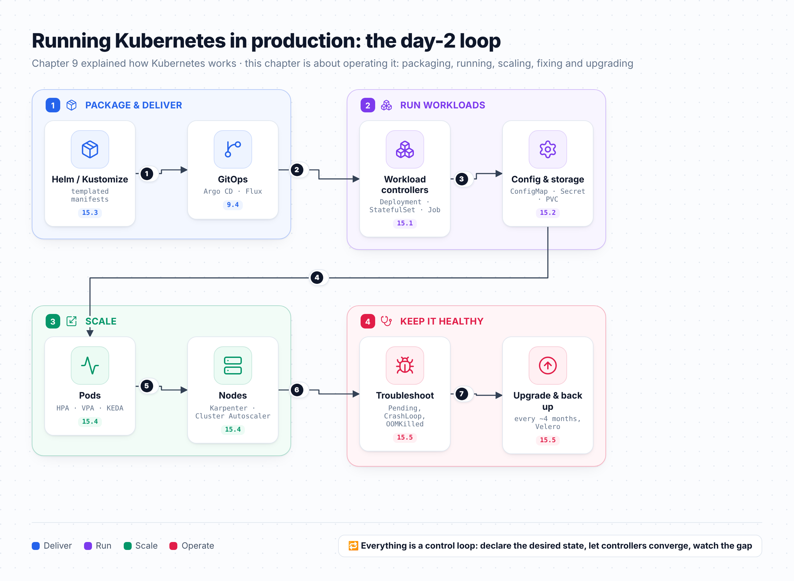

# Chapter 15 — Kubernetes in depth: running it in production

!!! abstract "In short"
    [Chapter 9](../09-infra/index.md) showed **how** Kubernetes works. Running it in production is about the **details
    that decide uptime**. That means the right **workload controller** with correct **probes, requests and graceful
    shutdown**, plus config and **persistent volumes** that follow pods. It also means **packaging** with Helm or
    Kustomize, **autoscaling** pods and nodes, reading **pod status** quickly, and **upgrading** every few months
    without drama.

## 📖 Key terms & abbreviations

| Term | Stands for | What it is | How it works (one line) |
|---|---|---|---|
| **Day 2** | — | Operating after the initial install | Upgrades, scaling, backups, incidents |
| **Workload controller** | — | Object that manages pods for you | Deployment, StatefulSet, DaemonSet, Job, CronJob |
| **Probe** | — | Kubelet health check | startup, readiness, liveness |
| **PDB** | PodDisruptionBudget | Min available pods during voluntary disruptions | Protects against drains taking too many |
| **PV / PVC** | PersistentVolume / Claim | Storage object / a pod's request for it | Bound 1:1, provisioned by CSI |
| **CSI** | Container Storage Interface | Plugin standard for storage drivers | Creates, attaches, mounts cloud disks |
| **Helm** | — | Package manager for Kubernetes | Charts = templates + values, releases |
| **Kustomize** | — | Template-free overlays | base + patches per environment |
| **Operator** | — | Controller + CRD encoding operational knowledge | Manages complex apps (DBs, Kafka) |
| **HPA / VPA** | Horizontal / Vertical Pod Autoscaler | Replica count / resource size automation | Based on metrics |
| **KEDA** | Kubernetes Event-Driven Autoscaling | Scales on external events, to zero | Queue length, Kafka lag, cron |
| **Karpenter** | — | Node autoscaler that picks instance types | Provisions just-in-time nodes |
| **Velero** | — | Backup/restore of cluster resources and volumes | Object storage + snapshots |

## 🗺️ Big picture



---

## 1 · Pick the right controller

| Controller | For | Key behaviour |
|---|---|---|
| **Deployment** | Stateless services | Rolling updates via ReplicaSets, `maxSurge`/`maxUnavailable` |
| **StatefulSet** | Databases, brokers, anything with identity | Stable names (`db-0`), ordered start, one PVC per pod |
| **DaemonSet** | One pod per node | Log shippers, CNI, node exporters, CSI node plugins |
| **Job / CronJob** | Run to completion / on schedule | Retries (`backoffLimit`), `concurrencyPolicy`, TTL cleanup |

Bare pods are never used in production: nothing recreates them.

## 2 · The settings that decide uptime

1. **Requests and limits**: requests for scheduling and guaranteed share; memory limit to contain leaks; CPU limits often omitted to avoid throttling (3.2).
2. **Probes**: readiness controls traffic, liveness restarts (be conservative), startup protects slow boots (15.1).
3. **Graceful shutdown**: handle SIGTERM, a short `preStop` sleep, enough `terminationGracePeriodSeconds`.
4. **Spread**: ≥ 2 replicas, `topologySpreadConstraints` across zones and nodes, a **PodDisruptionBudget**.
5. **Security context**: non-root, read-only filesystem, no privilege escalation (11).

## 3 · State, config and packaging

- **Config** through ConfigMaps and Secrets (External Secrets/CSI from Vault or a cloud secret manager), **storage** through PVCs and StorageClasses (15.2).
- **Package** apps with **Helm** charts or **Kustomize** overlays and deliver with **GitOps** (9.4); use **operators** for complex stateful software (15.3).

## 4 · Scale, troubleshoot, upgrade

- **Autoscaling** in two layers: HPA/KEDA/VPA for pods, Karpenter/Cluster Autoscaler for nodes (15.4).
- **Troubleshoot** by status: `Pending` = scheduling, `ImagePullBackOff` = registry, `CrashLoopBackOff` = the app or its limits, `Running` but failing = probes, Services, network (15.5).
- **Upgrade** regularly: Kubernetes ships ~3 minor versions a year and each gets ~14 months of patches; managed providers force upgrades when versions expire (15.5).

## 🔧 DevOps connection

- Most production outages on Kubernetes come from **configuration**, not Kubernetes bugs: missing readiness probes, no PDB, requests copied from a template, a single replica, missing shutdown handling.
- Make the good defaults part of the **platform** (16.4): a chart or template with probes, PDB, spread, security context and resource defaults.
- Enforce them with **policy** (Kyverno/Gatekeeper, 11) and check them in CI (kube-linter, kubeconform, Polaris).

## 🚨 Incident story: the deploy that dropped 2% of requests

!!! failure "The alarm"
    Every deployment of the `orders` service causes a burst of **502 errors** for about 30 seconds. Rollouts "succeed" and the pods look healthy.

Try to diagnose it yourself first, then open the clues one by one.

??? info "🔍 Clue 1"
    The errors come from the ingress controller: "upstream connection refused / reset" to pod IPs that are **terminating**.

??? info "🔍 Clue 2"
    The app exits immediately on SIGTERM. There's no `preStop` hook, and the readiness probe only checks that the port is open, so new pods receive traffic before their connection pools and caches are ready.

??? success "🎯 Root cause"
    Endpoint removal is asynchronous: the ingress and kube-proxy still send requests for a few seconds after a pod gets SIGTERM. The app died instantly, and new pods were marked Ready too early.

??? tip "🛠️ Fix and lesson"
    Add `preStop: sleep 5`, handle SIGTERM by stopping new work and draining in-flight requests, set a meaningful readiness endpoint (dependencies warm), use `maxUnavailable: 0` and a PDB. **Lesson:** "zero-downtime deploys" are a property of your pods' lifecycle, not of Kubernetes itself.

## 🧭 Go deeper

| Page | What's inside |
|---|---|
| **[15.1 — Workloads, probes & scheduling](01-workloads.md)** | Deployments and rollout settings, StatefulSets, DaemonSets, Jobs and CronJobs, the three probes and how to design them, graceful shutdown, requests and QoS, affinity, taints, topology spread, priority and PDBs. |
| **[15.2 — Configuration & persistent storage](02-config-storage.md)** | ConfigMaps and Secrets, env vs mounted files, External Secrets, PVs, PVCs, StorageClasses, access modes, CSI drivers, volume binding and zones, expanding and snapshotting volumes, StatefulSets and running databases. |
| **[15.3 — Helm, Kustomize & operators](03-helm-operators.md)** | Helm charts, values, releases and hooks, Kustomize bases and overlays, choosing between them, CRDs and the operator pattern, well-known operators, and how these fit into GitOps. |
| **[15.4 — Autoscaling pods and nodes](04-autoscaling.md)** | metrics-server and custom metrics, HPA behaviour and tuning, KEDA and scale to zero, VPA and right-sizing, Cluster Autoscaler vs Karpenter, consolidation, spot, and capacity headroom. |
| **[15.5 — Troubleshooting, upgrades & backups](05-troubleshooting.md)** | A systematic method by pod status, exit codes, events, kubectl debug, node problems, DNS and network checks, version skew and upgrade process, deprecated APIs, etcd and Velero backups. |

## 🧪 Try it yourself

```bash
# A local cluster with 3 nodes (kind)
cat > kind.yaml <<'EOF'
kind: Cluster
apiVersion: kind.x-k8s.io/v1alpha4
nodes: [{role: control-plane}, {role: worker}, {role: worker}]
EOF
kind create cluster --name day2 --config kind.yaml

# A production-shaped deployment: replicas, probes, PDB, spread
kubectl create deployment web --image=nginx:alpine --replicas=3
kubectl set resources deployment web --requests=cpu=50m,memory=64Mi --limits=memory=128Mi
kubectl create pdb web --selector=app=web --min-available=2
kubectl get pods -o wide                     # spread over workers?

# Drain a node and watch the PDB keep 2 pods available
kubectl drain day2-worker --ignore-daemonsets --delete-emptydir-data &
kubectl get pods -o wide -w
kind delete cluster --name day2
```

## 🃏 Cheat sheet

| Checklist item | Why |
|---|---|
| ≥ 2 replicas + topology spread | Survive node/zone loss |
| Readiness + startup probe | No traffic before ready |
| SIGTERM handling + preStop | No dropped requests on deploy |
| Requests from real usage, memory limit | Good packing, contained leaks |
| PDB | Safe drains and upgrades |
| Non-root, read-only FS | Smaller blast radius |
| Packaged (Helm/Kustomize) + GitOps | Reproducible, reviewable |
| Regular upgrades + Velero backups | Supported versions, recoverable |

## ❓ Test yourself

??? question "1. When do you use a StatefulSet instead of a Deployment?"
    When pods need stable identity and their own storage: stable names, ordered start/stop and one PVC per replica (databases, brokers, clustered apps).

??? question "2. What's the difference between a readiness and a liveness probe?"
    Readiness decides whether a pod receives traffic (removed from Service endpoints when failing); liveness decides whether the container is restarted.

??? question "3. Why can pods drop requests during a rolling update even though Kubernetes waits for readiness?"
    Endpoint removal propagates asynchronously after SIGTERM; if the app exits immediately, load balancers still route a few requests to it. A preStop delay and graceful draining fix it.

??? question "4. What does a PodDisruptionBudget protect against?"
    Voluntary disruptions (node drains, upgrades, autoscaler consolidation) evicting too many pods at once; it doesn't protect against crashes or node failures.

??? question "5. Why must Kubernetes clusters be upgraded regularly?"
    Minor versions are supported for only about 14 months; managed services force upgrades, APIs get removed, and security fixes only come for supported versions.

---

## 📚 Sources

- [Kubernetes — Workloads](https://kubernetes.io/docs/concepts/workloads/)
- [Kubernetes — Configure liveness, readiness and startup probes](https://kubernetes.io/docs/tasks/configure-pod-container/configure-liveness-readiness-startup-probes/)
- [Kubernetes — Disruptions and PodDisruptionBudgets](https://kubernetes.io/docs/concepts/workloads/pods/disruptions/)
- [Kubernetes — Release cycle and version skew](https://kubernetes.io/releases/)
- [Google Cloud — Kubernetes best practices: terminating with grace](https://cloud.google.com/blog/products/containers-kubernetes/kubernetes-best-practices-terminating-with-grace)

## ✍️ My notes

> Take one of your deployments and check it against the cheat sheet. Which items are missing?
