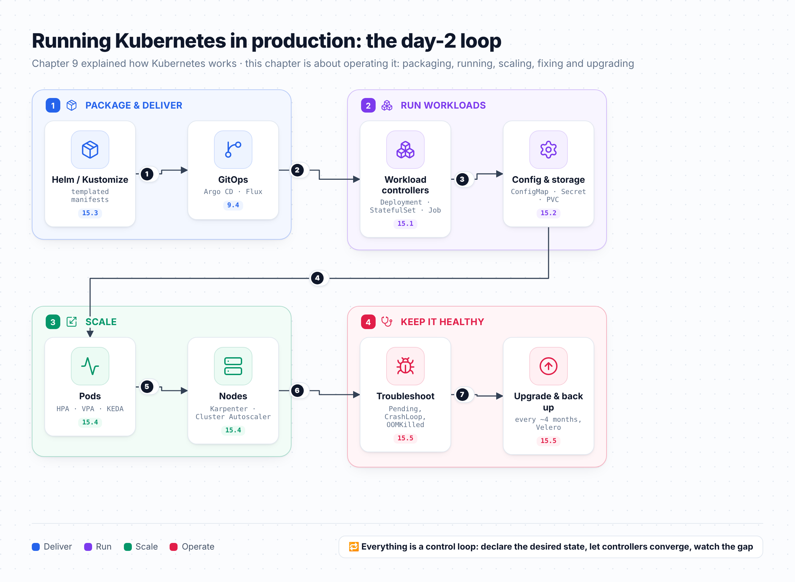

# Bölüm 15 — Derinlemesine Kubernetes: production'da çalıştırmak

!!! abstract "Kısaca"
    [Bölüm 9](../09-infra/index.md) Kubernetes'in **nasıl** çalıştığını gösterdi. Onu production'da çalıştırmak ise
    **erişilebilirliği belirleyen detaylarla** ilgilidir. Doğru **probe'lar, request'ler ve düzgün kapanışla** doğru
    **workload controller'ı** ve pod'ları takip eden yapılandırma ve **kalıcı volume'lar** gerekir. Ayrıca Helm ya da
    Kustomize ile **paketleme**, pod ve node'ları **otomatik ölçekleme**, **pod durumunu** hızlı okumak ve cluster'ı
    birkaç ayda bir dramsız **yükseltmek** gerekir.

## 📖 Temel terimler ve kısaltmalar

| Terim | Açılımı | Nedir | Nasıl çalışır (tek satır) |
|---|---|---|---|
| **2. gün** | Day 2 | İlk kurulumdan sonra işletim | Yükseltmeler, ölçekleme, yedekler, olaylar |
| **Workload controller'ı** | Workload controller | Pod'ları senin için yöneten nesne | Deployment, StatefulSet, DaemonSet, Job, CronJob |
| **Probe** | — | Kubelet sağlık kontrolü | startup, readiness, liveness |
| **PDB** | PodDisruptionBudget | Gönüllü kesintilerde en az erişilebilir pod sayısı | Drain'lerin çok fazlasını almasına karşı korur |
| **PV / PVC** | PersistentVolume / Claim | Depolama nesnesi / bir pod'un onu talep etmesi | 1:1 bağlanır, CSI ile oluşturulur |
| **CSI** | Container Storage Interface | Depolama sürücüleri için eklenti standardı | Bulut disklerini oluşturur, takar, mount eder |
| **Helm** | — | Kubernetes paket yöneticisi | Chart = şablonlar + değerler, release'ler |
| **Kustomize** | — | Şablonsuz overlay'ler | base + ortam başına yamalar |
| **Operator** | — | Operasyonel bilgiyi kodlayan controller + CRD | Karmaşık uygulamaları yönetir (DB, Kafka) |
| **HPA / VPA** | Horizontal / Vertical Pod Autoscaler | Replika sayısı / kaynak boyutu otomasyonu | Metriklere dayalı |
| **KEDA** | Kubernetes Event-Driven Autoscaling | Harici olaylara göre, sıfıra ölçekler | Kuyruk uzunluğu, Kafka gecikmesi, cron |
| **Karpenter** | — | Instance tipini seçen node ölçekleyici | Tam zamanında node oluşturur |
| **Velero** | — | Cluster kaynaklarının ve volume'ların yedek/geri yüklemesi | Nesne depolama + snapshot'lar |

## 🗺️ Büyük resim



---

## 1 · Doğru controller'ı seç

| Controller | Ne için | Temel davranış |
|---|---|---|
| **Deployment** | Durumsuz servisler | ReplicaSet'lerle kademeli güncelleme, `maxSurge`/`maxUnavailable` |
| **StatefulSet** | Veritabanları, broker'lar, kimliği olan her şey | Sabit isimler (`db-0`), sıralı başlatma, pod başına bir PVC |
| **DaemonSet** | Node başına bir pod | Log göndericiler, CNI, node exporter'lar, CSI node eklentileri |
| **Job / CronJob** | Tamamlanana kadar / zamanlanmış çalış | Yeniden denemeler (`backoffLimit`), `concurrencyPolicy`, TTL temizliği |

Çıplak pod'lar production'da asla kullanılmaz: onları yeniden oluşturan hiçbir şey yoktur.

## 2 · Erişilebilirliği belirleyen ayarlar

1. **Request ve limit'ler**: zamanlama ve garanti pay için request'ler; sızıntıları sınırlamak için bellek limiti; kısılmadan kaçınmak için CPU limitleri çoğu zaman konmaz (3.2).
2. **Probe'lar**: readiness trafiği kontrol eder, liveness yeniden başlatır (temkinli ol), startup yavaş boot'ları korur (15.1).
3. **Düzgün kapanış**: SIGTERM'ü ele al, kısa bir `preStop` beklemesi, yeterli `terminationGracePeriodSeconds`.
4. **Yayılım**: ≥ 2 replika, zone ve node'lara `topologySpreadConstraints`, bir **PodDisruptionBudget**.
5. **Güvenlik bağlamı**: root olmayan, salt okunur dosya sistemi, yetki yükseltme yok (11).

## 3 · Durum, yapılandırma ve paketleme

- **Yapılandırma** ConfigMap ve Secret'larla (Vault ya da bir bulut secret yöneticisinden External Secrets/CSI), **depolama** PVC ve StorageClass'larla (15.2).
- Uygulamaları **Helm** chart'ları ya da **Kustomize** overlay'leriyle **paketle**, **GitOps** ile teslim et (9.4); karmaşık durum tutan yazılımlar için **operator'ler** kullan (15.3).

## 4 · Ölçekle, sorun gider, yükselt

- İki katmanda **otomatik ölçekleme**: pod'lar için HPA/KEDA/VPA, node'lar için Karpenter/Cluster Autoscaler (15.4).
- Duruma göre **sorun gider**: `Pending` = zamanlama, `ImagePullBackOff` = registry, `CrashLoopBackOff` = uygulama ya da limitleri, `Running` ama başarısız = probe'lar, Service'ler, ağ (15.5).
- Düzenli **yükselt**: Kubernetes yılda ~3 minor sürüm çıkarır ve her biri ~14 ay yama alır; yönetilen sağlayıcılar sürümlerin süresi dolunca yükseltmeye zorlar (15.5).

## 🔧 DevOps bağlantısı

- Kubernetes'teki production kesintilerinin çoğu Kubernetes hatalarından değil **yapılandırmadan** gelir: eksik readiness probe'ları, PDB yok, şablondan kopyalanmış request'ler, tek replika, eksik kapanış ele alımı.
- İyi varsayılanları **platformun** parçası yap (16.4): probe'lar, PDB, yayılım, güvenlik bağlamı ve kaynak varsayılanları olan bir chart ya da şablon.
- Bunları **politikayla** zorunlu kıl (Kyverno/Gatekeeper, 11) ve CI'da kontrol et (kube-linter, kubeconform, Polaris).

## 🚨 Olay hikâyesi: isteklerin %2'sini düşüren deploy

!!! failure "Alarm"
    `orders` servisinin her deploy'u yaklaşık 30 saniyelik bir **502 hatası** patlamasına yol açıyor. Rollout'lar "başarılı" oluyor ve pod'lar sağlıklı görünüyor.

Önce kendin teşhis etmeye çalış, sonra ipuçlarını tek tek aç.

??? info "🔍 İpucu 1"
    Hatalar ingress controller'dan geliyor: **sonlanmakta olan** pod IP'lerine "upstream connection refused / reset".

??? info "🔍 İpucu 2"
    Uygulama SIGTERM'de hemen çıkıyor. `preStop` kancası yok ve readiness probe sadece portun açık olduğunu kontrol ediyor; yeni pod'lar bağlantı havuzları ve önbellekleri hazır olmadan trafik alıyor.

??? success "🎯 Kök neden"
    Endpoint'ten çıkarma asenkrondur: bir pod SIGTERM aldıktan sonra ingress ve kube-proxy birkaç saniye daha istek gönderir. Uygulama anında öldü ve yeni pod'lar çok erken Ready işaretlendi.

??? tip "🛠️ Çözüm ve ders"
    `preStop: sleep 5` ekle, SIGTERM'ü yeni işi durdurup süren istekleri bitirerek ele al, anlamlı bir readiness endpoint'i ayarla (bağımlılıklar ısınmış), `maxUnavailable: 0` ve bir PDB kullan. **Ders:** "kesintisiz deploy" Kubernetes'in değil, pod'larının yaşam döngüsünün bir özelliğidir.

## 🧭 Daha derine in

| Sayfa | Neler var |
|---|---|
| **[15.1 — Workload'lar, probe'lar ve zamanlama](01-workloads.md)** | Deployment'lar ve rollout ayarları, StatefulSet'ler, DaemonSet'ler, Job ve CronJob'lar, üç probe ve nasıl tasarlanacakları, düzgün kapanış, request'ler ve QoS, affinity, taint'ler, topoloji yayılımı, öncelik ve PDB'ler. |
| **[15.2 — Yapılandırma ve kalıcı depolama](02-config-storage.md)** | ConfigMap ve Secret'lar, env ve mount edilen dosyalar, External Secrets, PV, PVC, StorageClass'lar, erişim modları, CSI sürücüleri, volume bağlama ve zone'lar, volume büyütme ve snapshot, StatefulSet'ler ve veritabanı çalıştırmak. |
| **[15.3 — Helm, Kustomize ve operator'ler](03-helm-operators.md)** | Helm chart'ları, değerler, release'ler ve hook'lar, Kustomize base ve overlay'leri, aralarında seçim, CRD'ler ve operator deseni, bilinen operator'ler ve bunların GitOps'a nasıl oturduğu. |
| **[15.4 — Pod ve node'ları otomatik ölçekleme](04-autoscaling.md)** | metrics-server ve özel metrikler, HPA davranışı ve ayarı, KEDA ve sıfıra ölçekleme, VPA ve doğru boyutlandırma, Cluster Autoscaler ve Karpenter, konsolidasyon, spot ve kapasite payı. |
| **[15.5 — Sorun giderme, yükseltmeler ve yedekler](05-troubleshooting.md)** | Pod durumuna göre sistematik yöntem, çıkış kodları, olaylar, kubectl debug, node sorunları, DNS ve ağ kontrolleri, sürüm uyumu ve yükseltme süreci, kaldırılan API'ler, etcd ve Velero yedekleri. |

## 🧪 Kendin dene

```bash
# 3 node'lu yerel bir cluster (kind)
cat > kind.yaml <<'EOF'
kind: Cluster
apiVersion: kind.x-k8s.io/v1alpha4
nodes: [{role: control-plane}, {role: worker}, {role: worker}]
EOF
kind create cluster --name day2 --config kind.yaml

# Production şeklinde bir deployment: replikalar, probe'lar, PDB, yayılım
kubectl create deployment web --image=nginx:alpine --replicas=3
kubectl set resources deployment web --requests=cpu=50m,memory=64Mi --limits=memory=128Mi
kubectl create pdb web --selector=app=web --min-available=2
kubectl get pods -o wide                     # worker'lara yayıldı mı?

# Bir node'u boşalt ve PDB'nin 2 pod'u erişilebilir tuttuğunu izle
kubectl drain day2-worker --ignore-daemonsets --delete-emptydir-data &
kubectl get pods -o wide -w
kind delete cluster --name day2
```

## 🃏 Hatırlatma kartı

| Kontrol listesi maddesi | Neden |
|---|---|
| ≥ 2 replika + topoloji yayılımı | Node/zone kaybından kurtul |
| Readiness + startup probe | Hazır olmadan trafik yok |
| SIGTERM ele alımı + preStop | Deploy'da düşen istek yok |
| Gerçek kullanımdan request'ler, bellek limiti | İyi yerleşim, sınırlanmış sızıntılar |
| PDB | Güvenli drain'ler ve yükseltmeler |
| Root olmayan, salt okunur FS | Daha küçük etki alanı |
| Paketlenmiş (Helm/Kustomize) + GitOps | Tekrarlanabilir, incelenebilir |
| Düzenli yükseltmeler + Velero yedekleri | Desteklenen sürümler, kurtarılabilir |

## ❓ Kendini test et

??? question "1. Deployment yerine ne zaman StatefulSet kullanılır?"
    Pod'ların sabit kimliğe ve kendi depolamalarına ihtiyacı olduğunda: sabit isimler, sıralı başlatma/durdurma ve replika başına bir PVC (veritabanları, broker'lar, cluster'lı uygulamalar).

??? question "2. Readiness ile liveness probe arasındaki fark ne?"
    Readiness bir pod'un trafik alıp almayacağına karar verir (başarısız olunca Service endpoint'lerinden çıkarılır); liveness container'ın yeniden başlatılıp başlatılmayacağına karar verir.

??? question "3. Kubernetes readiness'ı beklese de pod'lar kademeli güncellemede neden istek düşürebilir?"
    Endpoint'ten çıkarma SIGTERM'den sonra asenkron yayılır; uygulama hemen çıkarsa load balancer'lar ona birkaç istek daha yönlendirir. preStop beklemesi ve düzgün boşaltma bunu düzeltir.

??? question "4. Bir PodDisruptionBudget neye karşı korur?"
    Gönüllü kesintilerin (node drain'leri, yükseltmeler, autoscaler konsolidasyonu) aynı anda çok fazla pod'u tahliye etmesine; çökmelere ya da node hatalarına karşı korumaz.

??? question "5. Kubernetes cluster'ları neden düzenli yükseltilmeli?"
    Minor sürümler sadece yaklaşık 14 ay desteklenir; yönetilen servisler yükseltmeye zorlar, API'ler kaldırılır ve güvenlik düzeltmeleri sadece desteklenen sürümlere gelir.

---

## 📚 Kaynaklar

- [Kubernetes — Workloads](https://kubernetes.io/docs/concepts/workloads/)
- [Kubernetes — Configure liveness, readiness and startup probes](https://kubernetes.io/docs/tasks/configure-pod-container/configure-liveness-readiness-startup-probes/)
- [Kubernetes — Disruptions and PodDisruptionBudgets](https://kubernetes.io/docs/concepts/workloads/pods/disruptions/)
- [Kubernetes — Release cycle and version skew](https://kubernetes.io/releases/)
- [Google Cloud — Kubernetes best practices: terminating with grace](https://cloud.google.com/blog/products/containers-kubernetes/kubernetes-best-practices-terminating-with-grace)

## ✍️ Notlarım

> Deployment'larından birini al ve hatırlatma kartına göre kontrol et. Hangi maddeler eksik?
