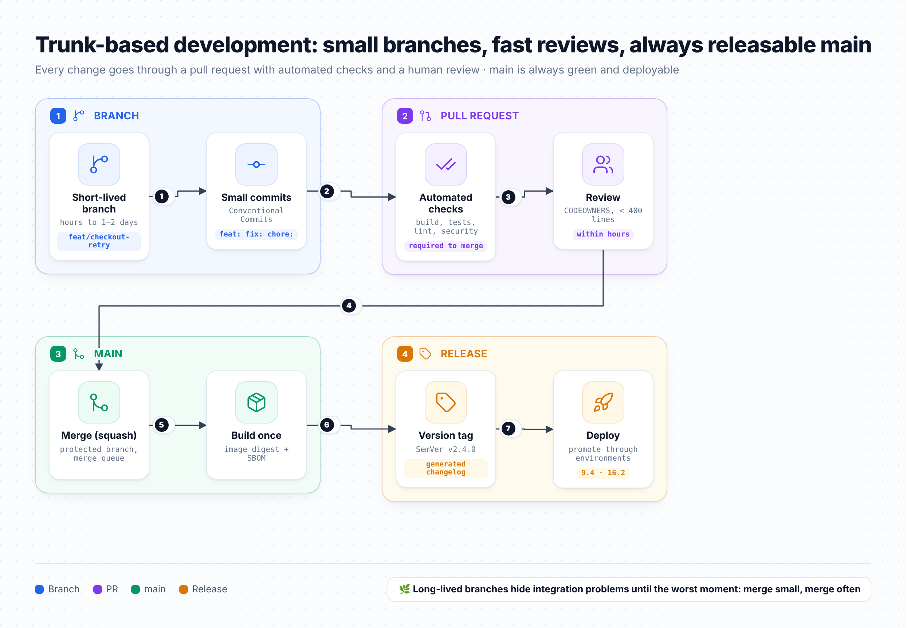

# 16.1 — Git workflows & code review

!!! abstract "In short"
    High-performing teams use **trunk-based development**: everyone works on **short-lived branches** (hours, not weeks)
    that merge into a **protected main** through **small pull requests** with **required automated checks** and a **fast
    human review**, so main is always releasable. Unfinished work hides behind **feature flags** instead of long
    branches, commits follow a **convention**, and releases get **semantic versions** and generated **changelogs**.

## 📖 Key terms & abbreviations

| Term | Stands for | What it is | How it works (one line) |
|---|---|---|---|
| **Trunk / main** | — | The single integration branch | Always green, always deployable |
| **Trunk-based development** | TBD | Integrate into main at least daily | Short branches or direct commits + flags |
| **GitFlow** | — | develop/release/hotfix branches | Suits versioned, shipped software; slows SaaS |
| **PR / MR** | Pull / Merge Request | Proposed change + review + checks | GitHub / GitLab |
| **Branch protection** | — | Rules on main | Required reviews, checks, no force-push |
| **Merge queue** | — | Tests PRs in merge order before landing | Keeps main green at high volume |
| **CODEOWNERS** | — | Files → required reviewers | Auto-requests the right team |
| **Squash merge** | — | One commit per PR on main | Clean, revertible history |
| **Conventional Commits** | — | `type(scope): summary` | `feat`, `fix`, `chore`, `BREAKING CHANGE` |
| **SemVer** | Semantic Versioning | MAJOR.MINOR.PATCH | Breaking / feature / fix |
| **Monorepo / polyrepo** | — | One repo for many projects / one per project | Trade-offs in tooling and coupling |
| **Signed commits** | — | Cryptographically verified authorship | SSH/GPG/Sigstore gitsign (11) |

## 🗺️ Big picture



---

## 1 · Trunk-based vs GitFlow

### How does it work?

| | Trunk-based | GitFlow |
|---|---|---|
| Branches | main + short feature branches (≤ 1–2 days) | main, develop, feature, release, hotfix |
| Integration | Continuous, daily | At the end of features / releases |
| Unfinished work | Behind feature flags (16.2) | Stays on a branch |
| Releases | From main, any time (or release branches cut from main) | Release branches, merges back to develop and main |
| Fits | SaaS, services deployed continuously | Software with several supported versions (mobile apps, libraries, on-prem products) |

Long-lived branches cause **merge hell**: conflicts, surprise interactions and big-bang integration at the worst moment. DORA research links trunk-based development with higher delivery performance.

## 2 · Protecting main

- **Required status checks**: build, unit tests, lint, type checks, security scans (secrets, dependencies, IaC, 11).
- **Required reviews**: at least one approval; **CODEOWNERS** for sensitive paths (infra, auth, payments); dismiss stale approvals on new pushes.
- **No direct pushes, no force-push**, linear history (squash or rebase merges).
- **Merge queue** when many PRs land: each is tested against the latest main plus PRs ahead of it, so main never breaks from "green separately, red together".
- **Signed commits** and protected tags for supply chain integrity (11).

## 3 · Small PRs and good reviews

- **Size**: under ~400 changed lines gets real review; 2,000-line PRs get "LGTM". Split by layer, use stacked PRs or flags.
- **Description**: what and **why**, how it was tested, risks, screenshots, links to the ticket.
- **Reviewers look for**: correctness, readability, tests, security, operability (logs, metrics, failure handling), backward compatibility.
- **Speed matters**: aim for a first review within a few hours; waiting PRs drive people towards big batches.
- **Automate the nitpicks**: formatters and linters in CI, so humans discuss design, not whitespace.
- **Kindness**: comment on the code, not the person; separate "must fix" from "nit/optional".

## 4 · Commits, versions and changelogs

```text
feat(checkout): retry payment provider on 503 with backoff
fix(api): return 404 instead of 500 for unknown order id
feat(auth)!: drop support for API keys v1

BREAKING CHANGE: v1 API keys are no longer accepted.
```

- **Conventional Commits** make history searchable and allow tools (release-please, semantic-release, changesets) to compute the next **SemVer** version and write the **changelog** automatically: `fix` → patch, `feat` → minor, `!`/`BREAKING CHANGE` → major.
- **Services** deployed continuously often use build numbers or commit SHAs plus image digests; **libraries and APIs** need SemVer so consumers know what's safe.
- Tag releases, and make every deployed artifact traceable to a commit (9.4).

## 5 · Monorepo or polyrepo?

| | Monorepo | Polyrepo |
|---|---|---|
| Pros | Atomic cross-project changes, shared tooling, easy refactors, one source of truth | Clear ownership boundaries, simple per-repo CI, independent permissions |
| Cons | Needs build tooling (Bazel, Nx, Turborepo, Pants), CI must test only what changed | Cross-repo changes are painful, version drift, duplicated tooling |
| Fits | Many tightly related services/libraries, strong platform team | Independent teams/products, open-source components |

Either works with good tooling; pick based on coupling and team structure, not fashion.

## 🔧 DevOps connection

- Branch protection, required checks and CODEOWNERS are **configuration as code** too (Terraform GitHub provider, repository rulesets).
- **CI speed is a developer-experience metric**: a 40-minute pipeline produces bigger PRs. Cache, parallelize, test only what changed.
- **Infra repos** follow the same rules: PR, plan output, review, apply after merge (14.3).
- Pre-commit hooks (`pre-commit`, `lefthook`) catch secrets and formatting before they reach CI.

## 🧪 Try it yourself

```bash
# Practise a clean trunk-based flow locally
mkdir tbd && cd tbd && git init -q -b main && echo "v1" > app.txt && git add . && git commit -qm "chore: initial commit"
git switch -c feat/greeting
echo "hello" >> app.txt && git commit -qam "feat(app): add greeting"
echo "hello, world" > app.txt && git commit -qam "fix(app): full greeting text"
git switch main && git merge --squash feat/greeting -q && git commit -qm "feat(app): add greeting (#12)"
git log --oneline --graph

# Interactive rebase to clean up before opening a PR (on your own branch only)
#   git rebase -i main
# Find which commit broke something
#   git bisect start; git bisect bad; git bisect good v1.4.0; git bisect run ./test.sh

# Who should review a path? (GitHub CODEOWNERS syntax)
printf "/infra/   @acme/platform\n/payments/ @acme/payments @acme/security\n" > CODEOWNERS && cat CODEOWNERS
```

## 🃏 Cheat sheet

| Practice | Default |
|---|---|
| Branch lifetime | < 2 days |
| PR size | < 400 lines, one purpose |
| Checks on main | Build, tests, lint, security — required |
| Reviews | ≥ 1, CODEOWNERS for sensitive paths, first response < 4 h |
| Merge style | Squash, linear history, merge queue at scale |
| Commit style | Conventional Commits |
| Versioning | SemVer for libraries/APIs, digests for services |

## ❓ Test yourself

??? question "1. Why do long-lived feature branches hurt delivery?"
    They delay integration, so conflicts and interactions appear late and all at once; reviews get huge, and releases become big, risky batches.

??? question "2. How do you merge unfinished work daily without exposing it to users?"
    Put it behind a feature flag (or keep it unreachable) so the code is integrated and deployed but not released (16.2).

??? question "3. What problem does a merge queue solve?"
    Two PRs that pass CI separately can break main when combined; the queue tests each PR against main plus the PRs ahead of it before merging.

??? question "4. Under SemVer, what does a change from 2.4.1 to 3.0.0 signal?"
    A breaking change: consumers may need to change their code or configuration to upgrade.

??? question "5. When does GitFlow still make sense?"
    For software where several versions are maintained and shipped in discrete releases (mobile apps, libraries, on-prem products) rather than deployed continuously.

---

## 📚 Sources

- [trunkbaseddevelopment.com](https://trunkbaseddevelopment.com/)
- [DORA — Trunk-based development capability](https://dora.dev/capabilities/trunk-based-development/)
- [Conventional Commits](https://www.conventionalcommits.org/en/v1.0.0/) · [Semantic Versioning](https://semver.org/)
- [GitHub — About protected branches](https://docs.github.com/en/repositories/configuring-branches-and-merges-in-your-repository/managing-protected-branches/about-protected-branches) · [Merge queue](https://docs.github.com/en/repositories/configuring-branches-and-merges-in-your-repository/configuring-pull-request-merges/managing-a-merge-queue)
- [Google — Engineering practices: code review](https://google.github.io/eng-practices/review/)

## ✍️ My notes

> What's the median age of a pull request in your team when it's merged? What makes the slow ones slow?
