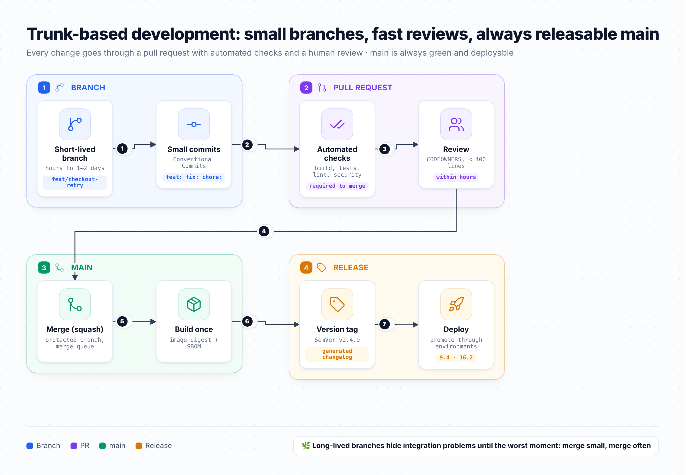

# 16.1 — Git akışları ve kod incelemesi

!!! abstract "Tek cümlede"
    Yüksek performanslı ekipler **trunk-based geliştirme** kullanır: herkes **kısa ömürlü branch'lerde** (haftalar değil
    saatler) çalışır, bunlar **zorunlu otomatik kontrollü** ve **hızlı insan incelemeli** **küçük pull request'lerle**
    **korumalı bir main'e** merge edilir; böylece main her zaman yayınlanabilir; bitmemiş iş uzun branch'ler yerine
    **feature flag'lerin** arkasında saklanır, commit'ler bir **kurala** uyar ve sürümler **semantik sürüm** numaraları ve
    üretilmiş **changelog'lar** alır.

## 📖 Temel terimler ve kısaltmalar

| Terim | Açılımı | Nedir | Nasıl çalışır (tek satır) |
|---|---|---|---|
| **Trunk / main** | — | Tek entegrasyon branch'i | Her zaman yeşil, her zaman deploy edilebilir |
| **Trunk-based geliştirme** | TBD | En az günlük main'e entegre ol | Kısa branch'ler ya da doğrudan commit + flag'ler |
| **GitFlow** | — | develop/release/hotfix branch'leri | Sürümlü, dağıtılan yazılıma uyar; SaaS'ı yavaşlatır |
| **PR / MR** | Pull / Merge Request | Önerilen değişiklik + inceleme + kontroller | GitHub / GitLab |
| **Branch koruması** | Branch protection | main üzerindeki kurallar | Zorunlu incelemeler, kontroller, force-push yok |
| **Merge kuyruğu** | Merge queue | PR'ları merge sırasıyla, girmeden önce test eder | Yüksek hacimde main'i yeşil tutar |
| **CODEOWNERS** | — | Dosyalar → zorunlu inceleyiciler | Doğru ekibi otomatik ister |
| **Squash merge** | — | main'de PR başına tek commit | Temiz, geri alınabilir geçmiş |
| **Conventional Commits** | — | `type(scope): özet` | `feat`, `fix`, `chore`, `BREAKING CHANGE` |
| **SemVer** | Semantic Versioning | MAJOR.MINOR.PATCH | Kırıcı / özellik / düzeltme |
| **Monorepo / polyrepo** | — | Çok proje için tek repo / proje başına bir | Araç ve bağlılıkta ödünleşimler |
| **İmzalı commit'ler** | Signed commits | Kriptografik olarak doğrulanmış yazarlık | SSH/GPG/Sigstore gitsign (11) |

## 🗺️ Büyük resim



---

## 1 · Trunk-based ve GitFlow

### Nasıl çalışır?

| | Trunk-based | GitFlow |
|---|---|---|
| Branch'ler | main + kısa özellik branch'leri (≤ 1–2 gün) | main, develop, feature, release, hotfix |
| Entegrasyon | Sürekli, günlük | Özelliklerin / sürümlerin sonunda |
| Bitmemiş iş | Feature flag'lerin arkasında (16.2) | Bir branch'te kalır |
| Sürümler | main'den, her an (ya da main'den kesilen release branch'leri) | Release branch'leri, develop ve main'e geri merge |
| Uygun olduğu yer | SaaS, sürekli deploy edilen servisler | Birkaç desteklenen sürümü olan yazılım (mobil uygulamalar, kütüphaneler, şirket içi ürünler) |

Uzun ömürlü branch'ler **merge cehennemine** yol açar: çakışmalar, sürpriz etkileşimler ve en kötü anda büyük patlama entegrasyon. DORA araştırması trunk-based geliştirmeyi daha yüksek teslim performansıyla ilişkilendirir.

## 2 · main'i korumak

- **Zorunlu durum kontrolleri**: build, unit testler, lint, tip kontrolleri, güvenlik taramaları (secret'lar, bağımlılıklar, IaC, 11).
- **Zorunlu incelemeler**: en az bir onay; hassas yollar (altyapı, kimlik doğrulama, ödemeler) için **CODEOWNERS**; yeni push'larda eski onayları düşür.
- **Doğrudan push yok, force-push yok**, doğrusal geçmiş (squash ya da rebase merge'leri).
- Çok PR girerken **merge kuyruğu**: her biri en son main artı önündeki PR'larla test edilir; main "ayrı ayrı yeşil, birlikte kırmızı" yüzünden asla bozulmaz.
- Tedarik zinciri bütünlüğü için **imzalı commit'ler** ve korumalı etiketler (11).

## 3 · Küçük PR'lar ve iyi incelemeler

- **Boyut**: ~400 satırın altı gerçek inceleme alır; 2.000 satırlık PR'lar "LGTM" alır. Katmana göre böl, yığılmış PR'lar ya da flag'ler kullan.
- **Açıklama**: ne ve **neden**, nasıl test edildi, riskler, ekran görüntüleri, ticket linkleri.
- **İnceleyiciler neye bakar**: doğruluk, okunabilirlik, testler, güvenlik, işletilebilirlik (loglar, metrikler, hata ele alımı), geriye uyumluluk.
- **Hız önemlidir**: birkaç saat içinde ilk inceleme hedefle; bekleyen PR'lar insanları büyük partilere iter.
- **Detay kusurlarını otomatikleştir**: CI'da formatlayıcılar ve linter'lar; insanlar boşlukları değil tasarımı tartışsın.
- **Nezaket**: kişiye değil koda yorum yap; "düzeltilmeli" ile "küçük/opsiyonel"i ayır.

## 4 · Commit'ler, sürümler ve changelog'lar

```text
feat(checkout): retry payment provider on 503 with backoff
fix(api): return 404 instead of 500 for unknown order id
feat(auth)!: drop support for API keys v1

BREAKING CHANGE: v1 API keys are no longer accepted.
```

- **Conventional Commits** geçmişi aranabilir yapar ve araçların (release-please, semantic-release, changesets) bir sonraki **SemVer** sürümünü hesaplamasını ve **changelog**'u otomatik yazmasını sağlar: `fix` → patch, `feat` → minor, `!`/`BREAKING CHANGE` → major.
- Sürekli deploy edilen **servisler** genelde build numaraları ya da commit SHA'ları artı imaj digest'leri kullanır; **kütüphaneler ve API'ler** tüketicilerin neyin güvenli olduğunu bilmesi için SemVer'e ihtiyaç duyar.
- Sürümleri etiketle ve deploy edilen her artefaktı bir commit'e kadar izlenebilir yap (9.4).

## 5 · Monorepo mu polyrepo mu?

| | Monorepo | Polyrepo |
|---|---|---|
| Artılar | Projeler arası atomik değişiklikler, ortak araçlar, kolay yeniden yapılandırma, tek doğruluk kaynağı | Net sahiplik sınırları, repo başına basit CI, bağımsız yetkiler |
| Eksiler | Build araçları gerekir (Bazel, Nx, Turborepo, Pants), CI sadece değişeni test etmeli | Repolar arası değişiklikler zahmetli, sürüm kayması, tekrarlanan araçlar |
| Uygun olduğu yer | Çok sayıda sıkı ilişkili servis/kütüphane, güçlü platform ekibi | Bağımsız ekipler/ürünler, açık kaynak bileşenler |

İyi araçlarla ikisi de çalışır; modaya göre değil, bağlılık ve ekip yapısına göre seç.

## 🔧 DevOps bağlantısı

- Branch koruması, zorunlu kontroller ve CODEOWNERS de **kod olarak yapılandırmadır** (Terraform GitHub provider'ı, repository ruleset'leri).
- **CI hızı bir geliştirici deneyimi metriğidir**: 40 dakikalık bir pipeline daha büyük PR'lar üretir. Önbelleğe al, paralelleştir, sadece değişeni test et.
- **Altyapı repoları** aynı kurallara uyar: PR, plan çıktısı, inceleme, merge'den sonra apply (14.3).
- Pre-commit hook'ları (`pre-commit`, `lefthook`) secret'ları ve biçimlendirmeyi CI'a ulaşmadan yakalar.

## 🧪 Kendin dene

```bash
# Yerelde temiz bir trunk-based akış pratiği
mkdir tbd && cd tbd && git init -q -b main && echo "v1" > app.txt && git add . && git commit -qm "chore: initial commit"
git switch -c feat/greeting
echo "hello" >> app.txt && git commit -qam "feat(app): add greeting"
echo "hello, world" > app.txt && git commit -qam "fix(app): full greeting text"
git switch main && git merge --squash feat/greeting -q && git commit -qm "feat(app): add greeting (#12)"
git log --oneline --graph

# PR açmadan önce temizlemek için interaktif rebase (sadece kendi branch'inde)
#   git rebase -i main
# Bir şeyi hangi commit'in bozduğunu bul
#   git bisect start; git bisect bad; git bisect good v1.4.0; git bisect run ./test.sh

# Bir yolu kim incelemeli? (GitHub CODEOWNERS sözdizimi)
printf "/infra/   @acme/platform\n/payments/ @acme/payments @acme/security\n" > CODEOWNERS && cat CODEOWNERS
```

## 🃏 Hatırlatma kartı

| Pratik | Varsayılan |
|---|---|
| Branch ömrü | < 2 gün |
| PR boyutu | < 400 satır, tek amaç |
| main'de kontroller | Build, test, lint, güvenlik: zorunlu |
| İncelemeler | ≥ 1, hassas yollar için CODEOWNERS, ilk yanıt < 4 sa |
| Merge stili | Squash, doğrusal geçmiş, ölçekte merge kuyruğu |
| Commit stili | Conventional Commits |
| Sürümleme | Kütüphane/API için SemVer, servisler için digest'ler |

## ❓ Kendini test et

??? question "1. Uzun ömürlü özellik branch'leri teslimi neden zorlaştırır?"
    Entegrasyonu geciktirirler; çakışmalar ve etkileşimler geç ve hep birden ortaya çıkar; incelemeler devasa olur ve sürümler büyük, riskli partilere dönüşür.

??? question "2. Bitmemiş işi kullanıcılara göstermeden her gün nasıl merge edersin?"
    Onu bir feature flag'in arkasına koyarak (ya da erişilemez tutarak); kod entegre edilir ve deploy edilir ama release edilmez (16.2).

??? question "3. Merge kuyruğu hangi sorunu çözer?"
    CI'ı ayrı ayrı geçen iki PR birleşince main'i bozabilir; kuyruk her PR'ı merge etmeden önce main artı önündeki PR'larla test eder.

??? question "4. SemVer'de 2.4.1'den 3.0.0'a geçiş neyi işaret eder?"
    Kırıcı bir değişikliği: tüketicilerin yükseltmek için kodlarını ya da yapılandırmalarını değiştirmesi gerekebilir.

??? question "5. GitFlow hâlâ ne zaman mantıklıdır?"
    Birkaç sürümün bakımının yapıldığı ve sürekli deploy yerine ayrı sürümlerle dağıtılan yazılımlarda (mobil uygulamalar, kütüphaneler, şirket içi ürünler).

---

## 📚 Kaynaklar

- [trunkbaseddevelopment.com](https://trunkbaseddevelopment.com/)
- [DORA — Trunk-based development capability](https://dora.dev/capabilities/trunk-based-development/)
- [Conventional Commits](https://www.conventionalcommits.org/en/v1.0.0/) · [Semantic Versioning](https://semver.org/)
- [GitHub — About protected branches](https://docs.github.com/en/repositories/configuring-branches-and-merges-in-your-repository/managing-protected-branches/about-protected-branches) · [Merge queue](https://docs.github.com/en/repositories/configuring-branches-and-merges-in-your-repository/configuring-pull-request-merges/managing-a-merge-queue)
- [Google — Engineering practices: code review](https://google.github.io/eng-practices/review/)

## ✍️ Notlarım

> Ekibinde bir pull request merge edildiğinde medyan yaşı ne? Yavaş olanları yavaş yapan ne?

-
