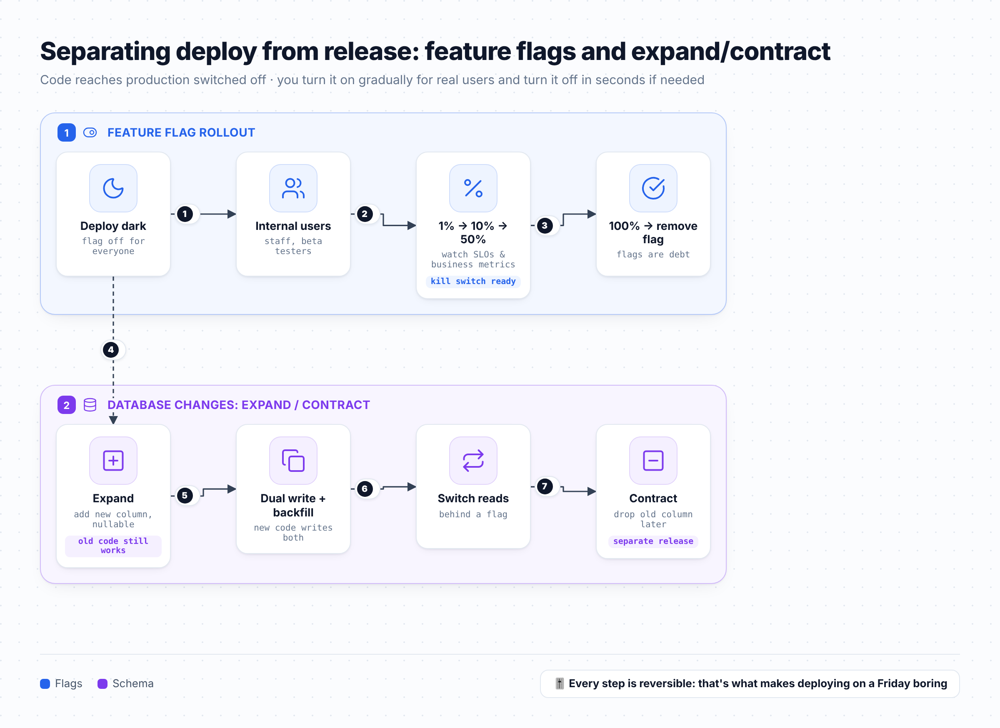

# 16.2 — Safe releases: feature flags & zero-downtime changes

!!! abstract "In short"
    The safest way to change production is to make every change **small and reversible**. **Deploy** code continuously,
    but **release** features separately with **feature flags**. Expose them **progressively** (staff → 1% → 100%) and
    let **metrics decide** whether to continue, with a **kill switch** ready. Evolve databases and APIs with
    **expand/contract**, so old and new versions can run side by side during every rollout and rollback.

## 📖 Key terms & abbreviations

| Term | Stands for | What it is | How it works (one line) |
|---|---|---|---|
| **Deploy** | — | Putting new code on servers | Technical event, frequent |
| **Release** | — | Exposing behaviour to users | Business decision, can be gradual |
| **Feature flag / toggle** | — | Runtime condition around code | Evaluated per request/user |
| **Release flag** | — | Hides unfinished work | Short-lived, removed after launch |
| **Ops flag / kill switch** | — | Turns off expensive or risky paths | Long-lived, for incidents |
| **Experiment flag** | — | A/B tests | Splits users, measures outcomes |
| **Permission flag** | — | Entitlements, plans, beta access | Long-lived, product logic |
| **OpenFeature** | — | CNCF vendor-neutral flag API | SDK + providers (LaunchDarkly, Flagd, Unleash…) |
| **Progressive delivery** | — | Gradual rollout gated by metrics | Canary analysis, auto-rollback (9.4) |
| **Expand / contract** | — | Parallel change for schemas and APIs | Add new → migrate → remove old |
| **Backward compatible** | — | Old clients/versions still work | Additive changes only |
| **Preview environment** | — | Short-lived env per PR | Review the change running |

## 🗺️ Big picture



---

## 1 · Deploy is not release

### How does it work?

```python
if flags.get_boolean("new-checkout", default=False, context={"user": user.id, "country": user.country}):
    return new_checkout(cart)
return old_checkout(cart)
```

The new code is merged and deployed while the flag is **off**. Then:

1. Turn it on for **internal users**; fix what they find.
2. Roll out to **1% → 10% → 50% → 100%**, watching error rates, latency, conversion and support tickets.
3. Something wrong? Turn the flag **off** in seconds, no deploy or rollback needed.
4. At 100% and stable: **delete the flag and the old code path** in the next PR.

Flags are evaluated locally from a cached ruleset (no network call per check) and the flag service is **not** a single point of failure: the code always has a safe default.

## 2 · Living with flags

- **Flags are debt**: each one doubles the paths to test. Give release flags an owner and an expiry date; alert on stale flags; delete them.
- **Don't nest** flags deeply; keep the flag check at the edge of the feature.
- **Test both states** in CI for flags that are mid-rollout.
- **Audit** who changed which flag when: flag changes are production changes and belong in the change log next to deploys.
- Use a standard API (**OpenFeature**) so you can switch providers or run your own (flagd, Unleash, Flipt).

## 3 · Progressive delivery

For changes that can't be flagged (new runtime version, config, infrastructure), roll out **the deployment itself** gradually (9.4):

- **Canary** with automated analysis (Argo Rollouts, Flagger, cloud deploy tools): send 5% of traffic to the new version, compare error rate and latency with the stable version, promote or **roll back automatically**.
- **Blue/green** for instant switch and instant rollback when you can afford double capacity.
- **Ring/cell deployments**: one region or cell at a time, with bake time in between.
- Always define **what "bad" means** before the rollout: SLO burn rate, error rate delta, business KPIs.

## 4 · Databases and APIs: expand / contract

During any rollout, **old and new versions run at the same time**, and a rollback brings the old version back. So every schema or contract change must work with both.

Renaming a column `name` → `full_name`:

1. **Expand**: add `full_name` (nullable). Old code ignores it.
2. **Dual write**: new code writes both columns; backfill old rows in batches.
3. **Switch reads** to `full_name` (behind a flag); verify.
4. **Stop writing** `name` once no running version reads it.
5. **Contract**: drop `name` in a **later** release, after rollback to the older version is no longer possible.

The same idea applies to **APIs and events**: add fields, never rename or remove them in place; version endpoints/schemas (`/v2`, schema registry) when a breaking change is unavoidable; keep consumers tolerant of unknown fields.

Also watch out for migrations that **lock tables** (adding an index without `CONCURRENTLY`, rewriting a big table); run them separately and online (pt-online-schema-change, gh-ost, PostgreSQL concurrent indexes).

## 5 · Environments and change management

- **Build once, promote the same artifact** through environments (dev → staging → prod) with only config differing (9.4, 15.3).
- **Preview environments** per PR (namespace + database branch + URL) let reviewers and product owners see changes running; tear them down automatically (13).
- **Production is the real test**: staging never matches prod fully, so invest in safe production rollouts more than in ever-bigger staging.
- **Change freezes** (holidays, big events) often just pile up changes for a risky "thaw day"; prefer continuing small, flagged changes with extra care, and freezing only risky categories.

## 🔧 DevOps connection

- Make rollback **one click** and **tested**: if you've never rolled back, you can't.
- Put **deploy and flag-change annotations** on dashboards so you can correlate a spike with a change in seconds.
- Your pipeline should block migrations that are not backward compatible (lint migrations: `squawk` for PostgreSQL, `atlas migrate lint`).
- "**Can we safely deploy on Friday?**" is a great maturity test. If the answer is no, the fix is in the process, not the calendar.

## 🧪 Try it yourself

```bash
# A tiny feature flag service with flagd (OpenFeature reference implementation)
cat > flags.json <<'EOF'
{"$schema":"https://flagd.dev/schema/v0/flags.json","flags":{
 "new-checkout":{"state":"ENABLED","variants":{"on":true,"off":false},"defaultVariant":"off",
  "targeting":{"fractional":[{"var":"targetingKey"},["on",10],["off",90]]}}}}
EOF
docker run -d --rm --name flagd -p 8013:8013 -v $PWD:/etc/flagd ghcr.io/open-feature/flagd:latest \
  start --uri file:/etc/flagd/flags.json
sleep 2
for u in alice bob carol dave erin frank grace heidi ivan judy; do
  printf "%-6s " $u; curl -s -X POST localhost:8013/flagd.evaluation.v1.Service/ResolveBoolean \
   -H 'Content-Type: application/json' -d "{\"flagKey\":\"new-checkout\",\"context\":{\"targetingKey\":\"$u\"}}"; echo
done                                # ~10% get true, and the same user always gets the same answer
# Edit flags.json (e.g. 50/50) and run the loop again: flagd reloads without restart
docker stop flagd
```

## 🃏 Cheat sheet

| Change | Safe pattern |
|---|---|
| New feature | Release flag, progressive exposure, delete flag |
| Risky dependency/path | Ops flag / kill switch |
| New version of a service | Canary with automated analysis |
| Column rename/type change | Expand → dual write/backfill → switch → contract |
| API field change | Add new, deprecate old, version if breaking |
| Big index / table rewrite | Online migration, separate from app deploy |
| Need to review a change running | Preview environment per PR |

## ❓ Test yourself

??? question "1. What's the difference between deploying and releasing?"
    Deploying puts new code into production; releasing exposes the new behaviour to users. Feature flags let you deploy continuously and release gradually and independently.

??? question "2. Why must feature flags be removed after launch?"
    Each flag adds code paths, testing combinations and confusion; stale flags become technical debt and a source of incidents when someone flips them unexpectedly.

??? question "3. Why can't you rename a database column in a single release?"
    During a rolling deploy (and after a rollback) the old version still runs and reads the old column; a one-step rename breaks it. Expand/contract keeps both versions working.

??? question "4. What should decide whether a canary is promoted?"
    Predefined metrics compared against the stable version (error rate, latency, SLO burn, key business metrics), ideally evaluated automatically with rollback on failure.

??? question "5. Why are change freezes often counterproductive?"
    Changes keep being written, so they accumulate into a large, risky batch released all at once after the freeze, the opposite of small safe changes.

---

## 📚 Sources

- [Martin Fowler — Feature Toggles (aka Feature Flags)](https://martinfowler.com/articles/feature-toggles.html)
- [OpenFeature](https://openfeature.dev/) · [flagd](https://flagd.dev/)
- [Martin Fowler — Parallel Change (expand/contract)](https://martinfowler.com/bliki/ParallelChange.html)
- [Argo Rollouts — Analysis & progressive delivery](https://argo-rollouts.readthedocs.io/en/stable/features/analysis/)
- [DORA — Deployment automation capability](https://dora.dev/capabilities/deployment-automation/)

## ✍️ My notes

> Think of your last rollback. How long did it take, and what would have made it a flag flip instead?
