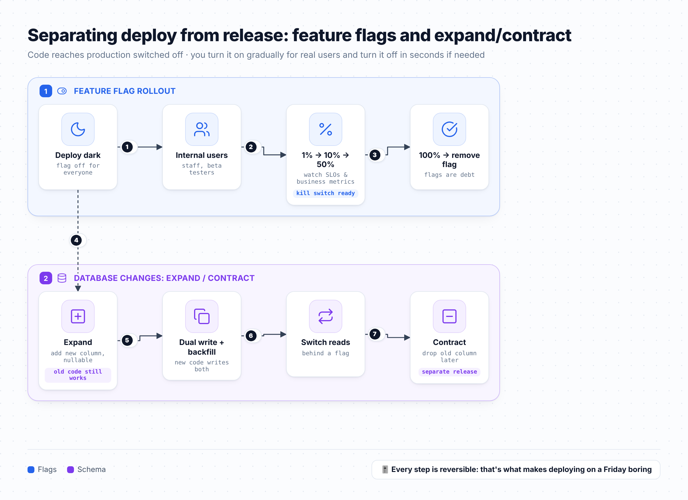

# 16.2 — Güvenli sürümler: feature flag'ler ve kesintisiz değişiklikler

!!! abstract "Kısaca"
    Production'ı değiştirmenin en güvenli yolu her değişikliği **küçük ve geri alınabilir** yapmaktır. Kodu sürekli
    **deploy et**, ama özellikleri **feature flag'lerle** ayrıca **release et**. Onları **kademeli** aç (çalışanlar → %1
    → %100); devam edip etmeyeceğine **metrikler karar versin** ve bir **kapatma anahtarı** hazır dursun.
    Veritabanlarını ve API'leri **genişlet/daralt** ile evrilt; böylece her rollout ve geri almada eski ve yeni sürümler
    yan yana çalışabilir.

## 📖 Temel terimler ve kısaltmalar

| Terim | Açılımı | Nedir | Nasıl çalışır (tek satır) |
|---|---|---|---|
| **Deploy** | — | Yeni kodu sunuculara koymak | Teknik olay, sık |
| **Release** | — | Davranışı kullanıcılara açmak | İş kararı, kademeli olabilir |
| **Feature flag / toggle** | — | Kodun etrafında çalışma anı koşulu | İstek/kullanıcı başına değerlendirilir |
| **Release flag'i** | Release flag | Bitmemiş işi saklar | Kısa ömürlü, lansmandan sonra kaldırılır |
| **Ops flag'i / kapatma anahtarı** | Ops flag / kill switch | Pahalı ya da riskli yolları kapatır | Uzun ömürlü, olaylar için |
| **Deney flag'i** | Experiment flag | A/B testleri | Kullanıcıları böler, sonuçları ölçer |
| **Yetki flag'i** | Permission flag | Haklar, planlar, beta erişimi | Uzun ömürlü, ürün mantığı |
| **OpenFeature** | — | CNCF'in sağlayıcıdan bağımsız flag API'si | SDK + sağlayıcılar (LaunchDarkly, Flagd, Unleash…) |
| **Kademeli teslim** | Progressive delivery | Metriklerle kapılanan kademeli yayılım | Canary analizi, otomatik geri alma (9.4) |
| **Genişlet / daralt** | Expand / contract | Şema ve API'ler için paralel değişiklik | Yeniyi ekle → taşı → eskiyi kaldır |
| **Geriye uyumlu** | Backward compatible | Eski istemciler/sürümler hâlâ çalışır | Sadece eklemeli değişiklikler |
| **Önizleme ortamı** | Preview environment | PR başına kısa ömürlü ortam | Değişikliği çalışırken incele |

## 🗺️ Büyük resim



---

## 1 · Deploy, release değildir

### Nasıl çalışır?

```python
if flags.get_boolean("new-checkout", default=False, context={"user": user.id, "country": user.country}):
    return new_checkout(cart)
return old_checkout(cart)
```

Yeni kod flag **kapalıyken** merge edilir ve deploy edilir. Sonra:

1. **İç kullanıcılar** için aç; buldukları şeyleri düzelt.
2. **%1 → %10 → %50 → %100** yay; hata oranlarını, gecikmeyi, dönüşümü ve destek ticket'larını izle.
3. Bir sorun mu var? Flag'i saniyeler içinde **kapat**, deploy ya da geri alma gerekmez.
4. %100'de ve kararlı: bir sonraki PR'da **flag'i ve eski kod yolunu sil**.

Flag'ler önbellekteki bir kural setinden yerel olarak değerlendirilir (kontrol başına ağ çağrısı yok) ve flag servisi tekil bir hata noktası **değildir**: kodun her zaman güvenli bir varsayılanı vardır.

## 2 · Flag'lerle yaşamak

- **Flag'ler borçtur**: her biri test edilecek yolları ikiye katlar. Release flag'lerine bir sahip ve bitiş tarihi ver; eskimiş flag'ler için alarm kur; sil.
- Flag'leri derin **iç içe koyma**; flag kontrolünü özelliğin kenarında tut.
- Rollout ortasındaki flag'ler için CI'da **iki durumu da test et**.
- Kimin hangi flag'i ne zaman değiştirdiğini **denetle**: flag değişiklikleri production değişiklikleridir ve deploy'ların yanında değişiklik günlüğünde yer alır.
- Sağlayıcı değiştirebilmek ya da kendininkini çalıştırabilmek (flagd, Unleash, Flipt) için standart bir API (**OpenFeature**) kullan.

## 3 · Kademeli teslim

Flag'lenemeyen değişiklikler (yeni runtime sürümü, yapılandırma, altyapı) için **deploy'un kendisini** kademeli yay (9.4):

- Otomatik analizli **canary** (Argo Rollouts, Flagger, bulut deploy araçları): trafiğin %5'ini yeni sürüme gönder, hata oranını ve gecikmeyi kararlı sürümle karşılaştır, terfi ettir ya da **otomatik geri al**.
- Çift kapasiteyi karşılayabiliyorsan anında geçiş ve anında geri alma için **blue/green**.
- **Halka/hücre deploy'ları**: aralarında bekleme süresiyle her seferinde bir bölge ya da hücre.
- Rollout'tan önce her zaman **"kötü"nün ne demek olduğunu** tanımla: SLO burn rate, hata oranı farkı, iş KPI'ları.

## 4 · Veritabanları ve API'ler: genişlet / daralt

Her rollout sırasında **eski ve yeni sürümler aynı anda çalışır** ve bir geri alma eski sürümü geri getirir. Bu yüzden her şema ya da sözleşme değişikliği ikisiyle de çalışmalıdır.

Bir kolonu `name` → `full_name` olarak yeniden adlandırmak:

1. **Genişlet**: `full_name` ekle (nullable). Eski kod onu yok sayar.
2. **Çift yazma**: yeni kod iki kolona da yazar; eski satırları partiler halinde geriye doldur.
3. **Okumaları** `full_name`'e (bir flag arkasında) **değiştir**; doğrula.
4. Çalışan hiçbir sürüm okumadığında `name`'e **yazmayı bırak**.
5. **Daralt**: eski sürüme geri alma artık mümkün olmadığında, **daha sonraki** bir sürümde `name`'i sil.

Aynı fikir **API'ler ve olaylar** için de geçerlidir: alan ekle, asla yerinde yeniden adlandırma ya da kaldırma; kırıcı değişiklik kaçınılmazsa endpoint/şemaları sürümle (`/v2`, şema registry'si); tüketicileri bilinmeyen alanlara toleranslı tut.

**Tabloları kilitleyen** migration'lara da dikkat et (`CONCURRENTLY` olmadan index eklemek, büyük bir tabloyu yeniden yazmak); onları ayrı ve çevrimiçi çalıştır (pt-online-schema-change, gh-ost, PostgreSQL eşzamanlı index'leri).

## 5 · Ortamlar ve değişiklik yönetimi

- **Bir kez build et, aynı artefaktı** sadece yapılandırma farklı olarak ortamlar boyunca (dev → staging → prod) **terfi ettir** (9.4, 15.3).
- PR başına **önizleme ortamları** (namespace + veritabanı branch'i + URL) inceleyicilerin ve ürün sahiplerinin değişiklikleri çalışırken görmesini sağlar; onları otomatik kaldır (13).
- **Gerçek test production'dır**: staging prod ile hiçbir zaman tam eşleşmez; giderek büyüyen staging'den çok güvenli production rollout'larına yatırım yap.
- **Değişiklik dondurmaları** (tatiller, büyük etkinlikler) çoğu zaman sadece değişiklikleri riskli bir "çözülme gününe" yığar; ekstra dikkatle küçük, flag'li değişikliklere devam etmeyi ve sadece riskli kategorileri dondurmayı tercih et.

## 🔧 DevOps bağlantısı

- Geri almayı **tek tık** ve **test edilmiş** yap: hiç geri almadıysan yapamazsın.
- Bir sıçramayı saniyeler içinde bir değişiklikle ilişkilendirebilmek için dashboard'lara **deploy ve flag değişikliği işaretleri** koy.
- Pipeline'ın geriye uyumlu olmayan migration'ları engellemeli (migration lint: PostgreSQL için `squawk`, `atlas migrate lint`).
- "**Cuma günü güvenle deploy edebilir miyiz?**" harika bir olgunluk testidir. Cevap hayırsa çözüm takvimde değil süreçtedir.

## 🧪 Kendin dene

```bash
# flagd ile küçük bir feature flag servisi (OpenFeature referans uygulaması)
cat > flags.json <<'EOF'
{"$schema":"https://flagd.dev/schema/v0/flags.json","flags":{
 "new-checkout":{"state":"ENABLED","variants":{"on":true,"off":false},"defaultVariant":"off",
  "targeting":{"fractional":[{"var":"targetingKey"},["on",10],["off",90]]}}}}
EOF
docker run -d --rm --name flagd -p 8013:8013 -v $PWD:/etc/flagd ghcr.io/open-feature/flagd:latest \
  start --uri file:/etc/flagd/flags.json
sleep 2
for u in alice bob carol dave erin frank grace heidi ivan judy; do
  printf "%-6s " $u; curl -s -X POST localhost:8013/flagd.evaluation.v1.Service/ResolveBoolean \
   -H 'Content-Type: application/json' -d "{\"flagKey\":\"new-checkout\",\"context\":{\"targetingKey\":\"$u\"}}"; echo
done                                # ~%10'u true alır ve aynı kullanıcı her zaman aynı cevabı alır
# flags.json'ı düzenle (ör. 50/50) ve döngüyü tekrar çalıştır: flagd yeniden başlatmadan yükler
docker stop flagd
```

## 🃏 Hatırlatma kartı

| Değişiklik | Güvenli desen |
|---|---|
| Yeni özellik | Release flag'i, kademeli açma, flag'i sil |
| Riskli bağımlılık/yol | Ops flag'i / kapatma anahtarı |
| Bir servisin yeni sürümü | Otomatik analizli canary |
| Kolon adı/tipi değişikliği | Genişlet → çift yaz/geriye doldur → değiştir → daralt |
| API alanı değişikliği | Yeniyi ekle, eskiyi kullanımdan kaldır, kırıcıysa sürümle |
| Büyük index / tablo yeniden yazımı | Uygulama deploy'undan ayrı çevrimiçi migration |
| Bir değişikliği çalışırken incelemek | PR başına önizleme ortamı |

## ❓ Kendini test et

??? question "1. Deploy etmek ile release etmek arasındaki fark ne?"
    Deploy etmek yeni kodu production'a koyar; release etmek yeni davranışı kullanıcılara açar. Feature flag'ler sürekli deploy edip kademeli ve bağımsız release etmeni sağlar.

??? question "2. Feature flag'ler lansmandan sonra neden kaldırılmalı?"
    Her flag kod yolları, test kombinasyonları ve kafa karışıklığı ekler; eskimiş flag'ler teknik borca ve biri onları beklenmedik şekilde değiştirdiğinde olay kaynağına dönüşür.

??? question "3. Bir veritabanı kolonunu neden tek bir sürümde yeniden adlandıramazsın?"
    Kademeli bir deploy sırasında (ve bir geri almadan sonra) eski sürüm hâlâ çalışır ve eski kolonu okur; tek adımlı bir yeniden adlandırma onu bozar. Genişlet/daralt iki sürümü de çalışır tutar.

??? question "4. Bir canary'nin terfi ettirilip ettirilmeyeceğine ne karar vermeli?"
    Kararlı sürümle karşılaştırılan önceden tanımlı metrikler (hata oranı, gecikme, SLO burn, temel iş metrikleri); ideal olarak hata durumunda geri almayla otomatik değerlendirilir.

??? question "5. Değişiklik dondurmaları neden çoğu zaman ters etki yapar?"
    Değişiklikler yazılmaya devam eder; dondurmadan sonra bir kerede release edilen büyük, riskli bir partiye birikir; bu da küçük güvenli değişikliklerin tam tersidir.

---

## 📚 Kaynaklar

- [Martin Fowler — Feature Toggles (aka Feature Flags)](https://martinfowler.com/articles/feature-toggles.html)
- [OpenFeature](https://openfeature.dev/) · [flagd](https://flagd.dev/)
- [Martin Fowler — Parallel Change (expand/contract)](https://martinfowler.com/bliki/ParallelChange.html)
- [Argo Rollouts — Analysis & progressive delivery](https://argo-rollouts.readthedocs.io/en/stable/features/analysis/)
- [DORA — Deployment automation capability](https://dora.dev/capabilities/deployment-automation/)

## ✍️ Notlarım

> Son geri almanı düşün. Ne kadar sürdü ve onu bir flag değişikliğine çevirmek için ne gerekirdi?
