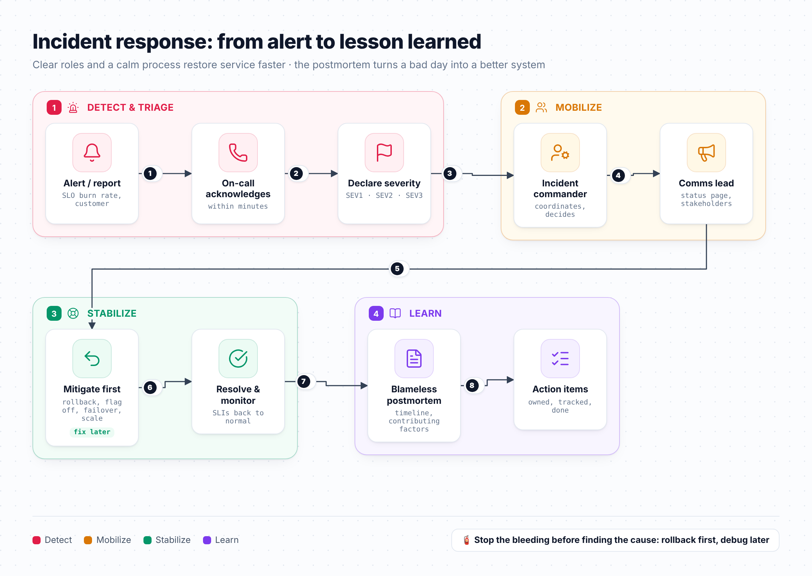

# 16.3 — Incidents, on-call & postmortems

!!! abstract "In short"
    Incidents will happen. What matters is how fast and calmly you **restore service** and how well you **learn**. A
    **sustainable on-call** is paged only for **user-visible symptoms** and declares a **severity**. An **incident
    commander** coordinates while others investigate and **communicate**, and the team **mitigates first** (rollback,
    flag off, failover). A **blameless postmortem** then turns the incident into **action items** that make the system
    stronger.

## 📖 Key terms & abbreviations

| Term | Stands for | What it is | How it works (one line) |
|---|---|---|---|
| **Incident** | — | Unplanned degradation of a service | Declared, managed, closed |
| **On-call** | — | Person responsible for responding | Rotations, primary + secondary |
| **Page** | — | Urgent alert to a human | Must be actionable and urgent |
| **SEV / severity** | — | Impact level | SEV1 major outage … SEV3 minor |
| **IC** | Incident Commander | Coordinates the response | Delegates, decides, doesn't debug |
| **Comms lead** | — | Internal and external updates | Status page, stakeholders |
| **Ops / subject matter lead** | — | Hands-on investigation and changes | One person changes prod at a time |
| **MTTA / MTTR** | Mean Time To Acknowledge / Restore | Response speed metrics | Trend, not target |
| **Mitigation** | — | Stop user impact | Rollback, flag off, failover, shed load |
| **Runbook / playbook** | — | Step-by-step response guide | Linked from alerts |
| **Postmortem / incident review** | — | Written analysis after resolution | Timeline, contributing factors, actions |
| **Blameless** | — | Focus on systems, not individuals | Psychological safety → honest data |

## 🗺️ Big picture



---

## 1 · On-call that people can sustain

- **Page only for symptoms users feel**: SLO burn-rate alerts, error rates, availability (9.5). Causes (CPU 90%, one pod restarting) go to dashboards or tickets.
- **Every page needs a runbook link** and must be actionable; review noisy alerts weekly and delete or fix them.
- **Rotations** of at least 6–8 people, primary + secondary, follow-the-sun if possible; compensate on-call time.
- **Handover** at the end of each shift: open issues, risky changes, flaky alerts.
- Healthy target (Google SRE): at most a couple of incidents per 12-hour shift, so there's time to handle them well and follow up.

## 2 · Running an incident

### How does it work?

1. **Acknowledge** the page quickly; assess impact (who, how many, since when).
2. **Declare** an incident and a **severity** early; it's cheap to downgrade, expensive to be late. Open a dedicated channel and a call.
3. **Assign roles**: the **incident commander** coordinates and decides; an **ops lead** investigates and makes changes; a **comms lead** updates stakeholders and the status page; a scribe keeps the timeline.
4. **Mitigate first**: what changed recently? Roll back the deploy, turn off the flag, fail over, scale up, block the bad traffic. Root cause can wait; users can't.
5. **Communicate** on a fixed cadence (e.g. every 30 minutes for SEV1): what we know, what we're doing, next update time.
6. **Resolve** when SLIs are back to normal; keep monitoring; hand over clearly if the incident lasts long.

| Severity | Example | Response |
|---|---|---|
| SEV1 | Checkout down for everyone, data loss | All hands, IC, exec + customer comms |
| SEV2 | Major feature degraded, one region down | IC + team, status page |
| SEV3 | Minor feature broken, workaround exists | Team handles in working hours |

## 3 · Blameless postmortems

Within a few days, write a postmortem for every significant incident (and interesting near-misses):

- **Summary and impact**: duration, users affected, SLO budget consumed, money/data impact.
- **Timeline**: detection, key decisions, mitigation, resolution, with timestamps.
- **Contributing factors**: technical (missing test, risky config, capacity) and organisational (unclear ownership, alert fatigue, missing runbook). There's rarely a single "root cause".
- **What went well / where we got lucky**.
- **Action items**: specific, owned, with due dates, prioritised against feature work; track until done.

**Blameless** doesn't mean nobody is accountable; it means asking "how did the system make this action seem reasonable?" instead of "who messed up?". People who fear blame hide information, and then the same incident happens again.

## 4 · Learning beyond single incidents

- Review postmortems **across** incidents quarterly: recurring themes (deploys, config, a fragile dependency) deserve investment.
- Use **error budgets** (9.5): when a service burns its budget, reliability work takes priority over features.
- Practise: **game days** and chaos experiments (12, 14.4), incident simulations ("wheel of misfortune") for new on-call engineers.
- Share postmortems widely; a good one teaches other teams for years.

## 🔧 DevOps connection

- Tooling: paging and schedules (PagerDuty, Opsgenie, Grafana OnCall/IRM), incident bots in Slack/Teams, status pages, postmortem templates.
- Correlate incidents with **changes**: deploys, flag flips and infra applies on the same timeline (16.2).
- Track **MTTA, MTTR, incidents per service, alert noise** as trends; use them to improve the system, not to judge people.
- Most incidents start with a change: safe rollout practices (16.2) are your best incident prevention.

## 🧪 Try it yourself

```bash
# A postmortem template you can drop into your repo
mkdir -p postmortems && cat > postmortems/TEMPLATE.md <<'EOF'
# Postmortem: <title>            Severity: SEVx   Status: draft
Date: YYYY-MM-DD   Authors: <names>   Incident commander: <name>

## Summary
<2–3 sentences: what happened, impact, how it was resolved>

## Impact
- Duration: hh:mm (detected after mm minutes)
- Users / requests affected:
- SLO error budget consumed:

## Timeline (UTC)
| Time | Event |
|---|---|
| 14:02 | Alert: checkout error rate > 5% |

## Contributing factors
- Technical:
- Process / organisational:

## What went well / where we got lucky

## Action items
| Action | Owner | Due | Ticket |
|---|---|---|---|
EOF
echo "template written: postmortems/TEMPLATE.md"

# Find your noisiest alerts (Prometheus): alerts firing most often in the last 7 days
# topk(10, count by (alertname) (changes(ALERTS{alertstate="firing"}[7d]) > 0))
```

## 🃏 Cheat sheet

| Moment | Remember |
|---|---|
| Page arrives | Acknowledge, assess impact, declare early |
| First 10 minutes | Assign IC, open channel, check recent changes |
| Choosing actions | Mitigate first: rollback, flag off, failover |
| During | One person changes prod, comms on a cadence |
| After | Blameless postmortem within days |
| Action items | Owned, dated, tracked, prioritised |
| Over time | Fix noisy alerts, invest in recurring themes |

## ❓ Test yourself

??? question "1. What should page a human at night, and what shouldn't?"
    Urgent, actionable, user-visible symptoms (SLO burn, high error rate, service down) should page; causes and non-urgent signals (high CPU, a single pod restart, disk at 70%) go to dashboards or tickets.

??? question "2. Why should the incident commander usually not debug?"
    Their job is coordination: keeping the big picture, assigning work, making decisions and ensuring communication. Debugging pulls them into details and leaves nobody steering.

??? question "3. Why mitigate before finding the root cause?"
    Users are affected right now; rolling back, disabling a flag or failing over usually restores service in minutes, while root cause analysis can take hours and is safer afterwards.

??? question "4. What makes a postmortem blameless, and why does it matter?"
    It focuses on how the system and process allowed the failure rather than who made a mistake; without fear of blame people share what really happened, so the right fixes are found.

??? question "5. What makes a good postmortem action item?"
    Specific, with an owner, a due date and a ticket, addressing a contributing factor (not "be more careful"), and actually prioritised and tracked to completion.

---

## 📚 Sources

- [Google SRE Book — Managing incidents](https://sre.google/sre-book/managing-incidents/) · [Postmortem culture](https://sre.google/sre-book/postmortem-culture/)
- [Google SRE Book — Being on-call](https://sre.google/sre-book/being-on-call/)
- [PagerDuty — Incident Response documentation](https://response.pagerduty.com/)
- [Atlassian — Incident management handbook](https://www.atlassian.com/incident-management/handbook)
- [learningfromincidents.io](https://www.learningfromincidents.io/)

## ✍️ My notes

> Look at last month's pages. How many were actionable, user-visible symptoms? Which alert would you delete first?
