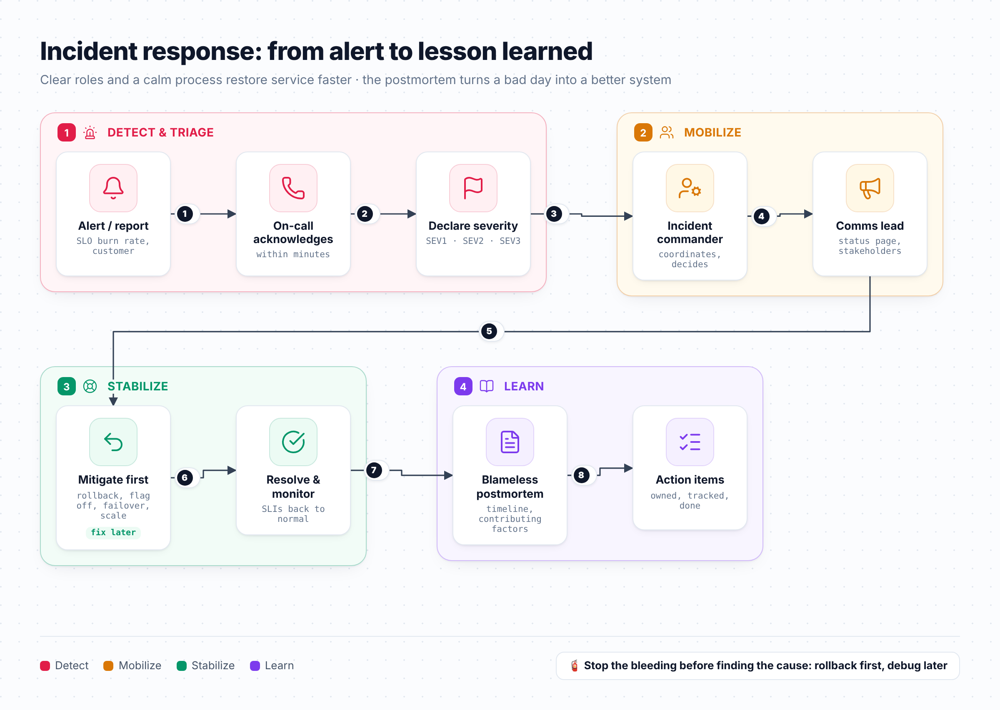

# 16.3 — Olaylar, nöbet ve postmortem'ler

!!! abstract "Tek cümlede"
    Olaylar olacak; önemli olan hizmeti ne kadar hızlı ve sakin **geri getirdiğin** ve ne kadar iyi **öğrendiğindir**:
    **sürdürülebilir bir nöbet** sadece **kullanıcının hissettiği belirtiler** için çağrılır, bir **önem seviyesi** ilan
    eder, diğerleri araştırıp **iletişim kurarken** bir **olay komutanı** koordine eder, ekip **önce hafifletir** (geri al,
    flag'i kapat, failover) ve sonra düzeltir, **suçlamasız bir postmortem** de olayı sistemi ve organizasyonu
    güçlendiren **aksiyon maddelerine** dönüştürür.

## 📖 Temel terimler ve kısaltmalar

| Terim | Açılımı | Nedir | Nasıl çalışır (tek satır) |
|---|---|---|---|
| **Olay** | Incident | Bir servisin plansız bozulması | İlan edilir, yönetilir, kapatılır |
| **Nöbet** | On-call | Müdahaleden sorumlu kişi | Rotasyonlar, birincil + ikincil |
| **Çağrı** | Page | Bir insana acil alarm | Aksiyon alınabilir ve acil olmalı |
| **SEV / önem seviyesi** | Severity | Etki seviyesi | SEV1 büyük kesinti … SEV3 küçük |
| **IC** | Incident Commander | Müdahaleyi koordine eder | Görev dağıtır, karar verir, debug etmez |
| **İletişim sorumlusu** | Comms lead | İç ve dış güncellemeler | Durum sayfası, paydaşlar |
| **Operasyon / konu uzmanı sorumlusu** | Ops lead | Uygulamalı araştırma ve değişiklikler | Prod'u aynı anda tek kişi değiştirir |
| **MTTA / MTTR** | Mean Time To Acknowledge / Restore | Müdahale hızı metrikleri | Eğilim, hedef değil |
| **Hafifletme** | Mitigation | Kullanıcı etkisini durdurmak | Geri al, flag kapat, failover, yük at |
| **Runbook / playbook** | — | Adım adım müdahale rehberi | Alarmlardan link verilir |
| **Postmortem / olay incelemesi** | — | Çözümden sonra yazılı analiz | Zaman çizelgesi, katkıda bulunan etkenler, aksiyonlar |
| **Suçlamasız** | Blameless | Bireylere değil sistemlere odak | Psikolojik güvenlik → dürüst veri |

## 🗺️ Büyük resim



---

## 1 · İnsanların sürdürebileceği nöbet

- **Sadece kullanıcıların hissettiği belirtiler için çağır**: SLO burn-rate alarmları, hata oranları, erişilebilirlik (9.5). Sebepler (CPU %90, yeniden başlayan tek bir pod) dashboard'lara ya da ticket'lara gider.
- **Her çağrının bir runbook linki olmalı** ve aksiyon alınabilir olmalı; gürültülü alarmları haftalık gözden geçir ve sil ya da düzelt.
- En az 6–8 kişilik **rotasyonlar**, birincil + ikincil, mümkünse güneşi takip eden; nöbet süresini telafi et.
- Her vardiyanın sonunda **devir**: açık sorunlar, riskli değişiklikler, kararsız alarmlar.
- Sağlıklı hedef (Google SRE): 12 saatlik vardiya başına en fazla birkaç olay; böylece onları iyi ele almak ve takip etmek için zaman kalır.

## 2 · Bir olayı yürütmek

### Nasıl çalışır?

1. Çağrıyı hızla **onayla**; etkiyi değerlendir (kim, kaç kişi, ne zamandan beri).
2. Erken bir olay ve **önem seviyesi** **ilan et**; seviyeyi düşürmek ucuz, geç kalmak pahalıdır. Özel bir kanal ve bir görüşme aç.
3. **Rolleri ata**: **olay komutanı** koordine eder ve karar verir; bir **operasyon sorumlusu** araştırır ve değişiklik yapar; bir **iletişim sorumlusu** paydaşları ve durum sayfasını günceller; bir yazıcı zaman çizelgesini tutar.
4. **Önce hafiflet**: son zamanlarda ne değişti? Deploy'u geri al, flag'i kapat, failover yap, büyüt, kötü trafiği engelle. Kök neden bekleyebilir; kullanıcılar bekleyemez.
5. Sabit bir sıklıkta **iletişim kur** (ör. SEV1 için her 30 dakikada): ne biliyoruz, ne yapıyoruz, sonraki güncelleme ne zaman.
6. SLI'lar normale dönünce **çöz**; izlemeye devam et; olay uzun sürerse devri net yap.

| Önem | Örnek | Müdahale |
|---|---|---|
| SEV1 | Ödeme herkes için kapalı, veri kaybı | Herkes, IC, yönetim + müşteri iletişimi |
| SEV2 | Büyük bir özellik bozuk, bir bölge kapalı | IC + ekip, durum sayfası |
| SEV3 | Küçük bir özellik bozuk, geçici çözüm var | Ekip mesai saatlerinde halleder |

## 3 · Suçlamasız postmortem'ler

Birkaç gün içinde her önemli olay (ve ilginç ramak kala olaylar) için bir postmortem yaz:

- **Özet ve etki**: süre, etkilenen kullanıcılar, tüketilen SLO bütçesi, para/veri etkisi.
- **Zaman çizelgesi**: tespit, önemli kararlar, hafifletme, çözüm; zaman damgalarıyla.
- **Katkıda bulunan etkenler**: teknik (eksik test, riskli yapılandırma, kapasite) ve organizasyonel (belirsiz sahiplik, alarm yorgunluğu, eksik runbook). Nadiren tek bir "kök neden" vardır.
- **Neler iyi gitti / nerede şanslıydık**.
- **Aksiyon maddeleri**: somut, sahipli, tarihli, özellik işlerine karşı önceliklendirilmiş; bitene kadar takip edilen.

**Suçlamasız** kimsenin sorumlu olmadığı anlamına gelmez; "kim hata yaptı?" yerine "sistem bu eylemi nasıl makul gösterdi?" diye sormak demektir. Suçlanmaktan korkan insanlar bilgi saklar ve aynı olay tekrar yaşanır.

## 4 · Tek tek olayların ötesinde öğrenmek

- Postmortem'leri üç ayda bir olaylar **arası** gözden geçir: tekrarlayan temalar (deploy'lar, yapılandırma, kırılgan bir bağımlılık) yatırımı hak eder.
- **Hata bütçeleri** kullan (9.5): bir servis bütçesini tükettiğinde güvenilirlik işi özelliklerin önüne geçer.
- Pratik yap: **game day'ler** ve kaos deneyleri (12, 14.4), yeni nöbetçiler için olay simülasyonları ("talihsizlik çarkı").
- Postmortem'leri geniş paylaş; iyi bir tanesi diğer ekiplere yıllarca öğretir.

## 🔧 DevOps bağlantısı

- Araçlar: çağrı ve takvimler (PagerDuty, Opsgenie, Grafana OnCall/IRM), Slack/Teams'te olay botları, durum sayfaları, postmortem şablonları.
- Olayları **değişikliklerle** ilişkilendir: aynı zaman çizelgesinde deploy'lar, flag değişiklikleri ve altyapı apply'ları (16.2).
- **MTTA, MTTR, servis başına olaylar, alarm gürültüsünü** eğilim olarak izle; insanları yargılamak için değil, sistemi iyileştirmek için kullan.
- Çoğu olay bir değişiklikle başlar: güvenli rollout pratikleri (16.2) en iyi olay önleyicindir.

## 🧪 Kendin dene

```bash
# Repona koyabileceğin bir postmortem şablonu
mkdir -p postmortems && cat > postmortems/TEMPLATE.md <<'EOF'
# Postmortem: <başlık>            Önem: SEVx   Durum: taslak
Tarih: YYYY-AA-GG   Yazarlar: <isimler>   Olay komutanı: <isim>

## Özet
<2–3 cümle: ne oldu, etki, nasıl çözüldü>

## Etki
- Süre: ss:dd (dd dakika sonra tespit edildi)
- Etkilenen kullanıcılar / istekler:
- Tüketilen SLO hata bütçesi:

## Zaman çizelgesi (UTC)
| Saat | Olay |
|---|---|
| 14:02 | Alarm: ödeme hata oranı > %5 |

## Katkıda bulunan etkenler
- Teknik:
- Süreç / organizasyonel:

## Neler iyi gitti / nerede şanslıydık

## Aksiyon maddeleri
| Aksiyon | Sahip | Tarih | Ticket |
|---|---|---|---|
EOF
echo "şablon yazıldı: postmortems/TEMPLATE.md"

# En gürültülü alarmlarını bul (Prometheus): son 7 günde en sık tetiklenen alarmlar
# topk(10, count by (alertname) (changes(ALERTS{alertstate="firing"}[7d]) > 0))
```

## 🃏 Hatırlatma kartı

| An | Hatırla |
|---|---|
| Çağrı geldi | Onayla, etkiyi değerlendir, erken ilan et |
| İlk 10 dakika | IC ata, kanal aç, son değişikliklere bak |
| Aksiyon seçmek | Önce hafiflet: geri al, flag kapat, failover |
| Sırasında | Prod'u tek kişi değiştirir, düzenli iletişim |
| Sonrasında | Günler içinde suçlamasız postmortem |
| Aksiyon maddeleri | Sahipli, tarihli, takip edilen, önceliklendirilmiş |
| Zamanla | Gürültülü alarmları düzelt, tekrarlayan temalara yatırım yap |

## ❓ Kendini test et

??? question "1. Gece bir insanı ne çağırmalı, ne çağırmamalı?"
    Acil, aksiyon alınabilir, kullanıcının gördüğü belirtiler (SLO burn, yüksek hata oranı, servis kapalı) çağırmalı; sebepler ve acil olmayan sinyaller (yüksek CPU, tek bir pod'un yeniden başlaması, %70 dolu disk) dashboard'lara ya da ticket'lara gitmeli.

??? question "2. Olay komutanı neden genelde debug etmemeli?"
    Görevi koordinasyondur: büyük resmi korumak, iş dağıtmak, karar vermek ve iletişimi sağlamak. Debug etmek onu detaylara çeker ve dümende kimse kalmaz.

??? question "3. Kök nedeni bulmadan önce neden hafifletilir?"
    Kullanıcılar şu anda etkileniyor; geri almak, bir flag'i kapatmak ya da failover genelde hizmeti dakikalar içinde geri getirir; kök neden analizi saatler sürebilir ve sonrasında daha güvenlidir.

??? question "4. Bir postmortem'i suçlamasız yapan nedir ve neden önemlidir?"
    Kimin hata yaptığına değil, sistemin ve sürecin hataya nasıl izin verdiğine odaklanır; suçlanma korkusu olmadan insanlar gerçekte ne olduğunu paylaşır ve doğru düzeltmeler bulunur.

??? question "5. İyi bir postmortem aksiyon maddesini ne yapar?"
    Somut olması; bir sahibi, bitiş tarihi ve ticket'ı olması; katkıda bulunan bir etkeni ele alması ("daha dikkatli ol" değil) ve gerçekten önceliklendirilip tamamlanana kadar takip edilmesi.

---

## 📚 Kaynaklar

- [Google SRE Book — Managing incidents](https://sre.google/sre-book/managing-incidents/) · [Postmortem culture](https://sre.google/sre-book/postmortem-culture/)
- [Google SRE Book — Being on-call](https://sre.google/sre-book/being-on-call/)
- [PagerDuty — Incident Response documentation](https://response.pagerduty.com/)
- [Atlassian — Incident management handbook](https://www.atlassian.com/incident-management/handbook)
- [learningfromincidents.io](https://www.learningfromincidents.io/)

## ✍️ Notlarım

> Geçen ayın çağrılarına bak. Kaçı aksiyon alınabilir, kullanıcının gördüğü belirtilerdi? İlk hangi alarmı silerdin?

-
