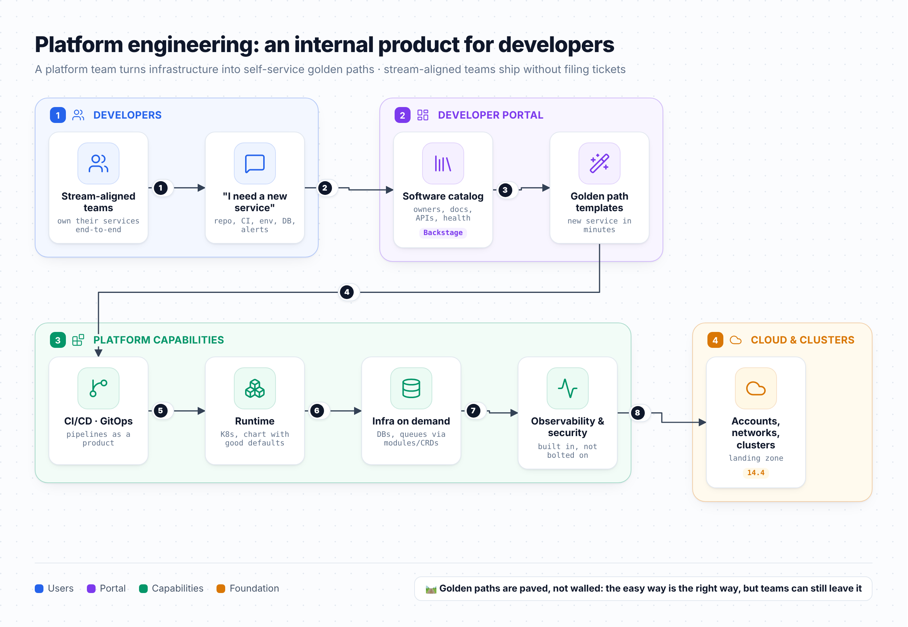

# 16.4 — Platform engineering & developer experience

!!! abstract "In short"
    When every product team must master Kubernetes, Terraform, CI, security and observability, delivery slows down. So a
    **platform team** builds an **internal product**. It offers **golden paths** that make the right way the easy way, a
    **developer portal** showing who owns what, and **self-service** APIs for environments, databases and pipelines. It
    succeeds when developers **choose** it because it lowers their **cognitive load** and helps them ship.

## 📖 Key terms & abbreviations

| Term | Stands for | What it is | How it works (one line) |
|---|---|---|---|
| **Platform engineering** | — | Building self-service internal platforms | Product mindset for infrastructure |
| **IDP** | Internal Developer Platform | The sum of tools/APIs teams self-serve from | CI/CD, runtime, infra, observability |
| **Developer portal** | — | UI front door to the platform | Catalog, docs, templates, scorecards |
| **Backstage** | — | CNCF open-source developer portal framework | Plugins, software catalog, scaffolder |
| **Golden path / paved road** | — | Opinionated, supported way to do a task | "New Go service" template with everything wired |
| **Cognitive load** | — | Mental effort a team must spend | Platform removes extraneous load |
| **Team Topologies** | — | Four team types, three interaction modes | Stream-aligned, platform, enabling, complicated-subsystem |
| **Stream-aligned team** | — | Owns a flow of business value | The platform's main customer |
| **X-as-a-Service** | — | Interaction mode with low coordination | Use the platform without meetings |
| **Scorecard** | — | Checks services against standards | Owner set, SLOs defined, on supported runtime |
| **DevEx / DX** | Developer Experience | How easy and pleasant it is to deliver | Surveys + flow metrics |
| **Ticket-ops** | — | Anti-pattern: platform via tickets | Waiting days for a database |

## 🗺️ Big picture



---

## 1 · Why platforms emerged

### How does it work?

"You build it, you run it" (16) gave teams ownership, but also a long list of things to know: containers, Kubernetes manifests, Helm, Terraform, IAM, secrets, CI pipelines, observability, security scanning, cost. Each team reinventing these leads to inconsistency, duplicated effort and slow delivery.

**Team Topologies** suggests a split:

- **Stream-aligned teams** focus on business features and own their services.
- A **platform team** provides internal services **as a product** that reduce the stream teams' cognitive load.
- **Enabling teams** coach (e.g. SRE or security specialists helping teams adopt practices).
- **Complicated-subsystem teams** own parts needing deep expertise (a video codec, a pricing engine).

## 2 · Golden paths

A golden path is a **complete, supported route** for a common task, for example "create a new HTTP service":

1. Pick the template in the portal, enter a name and owner team.
2. The platform creates the **repo** (code skeleton, Dockerfile, tests), **CI pipeline** (build, scan, sign, 11), **deployment config** (Helm chart with probes, PDB, HPA, 15), **GitOps entries** for dev/staging/prod (9.4), **dashboards and SLO alerts** (9.5), **catalog entry** with owner and docs.
3. Ten minutes later, "hello world" runs in dev with all the production practices built in.

Golden paths are **paved, not walled**: teams can leave them for good reasons, but then they own the extra complexity.

## 3 · The developer portal

- **Software catalog**: every service, API, library, database and pipeline with its **owner**, on-call, docs, dependencies and health; the answer to "who owns this?" during an incident (16.3).
- **Templates / scaffolder**: golden paths as forms.
- **TechDocs**: docs-as-code next to the service, rendered in one place.
- **Scorecards**: is the service on a supported runtime, does it have SLOs, a runbook, no critical CVEs? Visible gamified progress instead of mandates.
- Backstage is the common open-source choice; commercial portals (Port, Cortex, OpsLevel) trade flexibility for less maintenance.

## 4 · Self-service infrastructure

Behind the portal, capabilities are exposed as **APIs**, not tickets:

- **Terraform modules** in a registry, applied by pipelines (14.3).
- **Kubernetes-native** APIs: Crossplane compositions or operators (`kind: Database`, `kind: Bucket`) reconciled into cloud resources (15.3).
- **Environment/namespace vending** with quotas, network policies, RBAC and cost tags (11, 13).
- **Account vending** in the landing zone (14.4).

The platform keeps **guardrails** in code (policies, defaults, budgets) so self-service stays safe.

## 5 · Platform as a product

- Have a **product manager** mindset: user research with developers, a roadmap, release notes, docs, support channels.
- Start with the **thinnest viable platform**: maybe just a great template, a wiki and a CI library. Build what's painful for many teams, buy or adopt what's commodity.
- **Measure**: adoption, time to first deploy for a new service, lead time and change failure rate (DORA), developer satisfaction surveys, support requests per team.
- **Anti-patterns**: ticket-ops (requests wait days), mandating the platform instead of earning adoption, a platform team that builds for itself, rewriting the whole stack before delivering any value.

## 🔧 DevOps connection

- Many "DevOps engineer" roles are effectively **platform engineers**: the deliverable is no longer a pipeline per team, but a product all teams use.
- Everything in Chapters 9–15 becomes **platform building blocks**: secure CI (11), cost visibility (13), landing zones (14.4), golden charts and autoscaling defaults (15).
- Treat internal users like customers: watch them use the platform, fix the friction they hit, celebrate removed toil.

## 🧪 Try it yourself

```bash
# Run Backstage locally (Node 20/22 + yarn needed) and explore the catalog and templates
npx @backstage/create-app@latest --path my-portal   # answers: name of the app
cd my-portal && yarn start                          # http://localhost:3000

# Describe a service so it shows up in a Backstage catalog
cat > catalog-info.yaml <<'EOF'
apiVersion: backstage.io/v1alpha1
kind: Component
metadata:
  name: checkout
  description: Takes payment and creates orders
  annotations:
    github.com/project-slug: acme/checkout
    pagerduty.com/service-id: PXXXXXX
  tags: [go, payments]
spec:
  type: service
  lifecycle: production
  owner: team-payments
  system: shop
  providesApis: [checkout-api]
  dependsOn: [resource:orders-db]
EOF
echo "catalog-info.yaml created"
```

## 🃏 Cheat sheet

| Question | Platform answer |
|---|---|
| "How do I create a new service?" | Golden path template in the portal |
| "Who owns this?" | Software catalog with owners and on-call |
| "I need a database" | Self-service API/module with guardrails |
| "Is my service production-ready?" | Scorecard checks |
| "How do we know the platform helps?" | Adoption, DORA, time to first deploy, DevEx surveys |
| "Must everyone use it?" | Paved road, not a wall: earn adoption |

## ❓ Test yourself

??? question "1. What problem does platform engineering solve?"
    The growing cognitive load on product teams who must master many infrastructure tools; a platform provides self-service, opinionated paths so they can focus on business value.

??? question "2. What is a golden path?"
    A supported, end-to-end, opinionated way to accomplish a common task (e.g. creating a service) with best practices built in; teams can deviate but then own the extra complexity.

??? question "3. What is the software catalog for?"
    A single place listing services, APIs and resources with owners, docs, dependencies and health, used for discovery, standards and incident response.

??? question "4. Why is 'ticket-ops' an anti-pattern?"
    Requests wait in queues for humans, creating delays and bottlenecks; self-service APIs with guardrails give the same control without the wait.

??? question "5. How do you know an internal platform is successful?"
    Teams adopt it voluntarily, delivery metrics (lead time, deploy frequency, change failure rate) and time-to-first-deploy improve, and developer satisfaction rises.

---

## 📚 Sources

- [CNCF — Platforms white paper](https://tag-app-delivery.cncf.io/whitepapers/platforms/)
- [Team Topologies — key concepts](https://teamtopologies.com/key-concepts)
- [Backstage documentation](https://backstage.io/docs/overview/what-is-backstage)
- [platformengineering.org — What is platform engineering?](https://platformengineering.org/blog/what-is-platform-engineering)
- [DORA — Platform engineering in the State of DevOps research](https://dora.dev/research/)

## ✍️ My notes

> What are the three most repetitive requests your team gets from developers? Which could become a self-service golden path?
