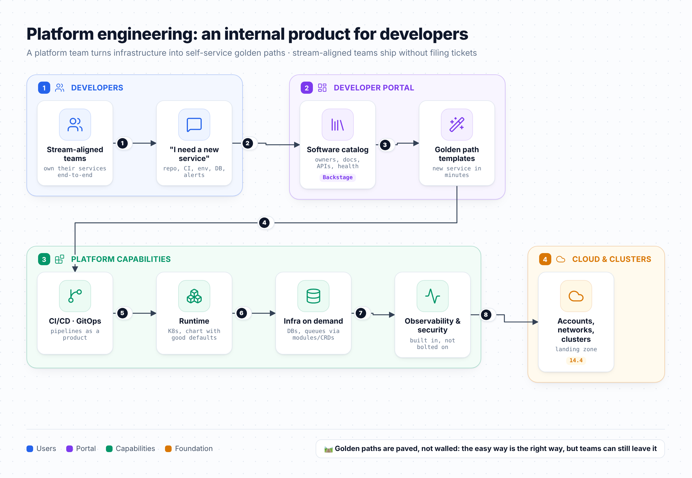

# 16.4 — Platform mühendisliği ve geliştirici deneyimi

!!! abstract "Kısaca"
    Her ürün ekibi Kubernetes, Terraform, CI, güvenlik ve gözlemlenebilirlikte uzmanlaşmak zorunda kalınca teslim
    yavaşlar. Bu yüzden bir **platform ekibi** bir **iç ürün** inşa eder: **altın yollar** (doğru yolu kolay yol yapan
    şablonlar ve varsayılanlar), neyin kime ait olduğunu ve işlerin nasıl yapılacağını gösteren bir **geliştirici
    portalı** ve ortamlar, veritabanları ve pipeline'lar için **self-servis** API'ler. Geliştiriciler onu **bilişsel
    yüklerini** azalttığı ve göndermelerine yardım ettiği için **gönüllü seçtiklerinde** başarılı olur. Teslim ve
    geliştirici deneyimi metrikleriyle ölçülür.

## 📖 Temel terimler ve kısaltmalar

| Terim | Açılımı | Nedir | Nasıl çalışır (tek satır) |
|---|---|---|---|
| **Platform mühendisliği** | Platform engineering | Self-servis iç platformlar inşa etmek | Altyapı için ürün bakışı |
| **IDP** | Internal Developer Platform | Ekiplerin self-servis kullandığı araç/API toplamı | CI/CD, çalışma ortamı, altyapı, gözlemlenebilirlik |
| **Geliştirici portalı** | Developer portal | Platformun arayüz kapısı | Katalog, dokümanlar, şablonlar, puan kartları |
| **Backstage** | — | CNCF açık kaynak geliştirici portalı çatısı | Eklentiler, yazılım kataloğu, iskelet üretici |
| **Altın yol / asfalt yol** | Golden path / paved road | Bir iş için görüşlü, desteklenen yol | Her şeyi bağlanmış "Yeni Go servisi" şablonu |
| **Bilişsel yük** | Cognitive load | Bir ekibin harcaması gereken zihinsel çaba | Platform gereksiz yükü kaldırır |
| **Team Topologies** | — | Dört ekip tipi, üç etkileşim modu | Akışa hizalı, platform, destekleyici, karmaşık alt sistem |
| **Akışa hizalı ekip** | Stream-aligned team | Bir iş değeri akışına sahip | Platformun ana müşterisi |
| **X-as-a-Service** | — | Az koordinasyonlu etkileşim modu | Platformu toplantısız kullan |
| **Puan kartı** | Scorecard | Servisleri standartlara göre kontrol eder | Sahibi var, SLO tanımlı, desteklenen runtime'da |
| **DevEx / DX** | Developer Experience | Teslimin ne kadar kolay ve keyifli olduğu | Anketler + akış metrikleri |
| **Ticket-ops** | — | Karşı desen: ticket'larla platform | Bir veritabanı için günlerce beklemek |

## 🗺️ Büyük resim



---

## 1 · Platformlar neden ortaya çıktı

### Nasıl çalışır?

"Sen yaptın, sen çalıştır" (16) ekiplere sahiplik verdi ama aynı zamanda bilinmesi gereken uzun bir liste: container'lar, Kubernetes manifest'leri, Helm, Terraform, IAM, secret'lar, CI pipeline'ları, gözlemlenebilirlik, güvenlik taraması, maliyet. Her ekibin bunları yeniden icat etmesi tutarsızlığa, tekrarlanan emeğe ve yavaş teslime yol açar.

**Team Topologies** bir ayrım önerir:

- **Akışa hizalı ekipler** iş özelliklerine odaklanır ve servislerine sahiptir.
- Bir **platform ekibi**, akış ekiplerinin bilişsel yükünü azaltan iç servisleri **bir ürün olarak** sunar.
- **Destekleyici ekipler** koçluk yapar (ör. ekiplerin pratikleri benimsemesine yardım eden SRE ya da güvenlik uzmanları).
- **Karmaşık alt sistem ekipleri** derin uzmanlık gerektiren parçalara sahiptir (bir video codec'i, bir fiyatlandırma motoru).

## 2 · Altın yollar

Bir altın yol yaygın bir iş için **eksiksiz, desteklenen bir rotadır**; örneğin "yeni bir HTTP servisi oluştur":

1. Portalda şablonu seç, bir isim ve sahip ekip gir.
2. Platform **repoyu** (kod iskeleti, Dockerfile, testler), **CI pipeline'ını** (build, tarama, imzalama, 11), **deploy yapılandırmasını** (probe'lar, PDB, HPA'lı Helm chart'ı, 15), dev/staging/prod için **GitOps girdilerini** (9.4), **dashboard ve SLO alarmlarını** (9.5) ve sahip ve dokümanlarla **katalog girdisini** oluşturur.
3. On dakika sonra "hello world" tüm production pratikleri içine gömülü olarak dev'de çalışır.

Altın yollar **asfalttır, duvar değil**: ekipler iyi sebeplerle onlardan ayrılabilir ama o zaman ek karmaşıklığa da sahip olurlar.

## 3 · Geliştirici portalı

- **Yazılım kataloğu**: her servis, API, kütüphane, veritabanı ve pipeline; **sahibi**, nöbetçisi, dokümanları, bağımlılıkları ve sağlığıyla; bir olay sırasında "bunun sahibi kim?" sorusunun cevabı (16.3).
- **Şablonlar / iskelet üretici**: form olarak altın yollar.
- **TechDocs**: servisin yanında kod olarak doküman, tek yerde üretilmiş.
- **Puan kartları**: servis desteklenen bir runtime'da mı, SLO'su, runbook'u var mı, kritik CVE'si yok mu? Zorunluluklar yerine görünür, oyunlaştırılmış ilerleme.
- Backstage yaygın açık kaynak seçimdir; ticari portallar (Port, Cortex, OpsLevel) daha az bakım için esneklikten feragat eder.

## 4 · Self-servis altyapı

Portalın arkasında yetenekler ticket olarak değil **API** olarak sunulur:

- Bir registry'de, pipeline'larla uygulanan **Terraform modülleri** (14.3).
- **Kubernetes'e özgü** API'ler: bulut kaynaklarına uzlaştırılan Crossplane kompozisyonları ya da operator'ler (`kind: Database`, `kind: Bucket`) (15.3).
- Kotalar, ağ politikaları, RBAC ve maliyet etiketleriyle **ortam/namespace üretimi** (11, 13).
- Landing zone'da **hesap üretimi** (14.4).

Platform **korkulukları** kodda tutar (politikalar, varsayılanlar, bütçeler); böylece self-servis güvenli kalır.

## 5 · Ürün olarak platform

- **Ürün yöneticisi** bakışına sahip ol: geliştiricilerle kullanıcı araştırması, bir yol haritası, sürüm notları, dokümanlar, destek kanalları.
- **En ince uygulanabilir platformla** başla: belki sadece harika bir şablon, bir wiki ve bir CI kütüphanesi. Birçok ekip için acı verici olanı inşa et, sıradan olanı satın al ya da benimse.
- **Ölç**: benimseme, yeni bir servis için ilk deploy'a kadar geçen süre, teslim süresi ve değişiklik hata oranı (DORA), geliştirici memnuniyet anketleri, ekip başına destek talepleri.
- **Karşı desenler**: ticket-ops (talepler günlerce bekler), benimsemeyi kazanmak yerine platformu zorunlu kılmak, kendisi için inşa eden bir platform ekibi, hiçbir değer teslim etmeden tüm yığını yeniden yazmak.

## 🔧 DevOps bağlantısı

- Birçok "DevOps mühendisi" rolü aslında **platform mühendisidir**: teslim edilen şey artık ekip başına bir pipeline değil, tüm ekiplerin kullandığı bir üründür.
- Bölüm 9–15'teki her şey **platform yapı taşlarına** dönüşür: güvenli CI (11), maliyet görünürlüğü (13), landing zone'lar (14.4), altın chart'lar ve ölçekleme varsayılanları (15).
- İç kullanıcılara müşteri gibi davran: platformu kullanmalarını izle, karşılaştıkları sürtünmeyi gider, kaldırılan angaryayı kutla.

## 🧪 Kendin dene

```bash
# Backstage'i yerelde çalıştır (Node 20/22 + yarn gerekir) ve kataloğu ve şablonları keşfet
npx @backstage/create-app@latest --path my-portal   # cevaplar: uygulamanın adı
cd my-portal && yarn start                          # http://localhost:3000

# Bir servisi Backstage kataloğunda görünecek şekilde tarif et
cat > catalog-info.yaml <<'EOF'
apiVersion: backstage.io/v1alpha1
kind: Component
metadata:
  name: checkout
  description: Takes payment and creates orders
  annotations:
    github.com/project-slug: acme/checkout
    pagerduty.com/service-id: PXXXXXX
  tags: [go, payments]
spec:
  type: service
  lifecycle: production
  owner: team-payments
  system: shop
  providesApis: [checkout-api]
  dependsOn: [resource:orders-db]
EOF
echo "catalog-info.yaml oluşturuldu"
```

## 🃏 Hatırlatma kartı

| Soru | Platformun cevabı |
|---|---|
| "Yeni bir servisi nasıl oluştururum?" | Portalda altın yol şablonu |
| "Bunun sahibi kim?" | Sahipleri ve nöbetçileriyle yazılım kataloğu |
| "Bir veritabanına ihtiyacım var" | Korkuluklu self-servis API/modül |
| "Servisim production'a hazır mı?" | Puan kartı kontrolleri |
| "Platformun yardım ettiğini nereden biliyoruz?" | Benimseme, DORA, ilk deploy süresi, DevEx anketleri |
| "Herkes kullanmak zorunda mı?" | Asfalt yol, duvar değil: benimsemeyi kazan |

## ❓ Kendini test et

??? question "1. Platform mühendisliği hangi sorunu çözer?"
    Birçok altyapı aracında uzmanlaşmak zorunda kalan ürün ekiplerinin artan bilişsel yükünü; platform self-servis, görüşlü yollar sunar ve ekipler iş değerine odaklanabilir.

??? question "2. Altın yol nedir?"
    Yaygın bir işi (ör. servis oluşturmak) en iyi pratikler içine gömülü olarak yapmanın desteklenen, uçtan uca, görüşlü bir yolu; ekipler sapabilir ama o zaman ek karmaşıklığa sahip olurlar.

??? question "3. Yazılım kataloğu ne içindir?"
    Servisleri, API'leri ve kaynakları sahipleri, dokümanları, bağımlılıkları ve sağlıklarıyla listeleyen tek bir yer; keşif, standartlar ve olay müdahalesi için kullanılır.

??? question "4. 'Ticket-ops' neden bir karşı desendir?"
    Talepler insanları bekleyen kuyruklarda bekler, gecikmeler ve darboğazlar yaratır; korkuluklu self-servis API'ler beklemeden aynı kontrolü sağlar.

??? question "5. Bir iç platformun başarılı olduğunu nasıl anlarsın?"
    Ekipler onu gönüllü benimser, teslim metrikleri (teslim süresi, deploy sıklığı, değişiklik hata oranı) ve ilk deploy'a kadar geçen süre iyileşir ve geliştirici memnuniyeti artar.

---

## 📚 Kaynaklar

- [CNCF — Platforms white paper](https://tag-app-delivery.cncf.io/whitepapers/platforms/)
- [Team Topologies — key concepts](https://teamtopologies.com/key-concepts)
- [Backstage documentation](https://backstage.io/docs/overview/what-is-backstage)
- [platformengineering.org — What is platform engineering?](https://platformengineering.org/blog/what-is-platform-engineering)
- [DORA — Platform engineering in the State of DevOps research](https://dora.dev/research/)

## ✍️ Notlarım

> Ekibinin geliştiricilerden aldığı en tekrarlayan üç talep ne? Hangisi self-servis bir altın yola dönüşebilir?
