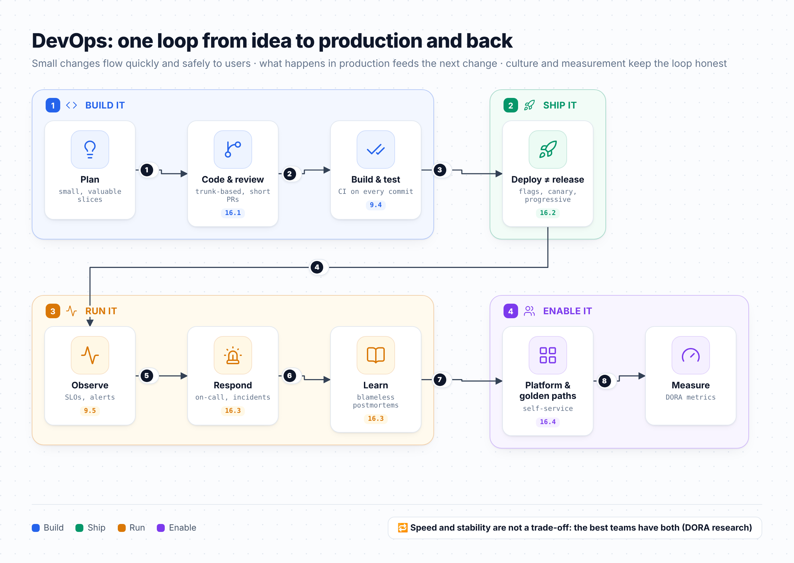

# Chapter 16 — DevOps practices: how good teams ship and operate software

!!! abstract "In short"
    DevOps is not a job title or a tool. It's a way of working in which the people who build software also **ship and
    run it**. Changes are **small** and flow through **automated pipelines** many times a day, and **deploying is
    separated from releasing** so every step is reversible. Production is **observed**, **incidents** become **blameless
    learning**, and a **platform** makes the right way easy. **DORA metrics** show that speed and stability go together.

## 📖 Key terms & abbreviations

| Term | Stands for | What it is | How it works (one line) |
|---|---|---|---|
| **DevOps** | Development + Operations | Shared ownership of building and running software | Culture + automation + feedback |
| **CALMS** | Culture, Automation, Lean, Measurement, Sharing | A lens to assess DevOps adoption | Tools alone ≠ DevOps |
| **SRE** | Site Reliability Engineering | Operations as a software problem | SLOs, error budgets, toil reduction (9.5) |
| **Platform engineering** | — | Building internal self-service platforms | Golden paths, developer portals (16.4) |
| **DORA metrics** | DevOps Research and Assessment | Delivery performance measures | Deploy frequency, lead time, change fail rate, recovery time |
| **Lead time for changes** | — | Commit → running in production | Hours for top performers |
| **Change failure rate** | — | % of deploys causing a failure | Needs rollback/hotfix/incident |
| **Toil** | — | Manual, repetitive, automatable work | SRE goal: < 50% of time |
| **Trunk-based development** | — | Everyone integrates to main daily | Short branches, feature flags (16.1) |
| **Feature flag** | — | Runtime switch for behaviour | Deploy ≠ release (16.2) |
| **Postmortem** | — | Written analysis after an incident | Blameless, action items (16.3) |
| **Team Topologies** | — | Model of team types and interactions | Stream-aligned, platform, enabling, complicated-subsystem |

## 🗺️ Big picture



---

## 1 · What DevOps changes

Before: developers "throw code over the wall" to operations, releases are big, rare and scary, and the people paged at night didn't write the code. After:

- **You build it, you run it**: teams own services end to end, including on-call.
- **Small batches**: a 50-line change is easy to review, test, deploy and roll back; a 3-month release is not.
- **Automate the path to production**: build, test, security checks, deploy (9.4), infrastructure (14.3).
- **Fast feedback**: tests in minutes, metrics in seconds, users' reactions in hours.
- **Learning culture**: incidents are investigated to improve the system, not to find someone to blame.

## 2 · Measuring it: DORA

| Metric | Measures | Elite teams (roughly) |
|---|---|---|
| **Deployment frequency** | How often you deploy to production | On demand, many per day |
| **Lead time for changes** | Commit → production | Less than a day |
| **Change failure rate** | Deploys that cause failures | Low (around 5–15%) |
| **Failed deployment recovery time** | Time to restore after a bad deploy | Less than an hour |

DORA's research across many years and thousands of teams shows that **throughput and stability correlate positively**: teams that deploy more often also fail less and recover faster, because small changes are safer. Measure these per team as **trends**, never as targets for individuals.

## 3 · DevOps, SRE and platform engineering

- **DevOps** is the philosophy: shared ownership, flow, feedback, learning.
- **SRE** is a concrete implementation for reliability: SLOs, error budgets that decide when to slow down, limits on toil, blameless postmortems (9.5, 16.3).
- **Platform engineering** scales it: instead of every team becoming experts in Kubernetes, Terraform and observability, a platform team provides **paved roads** as a product (16.4).
- The "DevOps engineer" role in practice is a mix of all three: building pipelines and infrastructure, enabling teams and running production.

## 4 · The practices in this chapter

1. **Git workflows & code review** (16.1): trunk-based development, small PRs, fast reviews, versioning.
2. **Safe releases** (16.2): feature flags, progressive delivery, database migrations without downtime.
3. **Incidents** (16.3): on-call, severity, incident command, postmortems.
4. **Platform engineering** (16.4): golden paths, developer portals, platform as a product.

## 🔧 DevOps connection

- Everything in Chapters 9, 11, 13, 14 and 15 is the **technical side**; this chapter is the **way of working** that makes those tools pay off.
- In interviews, expect questions like "how do you deploy safely?", "walk me through an incident you handled", "how would you measure your team's delivery?", "how do you reduce toil?"
- Change starts small: shorten one pipeline, add one flag, write one blameless postmortem, automate one ticket type.

## 🚨 Incident story: the Friday release train

!!! failure "The alarm"
    The team ships a **monthly release** every last Friday. This month's release has 140 merged PRs. 20 minutes after deploy, checkout conversion drops by 30% and nobody can tell which change caused it.

Try to diagnose it yourself first, then open the clues one by one.

??? info "🔍 Clue 1"
    Rolling back means reverting all 140 changes, including a database migration that already dropped a column. The rollback fails.

??? info "🔍 Clue 2"
    Several features were developed on long-lived branches merged in the last week; integration testing happened for the first time in staging two days before release.

??? success "🎯 Root cause"
    Big-batch releases. Too many changes at once make failures likely, diagnosis slow and rollback impossible; a destructive migration in the same release removed the escape hatch.

??? tip "🛠️ Fix and lesson"
    Hotfix forward this time, then move to trunk-based development with daily integration, deploy each merge to production behind feature flags, split migrations into expand/contract steps, and track DORA metrics. **Lesson:** releasing more often is how you make releases boring and safe.

## 🧭 Go deeper

| Page | What's inside |
|---|---|
| **[16.1 — Git workflows & code review](01-git-review.md)** | Trunk-based development vs GitFlow, branch protection and merge queues, small pull requests, review practices and CODEOWNERS, commit conventions, semantic versioning and changelogs, monorepo vs polyrepo. |
| **[16.2 — Safe releases: flags & zero-downtime changes](02-safe-releases.md)** | Deploy vs release, feature flag types and lifecycle, OpenFeature, progressive delivery with metrics, expand/contract database migrations, backward-compatible APIs, environments and preview environments, change freezes. |
| **[16.3 — Incidents, on-call & postmortems](03-incidents.md)** | Healthy on-call, alerting on symptoms, severity levels, incident command and roles, communication and status pages, mitigation first, blameless postmortems, action items and learning from near-misses. |
| **[16.4 — Platform engineering & developer experience](04-platform.md)** | Team Topologies, platform as a product, golden paths and templates, developer portals like Backstage, self-service infrastructure, measuring developer experience, and avoiding the ticket-ops trap. |

## 🧪 Try it yourself

```bash
# Measure two DORA metrics from your own git history (rough, but eye-opening)
# Deployment frequency proxy: tags (or merges to main) per week over the last 90 days
git log --since="90 days ago" --tags --simplify-by-decoration --pretty="%ad" --date=format:%G-W%V | sort | uniq -c | tail -12

# Lead time proxy: hours from first commit of a PR branch to its merge into main
git log --merges --first-parent main --since="30 days ago" --pretty="%H %ct" | while read m t; do
  first=$(git log --reverse --pretty=%ct $m^1..$m^2 2>/dev/null | head -1); [ -n "$first" ] && echo $(( (t-first)/3600 ))
done | sort -n | awk '{a[NR]=$1} END{if(NR) print "median lead time (h):", a[int((NR+1)/2)], " PRs:", NR}'

# Batch size: lines changed per merge (smaller is safer)
git log --merges --first-parent main --since="30 days ago" --pretty=%H | head -20 | while read m; do
  git diff --shortstat $m^1 $m; done
```

## 🃏 Cheat sheet

| Principle | Practice |
|---|---|
| Small batches | Short branches, small PRs, deploy each merge |
| Automate | CI/CD, IaC, policy as code, self-service |
| Reversible | Flags, canary, expand/contract, rollback tested |
| Feedback | Fast tests, SLOs, dashboards, alerts on symptoms |
| Shared ownership | You build it, you run it, sustainable on-call |
| Learn | Blameless postmortems with completed action items |
| Measure | DORA trends per team, developer experience surveys |

## ❓ Test yourself

??? question "1. Is DevOps a role, a tool or something else?"
    Primarily a culture and set of practices: shared ownership of building and running software, small automated changes and fast feedback. Tools and roles support it but don't create it.

??? question "2. What are the four DORA metrics?"
    Deployment frequency, lead time for changes, change failure rate and failed deployment recovery time.

??? question "3. Why do small, frequent deployments improve stability?"
    Each change is easier to review and test, failures are rarer and smaller, it's obvious which change caused a problem, and rolling back affects little.

??? question "4. How do DevOps, SRE and platform engineering relate?"
    DevOps is the philosophy of shared ownership and flow; SRE implements reliability with SLOs, error budgets and toil limits; platform engineering scales both by giving teams self-service golden paths.

??? question "5. Why should DORA metrics not be used to rank individuals?"
    They describe a team's system of work; using them as personal targets invites gaming (e.g. tiny meaningless deploys) and destroys their value as honest feedback.

---

## 📚 Sources

- [DORA — research and the four key metrics](https://dora.dev/guides/dora-metrics-four-keys/)
- [Google — Site Reliability Engineering book](https://sre.google/sre-book/table-of-contents/)
- [Team Topologies — key concepts](https://teamtopologies.com/key-concepts)
- [Martin Fowler — Continuous Integration](https://martinfowler.com/articles/continuousIntegration.html)
- [Atlassian — CALMS framework](https://www.atlassian.com/devops/frameworks/calms-framework)

## ✍️ My notes

> Estimate your team's four DORA metrics today. Which one would improve the most if you halved your batch size?
