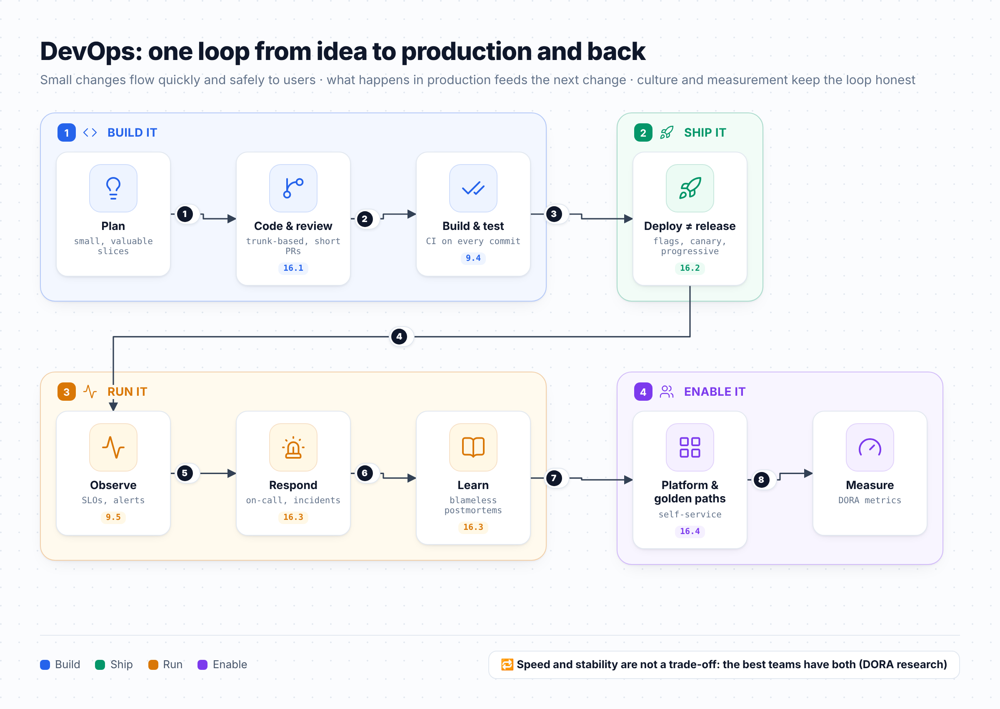

# Bölüm 16 — DevOps pratikleri: iyi ekipler yazılımı nasıl gönderir ve işletir

!!! abstract "Tek cümlede"
    DevOps bir iş unvanı ya da araç değil, yazılımı geliştirenlerin onu **gönderip çalıştırdığı** bir çalışma biçimidir:
    değişiklikler **küçüktür** ve günde birçok kez **otomatik pipeline'lardan** akar, her adım geri alınabilsin diye
    **deploy release'ten ayrılır**, production **gözlemlenir** ve **olaylar** sakin şekilde ele alınıp **suçlamasız
    öğrenmeye** dönüştürülür, bir **platform** doğru yolu kolay yol yapar ve tüm sistem **DORA metrikleriyle** ölçülür;
    çünkü hız ve kararlılığın birlikte geldiği ortaya çıkmıştır.

## 📖 Temel terimler ve kısaltmalar

| Terim | Açılımı | Nedir | Nasıl çalışır (tek satır) |
|---|---|---|---|
| **DevOps** | Development + Operations | Yazılımı geliştirme ve çalıştırmanın ortak sahipliği | Kültür + otomasyon + geri bildirim |
| **CALMS** | Culture, Automation, Lean, Measurement, Sharing | DevOps benimsemesini değerlendirme merceği | Tek başına araçlar ≠ DevOps |
| **SRE** | Site Reliability Engineering | Operasyonu bir yazılım problemi olarak ele almak | SLO, hata bütçeleri, angarya azaltma (9.5) |
| **Platform mühendisliği** | Platform engineering | İç self-servis platformlar inşa etmek | Altın yollar, geliştirici portalları (16.4) |
| **DORA metrikleri** | DevOps Research and Assessment | Teslim performansı ölçüleri | Deploy sıklığı, değişiklik süresi, hata oranı, kurtarma süresi |
| **Değişiklik teslim süresi** | Lead time for changes | Commit → production'da çalışıyor | En iyilerde saatler |
| **Değişiklik hata oranı** | Change failure rate | Hataya yol açan deploy yüzdesi | Geri alma/hotfix/olay gerektirir |
| **Angarya** | Toil | Elle, tekrarlayan, otomatikleştirilebilir iş | SRE hedefi: zamanın < %50'si |
| **Trunk-based geliştirme** | Trunk-based development | Herkes günlük main'e entegre olur | Kısa branch'ler, feature flag'ler (16.1) |
| **Feature flag** | — | Davranış için çalışma anı anahtarı | Deploy ≠ release (16.2) |
| **Postmortem** | — | Bir olaydan sonra yazılı analiz | Suçlamasız, aksiyon maddeleri (16.3) |
| **Team Topologies** | — | Ekip tipleri ve etkileşim modeli | Akışa hizalı, platform, destekleyici, karmaşık alt sistem |

## 🗺️ Büyük resim



---

## 1 · DevOps neyi değiştirir

Önce: geliştiriciler kodu operasyona "duvarın üstünden atar", sürümler büyük, seyrek ve korkutucudur ve gece çağrılan kişiler kodu yazmamıştır. Sonra:

- **Sen yaptın, sen çalıştır**: ekipler servislerine nöbet dahil uçtan uca sahiptir.
- **Küçük partiler**: 50 satırlık bir değişikliği incelemek, test etmek, deploy etmek ve geri almak kolaydır; 3 aylık bir sürümü değil.
- **Production'a giden yolu otomatikleştir**: build, test, güvenlik kontrolleri, deploy (9.4), altyapı (14.3).
- **Hızlı geri bildirim**: testler dakikalar, metrikler saniyeler, kullanıcı tepkileri saatler içinde.
- **Öğrenme kültürü**: olaylar suçlanacak birini bulmak için değil, sistemi iyileştirmek için incelenir.

## 2 · Ölçmek: DORA

| Metrik | Ölçtüğü | Elit ekipler (kabaca) |
|---|---|---|
| **Deploy sıklığı** | Production'a ne sıklıkla deploy edildiği | İstendiğinde, günde birçok kez |
| **Değişiklik teslim süresi** | Commit → production | Bir günden az |
| **Değişiklik hata oranı** | Hataya yol açan deploy'lar | Düşük (yaklaşık %5–15) |
| **Başarısız deploy kurtarma süresi** | Kötü bir deploy'dan sonra geri dönme süresi | Bir saatten az |

DORA'nın yıllara ve binlerce ekibe yayılan araştırması **hız ile kararlılığın pozitif ilişkili** olduğunu gösterir: daha sık deploy eden ekipler aynı zamanda daha az hata yapar ve daha hızlı toparlanır, çünkü küçük değişiklikler daha güvenlidir. Bunları ekip başına **eğilimler** olarak ölç, asla bireyler için hedef olarak değil.

## 3 · DevOps, SRE ve platform mühendisliği

- **DevOps** felsefedir: ortak sahiplik, akış, geri bildirim, öğrenme.
- **SRE** güvenilirlik için somut bir uygulamadır: SLO'lar, ne zaman yavaşlanacağına karar veren hata bütçeleri, angarya limitleri, suçlamasız postmortem'ler (9.5, 16.3).
- **Platform mühendisliği** bunu ölçekler: her ekibin Kubernetes, Terraform ve gözlemlenebilirlik uzmanı olması yerine bir platform ekibi **asfalt yolları** bir ürün olarak sunar (16.4).
- Pratikte "DevOps mühendisi" rolü üçünün karışımıdır: pipeline ve altyapı kurmak, ekipleri desteklemek ve production'ı işletmek.

## 4 · Bu bölümdeki pratikler

1. **Git akışları ve kod incelemesi** (16.1): trunk-based geliştirme, küçük PR'lar, hızlı incelemeler, sürümleme.
2. **Güvenli sürümler** (16.2): feature flag'ler, kademeli teslim, kesintisiz veritabanı migration'ları.
3. **Olaylar** (16.3): nöbet, önem seviyesi, olay komutası, postmortem'ler.
4. **Platform mühendisliği** (16.4): altın yollar, geliştirici portalları, ürün olarak platform.

## 🔧 DevOps bağlantısı

- Bölüm 9, 11, 13, 14 ve 15'teki her şey **teknik taraftır**; bu bölüm o araçların karşılığını veren **çalışma biçimidir**.
- Mülakatlarda şu tür sorular bekle: "güvenle nasıl deploy edersin?", "yönettiğin bir olayı anlat", "ekibinin teslim performansını nasıl ölçerdin?", "angaryayı nasıl azaltırsın?"
- Değişim küçük başlar: bir pipeline'ı kısalt, bir flag ekle, bir suçlamasız postmortem yaz, bir ticket tipini otomatikleştir.

## 🚨 Olay hikâyesi: cuma sürüm treni

!!! failure "Alarm"
    Ekip her ayın son cuması **aylık bir sürüm** gönderiyor. Bu ayın sürümünde 140 merge edilmiş PR var. Deploy'dan 20 dakika sonra ödeme dönüşümü %30 düşüyor ve hangi değişikliğin sebep olduğunu kimse söyleyemiyor.

Önce kendin teşhis etmeye çalış, sonra ipuçlarını tek tek aç.

??? info "🔍 İpucu 1"
    Geri almak, bir kolonu zaten silmiş bir veritabanı migration'ı dahil 140 değişikliğin hepsini geri almak demek. Geri alma başarısız oluyor.

??? info "🔍 İpucu 2"
    Birkaç özellik son hafta merge edilen uzun ömürlü branch'lerde geliştirilmiş; entegrasyon testi ilk kez sürümden iki gün önce staging'de yapılmış.

??? success "🎯 Kök neden"
    Büyük partili sürümler. Aynı anda çok fazla değişiklik hataları olası, teşhisi yavaş ve geri almayı imkânsız kılar; aynı sürümdeki yıkıcı bir migration da kaçış kapısını ortadan kaldırdı.

??? tip "🛠️ Çözüm ve ders"
    Bu sefer ileri doğru hotfix yap, sonra günlük entegrasyonlu trunk-based geliştirmeye geç, her merge'ü feature flag'ler arkasında production'a deploy et, migration'ları genişlet/daralt adımlarına böl ve DORA metriklerini takip et. **Ders:** daha sık sürüm çıkarmak, sürümleri sıkıcı ve güvenli yapmanın yoludur.

## 🧭 Daha derine in

| Sayfa | Neler var |
|---|---|
| **[16.1 — Git akışları ve kod incelemesi](01-git-review.md)** | Trunk-based geliştirme ve GitFlow, branch koruması ve merge kuyrukları, küçük pull request'ler, inceleme pratikleri ve CODEOWNERS, commit kuralları, semantik sürümleme ve changelog'lar, monorepo ve polyrepo. |
| **[16.2 — Güvenli sürümler: flag'ler ve kesintisiz değişiklikler](02-safe-releases.md)** | Deploy ve release, feature flag tipleri ve yaşam döngüsü, OpenFeature, metriklerle kademeli teslim, genişlet/daralt veritabanı migration'ları, geriye uyumlu API'ler, ortamlar ve önizleme ortamları, değişiklik dondurmaları. |
| **[16.3 — Olaylar, nöbet ve postmortem'ler](03-incidents.md)** | Sağlıklı nöbet, belirtilere alarm, önem seviyeleri, olay komutası ve roller, iletişim ve durum sayfaları, önce hafifletme, suçlamasız postmortem'ler, aksiyon maddeleri ve ramak kala olaylardan öğrenmek. |
| **[16.4 — Platform mühendisliği ve geliştirici deneyimi](04-platform.md)** | Team Topologies, ürün olarak platform, altın yollar ve şablonlar, Backstage gibi geliştirici portalları, self-servis altyapı, geliştirici deneyimini ölçmek ve ticket-ops tuzağından kaçınmak. |

## 🧪 Kendin dene

```bash
# Kendi git geçmişinden iki DORA metriğini ölç (kaba ama göz açıcı)
# Deploy sıklığı vekili: son 90 günde haftalık etiket (ya da main'e merge) sayısı
git log --since="90 days ago" --tags --simplify-by-decoration --pretty="%ad" --date=format:%G-W%V | sort | uniq -c | tail -12

# Teslim süresi vekili: bir PR branch'inin ilk commit'inden main'e merge'üne kadar saat
git log --merges --first-parent main --since="30 days ago" --pretty="%H %ct" | while read m t; do
  first=$(git log --reverse --pretty=%ct $m^1..$m^2 2>/dev/null | head -1); [ -n "$first" ] && echo $(( (t-first)/3600 ))
done | sort -n | awk '{a[NR]=$1} END{if(NR) print "medyan teslim süresi (sa):", a[int((NR+1)/2)], " PR:", NR}'

# Parti boyutu: merge başına değişen satır (küçük olan daha güvenli)
git log --merges --first-parent main --since="30 days ago" --pretty=%H | head -20 | while read m; do
  git diff --shortstat $m^1 $m; done
```

## 🃏 Hatırlatma kartı

| İlke | Pratik |
|---|---|
| Küçük partiler | Kısa branch'ler, küçük PR'lar, her merge'ü deploy et |
| Otomatikleştir | CI/CD, IaC, kod olarak politika, self-servis |
| Geri alınabilir | Flag'ler, canary, genişlet/daralt, test edilmiş geri alma |
| Geri bildirim | Hızlı testler, SLO'lar, dashboard'lar, belirtilere alarm |
| Ortak sahiplik | Sen yaptın sen çalıştır, sürdürülebilir nöbet |
| Öğren | Aksiyon maddeleri tamamlanan suçlamasız postmortem'ler |
| Ölç | Ekip başına DORA eğilimleri, geliştirici deneyimi anketleri |

## ❓ Kendini test et

??? question "1. DevOps bir rol mü, araç mı, yoksa başka bir şey mi?"
    Öncelikle bir kültür ve pratikler bütünü: yazılımı geliştirme ve çalıştırmanın ortak sahipliği, küçük otomatik değişiklikler ve hızlı geri bildirim. Araçlar ve roller onu destekler ama yaratmaz.

??? question "2. Dört DORA metriği hangileri?"
    Deploy sıklığı, değişiklik teslim süresi, değişiklik hata oranı ve başarısız deploy kurtarma süresi.

??? question "3. Küçük ve sık deploy'lar kararlılığı neden artırır?"
    Her değişikliği incelemek ve test etmek daha kolaydır, hatalar daha seyrek ve küçüktür, sorunu hangi değişikliğin yarattığı bellidir ve geri almak az şeyi etkiler.

??? question "4. DevOps, SRE ve platform mühendisliği nasıl ilişkilidir?"
    DevOps ortak sahiplik ve akış felsefesidir; SRE güvenilirliği SLO'lar, hata bütçeleri ve angarya limitleriyle uygular; platform mühendisliği ikisini ekiplere self-servis altın yollar vererek ölçekler.

??? question "5. DORA metrikleri neden bireyleri sıralamak için kullanılmamalı?"
    Bir ekibin çalışma sistemini tarif ederler; kişisel hedef olarak kullanmak oyunlaştırmayı (ör. küçük anlamsız deploy'lar) davet eder ve dürüst geri bildirim değerlerini yok eder.

---

## 📚 Kaynaklar

- [DORA — research and the four key metrics](https://dora.dev/guides/dora-metrics-four-keys/)
- [Google — Site Reliability Engineering book](https://sre.google/sre-book/table-of-contents/)
- [Team Topologies — key concepts](https://teamtopologies.com/key-concepts)
- [Martin Fowler — Continuous Integration](https://martinfowler.com/articles/continuousIntegration.html)
- [Atlassian — CALMS framework](https://www.atlassian.com/devops/frameworks/calms-framework)

## ✍️ Notlarım

> Ekibinin dört DORA metriğini bugün için tahmin et. Parti boyutunu yarıya indirseydin hangisi en çok iyileşirdi?

-
